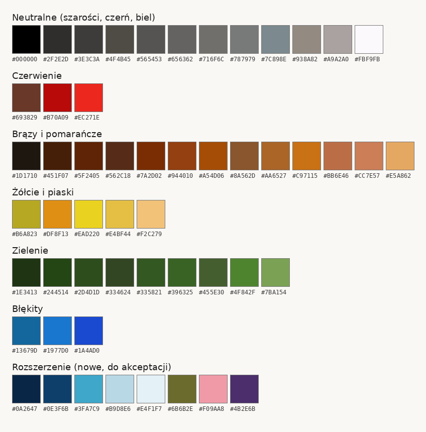
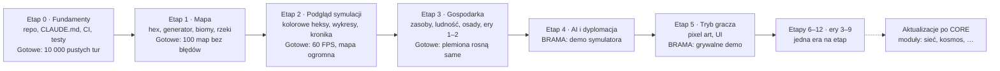

# CivSim 2 — Dokument projektu gry (GDD)

Wersja z 3 listopada 2026 · źródło: dokument projektu w Claude

## 1. Wizja i filary

CivSim 2 to turowa gra 4X w pixel arcie, a przede wszystkim symulator rozwoju gospodarczego na mapie heksagonalnej, w której cywilizacje przechodzą od plemienia z epoki kamienia do kolonizacji kosmosu. Najpierw powstaje **symulator**, w którym cywilizacje same podejmują sensowne decyzje. Dopiero na nim budujemy **grę**, w której gracz prowadzi jedną z nich na tych samych zasadach.

**Filary (każda decyzja projektowa musi przejść przez nie wszystkie):**

1. **Jedna symulacja, jedne zasady.** AI i gracz korzystają z tych samych mechanik i tych samych danych. AI nie oszukuje: nie ma ukrytych bonusów i widzi tylko to, co odkryła.
2. **Decyzje wynikają z sytuacji.** Cywilizacja reaguje na sąsiadów, granice, braki surowców, historię relacji i osobowość przywódcy. Te same warunki startowe przy innym seedzie dają inną historię.
3. **Stabilność na długim dystansie.** Gra działa płynnie po 10 000 turach. Pamięć i czas tury nie rosną bez ograniczeń.
4. **Czytelna głębia.** Mechanik może być dużo, ale gracz zawsze widzi, *dlaczego* coś się stało, np. „miasto głoduje, bo susza obniżyła zbiory o 40%”.
5. **Zawartość w danych, nie w kodzie.** Technologie, zasoby, budynki, jednostki i zdarzenia definiujemy w plikach JSON. Nowa technologia nie wymaga programowania.

**Inspiracje:** Civilization (ery, drzewo technologii, dyplomacja, mapa hex), Factorio (łańcuchy produkcji, przepływy towarów), Dwarf Fortress i Crusader Kings (historie wyłaniające się z symulacji), Old World (charakter przywódców).

**Czego NIE robimy (żeby projekt był do skończenia):**

- Multiplayera bez serwera (peer-to-peer, lockstep). Gra sieciowa działa wyłącznie jako klient–serwer (2.1).
- Walki w czasie rzeczywistym. Wszystko rozstrzyga się w turach.
- Grafiki 3D i animowanych przerywników.
- Zarządzania pojedynczym człowiekiem. Ludność to grupy, nie osoby (wyjątek: przywódcy i wielcy ludzie).
- Fabuły pisanej ręcznie. Historie mają wynikać z symulacji. Nie ma też kultury ani religii jako mechanik gry.

## 2. Technologia i architektura

Symulacja to osobna biblioteka C#, która nie wie, że istnieje grafika. Godot tylko wyświetla jej stan i przekazuje rozkazy gracza. To usuwa główną przyczynę zacinania się starej wersji.


Godot nigdy nie zmienia stanu symulacji bezpośrednio: wysyła komendy i dostaje gotowe migawki.

**Stos:** Godot 4 w wersji .NET, C# na aktualnym .NET LTS, testy w xUnit, dane w JSON, zapis gry w MessagePack. Repo na GitHubie, praca na gałęziach i PR-ach. **Gra jest wyłącznie po angielsku:** interfejs, kronika, nazwy w danych, kod i komentarze. Ten dokument zostaje po polsku. **Platformy:** Windows, Linux i macOS. Godot nie eksportuje jeszcze oficjalnie projektów C# do przeglądarki, więc wersji webowej na razie nie planujemy; urządzenia mobilne ewentualnie później.

**Struktura repo:**

| Projekt | Rola | Zależy od |
| --- | --- | --- |
| `CivSim.Core` | Cała logika: mapa, ekonomia, AI, tura | nic (czysty .NET) |
| `CivSim.Data` | Pliki JSON z zawartością + walidator | Core |
| `CivSim.Protocol` | Wiadomości klient–serwer, wersja protokołu, serializacja | Core |
| `CivSim.Server` | Serwer gry: lobby, tury, sprawdzanie komend, filtrowanie widoczności, zapis | Core, Data, Protocol |
| `CivSim.Headless` | Uruchamianie symulacji bez okna, benchmarki, raporty | Core, Data |
| `CivSim.Tests` | Testy jednostkowe, determinizmu, długich przebiegów i protokołu | wszystkie |
| `CivSim.Game` | Klient w Godocie: mapa, UI, kamera, dźwięk | Protocol (nie Core!) |
| `art/` | Twoje pliki źródłowe i wyeksportowane PNG | — |

**Zasady architektury:**

- **Osobny wątek symulacji.** Po każdej turze rdzeń publikuje niezmienną migawkę stanu (albo listę zmian). Godot rysuje ostatnią gotową migawkę, więc UI nigdy nie czeka na turę.
- **Wszystko przez komendy.** Każda zmiana stanu to komenda (`ZbudujBudynek`, `WypowiedzWojne`, `PrzesunJednostke`). AI i gracz wydają te same komendy. Daje to powtórki, debugowanie i podstawę multiplayera: komendy to jedyne, co klient wysyła do serwera.
- **Determinizm.** Własny generator liczb losowych z seedem (osobny strumień na system: pogoda, AI, walka). Ilości zasobów trzymamy jako liczby całkowite w setnych częściach jednostki, bez `float` w ekonomii. Iteracja zawsze w stałej kolejności identyfikatorów. Ten sam seed + te same komendy = identyczna gra.
- **Dane zorientowane na wydajność.** Pola mapy w płaskich tablicach (osobna tablica na wysokość, biom, właściciela itd.), byty identyfikowane liczbami, zero alokacji pamięci w głównej pętli tury, pule obiektów dla jednostek.
- **Stała pamięć historii.** Statystyki są próbkowane coraz rzadziej wraz z wiekiem: ostatnie 100 tur co turę, starsze co 10, najstarsze co 100. Kronika zdarzeń zachowuje wszystkie ważne wpisy i usuwa drobne po 500 turach.
- **Zapis gry.** Pełny stan + wersja formatu + seed. Zapis ręczny w dowolnym momencie (wykonuje się na granicy tury, więc stan jest zawsze spójny) plus autozapis co 10 tur w rotacji 5 plików. Opcjonalnie powtórka jako seed + lista komend.
- **Narzędzia deweloperskie od pierwszego dnia:** inspektor pola (wszystkie wartości po kliknięciu), nakładka z ocenami decyzji AI, konsola komend, krokowe uruchamianie tury.

### 2.1 Gotowość na multiplayer (klient–serwer)

Multiplayera jeszcze nie budujemy, ale architektura jest na niego gotowa od pierwszego dnia. Gra zawsze działa jako klient i serwer: w trybie jednoosobowym serwer startuje lokalnie razem z grą i rozmawia z klientem tym samym protokołem, tylko bez sieci. Gdy w przyszłej aktualizacji dodamy grę w sieci, podmienimy połączenie lokalne na sieciowe, a logika gry się nie zmieni. Zasady poniżej obowiązują od etapu 0, nawet jeśli dotyczą funkcji budowanych później.

- **Serwer jest autorytatywny.** Tylko serwer liczy symulację. Klient wysyła komendy i wyświetla to, co dostał. Serwer sprawdza każdą komendę: czy gracz może ją wydać, czy ma zasoby i czy widzi cel.
- **Klient wie tylko to, co jego cywilizacja.** Serwer filtruje stan przez mgłę wojny i pamięć mapy gracza (8.2), więc podglądnięcie mapy przeciwników jest niemożliwe. Dlatego nie używamy modelu lockstep, w którym każdy klient liczy całą symulację i zna cały stan.
- **Przesył danych:** pełny widok przy dołączeniu, potem tylko zmiany po każdej turze, w formacie MessagePack.
- **Tury równoczesne:** gracze wydają rozkazy w tej samej turze. Tura kończy się, gdy wszyscy klikną „End turn” albo minie limit czasu ustawiony przez gospodarza. Serwer rozstrzyga komendy według kolejności z 11.1.
- **Rozłączenie:** cywilizację gracza przejmuje AI (te same poziomy delegowania co w 7.1), a po powrocie gracz odzyskuje kontrolę. Do trwającej gry można dołączyć na cywilizację prowadzoną przez AI.
- **Obserwatorzy:** mogą oglądać grę z pełną albo ograniczoną wiedzą, według ustawień gospodarza.
- **Zapis gry** jest po stronie serwera. Gospodarz zapisuje w dowolnym momencie.
- **Serwer dedykowany:** `CivSim.Server` to zwykły program .NET bez Godota, więc może działać na Linuksie bez ekranu, np. na własnym serwerze albo VPS.
- **Godot i sieć:** Godot ma wbudowany multiplayer (ENet, WebSocket), ale wymaga Godota po obu stronach. Serwer jest czystym .NET, więc warstwę sieciową piszemy w C# we wspólnym `CivSim.Protocol` z biblioteką sieciową .NET, której używa też klient w Godocie. Konkretną bibliotekę wybierzemy w osobnej decyzji (ADR).
- **Wielkość gry (propozycja):** do 8 graczy ludzkich, reszta cywilizacji prowadzona przez AI.
- **Koszt:** filtrowanie widoczności dla każdego gracza obciąża serwer, więc wchodzi do benchmarków.

**Cele wydajności** (mierzone w `CivSim.Headless` na każdym PR):

| Scenariusz | Mapa | Cywilizacje | Czas tury | Pamięć po 10 000 tur |
| --- | --- | --- | --- | --- |
| Standard | 256×160 (40 960 pól) | 12 | < 50 ms | < 1 GB |
| Duża | 384×240 (92 160 pól) | 20 | < 120 ms | < 1,5 GB |
| Ogromna | 512×320 (163 840 pól) | 32 | < 250 ms | < 3 GB |
| Podgląd | dowolna | dowolna | 60 FPS niezależnie od tury | — |

Wartości są robocze. Dostroimy je po pierwszych pomiarach na Twoim komputerze.

## 3. Świat i mapa

Mapa to siatka heksów generowana z seeda: najpierw geologia i klimat, potem biomy, rzeki i surowce. Każde pole ma kilkanaście wartości, które zmieniają się w trakcie gry: żyzność spada, złoża się wyczerpują, lasy się wycina i odrastają.

**Siatka:** heksy z płaskim bokiem na górze, współrzędne osiowe (q, r) w logice, tablica wierszy w pamięci. **Mapa to kula** (ADR 0012, decyzja Patryka z 2026-11-05): wschód–zachód zawija się, górny rząd dotyka bieguna północnego, dolny południowego, a kto przejdzie przez biegun, schodzi po drugiej stronie planety (przesunięty o pół obwodu). Rzędy to pasy o równej powierzchni na kuli, więc okolice biegunów zajmują mniej rzędów niż równik. Równik biegnie przez środek mapy. Szerokość jest zawsze o 2 większa od wielokrotności 4, a wysokość parzysta, żeby heksy schodziły się nad biegunami bez przerwy.

| Rozmiar | Wymiary | Pola | Cywilizacje (domyślnie) | Przeznaczenie |
| --- | --- | --- | --- | --- |
| Testowa | 66×40 | 2 640 | 4 | testy i debugowanie |
| Standard | 258×160 | 41 280 | 12 | zwykła gra |
| Duża | 386×240 | 92 640 | 20 | długa gra |
| Ogromna | 514×320 | 164 480 | 32 | symulacja świata do ery kosmicznej |

**Planeta** (etapy 1b i 1c-A, decyzje Patryka z 2026-11-05, ADR 0014): każda planeta leży w strefie zamieszkiwalnej swojej gwiazdy i na każdej jest życie. Gwiazda, odległość i rok są powiązane prawdziwymi wzorami: światło `S = L / d²`, masa gwiazdy z jasności (ciąg główny), rok z trzeciego prawa Keplera. Dowolne dwie z wielkości jasność, odległość, rok wyznaczają trzecią: gracz zmienia jedną, druga się dopasowuje, a gdy planeta wypadłaby ze strefy (S od 0,356 do 1,107), staje na jej granicy. Parametry ustawia się presetem (`data/planets.json`), a potem każdą wartość można zmienić:

| Parametr | Zakres | Ziemia | Mars | Uran | Co zmienia |
| --- | --- | --- | --- | --- | --- |
| Nachylenie osi | 0–180° | 23,4° | 25,2° | 97,8° | pory roku; przy dużym nachyleniu bieguny są cieplejsze od równika, ale z dekadami dnia i nocy |
| Jasność gwiazdy | 0,04–7000 L☉ | 1 | 1 | 1365 (7,1 M☉) | światło, masa gwiazdy, rok |
| Odległość od gwiazdy | w strefie zamieszkiwalnej | 1 AU | 1,524 AU | 36,9 AU | światło i rok |
| Długość roku | 0,1–500 lat ziemskich (wynika z dwóch powyższych) | 1 | 1,88 | 84 | tylko pory roku: dłuższy rok to większa różnica lato–zima; zegar gry zostaje w latach ziemskich |
| Światło na planecie | 0,356–1,107 Ziemi | 1 | 0,43 | 1 | średnia temperatura |
| Mimośród orbity | 0–0,3 | 0,017 | 0,093 | 0,046 | jedna półkula ma ostrzejsze pory roku |
| Aktywność wulkaniczna | 0–5000% Ziemi | 100% | 1000% | 100% | ile CO₂ dają wulkany (cykl węglowy, niżej) |
| Pozostałe gazy (azot, tlen) | 0,1–50 bar | 1 bar | 1 bar | 1 bar | ciśnienie razem z CO₂ |
| CO₂ | z cyklu węglowego albo ręcznie | 280 ppm | ok. 9 bar | 756 ppm | efekt cieplarniany (Ziemia 33 °C) i ciśnienie |
| Woda, wilgotność, górzystość | jak niżej | 60%, normalna, normalna | 30%, sucha, górzysta | 60%, normalna, normalna | ląd planety |

**Atmosfera z cyklu węglowego:** wulkany stale dodają CO₂, a deszcz i skały je zabierają (wietrzenie), szybciej tam, gdzie cieplej, i tylko tam, gdzie woda jest ciekła. Na starcie świata obie strony są w równowadze. Dlatego planety daleko od gwiazdy mają grubą atmosferę CO₂, a bliskie cienką; na planecie leżącej na boku (bez zimnych biegunów) wietrzeje cała powierzchnia. Gruba atmosfera przenosi więcej ciepła ku biegunom i łagodzi pory roku (siła pór roku = 100% · √(1 bar / ciśnienie)). CO₂ jest stanem świata, nie stałą: od etapu 1c-B zmienia się w trakcie gry, a w erze przemysłowej spalanie i wycinanie lasów będą je zwiększać, więc cywilizacje mogą wpływać na klimat.

**Temperatura** wynika z bilansu energii w pasach szerokości (Budyko–Sellers): słońce grzeje, planeta wypromieniowuje ciepło w kosmos, wiatry i prądy przenoszą je ku biegunom, a lód odbija więcej światła i dlatego czapy lodowe rosną. Ziemia: 27 °C na równiku, 10 °C na 45°, −22 °C na biegunach.

**Epoki lodowe** (etap 1c-B, ADR 0015, decyzja Patryka z 2026-11-05): orbita planety powoli się chwieje (cykle Milankovicia): nachylenie osi o ±1,2° co 41 tys. lat, mimośród rośnie i maleje co 100 i 405 tys. lat, a pora roku najbliżej gwiazdy obiega rok co 23 tys. lat. Gdy lata na 65° szerokości słabną, rosną lądolody, ale tylko na lądzie i tylko na planetach, które mają dość zimne bieguny (planeta leżąca na boku epok lodowych nie ma). Lądolód rośnie wolno (dziesiątki tysięcy lat), a znika szybko, gdy lato wraca. W szczycie epoki lodowej brzeg lodu schodzi do 40° szerokości, oceany pochłaniają jedną trzecią CO₂, a Ziemia jest o ok. 5 °C chłodniejsza. Gra zaczyna się w ciepłym momencie cyklu; na Ziemi pierwsze zlodowacenie zaczyna się po ok. 15–20 tys. lat, a jego szczyt przychodzi po ok. 110 tys. lat. Klimat przeliczamy co 500 lat gry: temperatura, pory roku, sezon wzrostu, biomy lądu, a przez nie dzika żywność. Gwiazda może też zmieniać jasność (ustawienie: siła i okres; domyślnie stała). **Poziom morza** opada razem z lodem (etap 1c-C): w szczycie zlodowacenia o ok. 120 m, więc płytkie szelfy stają się lądem i powstają pomosty lądowe między kontynentami; gdy lód topnieje, morze je zabiera. Gdy stopnieje także stały lód lądowy ze startu (cieplejszy klimat, w przyszłości również od przemysłu), morze wznosi się nawet o ok. 70 m ponad poziom startowy i zalewa niskie wybrzeża. Morza zamarzają tam, gdzie średnia roczna spada do −8 °C, więc w zimnych okresach lód morski łączy lądy (jako droga dla wędrówek od etapu 3g); bardzo zimna planeta bez cyklu węglowego może zamarznąć cała. Mieszkańcy zalanej osady przenoszą się z tym, co uniosą, na najbliższe suche pole, a to, co zostawili, staje się ruinami pod wodą.

Mars w presecie to planeta podobna do Marsa w odległości Marsa od Słońca (zimniejsza, suchsza i bardziej górzysta niż Ziemia, z bardzo aktywnymi wulkanami, dzięki którym gruba atmosfera CO₂ utrzymuje ją przy życiu), nie dzisiejszy Mars. Uran w presecie ma rok Urana przy świetle Ziemi; wymaga to jasnej, ciężkiej gwiazdy, która w rzeczywistości żyje tylko ok. 50 mln lat (w grze naginamy).

**Pory roku na żywo przy długim roku** (ADR 0013, „dwa zegary”): gdy rok planety trwa co najmniej 8 lat ziemskich, tura trwa 1/8 roku planety (Uran: 10,5 roku) i pora roku zmienia się z tury na turę: zimą nic nie rośnie, polowanie daje 20% dzikiej żywności. Plemiona same przenoszą się tam, gdzie jest jedzenie i znośna temperatura; ogień, odzież i domy (efekt `cold_tolerance`) pozwolą później żyć w zimniejszych miejscach. Decyzje wolne (odłamy, łączenie) zapadają raz na długość tury ery.

**Na pozostałych planetach pory roku są uśrednione** (tura trwa tam do 50 lat). Generator liczy dla każdej szerokości geograficznej nasłonecznienie w 48 punktach orbity (oś, mimośród, światło gwiazdy) i z tego:

- **średnią temperaturę** z bilansu energii (wyżej),
- **różnicę lato–zima** (większą w głębi lądu, małą nad wodą, większą przy długim roku, mniejszą pod grubą atmosferą),
- **sezon wzrostu**: część roku między 5 °C a 45 °C, gdy rośliny rosną.

Biomy biorą to pod uwagę: ląd, którego lato nie przekracza zera, jest lodem; ląd z sezonem wzrostu krótszym niż 15% roku jest tundrą; ogromne różnice lato–zima działają jak susza (lasy ustępują stepom i pustyniom). Dzika żywność rośnie tylko w sezonie wzrostu: sezon od 60% roku daje pełne plony, brak sezonu 40%. **Długie zimy** (decyzja Patryka z 2026-11-05: trudniejszy wariant symulacji): martwa pora dłuższa niż 0,75 roku zmniejsza dziką żywność proporcjonalnie, więc na planetach z długim rokiem plemiona ledwo przeżywają, dopóki technologie (przechowywanie) nie podniosą tego progu.

**Kontynenty:** ląd rośnie wokół kilku losowych zarodków na kuli (kontynenty 5–6, pangea 1, archipelag 18–24), a szum rzeźbi wybrzeża i wnętrza. Plemiona startują tylko tam, gdzie sezon wzrostu trwa co najmniej 40% roku.

**Żeby świat nie był odkryty po 2–3 erach:**

- **Wiedza o mapie jest własna.** Cywilizacja zna tylko to, co sama zobaczyła. Mapy można wymieniać dyplomatycznie dopiero od kartografii.
- **Morze jest barierą.** Płytkie wody są dostępne od łodzi, ale głęboki ocean dopiero od żeglugi oceanicznej (renesans). Kontynenty długo żyją osobno.
- **Teren ogranicza zasięg.** Góry, pustynie i dżungle zwężają widoczność, strefę wpływów i zasięg zwiadowców.
- **Kontakt jest warunkiem wiedzy.** O odległej cywilizacji wiadomo tylko z kontaktu albo z relacji kupców.

**Fragmenty mapy:** świat jest podzielony na fragmenty 32×32 pola. Symulacja przelicza tylko fragmenty, w których coś się zmieniło, a podgląd rysuje tylko widoczne. Dzięki temu mapa ogromna jest wykonalna.

**Dane jednego pola:**

| Wartość | Zakres | Zmienia się w grze? |
| --- | --- | --- |
| Wysokość | 0–255 (poziom morza ok. 100; w epokach lodowych do 97) | tylko przez kataklizmy |
| Temperatura | −30…+40 °C (średnia roczna) | tak: epoki lodowe co 500 lat gry, zmiany klimatu w erze przemysłowej |
| Wilgotność | 0–100 | tak, susze, nawadnianie |
| Biom | jeden z 14 | tak, np. las → równina po wycięciu, pustynnienie |
| Cecha terenu | las, dżungla, bagno, oaza, rafa, pole lodowe | tak |
| Żyzność gleby | 0–100 | tak, spada przy intensywnej uprawie, rośnie przy odłogu i nawożeniu |
| Rzeki / jezioro | rzeka na dowolnej z 6 krawędzi (wielkość, kierunek), jezioro na polu | tylko przez tamy i kanały |
| Złoże | typ + zasobność + głębokość | tak, wyczerpuje się lub odnawia |
| Właściciel, osada, ulepszenie | identyfikatory | tak |
| Zanieczyszczenie, promieniowanie | 0–100 | tak, od ery przemysłowej |
| Efekty aktywne | lista z czasem trwania | tak |

**Biomy (14):** głęboki ocean, płytkie morze, wybrzeże, jezioro, łąka, step, pustynia, tundra, lód, las liściasty, tajga, dżungla, bagno, sawanna. Do tego modyfikator rzeźby: płasko / wzgórza / góry.

**Ustawienia świata** (wybierane przy tworzeniu gry, stałe przez całą grę):

| Ustawienie | Wartości | Domyślnie | Co zmienia |
| --- | --- | --- | --- |
| Rozmiar mapy | testowa, standard, duża, ogromna | standard | wymiary (tabela wyżej) |
| Liczba cywilizacji | 1–64 | zależna od rozmiaru (4/12/20/32) | ile plemion startuje |
| Typ świata | kontynenty, pangea, archipelag | kontynenty | kształt lądów |
| Procent wody | 30–80% | 60% | poziom morza |
| Planeta | ziemia, mars, uran + nachylenie osi, mimośród, dwie z: jasność gwiazdy, odległość, rok, światło; wulkanizm, pozostałe gazy, CO₂ | ziemia | patrz tabela „Planeta” wyżej |
| Wilgotność | sucha, normalna, mokra | normalna | −15 / 0 / +15 wilgotności: pustynie, lasy, liczba rzek |
| Wilgotność w głębi lądu | sucha, normalna, wilgotna | normalna | spadek wilgotności z odległością od morza: −4 za pole do −60 / −3 do −36 / −2 do −20 (pola mapy standardowej, więc duże mapy nie mają suchszych środków kontynentów) |
| Górzystość | płaska, normalna, górzysta | normalna | góry i wzgórza: 4+12%, 8+20%, 14+26% lądu |
| Złoża | skąpe, normalne, bogate | normalne | 60% / 100% / 160% liczby złóż |

Te same ustawienia opisują w przyszłości inne planety (temperatura, woda).

**Kolejność generowania:**

1. Kontynenty i płyty z szumu wielooktawowego, z ustawieniem typu świata (pangea, kontynenty, archipelag).
2. Wysokość i poziom morza według zadanego procentu wody (domyślnie 60%).
3. Atmosfera z cyklu węglowego, potem temperatura z bilansu energii, pory roku i sezon wzrostu z nasłonecznienia planety (oś, rok, orbita, gwiazda), wysokości i odległości od morza.
4. Wilgotność z odległości od morza (według ustawienia „wilgotność w głębi lądu”), pasów szerokości geograficznej i przeważających wiatrów (cień opadowy za górami).
5. Biomy z tabeli temperatura × wilgotność (diagram Whittakera).
6. Rzeki płyną po krawędziach heksów, od źródeł w górach do morza; jeziora powstają w zagłębieniach. Pola przylegające do rzeki mają słodką wodę i wyższą żyzność.
7. Cechy terenu i żyzność (najwyższa w dolinach rzek).
8. Złoża według biomu i geologii, z głębokością: płytkie widać od razu, głębokie dopiero po technologii.
9. Cuda natury (kilka na mapę, unikalne premie).
10. Pozycje startowe ze sprawdzeniem uczciwości: podobna ilość jedzenia, wody i surowców w promieniu 3 pól oraz minimalna odległość między cywilizacjami.

**Ruch i widoczność:** każdy biom i rzeźba ma koszt ruchu (łąka 1, las 2, góry 3, przejście przez krawędź z rzeką +1 bez mostu). Drogi go obniżają. Każda cywilizacja ma własną mgłę wojny w trzech stanach: nieodkryte, zapamiętane (ostatni widziany stan) i widoczne.

**Światy i kosmos.** Symulacja od początku obsługuje wiele światów. Każda planeta lub księżyc to osobna mapa-kula z własnym rozmiarem i parametrami (temperatura, atmosfera, woda, grawitacja), tworzona tym samym generatorem. Ziemia jest pierwszym światem, a w erze kosmicznej dochodzą kolejne. Widok przełącza się między powierzchnią wybranego świata a widokiem kosmosu (planety, orbity, statki). Decyzje są jednolite: te same komendy, doradcy, zasoby i sieci handlowe działają na wszystkich światach, a transport kosmiczny łączy ich gospodarki.

## 4. Zasoby i ekonomia

Towary istnieją fizycznie: leżą w magazynach konkretnych osad i przemieszczają się po sieci transportowej. Nie ma jednego magicznego skarbca cywilizacji. Osady połączone drogami, rzekami lub morzem tworzą **sieć handlową**, która dzieli zapasy z kosztem i opóźnieniem transportu. Odcięcie drogi (wojna, powódź) dzieli sieć na dwie.

### 4.1 Trzy warstwy zasobów

| Warstwa | Przykłady | Gdzie jest | Jak powstaje |
| --- | --- | --- | --- |
| Złoża naturalne | ruda żelaza, las, łowisko, ropa | na polu mapy | generator mapy; odnawialne odrastają |
| Towary | zboże, sztaby, narzędzia, paliwo | w magazynie osady | wydobycie z pola lub budynek przetwórczy |
| Przepływy abstrakcyjne | nauka, energia elektryczna, złoto | licznik cywilizacji lub sieci | wytwarzane co turę, w większości nie są magazynowane |

### 4.2 Surowce według er

Każdy surowiec jest niewidoczny i niedostępny do zbierania, dopóki cywilizacja nie zna odpowiedniej technologii. Pełna lista z technologiami trafi do plików danych; poniżej wersja pierwsza.

| Era | Surowce (wydobycie) | Towary przetworzone |
| --- | --- | --- |
| Kamień | dzikie rośliny, zwierzyna, ryby, drewno, kamień, krzemień, skóry | narzędzia kamienne, odzież ze skór |
| Neolit | zboże, bydło, owce, glina, len | ceramika, wełna, tkaniny, chleb |
| Brąz | miedź, cyna, sól, złoto, srebro | brąz, biżuteria, solone mięso |
| Żelazo i antyk | ruda żelaza, konie, marmur, winogrona, oliwki, papirus | żelazo, węgiel drzewny, wino, oliwa, monety |
| Średniowiecze | jedwab, przyprawy, trzcina cukrowa, saletra | stal, papier, cukier, księgi |
| Renesans | bawełna, tytoń, kawa, herbata, piasek kwarcowy | proch, szkło, instrumenty, statki oceaniczne |
| Przemysł | węgiel kamienny, ropa, kauczuk, wapień | koks, stal przemysłowa, cement, maszyny, paliwo |
| Nowoczesność | boksyt, uran, fosforyty | aluminium, plastik, nawozy, chemikalia, elektryczność |
| Informacja | krzem, lit, metale ziem rzadkich | półprzewodniki, elektronika, baterie |
| Kosmos | tytan, hel-3 (księżyc), lodód z asteroid | kompozyty, paliwo rakietowe, ogniwa fuzyjne, moduły orbitalne |

### 4.3 Przechowywanie

- **Magazyn osady** ma osobną pojemność na cztery kategorie: żywność (spichlerz), materiały sypkie i masowe (skład), towary cenne (skarbiec), płyny i gazy (zbiorniki, od ery przemysłowej).
- **Nadmiar ponad pojemność przepada** albo jest sprzedawany z rabatem, jeśli osada jest w sieci handlowej.
- **Psucie się na rok** (przeliczane przez długość tury, jak każde tempo): zboże 1%, chleb 4%, mięso 5%, ryby 8%. Solenie, chłodnie i konserwy obniżają te wartości. Drewno, kamień i metale się nie psują, a narzędzia i broń zużywają się tylko w użyciu.
- **Energia elektryczna** nie jest magazynowana bez magazynów energii (od ery informacji). Co turę produkcja musi pokryć zużycie, inaczej budynki pracują z mniejszą wydajnością.

### 4.4 Wydobycie i produkcja

- **Wydobycie:** pole z ulepszeniem (farma, kopalnia, tartak, pastwisko, łowisko) obsadzone ludnością.
- **Wydajność pola** = baza biomu × żyzność lub zasobność złoża × mnożnik technologii × efekty (susza, powódź) × nastrój pracowników.
- **Złoża kopalne się wyczerpują.** Kopalnia z zasobnością 2000 jednostek przy wydobyciu 10/turę działa 200 tur, potem trzeba szukać nowych złóż lub sprowadzać surowiec. Lasy, łowiska i zwierzyna odnawiają się, chyba że eksploatacja przekroczy tempo odnawiania.
- **Dzika żywność wokół obozów się wyczerpuje.** Każde pole ma zapas zwierzyny i roślin (0–100%). Zbieranie go zmniejsza, a nieużywane pole odrasta według tempa na rok. Plemię, które zbiera za dużo, wyjada okolicę, głoduje i musi wędrować; porzucona okolica po kilku stuleciach wraca do pełni.
- **Ziemia uprawna jałowieje** (zgoda Patryka z 2026-11-05). Pole uprawiane rok po roku traci żyzność, a pole leżące odłogiem ją odzyskuje. Nawadnianie, płodozmian i nawozy (późniejsze technologie) spowalniają jałowienie. Wyjałowione pola to jeden z powodów spadków ludności i wędrówek rolników.
- **Lata dobre i złe:** plony z roku na rok wahają się regionalnie (kilkanaście procent w górę i w dół). Duże klęski to osobne zdarzenia (rozdział 10).
- **Produkcja to receptury** (styl Factorio): wejścia → wyjścia, wymagana grupa pracowników, czas. Przykład: dymarka: 2 ruda żelaza + 1 węgiel drzewny → 1 żelazo, 2 rzemieślników, 1 tura.
- **Łańcuchy wydłużają się z erami.** Węgiel drzewny z drewna → żelazo → stal → maszyny → fabryka elektroniki. Jedno brakujące ogniwo zatrzymuje cały łańcuch, więc AI musi planować zapasy.

### 4.5 Rozdział przy niedoborach

Gdy towaru brakuje, sieć rozdziela go według priorytetów, które ustawia gracz lub AI (etap 3e: na razie stała kolejność domyślna; potrzeby wyższe ludzi, np. odzież i narzędzia, idą zaraz po wyżywieniu). Domyślna kolejność:

1. Wyżywienie ludności (głód to najszybszy spadek populacji i stabilności).
2. Utrzymanie: budynki i armia.
3. Budowy w toku.
4. Produkcja przetwórcza.
5. Eksport i rezerwy.

**Sieć handlowa w CORE** (etap 3e, decyzje Patryka z 2026-11-05): sieć tworzą osady jednej cywilizacji połączone łańcuchem, w którym sąsiednie osady dzieli najwyżej 8 pól. Przy każdym przekazaniu ginie 2% towaru na pole odległości (10 pól: 18%). Każda osada zatrzymuje jedzenie na turę i rok zapasu, zanim odda resztę. Nadwyżka ponad pojemność magazynu najpierw jedzie do osady sieci z wolnym miejscem; reszta przepada (bez pieniędzy nie ma sprzedaży z rabatem). Handel między cywilizacjami przyjdzie z umowami w etapie 4.

**Produkcja w CORE** (etap 3e): rzemieślnicy osady wykonują jedną recepturę; cykli jest tyle, ile pozwalają rzemieślnicy i wejścia w magazynie. Surowce do receptur zbierają wytwórcy przy okazji jedzenia: drewno w lasach, krzemień i kamień ze złóż (złoża nieodnawialne się wyczerpują). Recepturę wybiera AI według cen wewnętrznych: najbardziej opłaca się to, czego ludziom brakuje.

### 4.6 Ceny i pieniądz

- Każdy towar ma **cenę wewnętrzną w sieci handlowej**, liczoną z podaży, popytu i zapasów. AI używa jej do oceny, co opłaca się produkować, kupować i sprzedawać. W CORE (etap 3e): cena = wartość towaru × roczny popyt sieci / zapasy sieci, w granicach 25–400% wartości.
- Do odkrycia mennictwa handel jest barterowy (wymiana po cenach wewnętrznych obu stron). Potem pojawia się złoto jako waluta, podatki i budżet. Później bankowość, kredyt i inflacja.

## 5. Ludność i osady

Ludność to liczba ludzi w każdej osadzie, podzielona na warstwy zawodowe, z których każda ma własne potrzeby. Zaspokojone potrzeby dają zadowolenie, a ono napędza wzrost, wydajność i stabilność państwa.

### 5.1 Warstwy zawodowe

| Warstwa | Od ery | Pracuje przy | Potrzeby podstawowe | Potrzeby wyższe |
| --- | --- | --- | --- | --- |
| Zbieracze i rolnicy | Kamień | pola, łowiska, pastwiska | żywność, schronienie | odzież, ceramika |
| Rzemieślnicy | Neolit | warsztaty, kopalnie | żywność, odzież | narzędzia, wino |
| Kupcy | Brąz | rynki, karawany, porty | żywność, odzież, sól | luksusy, biżuteria |
| Urzędnicy | Brąz | administracja, archiwa | żywność, odzież | księgi, luksusy |
| Uczeni | Antyk | biblioteki, uniwersytety | żywność, odzież, papier | księgi, instrumenty |
| Żołnierze | Kamień | armia, garnizony | żywność, broń | żołd w złocie |
| Robotnicy | Przemysł | fabryki | żywność, odzież, mieszkanie | dobra przemysłowe |
| Specjaliści i inżynierowie | Nowoczesność | laboratoria, elektrownie, kosmodromy | jak robotnicy + elektryczność | elektronika |

Ludzie przechodzą między warstwami powoli (kilka procent na turę), w stronę lepiej opłacanych i tam, gdzie są wolne miejsca pracy. Edukacja przyspiesza przejście do warstw wyższych.

### 5.2 Wzrost i zdrowie

- **Przyrost** = urodzenia − zgony ± migracja. Urodzenia rosną z nadwyżką żywności i zadowoleniem, zgony z głodem, chorobami, wojną i brakiem schronienia.
- **Pojemność mieszkań** osady ogranicza wzrost. Ponad limit rośnie przeludnienie: więcej chorób i niższe zadowolenie.
- **Zdrowie osady** zależy od gęstości, wody pitnej, sanitacji (akwedukty, kanalizacja) i medycyny. Niskie zdrowie zwiększa szansę na epidemię.
- **Migracja:** ludzie uciekają z osad głodujących, ogarniętych wojną lub niezadowolonych do lepszych, także do innych cywilizacji, jeśli granice są otwarte.
- **Lojalność podbitych:** podbita ludność przez kilka pokoleń jest mniej lojalna: pracuje mniej wydajnie i łatwiej się buntuje.

### 5.3 Poziomy osad

Każda osada ma pole centralne i strefę wpływów opisaną w 5.4. Od poziomu miasta zabudowa zajmuje kolejne pola (dzielnice): pole zabudowane przestaje dawać surowce, ale mieści budynki i mieszkańców. Tak jak w starym CivSim.

| Poziom | Ludność | Wymaga | Odblokowuje |
| --- | --- | --- | --- |
| Obóz plemienny | do 150 | — | może się przemieszczać; zbieractwo i łowy |
| Wioska | 150–1 000 | rolnictwo, osiedlenie się | pola uprawne, spichlerz |
| Miasteczko | 1 000–5 000 | rzemiosło, źródło wody | rynek, warsztaty, 1 dzielnica |
| Miasto | 5 000–50 000 | pismo, administracja | do 4 dzielnic, mury, archiwum |
| Metropolia | 50 000–1 mln | sanitacja, przemysł | do 8 dzielnic, fabryki, kolej |
| Megalopolis | powyżej 1 mln | nowoczesna infrastruktura | do 12 dzielnic, lotnisko, wieżowce |
| Kolonia pozaziemska | dowolna | era kosmiczna | osobna mapa księżyca lub planety |

**Osiedlanie w CORE** (etap 3f): obóz co najmniej 60 osób cywilizacji znającej rolnictwo może osiąść jako wioska (AI robi to, gdy ziemia jego strefy wyżywiłaby uprawą półtora raza więcej ludzi). Wytwórcy wioski uprawiają najlepsze żyzne pola strefy (do 40 rolników na pole), a reszta zbiera; uprawiane pola jałowieją, odłogi odzyskują żyzność. Wioska nie wędruje, ale wysyła odłamy jako nowe obozy.

**Koczownicy na starcie:** w erze kamienia plemię nie ma stałej osady i przemieszcza się za zwierzyną. Każda cywilizacja zaczyna jako plemię z jednym obozem, a osiedlenie się nie wiąże jej z miejscem na zawsze (5.4).

### 5.4 Koczownicy, migracje i strefa wpływów

Cywilizacja nie jest przywiązana do miejsca. Startuje jako koczownicze plemię, a nawet osiadła może przenieść się w całości tam, gdzie warunki są lepsze, także podbijając po drodze inne plemię i osiedlając się na jego ziemi.

**Strefa wpływów** to pola, na których cywilizacja zbiera, poluje, pobiera daninę i których broni. Sięga dalej niż pola zamieszkane i jest przeliczana co turę:

- **Zasięg** rośnie z siłą cywilizacji (liczba wojowników i armii), z narzędziami i bronią (technologie) oraz ze środkami ruchu (konie, łodzie, drogi).
- **Każde pole kosztuje** tyle, ile wynosi koszt dotarcia po terenie (rozdział 3). Na otwartym stepie strefa sięga daleko, w górach, dżungli i na bagnach jest wąska.
- **Siła wpływu słabnie z odległością.** Na polu, gdzie strefy się nakładają, przeważa silniejszy wpływ. Przy podobnych wartościach pole jest sporne i wywołuje spór graniczny (8.5).
- **Strefa kurczy się po klęskach:** przegrana bitwa, głód czy epidemia od razu oddają pola sąsiadom.

**Migracja** to zwykłe działanie oceniane przez AI (8.3). AI porównuje wartość obecnego terenu (żywność, woda, surowce, zagrożenie, wyczerpanie zasobów) z najlepszym znanym celem i odejmuje koszt drogi: zapasy na wędrówkę, ryzyko i porzucone budynki. Ekspansywność przywódcy zachęca do przeprowadzki, ostrożność ją hamuje.

| Rodzaj migracji | Kto | Co się dzieje |
| --- | --- | --- |
| Sezonowa | koczownicy | obóz przesuwa się o kilka pól, mały koszt |
| Odłam | duże plemię lub osada | część ludności odchodzi i zakłada nową grupę: kolonię albo osobną cywilizację |
| Całkowita | cała cywilizacja | wszyscy ruszają w drogę; osady zostają opuszczone i każdy może je przejąć (5.5) |
| Z podbojem | dowolna, gdy cel jest zajęty | atak na mieszkańców celu; po zwycięstwie wygnanie ich, wcielenie (lojalność podbitych, 5.2) albo nałożenie trybutu |

**Osiedlenie się jest odwracalne, ale coraz droższe.** Pola uprawne, budynki i liczna ludność podnoszą koszt przeprowadzki. Dlatego całkowite migracje same zanikają w późniejszych erach, poza sytuacjami kryzysowymi: wojną, zmianą klimatu, klęską.

**Na mapie:** strefa wpływów to poświata w kolorze cywilizacji, mocniejsza tam, gdzie wpływ jest silniejszy. Trasy wędrówek zostają w kronice i można je wyświetlić na mapie.

### 5.5 Osady jako majątek: porzucanie, ruiny i odbudowa

Osada to majątek cywilizacji: pola uprawne, budynki, mury i zapasy. Można ją porzucić, a opuszczona niszczeje stopniowo. Dopóki stoi, każda cywilizacja może ją zająć i odbudować taniej, niż gdyby budowała od zera.

**Stany porzuconej osady** (czasy w latach, przeliczane na tury według ery; wartości robocze):

| Stan | Od porzucenia | Co zostaje | Co można zrobić |
| --- | --- | --- | --- |
| Opuszczona | 0–10 lat | budynki prawie całe, pozostawione zapasy (psują się), pola zaczynają zarastać | zająć i zamieszkać od razu, splądrować zapasy |
| Niszczejąca | 10–50 lat | budynki tracą stan co rok, drewniane szybciej | odrestaurować za część kosztu budowy |
| Ruiny | 50–300 lat | fundamenty, mury kamienne | rozebrać na kamień, odbudowa już tylko częściowa |
| Stanowisko archeologiczne | ponad 300 lat | ślad na mapie | od ery renesansu wykopaliska dają naukę |

**Zasady:**

- **Stan budynku (0–100%)** w opuszczonej osadzie spada co rok. Tempo zależy od materiału (drewno szybko, kamień wolno), od klimatu (wilgoć przyspiesza) i od zdarzeń (pożar, powódź, trzęsienie ziemi).
- **Porzucenie** następuje z wyboru (migracja, wyczerpane złoża, zagrożenie) albo z konieczności (epidemia, głód, przegrana wojna). Odchodzący zabierają tyle zapasów, ile są w stanie unieść. Zwierzęta juczne, wozy i statki zwiększają ten limit.
- **Przejęcie:** opuszczoną osadę może zająć każda cywilizacja lub plemię, w którego strefie wpływów się znajduje. Odbudowa kosztuje (1 − stan) × koszt budowy plus pracę. Zarośnięte pola wracają do pełnej żyzności po kilku latach uprawy.
- **Roszczenie:** dawny właściciel przez 100 lat ma roszczenie do porzuconej osady. Zajęcie jej przez kogoś innego to spór graniczny (8.5) i możliwy cel wojny (9.3).
- **Powroty koczowników:** plemiona koczownicze wracają sezonowo do tych samych obozowisk. Obozowisko, które stoi puste, nie niszczeje szybko, a doświadczenie z jego okolicy (znane łowiska, złoża) zostaje w pamięci plemienia.
- **Ruiny jako źródło surowców:** rozbiórka daje kamień i cegły, a plądrowanie może dać zapasy lub skarby pozostawione w pośpiechu.

**Wersja CORE (wdrożona w etapie 3d, zgoda Patryka z 2026-11-05):** dwa stany, opuszczona i ruiny, z czasami zależnymi od poziomu osady (obóz 50/100 lat, wioska 50/300, miasto 100/500, metropolia 100/1000; im bardziej rozwinięta osada, tym trwalsza). Ludzie niosą 10 jednostek na osobę; to ogólna zasada każdej wędrówki, którą technologie podnoszą efektem `carrying`. Roszczenie jest na razie tylko zapisane. Podbój przy migracji: atak wojowników na obronę (wojownicy + część pozostałych), pokonani uciekają, zwycięzcy zajmują pole; wcielenie i trybut później. Cywilizacja bez ludzi wymiera i zostaje na liście jako wymarła.

**AI:** w ocenie migracji (5.4) opuszczona osada w celu podnosi jego wartość o zaoszczędzony koszt budowy. AI sama decyduje, czy zająć cudzą osadę mimo roszczenia, a jej charakter (ostrożność, agresja) waży ryzyko konfliktu z dawnym właścicielem.

**Grafika:** każdy poziom osady potrzebuje dwóch dodatkowych wariantów: opuszczonej i zrujnowanej.

## 6. Technologie i ery

Technologie tworzą jeden graf zależności przez 10 er, od krzesania ognia po statek międzygwiezdny. Koszt badania zależy od sytuacji: sąsiedzi i partnerzy handlowi znający daną technologię oraz dostęp do potrzebnych surowców wyraźnie go obniżają.

### 6.1 Budowa technologii (format w danych)

Każda technologia w pliku JSON ma:

- **identyfikator, nazwę, erę i dziedzinę:** gospodarka, nauka, wojsko lub społeczeństwo;
- **bazowy koszt** w punktach nauki;
- **wymagania:** technologie poprzedzające (wszystkie lub jedna z kilku);
- **inspiracje:** warunki sytuacyjne obniżające koszt, np. „masz miedź i cynę w sieci handlowej: −30%”, „sąsiad zna technologię: −20%”, „przeżyłeś epidemię: medycyna −15%”;
- **odblokowania:** surowce (widoczność i wydobycie), ulepszenia pól, budynki, receptury, jednostki, polityki, ustroje, warstwy ludności.

**Zasady badania:** naukę produkują uczeni i budynki. Cywilizacja bada jedną technologię naraz i może mieć kolejkę. Do ery żelaza część technologii odkrywa się też przypadkiem przez użytkowanie, np. dużo wytopu miedzi przybliża obróbkę brązu. Upadek cywilizacji (utrata bibliotek i uczonych) może cofnąć niektóre technologie i wywołać „ciemne wieki”.

### 6.2 Ery

Wszystkie tempa w grze (wzrost, psucie, odrastanie lasów) są zdefiniowane na rok i przeliczane przez długość tury. Dzięki temu zmiana długości tury między erami nie psuje ekonomii.

| # | Era | Lat na turę | Próg wejścia | Co się zmienia |
| --- | --- | --- | --- | --- |
| 1 | Kamienia | 50 | start | koczownictwo, zbieractwo, plemiona |
| 2 | Neolit | 25 | Rolnictwo + osiedlenie | wioski, hodowla, pierwsze zapasy |
| 3 | Brązu | 20 | Wytop brązu | miasta, pismo, urzędnicy, pierwsze państwa |
| 4 | Żelaza i antyk | 10 | Wytop żelaza | waluta, prawo, imperia, filozofia |
| 5 | Średniowiecze | 5 | Feudalizm | zamki, cechy, uniwersytety |
| 6 | Renesans | 2 | Druk | żeglarstwo oceaniczne, proch, banki |
| 7 | Przemysłowa | 1 | Maszyna parowa | fabryki, kolej, robotnicy, zanieczyszczenie |
| 8 | Nowoczesna | 1 | Elektryczność | ropa, lotnictwo, wojny totalne, atom |
| 9 | Informacji | 0,5 | Komputery | elektronika, globalizacja, satelity |
| 10 | Kosmiczna | 0,25 | Lot orbitalny | stacje, Księżyc, Mars, statek międzygwiezdny |

Era cywilizacji zmienia się po zbadaniu technologii progowej i 60% technologii ery bieżącej. Przy starcie wszyscy są w erze kamienia. Standardowa gra od startu do ery kosmicznej trwa około 10 godzin. Liczba tur nie jest celem: tempo rozwoju stroimy tak, żeby gra zmieściła się w tym czasie.

### 6.3 Pierwsze technologie (ery 1–2, do dopracowania)

| Technologia | Era | Wymaga | Odblokowuje |
| --- | --- | --- | --- |
| Ogień | Kamień | — (start) | gotowanie (+żywność), ochrona przed zimnem |
| Obróbka krzemienia | Kamień | — (start) | narzędzia kamienne, włócznicy |
| Łowiectwo zespołowe | Kamień | Obróbka krzemienia | więcej mięsa i skór ze zwierzyny |
| Rybołówstwo | Kamień | Obróbka krzemienia | łowiska przybrzeżne, łodzie z pnia |
| Garbarstwo | Kamień | Łowiectwo zespołowe | odzież ze skór, zasiedlanie zimnych biomów |
| Tradycje | Kamień | Ogień | starszyzna, stałość plemienia, wolniejszy spadek stabilności |
| Rolnictwo | Neolit | Ogień + Obróbka krzemienia | zboże, pole uprawne, osiedlenie się |
| Udomowienie zwierząt | Neolit | Łowiectwo zespołowe | bydło, owce, pastwisko |
| Garncarstwo | Neolit | Rolnictwo | glina, ceramika, spichlerz (mniejsze psucie) |
| Tkactwo | Neolit | Udomowienie lub len | wełna, tkaniny |
| Kamieniarstwo | Neolit | Obróbka krzemienia | kamieniołom, mury |
| Nawadnianie | Neolit | Rolnictwo + rzeka obok | kanały, +żyzność, odporność na suszę |
| Wymiana barterowa | Neolit | Garncarstwo | handel z innymi plemionami |

**W CORE (etap 3f):** naukę w erach 1–2 wytwarzają wszyscy ludzie (rzemieślnicy dziesięć razy więcej niż wytwórcy), bo uczonych i budynków jeszcze nie ma. Koszt spada o inspiracje (np. krzemień w strefie wpływów: obróbka krzemienia −30%) i o 20% za każdego sąsiada, który zna technologię (najwyżej 2 sąsiadów, sąsiad: osada w promieniu 12 pól), nie niżej niż do 25% kosztu. Odkryć przypadkiem nie ma (rozdział 16: „Wytnij”). Odblokowania z tabeli działają tak: ogień +10% plonów i +4 °C tolerancji zimna; obróbka krzemienia: zbieranie krzemienia i narzędzia kamienne; łowiectwo zespołowe: więcej mięsa i skór ze zwierzyny; rybołówstwo: ryby z wybrzeży, jezior i łowisk; garbarstwo: odzież ze skór i +4 °C; tradycje: +5 nastroju; rolnictwo: zboże z dzikiego zboża; udomowienie: stada (bydło, owce, konie) i +25% udźwigu; garncarstwo: glina, ceramika i 25% wolniejsze psucie jedzenia; tkactwo: tkaniny; kamieniarstwo: kamień; nawadnianie: +5% plonów; pieczenie chleba (dodane, żeby chleb miał swoją technologię): chleb. Wymiana barterowa zacznie działać z handlem między cywilizacjami w etapie 4. Rolnictwo pozwala też osiąść w wiosce i uprawiać pola (5.3).

Ery 3–10 rozpiszemy etapami: każdy etap roadmapy (rozdział 14) zaczyna się od pełnej listy technologii swojej ery.

## 7. Zarządzanie cywilizacją

Państwem rządzi się na pięciu poziomach decyzji, od strategii po pojedyncze pole. Każdy z nich gracz może prowadzić sam albo oddać temu samemu AI, które prowadzi cywilizacje komputerowe. Ograniczeniem ekspansji nie jest sztywny limit, tylko zdolność administracyjna i stabilność.

### 7.1 Poziomy decyzji

| Poziom | Co obejmuje | Jak często | Domyślnie u gracza |
| --- | --- | --- | --- |
| Strategia | cele długoterminowe, wojna i pokój, kierunek badań | co 10–20 tur | tak |
| Państwo | ustrój, polityki, podatki, budżet, priorytety towarów | co kilka tur | tak |
| Prowincja / osada | budowy, dzielnice, przydział pracowników | co turę | tak, z możliwością gubernatora AI |
| Armia | ruchy jednostek, oblężenia, obrona | co turę | tak, z możliwością dowódcy AI |
| Pole | ulepszenia, wycinka, kopalnie | rzadko | nie, AI osady robi to sama |

### 7.2 Ustrój i polityki

Ustrój decyduje o dwóch rzeczach naraz: jak szybko państwo podejmuje i wdraża decyzje oraz ile kosztuje to ludność. Ustroje szybkie przyspieszają rozwój, ale gromadzą **napięcie społeczne**, które z czasem zamienia się w niepokoje i rewolucje (7.3).

- **Czas wdrożenia:** każda decyzja państwowa (polityka, reforma, wypowiedzenie wojny, mobilizacja, duża budowa) zaczyna działać dopiero po opóźnieniu: bardzo szybko 0 tur, szybko 1, średnio 2, wolno 4.
- **Tempo AI:** ustrój zmienia częstotliwość pracy doradców (8.1). Despotia reaguje od razu, ale impulsywnie (więcej losowości w wyborze). Demokracja reaguje wolno, ale konsekwentnie (silniejsza histereza planów, 8.6).
- **Napięcie społeczne** rośnie co turę o wartość zależną od ustroju i polityk, a spada przy zadowolonej ludności. Wysokie napięcie obniża stabilność i zwiększa szansę na rewoltę.
- **Ustrój określa też:** liczbę slotów polityk, wpływ polityczny każdej warstwy, sposób sukcesji, zdolność administracyjną i koszt zmiany ustroju (okres anarchii).

| Ustrój | Od ery | Tempo decyzji | Przyspiesza | Koszt dla ludności |
| --- | --- | --- | --- | --- |
| Rada starszych | Kamień | wolno | stabilność, mało konfliktów | powolny rozwój |
| Wodzostwo | Kamień | szybko | wojny, migracje, ekspansję | kryzys po śmierci wodza |
| Despotia | Brąz | bardzo szybko | budowy, pobór, mobilizację | ucisk niższych warstw, wysokie napięcie |
| Republika miejska | Brąz | średnio | handel, naukę | słabsza armia, spór frakcji kupców |
| Oligarchia | Brąz | średnio | skarb, wielkie budowy | władza bogatych, frustracja niższych warstw |
| Feudalizm | Średniowiecze | wolno | tanią armię, duży zasięg administracji | rozdrobnienie, bunty wasali |
| Monarchia absolutna | Renesans | szybko | centralizację, skarb | ucisk podatkowy, ryzyko rewolucji |
| Monarchia konstytucyjna | Renesans | średnio | stabilność, kredyt | wolniejsze reformy |
| Demokracja | Przemysł | wolno | zadowolenie, innowacje | szybko rosnące zmęczenie wojną |
| Państwo jednopartyjne | Przemysł | szybko | industrializację, gospodarkę planową | niedobory dóbr codziennych, represje |
| Autorytaryzm | Nowoczesność | bardzo szybko | mobilizację, wojsko | emigracja, stagnacja nauki |
| Technokracja | Informacja | średnio | naukę, wydajność | nierówności, opór niższych warstw |

**Polityki** działają tak samo: każda ma efekt, czas wdrożenia, koszt utrzymania, wpływ na nastrój poszczególnych warstw i dopływ napięcia. Przykład: gospodarka planowa daje +30% produkcji przemysłowej, ale obniża podaż dóbr codziennych i każdej tury dokłada napięcia.

### 7.3 Stabilność i administracja

- **Stabilność (0–100)** to średnia zadowolenia warstw ważona ich wpływem politycznym. Poniżej 30 zaczynają się niepokoje (strajki, niższa wydajność), poniżej 15 bunty, secesja odległych osad lub wojna domowa. Dzięki temu imperia rosną i upadają, a długa symulacja nie kończy się jednym hegemonem.
- **Zdolność administracyjna:** każda osada zużywa punkty administracji, tym więcej, im dalej leży od stolicy (liczone kosztem drogi, nie w linii prostej). Przekroczenie limitu oznacza korupcję, niższe podatki i spadek stabilności. Limit podnoszą pismo, urzędnicy, drogi, ustrój i później telegraf.
- **Grupy interesu:** warstwy ludności zachowują się jak frakcje. Wpływowa i niezadowolona warstwa może wymusić zmianę polityki, zorganizować zamach albo rewolucję.

### 7.4 Budżet (od mennictwa)

- **Przychody:** podatki (osobna stawka na warstwę), cła, zyski z handlu, trybut, łupy.
- **Wydatki:** utrzymanie budynków, żołd armii, pensje urzędników, finansowanie nauki, odsetki od długu.
- **Deficyt:** najpierw rezerwy, potem pożyczki (od bankowości), na końcu niewypłacony żołd, co obniża stabilność i grozi buntem armii.

### 7.5 Przywódca

Każda cywilizacja ma przywódcę z imieniem, wiekiem i 2–3 cechami (np. zdobywca, budowniczy, uczony, kupiec, ostrożny, paranoik). Przywódca się starzeje i umiera. Sukcesja zależy od ustroju: dziedziczna grozi kryzysem, wybory zmieniają cechy co kadencję. Cechy przywódcy wpływają bezpośrednio na wagi decyzji AI (rozdział 8), więc zmiana władcy zmienia politykę państwa.

### 7.6 Kierunki rozwoju

Gracz i strateg AI wyznaczają na mapie kierunki i strefy, w których cywilizacja ma się rozrastać, wycinać las, kopać albo których ma nie ruszać. To nie są rozkazy, tylko dodatkowy czynnik w ocenach gubernatorów (8.3). Dzięki temu cywilizacja rośnie w przemyślanym kierunku, a nie jak bezkształtna plama.

| Rodzaj | Przykład | Wpływ na decyzje |
| --- | --- | --- |
| Kierunek ekspansji | „na południe, wzdłuż rzeki” | nowe osady, migracje i rozrost strefy wpływów w tym kierunku dostają premię |
| Strefa wycinki | las na północ od stolicy | tartaki i wycinka powstają najpierw tutaj |
| Strefa ochronna | stary las, las przy granicy | wycinka i kopalnie zablokowane (czynnik = 0) |
| Strefa wydobycia | wzgórza z rudą | kopalnie i poszukiwania złóż najpierw tutaj |
| Strefa rolnicza | dolina rzeki | pola uprawne i nawadnianie najpierw tutaj |
| Korytarz drogowy | do sąsiedniego miasta | budowa dróg wzdłuż wyznaczonej trasy |

- **Siła kierunku:** sugestia (mała premia), priorytet (duża premia) albo wyłącznie (poza strefą tego typu działań nie ma).
- **Gubernator nadal ocenia sens.** Bez złoża w strefie wydobycia kopalnia nie powstanie, a cywilizacja zgłosi problem: „w strefie wydobycia brak znanych złóż”.
- **AI wyznacza kierunki sama:** strateg wybiera je z map wpływów (8.2), czyli w stronę najlepszej wolnej ziemi, z dala od zagrożeń, ku surowcom deficytowym. Zmienia je rzadko, żeby rozwój był spójny.
- **Na mapie:** kierunki każdej cywilizacji można wyświetlić jako strzałki i obszary, także w trybie obserwatora. To dobre narzędzie do sprawdzania, czy AI myśli sensownie.

## 8. Autonomia: jak myśli cywilizacja

Każda cywilizacja komputerowa to zespół „doradców” na poziomach z rozdziału 7. Wszyscy oceniają możliwe działania punktowo według bieżącej sytuacji (utility AI). Wynik zależy od tego, co cywilizacja widzi, co pamięta i jaki ma charakter. Gracz może w każdej chwili sprawdzić, dlaczego AI podjęło daną decyzję.

### 8.1 Doradcy

| Doradca | Decyduje o | Co ile tur |
| --- | --- | --- |
| Strateg | wagi celów: ekspansja, bezpieczeństwo, dobrobyt, nauka, wpływ, podbój | 10–20 (i natychmiast po wstrząsie: wojna, klęska, nowa era) |
| Dyplomata | sojusze, umowy, wypowiedzenia wojny, pokój | 5 |
| Skarbnik | podatki, priorytety towarów, polityki, handel | 3 |
| Gubernator (jeden na osadę) | budowy, dzielnice, praca ludności, ulepszenia pól | 1 |
| Dowódca | rekrutacja, ruchy armii, obrona, oblężenia | 1 |
| Uczony | kolejka badań | po każdej ukończonej technologii |

Strateg nie wydaje rozkazów, tylko ustawia wagi celów i kierunki rozwoju (7.6). Pozostali doradcy mnożą przez nie swoje oceny. Gdy strateg podniesie wagę bezpieczeństwa, gubernatorzy sami zaczną stawiać mury, a skarbnik przesunie budżet na armię.

### 8.2 Obraz świata (percepcja)

AI widzi tylko to, co odkryła jej cywilizacja. Z tego co turę buduje:

- **Mapy wpływów:** zagrożenie (siła wrogich armii rozlana na pola wokół), wartość wolnej ziemi pod osadnictwo, napięcie na granicach, zasięg własnej obrony.
- **Bilans sąsiadów:** kto graniczy, długość wspólnej granicy, stosunek sił militarnych i gospodarczych, ich sojusze.
- **Prognozę zasobów:** zapas, zmiana na turę i liczba tur do wyczerpania dla każdego towaru. „Za 12 tur zabraknie żelaza” to silny bodziec do działania.
- **Szanse:** wolne złoża, słaby sąsiad, partner handlowy z nadwyżką potrzebnego towaru.

**Zwiad i pamięć mapy.** Wszystko, co zobaczą jednostki cywilizacji (zwiadowcy, łowcy, kupcy, armie, wędrujące plemię), trafia do jej pamięci razem z datą obserwacji. To, ile i jak długo cywilizacja pamięta, zależy od jej rozwoju:

| Poziom pamięci | Od technologii | Co zapamiętuje | Trwałość |
| --- | --- | --- | --- |
| Pamięć ustna | start | ogólny teren, woda, zwierzyna, obce plemiona | zanika po kilku pokoleniach, jeśli plemię nie wraca w dane miejsce |
| Mapy rysowane | Pismo | teren, widoczne złoża, obce osady, drogi | trwała, dopóki istnieją archiwa |
| Kartografia | Kartografia | dokładne granice, szlaki, możliwość wymiany map | trwała, mapy można wymieniać i kraść |
| Nawigacja | Żegluga oceaniczna | wybrzeża, prądy, szlaki morskie | trwała |
| Rozpoznanie z powietrza | Lotnictwo, potem satelity | aktualny obraz dużych obszarów, ruchy armii | stała aktualizacja |

- **W CORE (etap 3g):** osada widzi 6 pól wokół, a co turę wysyła zwiadowcę na 15 pól w losowym kierunku; pamięć ustna trzyma pole 300 lat od ostatniej obserwacji. Obóz może wyruszyć w kilkuturową wędrówkę do znanego miejsca do 40 pól dalej, po lądzie, lodzie morskim i pomostach lądowych.
- **Pewność informacji maleje z wiekiem.** Armia widziana 10 tur temu to dla AI już tylko przypuszczenie. Teren starzeje się wolno, ruchy wojsk szybko.
- **Zobaczyć to nie wszystko.** Złoże trafia do pamięci tylko wtedy, gdy cywilizacja zna już ten surowiec (4.2). Ruda żelaza widziana w epoce kamienia to dla niej zwykłe wzgórze.
- **Misje zwiadowcze:** dowódca ocenia wartość zwiadu jak każde inne działanie. Liczy się dużo nieznanych pól w kierunku rozwoju (7.6), przestarzałe informacje przy granicy i zagrożenie bez aktualnego rozpoznania.
- **Utrata wiedzy:** upadek cywilizacji albo zniszczenie archiwów może cofnąć pamięć do poziomu ustnego.
- **Koszt w pamięci komputera:** na każdą cywilizację i każde pole kilka bajtów (data obserwacji, znany teren, znane złoże, znany właściciel). Mapa ogromna z 32 cywilizacjami to około 40–50 MB.

### 8.3 Ocena działania

Poniżej jest wersja pierwsza. Dopracujemy ją w etapie 4 na podstawie wsadowych testów AI kontra AI.

Każde możliwe działanie ma listę czynników. Każdy czynnik zamienia jedną wartość ze świata na liczbę 0–1 przez krzywą odpowiedzi (np. „zagrożenie rośnie gwałtownie, gdy wroga armia jest bliżej niż 4 pola”). Czynniki się mnożą, więc jeden czynnik równy zero wyklucza działanie.

```latex
\text{ocena} = \left( \prod_i c_i \right) \cdot w_{\text{cel}} \cdot m_{\text{charakter}} - \text{koszt}
```

**Przykład: „Wypowiedzieć wojnę sąsiadowi B”**

| Czynnik | Skąd bierze dane | Kierunek |
| --- | --- | --- |
| Przewaga militarna nad B | stosunek sił armii w zasięgu | im większa, tym wyżej (poniżej 1,2 : 1 prawie zero) |
| Cel wojny | sporne pole, złoże, miasto B, którego potrzebujemy | bez celu = zero |
| Opinia o B | pamięć relacji (8.5) | im gorsza, tym wyżej |
| Sojusznicy B | siła sojuszników B blisko nas | im silniejsi, tym niżej |
| Stan gospodarki | zapasy żywności i broń na 20 tur | brak = zero |
| Stabilność | stabilność państwa | poniżej 40 mocno niżej |
| Umowy z B | pakt o nieagresji | złamanie kosztuje zaufanie u wszystkich |
| Charakter | agresja i mściwość przywódcy | mnożnik 0,5–2 |

**Wybór:** AI nie bierze zawsze najlepszego działania. Losuje spośród 3 najlepszych z prawdopodobieństwem zależnym od ocen (losowość z seeda, więc deterministyczna). Ostrożny przywódca prawie zawsze bierze najlepsze, nieprzewidywalny częściej ryzykuje.

### 8.4 Charakter cywilizacji

Osiem cech w skali 0–1: agresja, ekspansywność, handlowość, naukowość, otwartość na obcych, ostrożność, mściwość, lojalność wobec sojuszników. Charakter = doświadczenie cywilizacji (zmienia się powoli z doświadczeniem, np. częste najazdy zwiększają ostrożność) + cechy obecnego przywódcy (zmieniają się skokowo przy sukcesji).

### 8.5 Pamięć relacji

**Odkrywanie cywilizacji.** Lista relacji na starcie jest pusta, bo cywilizacje nie wiedzą o sobie nawzajem. Obca cywilizacja trafia na listę dopiero wtedy, gdy:

- zwiad zobaczy jej jednostkę, obóz lub osadę,
- dojdzie do bezpośredniego kontaktu: spotkanie jednostek albo zetknięcie się stref wpływów,
- dotrze pogłoska: od handlarzy, zwiadowców lub innych jednostek, które zetknęły się z obcymi, albo od znanej już cywilizacji. Pogłoska może być nieścisła: kierunek jest przybliżony, a siła obcych przesadzona lub zaniżona. Wtedy wiadomo tylko, że taki lud istnieje i w którym kierunku, a dyplomacja jest możliwa dopiero po prawdziwym kontakcie.

Pierwszy kontakt to wpis w kronice. Początkowa opinia zależy od okoliczności (spotkanie kupców podnosi ją, napaść na zwiadowców obniża) oraz od charakteru cywilizacji.

Każda cywilizacja prowadzi dla każdej znanej sobie osobną listę wydarzeń z wagą i czasem wygasania. Wynikają z niej dwie liczby: **sympatia** (czy ich lubimy) i **zaufanie** (czy dotrzymują słowa).

| Wydarzenie | Sympatia | Zaufanie | Wygasa po |
| --- | --- | --- | --- |
| Atak na nas | −50 | −20 | 150 lat (mściwi: 300) |
| Złamanie traktatu | −20 | −40 | 200 lat |
| Spór graniczny | −1 na rok (max −30) | — | trwa, dopóki trwa spór, potem 20 lat |
| Aktywny handel | +0,5 na rok (max +30) | +0,2 na rok (max +20) | 20 lat po zerwaniu |
| Wspólny wróg | +20 | +10 | koniec wojny + 50 lat |
| Pomoc w wojnie | +30 | +25 | 200 lat |
| Inny ustrój | −10 | — | trwa, dopóki różnica |

Czasy i tempa są w latach, nie w turach (zasada „tempa na rok”, decyzja Patryka z 2026-11-06): tura w epoce kamienia trwa 50 lat, więc
uraz pamiętany 150 lat to tam 3 tury, a w erze przemysłowej 150 tur. Wspomnienie po zakończeniu słabnie liniowo do zera.
Wartości są robocze, dostroimy je w testach.

### 8.6 Plany i konsekwencja

Duże cele stają się planami z etapami, np. „zdobyć kopalnię żelaza B”: zbroić się przez 10 tur, przemieszczać armię, oblężyć, zawrzeć pokój z przejęciem pola. Plan jest porzucany tylko wtedy, gdy jego ocena spadnie o ponad 30% (histereza). Zapobiega to miotaniu się AI co turę.

### 8.7 Wyjaśnialność i strojenie

- Każda decyzja zapisuje 3 najważniejsze czynniki. W grze to panel „Dlaczego?” i wpis w kronice, np. „Arvenowie wypowiedzieli wojnę Tarsom: spór o złoża żelaza, przewaga 2 : 1, przywódca zdobywca”.
- AI strojemy wsadowo: 100 gier bez grafiki na różnych seedach i porównanie metryk (ile wojen, ile upadków, kiedy ktoś dochodzi do kosmosu, czy ktoś głoduje bez reakcji).
- Strategów różnych cywilizacji rozkładamy na różne tury, żeby ciężkie obliczenia nie wypadały w jednej turze.

## 9. Dyplomacja, handel, wojna

Relacje opierają się na pamięci z rozdziału 8.5, handel to fizyczne karawany i statki na mapie, a wojna to armie, które muszą być zaopatrywane. Wojny kończą się, bo zmęczenie wojną rośnie po obu stronach.

### 9.1 Dyplomacja

- **Stany:** nieznani → pierwszy kontakt → pokój (domyślnie) → umowy. Wojna może zacząć się z każdego stanu.
- **Umowy (odblokowywane technologiami):** otwarte granice, umowa handlowa, pakt o nieagresji, sojusz obronny, sojusz pełny, trybut i wasalstwo, później organizacje międzynarodowe i federacje.
- **Negocjacje:** każda propozycja jest oceniana przez dyplomatę drugiej strony tak samo jak inne działania (8.3). AI też składa propozycje graczowi.
- **Reputacja:** złamanie umowy obniża zaufanie nie tylko u poszkodowanego, ale u wszystkich, którzy o tym wiedzą.

### 9.2 Handel

- **Kupcy prywatni** działają automatycznie: wożą towary tam, gdzie cena jest wyższa, jeśli zysk pokrywa koszt transportu. Państwo pobiera od tego cła i podatki.
- **Umowy państwowe:** stałe dostawy, np. 10 zboża na turę za 3 żelaza, negocjowane przez dyplomatów.
- **Szlaki handlowe** to jednostki na mapie (karawany, statki, później pociągi i kontenerowce). Można je napaść, zablokować lub chronić. Kontynuacja pomysłu jednostek handlowych ze starego CivSim.
- **Efekty uboczne:** handel podnosi sympatię, przyspiesza dyfuzję technologii (6.1) i przenosi choroby.

### 9.3 Wojna

- **Cel wojny jest obowiązkowy:** sporne pole, miasto, trybut, wyzwolenie, zmiana ustroju. Od celu zależą warunki pokoju i kara za agresję w oczach innych.
- **Wynik wojny (−100…+100)** rośnie za wygrane bitwy, zajęte pola i miasta. **Zmęczenie wojną** rośnie z czasem i stratami. Gdy zmęczenie przekroczy próg, strona szuka pokoju.
- **Armie, nie pojedyncze jednostki.** Armia to grupa oddziałów pod dowódcą, który ogranicza jej wielkość. Jedno pole mieści określoną liczbę oddziałów (rośnie z logistyką ery), więc duża armia zajmuje kilka sąsiednich pól i tworzy front. Porusza się jako całość, w tempie najwolniejszego ze swoich pól, i blokuje przejście wrogom. Na mapie jest rysowana zgodnie z siłą: im silniejsza, tym więcej figurek na jej polach. Mniej obiektów na mapie oznacza szybszą symulację i prostsze AI.
- **Zaopatrzenie:** armia zjada żywność i zużywa broń. Poza zasięgiem zaopatrzenia (drogi, rzeki, własne terytorium) co turę traci siłę i morale. Łupienie wrogich pól daje doraźne zaopatrzenie.
- **Bitwa:** kilka rund z losowością. Liczą się siła, teren (wzgórza, las, rzeka), mury, morale i dowódca. Przy niskim morale oddział ucieka zamiast ginąć.
- **Oblężenie:** miasto z murami trzeba oblęgać przez kilka tur. W tym czasie miasto zjada zapasy, a oblężnik zużywa własne zaopatrzenie.

### 9.4 Jednostki

| Kategoria | Przykłady przez ery | Uwagi |
| --- | --- | --- |
| Piechota | włócznicy → legion → pikinierzy → muszkieterowie → strzelcy → piechota zmechanizowana | podstawa armii |
| Strzelcy | procarze → łucznicy → kusznicy | znikają z bronią palną |
| Kawaleria | rydwany → jeźdźcy → rycerze → dragoni → czołgi | wymaga koni, potem paliwa |
| Oblężnicze | taran → katapulta → trebusz → armata → artyleria | niezbędne na mury |
| Morskie | łódź → trirema → karaka → galeon → pancernik → lotniskowiec | transport i blokada |
| Powietrzne | samolot → bombowiec → drony | od ery nowoczesnej |
| Cywilne | osadnicy, zwiadowcy, kupcy, szpiedzy, inżynierowie | nie walczą |
| Kosmiczne | satelity, wahadłowce, statki kolonizacyjne | widok kosmosu i inne światy (rozdział 3) |

**Plemiona niezależne:** koczownicy, którzy nie założyli cywilizacji, zostają na mapie jako plemiona. Mogą najechać, handlować, zostać wchłonięte albo z czasem utworzyć nową cywilizację.

## 10. Zdarzenia i efekty

Zdarzenia ze starego CivSim zostają, ale przestają być czysto losowe: szansa na nie wynika ze stanu świata. Susza trafia w suchy klimat, epidemia w ciasne miasta z kiepską sanitacją. Każde zdarzenie nakłada **efekty**, a cywilizacje mogą się przed nimi zabezpieczać technologiami i budynkami.

### 10.1 Efekty (wspólny mechanizm)

Efekt to modyfikator z celem (pole, osada, armia, cywilizacja), siłą, czasem trwania i regułą nakładania się (sumuje się, zastępuje albo bierze silniejszy). Zdarzenia, polityki, budynki i technologie używają tego samego mechanizmu.

| Efekt | Działanie |
| --- | --- |
| Uszkodzenie | osada lub budynek działa słabiej, dopóki nie zostanie naprawiony (koszt: drewno, kamień, praca) |
| Zniszczenie | budynek znika; osada spada o poziom; pole złoża jest zablokowane na kilka tur |
| Restrykcja ruchu | pola nie da się przekroczyć |
| Spowolnienie ruchu | wejście na pole kosztuje dodatkową turę |
| Redukcja wydobycia | wydobycie z pola ×0,5 albo ×0,33 zależnie od surowca |
| Depopulacja | co turę ubywa określony procent mieszkańców |
| Spadek nastroju | niższe zadowolenie wybranych warstw |

### 10.2 Zdarzenia

| Zdarzenie | Kiedy się zdarza | Skutek | Przeciwdziałanie |
| --- | --- | --- | --- |
| Pożar | sucho, lasy, zabudowa drewniana | niszczy las, uszkadza osadę | budownictwo kamienne, straż |
| Powódź | pola przy rzece, ulewy | spowolnienie ruchu, redukcja zbiorów, depopulacja w mieście; potem +żyzność | wały, tamy |
| Ulewa | wilgotny klimat | spowolnienie ruchu | drogi utwardzone |
| Susza | niska wilgotność, kilkanaście tur | redukcja zbiorów na dużym obszarze | nawadnianie, spichlerze |
| Epidemia | gęstość, słaba sanitacja, szlaki handlowe | depopulacja, rozprzestrzenia się po szlakach | kwarantanna, medycyna, kanalizacja |
| Deszcz meteorytów | bardzo rzadko, losowo | niszczy pola, wzniecają pożary | brak (od ery kosmicznej: obrona planetarna) |
| Tornado | równiny, umiarkowany klimat | wędruje i niszczy jednostki, uszkadza osady | prognozy pogody (ograniczają straty) |
| Trzęsienie ziemi, wulkan | granice płyt (z generatora mapy) | niszczy budynki; wulkan po latach daje żyzną glebę | budownictwo sejsmiczne |
| Klęska nieurodzaju | susza lub chore zboże | głód, niepokoje | różnorodność upraw, handel |
| Kryzys gospodarczy | od bankowości, dług i bańki cen | spadek handlu i podatków | regulacje, rezerwy |
| Rewolta, rewolucja | niska stabilność (7.3) | bunt, secesja, zmiana ustroju | reformy, armia, poprawa nastrojów |
| Wielki człowiek | dużo nauki, handlu lub wojny | jednorazowa premia lub dzieło | — |
| Zmiany klimatu | skumulowane zanieczyszczenie świata | przesuwanie biomów, podnoszenie morza | czysta energia, umowy klimatyczne |
| Awaria elektrowni atomowej | elektrownie bez technologii bezpieczeństwa | promieniowanie na polach | technologia bezpieczeństwa |

Wszystkie zdarzenia są w plikach danych: warunki, szanse, efekty i komunikat do kroniki. Nowe zdarzenia dodajesz bez programowania.

- **W CORE (etap 3h):** susza, pożar, powódź i epidemia. Szansa to „ile razy na 10 tys. lat”, mnożona przez warunki osady (wilgotność, rzeka, las w pobliżu, liczba ludzi, osiadłość). Technologie łagodzą skutki (nawadnianie i garncarstwo suszę, kamieniarstwo pożar). Skutki to efekty z 10.1 (redukcja wydobycia, uszkodzenie, depopulacja, spadek nastroju); gdy tura trwa dłużej niż efekt, jego siła jest przeliczana przez długość tury. Powódź zostawia żyźniejszą ziemię, epidemia przechodzi po sieci handlowej. Ulewa i spowolnienie ruchu przyjdą z armiami i drogami, zniszczenie z budynkami.

## 11. Pętla symulacji

Tury są **równoczesne**: wszystkie cywilizacje podejmują decyzje na podstawie tego samego stanu świata, a potem rdzeń rozstrzyga je w stałej kolejności. Dzięki temu AI każdej cywilizacji może liczyć się równolegle na osobnych rdzeniach procesora, a wynik i tak jest deterministyczny.

### 11.1 Kolejność faz tury

1. **Świat:** pogoda i klimat, odrastanie lasów i zwierzyny, wygasanie efektów, sprawdzenie warunków zdarzeń.
2. **Percepcja:** widoczność i mgła wojny, mapy wpływów, prognozy zasobów (tylko tam, gdzie coś się zmieniło).
3. **Decyzje:** doradcy AI według harmonogramu (8.1) plus rozkazy gracza; wynik to lista komend. Ten etap działa równolegle.
4. **Rozstrzygnięcie komend:** najpierw dyplomacja, potem gospodarka, potem ruchy. Kolejność cywilizacji obraca się co turę, żeby nikt nie miał stałej przewagi.
5. **Ruch:** armie, karawany, statki, osadnicy.
6. **Walka i oblężenia.**
7. **Gospodarka:** wydobycie → transport w sieci handlowej → produkcja z receptur → konsumpcja i potrzeby → psucie się i limity magazynów.
8. **Ludność:** przyrost, zdrowie, migracje, przejścia między warstwami.
9. **Państwo:** podatki i budżet, administracja, stabilność, bunty i secesje, sukcesja przywódcy.
10. **Nauka i wpływy:** postęp badań, dyfuzja technologii, przeliczenie stref wpływów, zmiana ery.
11. **Zapis:** statystyki, kronika, nowa migawka dla grafiki, autozapis co 10 tur.

### 11.2 Prędkości i tryby

- **Obserwator:** pauza, ×1 (jedna tura na 2 s), ×2, ×5 i maksymalna. Przy maksymalnej grafika odświeża mapę co kilka tur.
- **Gracz:** symulacja czeka na „Koniec tury”. Opcjonalnie auto-koniec tury, gdy nic nie wymaga uwagi.
- **Bez okna (`CivSim.Headless`):** dowolna liczba tur najszybciej jak się da, raport w CSV i kronika na koniec.

### 11.3 Jak utrzymujemy wydajność

- **Liczymy tylko to, co się zmieniło:** flagi zmian na polach i osadach, mapy wpływów aktualizowane lokalnie.
- **Rozkładanie ciężkich decyzji w czasie:** stratedzy i dyplomaci różnych cywilizacji pracują w różnych turach.
- **Szukanie drogi:** A\* po heksach z pamięcią podręczną dla sieci dróg, przeliczaną tylko po zmianie terenu lub drogi.
- **Indeks przestrzenny** do pytań typu „jakie armie są w promieniu 6 pól”.
- **Test długiego przebiegu w każdym PR:** 10 000 tur na stałym seedzie. PR, który zwiększa czas tury lub pamięć o więcej niż 10%, wymaga wyjaśnienia.

## 12. Grafika pixel art i interfejs

Podstawowy heks ma **48×42 px** w pliku i w grze jest powiększany tylko całkowicie (×2, ×3, ×4), bez wygładzania. Na jednym polu mieszczą się obiekty 32×32 w stylu starego CivSim razem z biomem, terenem i jednostką, a przy powiększeniu ×2–×4 obraz jest ostry na Full HD i 4K.

### 12.1 Zasady stylu

- **Narzędzie:** LibreSprite (darmowy fork Aseprite). Pliki źródłowe .ase w `art/src`, eksport PNG do `art/export`.
- **Paleta CivSim 2:** 45 kolorów wyciągniętych z Twoich grafik starego CivSim (mapa, efekty, jednostki) plus 8 kolorów rozszerzenia dla rzeczy, których stary projekt nie miał: lód, płytka i głęboka woda, bagno, róż, fiolet. Pliki trafią do `art/palette/`: `civsim2_palette.gpl` (LibreSprite, Aseprite, GIMP), `.hex` i `_1x.png`.
- **Światło z lewej góry**, kontury ciemniejszym odcieniem koloru wypełnienia zamiast czystej czerni, bez półprzezroczystych krawędzi.
- **Kolor cywilizacji:** fragmenty, które mają przyjmować kolor gracza (flagi, tarcze, dachy), rysujesz trzema zarezerwowanymi odcieniami magenty: `#FF00FF`, `#C000C0`, `#800080`. Shader podmienia je w grze na barwy cywilizacji, więc jedna grafika jednostki starcza dla wszystkich.
- **Układ heksów:** płaski bok u góry, 48×42 px; sąsiednie kolumny co 36 px, rzędy co 42 px, co druga kolumna przesunięta o 21 px w dół. Przygotuję Ci szablon PNG z maską heksu i siatką do rysowania.
- **Rozmieszczenie na polu:** obiekty (osady, złoża, ulepszenia) w środku pola, jednostki 32×32 przy dolnej krawędzi, żeby nie zasłaniały osady.
- **Nazwy plików:** `kategoria_nazwa_wariant.png`, np. `terrain_grassland_02.png`, `unit_spearman_idle_01.png`.



Paleta CivSim 2: sześć grup z dawnych grafik i rozszerzenie do akceptacji.

### 12.2 Warstwy mapy (od dołu)

Grafiki są warstwowe: każda warstwa to osobny plik z przezroczystością, a gra składa je na polu od dołu do góry.

1. **Kafelek biomu:** 14 biomów, po 3 warianty losowane, żeby nie było widać powtarzalności.
2. **Teren:** rzeźba (wzgórza, góry), cechy (las, dżungla, bagno, oaza) i rzeki na krawędziach. Rzeki to jedna nakładka na każdą z 6 krawędzi w 2 szerokościach (strumień, rzeka); gra składa z nich dowolny bieg rzeki.
3. **Obiekty na kafelku:** ikony złóż, ulepszenia (farma, kopalnia, tartak), drogi, osady w każdym stanie (zamieszkana, opuszczona, ruiny).
4. **Jednostki:** armie (liczba figurek rośnie z siłą, armia może zajmować kilka pól), karawany, zwiadowcy, osadnicy.

Nad tym gra rysuje sama, bez Twoich grafik: granice, strefę wpływów, kierunki rozwoju, mgłę wojny i efekty zdarzeń (dym, woda, pył).

### 12.3 Lista grafik na pierwsze etapy

Do etapu 4 podgląd używa prostych kolorowych heksów, więc grafiki zaczynają być potrzebne od etapu 5. Możesz rysować wcześniej, jeśli masz ochotę.

| Zestaw | Rozmiar | Sztuk | Kiedy potrzebne |
| --- | --- | --- | --- |
| Biomy | 48×42 | 14 × 3 warianty = 42 | Etap 5 (najpierw po 1 wariancie: 14) |
| Rzeźba: wzgórza, góry | 48×42 | 2 × 2 warianty | Etap 5 |
| Cechy terenu | 48×42 | 6 | Etap 5 |
| Rzeki | 48×42 | 12 (6 krawędzi × 2 szerokości) | Etap 5 |
| Ikony złóż | 24×24 | 12 (era kamienia i neolit) | Etap 5 |
| Osady: obóz, wioska, miasteczko (+ opuszczona i ruiny) | 48×42 | 3 × 3 stany = 9 | Etap 5 |
| Ulepszenia pól | 48×42 | 6 | Etap 5 |
| Motyw interfejsu ery | elementy 9-slice: rogi 16×16, krawędzie, tła, przyciski w 3 stanach | ok. 10 na erę; na start 2 ery | Etap 5 |
| Ikony interfejsu | 16×16 | ok. 30 | Etap 5 |
| Jednostki (z kolorem cywilizacji) | 32×32 | 6 + 2 klatki ruchu | Etap 6 |
| Portrety przywódców | 64×64 | 8 | Etap 6 |

### 12.4 Interfejs

- Pełny ekran, skalowanie UI także całkowite. Cały interfejs po angielsku, czcionka pixelowa.
- **Czcionka: Pixelify Sans** (decyzja Patryka z 2026-11-06). Darmowa z Google Fonts, licencja SIL Open Font License 1.1, więc można ją dołączyć do gry razem z plikiem licencji. Grube wersje na nagłówki i liczby, zwykła na teksty. Rysujemy ją bez wygładzania, w rozmiarach będących wielokrotnością siatki czcionki, żeby piksele były ostre jak w grafikach. Pliki czcionki trafią do zasobów klienta w etapie 5 i są przypisane w motywach Theme, więc motyw ery może ją w przyszłości zmienić.
- **Układ ekranu:** górny pasek (era, rok, kluczowe zasoby, nauka, stabilność), minimapa w prawym dolnym rogu, panel wybranego pola lub osady po lewej, kronika i powiadomienia po prawej, na dole oś czasu z prędkością symulacji.
- **Widoki mapy** (przełączane klawiszem): polityczny, zasoby, żyzność, zagrożenie AI, relacje dyplomatyczne, handel. Osobny przełącznik: powierzchnia wybranego świata albo widok kosmosu.
- **Ekrany:** drzewo technologii, przegląd gospodarki (bilans towarów), dyplomacja, wykresy historii, kronika.

**Interfejs zmienia się z erą.** Każda era ma własny motyw: ramki, tła paneli, przyciski, nagłówki i akcenty.

| Era | Motyw |
| --- | --- |
| Kamień, neolit | skóra, kamień, rzeźbienia w drewnie |
| Brąz | gliniane tabliczki |
| Żelazo i antyk | marmur i papirus |
| Średniowiecze | drewno i pergamin (ramki ze starego CivSim pasują tu od razu) |
| Renesans | mosiądz i papier |
| Przemysł | żeliwo i nity |
| Nowoczesność | stal i emalia |
| Informacja | płaskie ekrany |
| Kosmos | holograficzny |

- **Motyw należy do obserwowanej cywilizacji.** Interfejs pokazuje jej erę, a jej kolor jest akcentem. Po przełączeniu na inną cywilizację motyw zmienia się z krótkim przejściem. W trybie gracza zawsze widać motyw własnej cywilizacji, a obserwator bez wybranej cywilizacji widzi motyw neutralny.
- **Ramki 9-slice:** rysujesz tylko rogi, krawędzie i tło, a panel dowolnego rozmiaru składa się sam. Stare pliki `top_left_corner.png`, `top_pane.png` itd. to dokładnie ten format.
- **Technicznie:** każdy motyw to zestaw zasobów Theme w Godocie, przypisany do ery w plikach danych. Nowy motyw nie wymaga zmian w kodzie.

## 13. Tryby gry i zwycięstwo

Gra ma dwa tryby na tym samym rdzeniu: obserwatora, w którym oglądasz i badasz symulację, oraz gracza, w którym prowadzisz jedną cywilizację. Poziom trudności nie daje AI premii. Zmienia jakość jej decyzji i warunki startowe.

### 13.1 Tryby

- **Obserwator (symulator):** wszystkie cywilizacje prowadzi AI. Możesz podglądać mapy wpływów i oceny decyzji, cofać się w historii (wykresy, kronika) i używać „widoku boga”: wywołać zdarzenie, zmienić pole, dodać cywilizację. Ten tryb powstaje pierwszy.
- **Gracz:** prowadzisz jedną cywilizację i widzisz tylko to, co ona. Każdy poziom decyzji (7.1) możesz oddać AI i odebrać w dowolnej chwili.
- **Multiplayer (aktualizacja po CORE):** kilku graczy w sieci na jednym serwerze, tury równoczesne, pozostałe cywilizacje prowadzi AI (2.1).
- **Później:** scenariusze (gotowa mapa i sytuacja) oraz edytor mapy.

### 13.2 Warunki zwycięstwa (do wyboru przy starcie)

| Zwycięstwo | Warunek |
| --- | --- |
| Kosmiczne | wysłanie statku międzygwiezdnego po zbudowaniu samowystarczalnej kolonii na innej planecie |
| Dominacja | kontrola 60% ludności świata przez 20 tur |
| Dyplomatyczne | przewodnictwo w federacji światowej z poparciem większości cywilizacji |
| Gospodarcze | największa gospodarka świata (produkcja i handel) przez 50 tur |
| Punktowe | najwyższy wynik po limicie tur (ludność, technologie, gospodarka, dobrobyt) |
| Bez końca | brak zwycięstwa, symulacja trwa |

**Porażka:** utrata wszystkich osad. W trybie gracza można wtedy kontynuować jako obserwator.

### 13.3 Poziomy trudności

- **Łatwy:** AI częściej wybiera nieoptymalne działania, krócej planuje, a gracz ma lepszy start.
- **Normalny:** uczciwe warunki.
- **Trudny:** AI zawsze wybiera najlepsze działanie, planuje dalej, a częstotliwość klęsk rośnie.

Żaden poziom nie daje AI dodatkowych zasobów ani widoczności.

## 14. Roadmapa i podział pracy

Etapy 0–4 dają działający symulator, etap 5 grywalne demo do ery neolitu. Potem każda kolejna era (3–9) to osobny etap tworzony tym samym cyklem. Moduły z rozdziału 16, w tym gra w sieci i kosmos, przyjdą jako późniejsze aktualizacje. Etap kończy się dopiero po spełnieniu kryterium „Gotowe”.

**Priorytet: symulacja.** Do etapu 4 włącznie budujemy wyłącznie rdzeń i prosty podgląd deweloperski: kolorowe heksy, wykresy, kronika, inspektor pola i nakładki AI. Pixel art i interfejs gracza wchodzą od etapu 5, kiedy symulacja działa stabilnie na mapie ogromnej. Twoja rola w etapach 0–4 to decyzje o zasadach i ocena, czy przebiegi symulacji wyglądają sensownie.



W każdym etapie ja piszę kod, testy i pliki danych, a na starcie etapu dostajesz listę grafik z rozmiarami i wskazówkami. Ty decydujesz o kierunku, rysujesz, uruchamiasz grę i oceniasz, czy jest fajna.

**Jak pracujemy w każdej sesji:**

1. Na początku czytam `CLAUDE.md`, `ROADMAP.md` i graf wiedzy projektu, żeby wiedzieć, na czym skończyliśmy.
2. Proponuję plan sesji: co robię ja, co robisz Ty i jakie decyzje są potrzebne.
3. Pracuję na osobnej gałęzi. Każda zmiana to PR z opisem po polsku; kod i komentarze są po angielsku.
4. Każdy PR zawiera wyniki testów, benchmark 10 000 tur, raport wpływu zmian z `/understand-diff`, zaktualizowany graf wiedzy i dokumentację zmienionego systemu.
5. Ty sprawdzasz efekt w podglądzie i w grafie, akceptujesz albo mówisz, co zmienić.
6. Aktualizuję roadmapę i ten dokument, jeśli zmieniły się zasady.

**Kod zrozumiały od pierwszego commita:**

- **Understand Anything w repo od etapu 0.** To plugin do Claude Code, który buduje graf wiedzy projektu: każdy plik, klasa i funkcja to węzeł z opisem i powiązaniami. Graf w katalogu `.understand-anything/` jest commitowany razem z kodem i aktualizowany automatycznie po każdym commicie (`/understand --auto-update`), więc zawsze zgadza się z kodem.
- **Jak z niego korzystasz:** `/understand-dashboard` otwiera interaktywny graf. `/understand-domain` pokazuje przepływy, np. kolejne fazy tury, zamiast plików. `/understand-explain` tłumaczy konkretny plik lub funkcję. `/understand-chat` odpowiada na pytania typu „skąd AI wie, że brakuje żelaza?”.
- **Dokumentacja systemów:** każdy system rdzenia (mapa, gospodarka, ludność, AI) ma krótki opis w `docs/systems/` z diagramem przepływu danych w Mermaid. Ważne decyzje architektoniczne trafiają do `docs/decisions/`.
- **Koszt i ostrożność:** pierwsza pełna analiza zużywa sporo tokenów, kolejne obejmują tylko zmienione pliki. Graf większy niż 10 MB trzymamy w Git LFS. Plugin jest projektem społeczności, nie Anthropic, więc przed instalacją przejrzymy jego wersję.

## 15. Otwarte decyzje

Te punkty przyjąłem roboczo albo zostawiłem otwarte. Odznacz, gdy decyzja zapadnie, albo dopisz swoją.

- [x] **Nazwa gry:** CivSim 2. Jedynki nie było.
- [x] **Rzeki:** na krawędziach heksów, jako osobne nakładki graficzne.
- [x] **Armie:** grupy oddziałów, mogą zajmować kilka pól, rysowane zgodnie z siłą.
- [x] **Religia:** usunięta z projektu. Wróci jako osobny moduł.
- [x] **Kosmos:** nowy etap gry, inne planety jako osobne światy z przełączanym widokiem i jednolitymi decyzjami.
- [x] **Mapa:** kula: zawija się wschód–zachód, przez bieguny przechodzi się na drugą stronę planety (ADR 0012).
- [x] **Platformy:** Windows, Linux, macOS.
- [x] **Język gry:** wyłącznie angielski.
- [x] **Długość gry:** standardowa gra około 10 godzin, zapis w dowolnym momencie.
- [x] **Paleta:** z grafik starego CivSim (rozdział 12.1).
- [x] **Rozmiar heksa:** 48×42.
- [x] **Pogłoski o obcych cywilizacjach:** zostają (8.5).
- [ ] **Rozszerzenie palety:** 8 nowych kolorów do akceptacji.

## 16. Zakres: CORE i moduły

**Ustalone: bieżący plan obejmuje wyłącznie CORE i CORE (uproszczone).** Moduły to przyszłe aktualizacje. Kultura i religia nie są częścią gry: CivSim 2 to symulator rozwoju gospodarczego.

CORE to minimum, przy którym symulator żyje i spełnia filary z rozdziału 1. Wszystko inne to moduły dobudowywane później bez przebudowy, bo architektura (dane w JSON, efekty, komendy) zostawia na nie miejsce. W kolumnie „Decyzja” jest moja rekomendacja; zmień ją z listy, jeśli się nie zgadzasz.

- **CORE:** budujemy w etapach 0–5.
- **CORE (uproszczone):** w CORE, ale w prostszej wersji; pełna wersja to późniejszy moduł.
- **Moduł:** przyszła aktualizacja po ukończeniu CORE; teraz jej nie planujemy.
- **Wytnij:** rezygnujemy, bo dubluje inną funkcję albo nie jest warta kosztu.

| Funkcja | Rozdz. | Decyzja | Dlaczego |
| --- | --- | --- | --- |
| Rdzeń oddzielony od grafiki, komendy, determinizm | 2 | CORE | fundament; później nie do dodania |
| Zawartość w JSON z walidatorem | 2 | CORE | tanio teraz, bez tego każda zmiana to programowanie |
| Zapis gry w dowolnym momencie | 2 | CORE | potrzebny już do testów |
| Gotowość klient–serwer (protokół, serwer lokalny) | 2.1 | CORE | tanio teraz, bardzo drogo później |
| Gra w sieci (lobby, serwer dedykowany) | 2.1 | Moduł | dopiero gdy gra jednoosobowa jest fajna |
| Understand Anything i opisy systemów | 14 | CORE | warunek, żebyś rozumiał kod |
| Mapa hex na kuli (ADR 0012), fragmenty 32×32 | 3 | CORE | baza wszystkiego |
| Planeta: nachylenie osi, rok, jasność gwiazdy, orbita, uśrednione pory roku, presety | 3 | CORE | decyzja Patryka z 2026-11-05 (etap 1b) |
| Generator: klimat, biomy, rzeki na krawędziach, złoża | 3 | CORE | bez tego nie ma sytuacji, na które AI reaguje |
| Mapy duża i ogromna | 3 | CORE (uproszczone) | architektura od razu, strojenie wydajności ogromnej dopiero przed etapem 5 |
| Cuda natury | 3 | Moduł | ozdoba, nie zmienia symulacji |
| Mechaniki późnych er: elektryczność, zanieczyszczenie, promieniowanie, zmiany klimatu | 3, 4, 10 | Moduł | dotyczą dopiero ery przemysłowej i późniejszych |
| Wiele światów i kosmos | 3 | Moduł | ostatnia era; w CORE tylko lista światów w stanie gry |
| Towary w magazynach osad, sieć handlowa | 4 | CORE (uproszczone) | połączone osady dzielą zapasy z kosztem zależnym od odległości, bez fizycznego transportu |
| Logistyka fizyczna (przepustowość dróg, opóźnienia) | 4 | Moduł | dużo kodu i obciążenia, mało widać na początku |
| Surowce odblokowywane technologią, wyczerpywanie i odnawianie złóż | 4 | CORE | napędza migracje i konflikty |
| Psucie i pojemność magazynów | 4 | CORE (uproszczone) | psucie tylko żywności, jedna pojemność na osadę |
| Receptury produkcji | 4 | CORE (uproszczone) | jednoetapowe w erach 1–2; długie łańcuchy jak w Factorio razem z erą przemysłową |
| Ceny wewnętrzne | 4 | CORE | AI potrzebuje ich do decyzji |
| Pieniądz, podatki, budżet, kredyt | 4, 7.4 | Moduł | wchodzi z antykiem; wcześniej wystarcza barter |
| Ludność: wzrost, głód, migracje między osadami | 5 | CORE | serce symulacji |
| Warstwy zawodowe z potrzebami | 5.1 | CORE (uproszczone) | 3 warstwy na start (wytwórcy, rzemieślnicy, wojownicy), kolejne dokładają ery |
| Zdrowie i sanitacja | 5.2 | CORE (uproszczone) | jedna wartość zdrowia, wpływa na epidemie |
| Lojalność podbitej ludności | 5.2 | Moduł | ważne przy podbojach, nie na start |
| Poziomy osad | 5.3 | CORE | widać rozwój cywilizacji |
| Dzielnice zajmujące pola | 5.3 | Moduł | dotyczy miast, czyli po erze 2 |
| Koczownicy, strefa wpływów, migracje z podbojem | 5.4 | CORE | serce Twojej wizji |
| Porzucanie i przejmowanie osad | 5.5 | CORE | wynika z migracji |
| Niszczenie, ruiny, archeologia | 5.5 | CORE (uproszczone) | dwa stany: opuszczona i ruiny; archeologia jako moduł |
| Drzewo technologii w danych, ery, długość tury | 6 | CORE | szkielet postępu |
| Inspiracje i dyfuzja technologii | 6.1 | CORE | filar „decyzje wynikają z sytuacji” |
| Odkrycia przypadkiem przez użytkowanie | 6.1 | Wytnij | dubluje inspiracje |
| Ciemne wieki (utrata technologii) | 6.1 | Moduł | ciekawe, ale trudne do zbalansowania |
| Poziomy decyzji i delegowanie do AI | 7.1 | CORE | AI i gracz używają tych samych poziomów |
| Ustroje z tempem decyzji | 7.2 | CORE (uproszczone) | 3–4 ustroje z er 1–3, reszta razem z erami |
| Napięcie społeczne jako osobny wskaźnik | 7.2 | Wytnij | wchłonąć w stabilność: ustrój po prostu zmienia jej spadek |
| Polityki (karty) | 7.2 | Moduł | dobra rozbudowa po CORE |
| Stabilność, bunty, secesja, administracja | 7.3 | CORE | hamulec ekspansji i źródło upadków imperiów |
| Grupy interesu, zamachy, rewolucje | 7.3 | Moduł | wymaga rozbudowanych warstw |
| Przywódca z cechami i sukcesją | 7.5 | CORE | zasila charakter AI |
| Kierunek ekspansji | 7.6 | CORE | spójny rozrost cywilizacji |
| Strefy wycinki, wydobycia, ochronne, korytarze dróg | 7.6 | Moduł | przydają się głównie graczowi |
| Doradcy AI, mapy wpływów, ocena działań, plany | 8 | CORE | mózg symulatora |
| Charakter cywilizacji i pamięć relacji | 8.4, 8.5 | CORE | różne cywilizacje = różne historie |
| Zwiad i pamięć mapy | 8.2 | CORE (uproszczone) | pamięć ustna i mapy rysowane; kolejne poziomy z erami |
| Odkrywanie cywilizacji, pogłoski | 8.5 | CORE | ustalone przez Ciebie |
| Panel „Dlaczego?” i kronika | 8.7 | CORE | bez tego nie wystroimy AI |
| Dyplomacja: pokój, wojna, umowa handlowa, sojusz | 9.1 | CORE | minimum relacji między cywilizacjami |
| Wasalstwo, trybut, federacje | 9.1 | Moduł | rozbudowa dyplomacji |
| Handel automatycznych kupców | 9.2 | CORE (uproszczone) | jako przepływ między sieciami, bez jednostek na mapie |
| Karawany i statki jako jednostki na mapie | 9.2 | Moduł | ładne, ale kosztowne |
| Wojna: cel, wynik, zmęczenie | 9.3 | CORE | wojny muszą się kończyć |
| Armie | 9.3 | CORE (uproszczone) | na jednym polu, rysowane według siły; armie wielopolowe jako moduł |
| Zaopatrzenie armii | 9.3 | CORE (uproszczone) | tylko kara za walkę daleko poza własnym terytorium |
| Oblężenia | 9.3 | Moduł | ważne dopiero przy murach i miastach |
| Plemiona niezależne | 9.4 | CORE | wynikają z koczowników za darmo |
| Mechanizm efektów + susza, pożar, powódź, epidemia | 10 | CORE | główne źródła kryzysów i migracji |
| Pozostałe zdarzenia i wielcy ludzie | 10 | Moduł | każde zdarzenie to mały dodatek w danych |
| Podgląd deweloperski i tryb obserwatora | 13 | CORE | tak ocenisz symulację |
| Narzędzia „widoku boga” | 13.1 | CORE (uproszczone) | tylko te potrzebne do testów |
| Tryb gracza | 13.1 | CORE | po symulatorze, w etapie 5 |
| Warunki zwycięstwa | 13.2 | CORE (uproszczone) | punktowe i bez końca; pozostałe razem z modułami |
| Poziomy trudności | 13.3 | Moduł | ma sens dopiero przy dopracowanym AI |
| Pixel art w warstwach, kolor cywilizacji | 12 | CORE | podstawa wyglądu gry |
| Motywy interfejsu dla każdej ery, animacje | 12.4 | Moduł | w CORE jeden motyw i statyczne grafiki |

Wynik rekomendacji: 30 funkcji w CORE, 14 w CORE w wersji uproszczonej, 18 modułów i 2 do wycięcia. Religia jest już poza projektem (ADR 0007).
