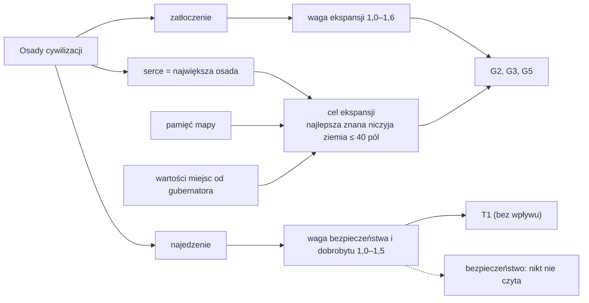

# Strateg (S1)

[← spis treści](README.md) · kod: `src/CivSim.Core/Ai/StrategistAdvisor.cs` · GDD 8.1, 7.6 · ADR 0017

Strateg nie wydaje rozkazów osadom. Ustawia cywilizacji **wagi 6 celów** i **cel ekspansji** (pole na mapie), a pozostali doradcy
mnożą przez te wagi swoje oceny.

## S1: Ustawienie strategii

**Komenda:** `SetStrategyCommand(wagi[6], pole celu, miesiąc następnego przeglądu, era)`.
Komenda zapisuje w cywilizacji: `GoalWeights`, `ExpansionTarget`, `StrategyReviewMonth`, `StrategyEra`. Odrzucana, gdy wag nie
jest 6, któraś jest spoza 0–3000 albo pole nie należy do Ziemi.

### Kiedy

Dla każdej żywej cywilizacji AI, gdy **nadszedł miesiąc przeglądu** albo **cywilizacja jest w innej erze niż przy ostatnim
przeglądzie**. Pierwszy przegląd: tura 1 (wszyscy). Następny: za 15 tur (`reviewEveryTurns`) plus przesunięcie `numer cywilizacji
mod 15` (tylko po pierwszym przeglądzie), potem co 15 tur. W epoce kamienia 15 tur = 750 lat; w neolicie 375 lat.

Strateg działa **po gubernatorze**, więc nowe wagi obowiązują od następnej tury.

### Dane wejściowe

Liczone tylko z własnych, zamieszkanych osad na Ziemi:

| Wielkość | Wzór |
| --- | --- |
| ludzie | suma mieszkańców wszystkich osad |
| miejsce | suma maksymalnej liczby mieszkańców poziomów osad (obóz 150, wioska 1000, …) |
| **zatłoczenie** (‰) | ludzie × 1000 / miejsce |
| **najedzenie** (‰) | średnia ważona liczbą mieszkańców z `FedPerMille` osad (ile potrzeb jedzenia zaspokoiła poprzednia tura) |
| „serce” | osada z największą liczbą mieszkańców (przy remisie pierwsza na liście) |

Gdy cywilizacja nie ma ludzi, przegląd jest pomijany.

### Wagi celów

| Cel | Waga | Wzór |
| --- | --- | --- |
| ekspansja | 1000–1600 | prosta: zatłoczenie ≤ 50% → 1000; ≥ 90% → 1600; pomiędzy liniowo (`crowdingLowPercent`, `crowdingHighPercent`, `expansionWeightMin/Max`) |
| bezpieczeństwo | 1000–1500 | prosta: najedzenie ≥ 95% → 1000; ≤ 60% → 1500 (`fedWellPercent`, `fedBadlyPercent`, `hungerWeightMax`) |
| dobrobyt | 1000–1500 | ta sama liczba co bezpieczeństwo |
| nauka | 1000 | stała |
| wpływ | 1000 | stała |
| podbój | 1000 | stała (dostanie własną wagę z wojnami w 4e) |

Przykłady: obozy pełne w 70% → ekspansja 1300. Ludzie najedzeni w 80% → bezpieczeństwo i dobrobyt 1215.

Charakter **nie** wpływa na wagi stratega. Wpływa osobno, jako mnożnik w ocenie każdego działania.

### Cel ekspansji

Najlepsze **wolne** (niczyje) pole lądu, które cywilizacja **zna** (pamięć mapy), w promieniu wędrówki (40 pól, `journeyCells`)
od serca. Sprawdzane jest tylko co trzecie pole w każdym kierunku (kolumna i rząd podzielne przez 3), żeby liczyć szybko.

```
wartość pola = wartość miejsca do życia × bliskość
wartość miejsca do życia = jedzenie okolicy na rok × wygoda   (dokładnie jak u gubernatora, bez wag i kierunku)
bliskość = 1000 − 12,5 × odległość od serca (‰), czyli 0,5 na granicy 40 pól
```

Wygrywa najwyższa wartość (przy remisie pierwsze sprawdzone). Bez losowania. Jeśli nie ma żadnego pola z wartością > 0, cel to
„brak” (−1). Własna ziemia cywilizacji **nie** może być celem (tylko niczyja).

Cel działa w G2, G3 i G5 jako **premia +15%** dla miejsc bliżej celu niż obecny obóz (`directionBonusPercent`).

### Zapis „Dlaczego?”

Ocena = waga ekspansji. Notatki: zatłoczenie w %, najedzenie w ‰, wartość pola celu. Przykład z gry (seed 7, tura 1):
`Civilization 1, Strategist, SetStrategy, cel 7119, ocena 1000: crowding 33%, fed 1000, food 59917`.

### Kto czyta wynik

| Wynik | Czyta | Skutek |
| --- | --- | --- |
| waga ekspansji | G2, G3, G5 | mnożnik ocen miejsc; **obniża próg odłamu** (G5) |
| waga podboju | G2 | mnożnik oceny wypędzenia (dziś zawsze 1000) |
| waga dobrobytu | T1 | mnożnik wszystkich receptur (bez wpływu na wybór) |
| waga nauki | U1 | mnożnik wszystkich technologii (zawsze 1000) |
| waga bezpieczeństwa | nikt | — |
| waga wpływu | nikt | — |
| cel ekspansji | G2, G3, G5 | +15% dla miejsc w jego stronę |


