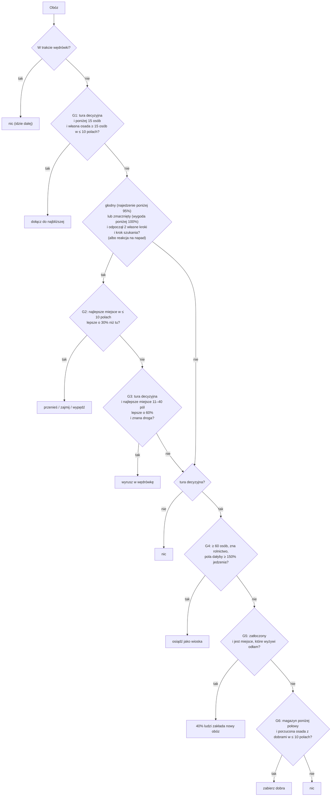

# Gubernator (G1–G6)

[← spis treści](README.md) · kod: `src/CivSim.Core/Ai/GovernorAdvisor.cs` · GDD 5.3, 5.4, 5.5, 8.1, 8.3 · stary opis reguł: `docs/systems/influence-migration.md`

Gubernator prowadzi **obozy koczownicze**. Wioski (osiadłe) nie dostają od niego żadnych decyzji.

## Kolejność decyzji jednego obozu

W każdym kroku świata gubernator przechodzi po kolei cywilizacje AI, które mają **własny krok** albo alarm „napadnięto nasz obóz”
(ADR 0018), a w każdej jej zamieszkane obozy po kolei. Dla obozu sprawdza decyzje **w tej kolejności i kończy na pierwszej, która
zapadła** (obóz robi najwyżej jedną rzecz na krok). W reakcji na napad sprawdza tylko G2 (bez G1, G3–G6):



**Rezerwacja pól.** Pole wybrane w G2, G3 albo G5 jest zajęte do końca tury dla wszystkich kolejnych obozów (`Take`). Do tego przy
odłamach (G5) pola w promieniu 3 od każdego obozu cywilizacji (także od nowo wybranych) są wykluczone. Kto liczy wcześniej, wybiera
pierwszy: cywilizacje po numerze, obozy po kolejności na liście osad.

---

## Wspólna ocena miejsca

G2, G3, G5 i strateg oceniają miejsce tym samym rdzeniem.

### Jedzenie okolicy (wartość bazowa)

`ComputeSiteFood`, `GovernorAdvisor.cs:714`. „Ziemia miejsca” to pola, do których dotarłby obóz bez wojowników, licząc koszt terenu
jak strefa wpływów:

1. Od pola środka rozchodzimy się po lądzie. Wejście na pole kosztuje: koszt ruchu biomu + 1 za wzgórza albo + 2 za góry. Woda jest
   nieprzekraczalna.
2. Bierzemy pola o łącznym koszcie ≤ 3 (`influence.baseRange`).
3. Dla każdego pola: `jedzenie pola na rok × obecny zapas dzikiej żywności / pełny zapas`.

Jedzenie pola na rok (`GatheringSystem.CellFoodPerYear` **bez technologii cywilizacji**):

```
4 × jedzenie biomu × (50 + żyzność) / 100 × część roku, w której rośnie roślinność (%)   + jedzenie ze złoża na tym polu (np. zwierzyna)
```

Na planecie z porami roku na żywo: średnia z obecnej i następnej pory roku.

Wynik jest w setnych jednostki jedzenia na rok. Przykład: 7552 = 75,52 jedzenia rocznie. Dla porównania: producent i rzemieślnik
jedzą 1 jedzenie na rok, wojownik 1,2. Obóz 100 osób potrzebuje około 103 jedzenia na rok.

### Wygoda (czynnik „comfort”)

`Comfort`, `GovernorAdvisor.cs:699`.

```
T = temperatura zimy pola (średnia roczna − połowa sezonowości); na planecie z porami na żywo: temperatura następnej pory
granica zimna = −5 °C − tolerancja zimna (ogień +4, garbarstwo +4, czyli z obiema −13 °C)
zimno = max(0, granica zimna − T),   upał = max(0, T − 38 °C)
wygoda = max(5%, 100% − 2% × (zimno + upał))
```

Pole z zimą −15 °C bez technologii: zimno 10 → wygoda 80%. Wygoda jest też **wyzwalaczem**: obóz z wygodą < 100% u siebie szuka
nowego miejsca nawet najedzony (G2).

### Czynniki miejsca w zasięgu jednego ruchu (G2, G5)

`Place`, `GovernorAdvisor.cs:527`. Ocena = jedzenie okolicy, potem kolejno:

| Czynnik | Wartość | Kiedy |
| --- | --- | --- |
| wygoda (`comfort`) | 50–1000‰ (patrz wyżej) | zawsze |
| bliskość (`distance`) | 1000 − 30 × odległość (970 … 700) | zawsze |
| stare obozowisko (`own old campsite`) | 1100 | na polu stoi pusta osada tej cywilizacji albo przez nią zajmowana (roszczenie) |
| kierunek (`direction`) | 1150 | pole jest bliżej celu ekspansji niż obecny obóz; **nie** dla obcych obozów |
| opinia (`opinion`) | 1000 − 5 × sympatia w punktach (−100 → 1500, 0 → 1000, +100 → 500) | tylko obcy obóz |
| wojna (`war`) | 1500 (`warRaidPercent`) | obcy obóz cywilizacji, z którą jesteśmy w wojnie (etap 4d) |
| waga celu | waga ekspansji, a dla obcego obozu waga podboju | gdy ≠ 1000 |
| charakter | 500 + ekspansywność, a dla obcego obozu 500 + agresja | gdy ≠ 1000 |

### Czynniki miejsca dalekiego (G3)

`Far`, `GovernorAdvisor.cs:518`: jedzenie × wygoda × bliskość dalekiego miejsca (1000 − 10 × odległość, `journeyPenaltyPerMillePerCell`) × kierunek (1150) × waga
ekspansji × ekspansywność. Bez premii za stare obozowisko i bez obcych obozów.

### Ocena „zostać tutaj”

`stay` = jedzenie okolicy obecnego pola × wygoda × **połowa** wagi ekspansji × **połowa** mnożnika ekspansywności. **Bez** bliskości,
kierunku i obozowiska.

„Połowa” znaczy: zostaje 50% odchylenia od 1000 (`moveExpansionSharePercent: 50`). Przy wadze ekspansji 1600 nowe miejsca dostają
× 1,6, a „zostać” tylko × 1,3. Dawniej obie strony dostawały pełną wagę, więc waga ekspansji i ekspansywność nie zmieniały decyzji
„przenieść się czy zostać” (od PR B zmieniają: ekspansywne, zatłoczone plemię chętniej rusza w drogę).

---

## G1: Mały obóz dołącza do innego

`Decide`, `GovernorAdvisor.cs:188`.

- **Kiedy:** tura decyzyjna, obóz ma **mniej niż 15 osób** (`mergeBelowPeople`).
- **Dokąd:** najbliższa (w polach) zamieszkana osada **tej samej cywilizacji** mająca co najmniej 15 osób, nie dalej niż 10 pól
  (`maxMoveCells`). Może to być też wioska. Przy remisie odległości: pierwsza na liście osad.
- **Ocena:** brak wyboru między opcjami. Zapis: ocena = liczba osób, notatka `people`.
- **Komenda:** `AbandonSettlementCommand`: wszyscy przechodzą, niosą tyle dóbr, ile udźwigną (10 jednostek na osobę, więcej z
  technologiami), obóz zostaje porzucony. Obóz, do którego dołączono, nie podejmuje już decyzji w tej turze.
- **Bez:** wag, charakteru, losowania. Gdy w promieniu 10 pól nie ma własnej osady, mały obóz żyje dalej sam.

## G2: Przeniesienie obozu, zajęcie albo wypędzenie

`Decide` (`GovernorAdvisor.cs:207`) i `BestSite` (`GovernorAdvisor.cs:445`).

**Warunki wejścia (wszystkie):**

1. obóz jest **głodny** (najedzenie w poprzednim własnym kroku < 95%, `moveWhenFedBelowPercent`) **albo zmarznięty/przegrzany**
   (wygoda jego pola < 100%, `uncomfortableBelowPercent`);
2. **odpoczął**: od ostatniej przeprowadzki minęły co najmniej 2 własne kroki (`minStepsBetweenMoves` × rytm ery);
3. to **krok szukania**: obóz głoduje mocno (najedzenie < 85%, `starvingFedPercent`), albo planeta ma pory roku na żywo, albo
   `(liczba własnych kroków − 1 + numer obozu) mod 3 = 0` (`searchEverySteps`).

**Reakcja na napad** (ADR 0018): gdy inna cywilizacja napadła któryś obóz tej cywilizacji, w najbliższym kroku świata wszystkie jej
obozy sprawdzają G2 od razu: warunki 1–3 nie obowiązują, ale nowe miejsce dalej musi być lepsze o 30%.

**Kandydaci:** każde pole w promieniu 10 pól, które:

- nie jest wodą i nie jest polem obozu,
- jest **znane** cywilizacji (pamięć mapy, W1),
- jest **niczyje albo własne** (strefa wpływów), **albo** stoi na nim zamieszkany **obcy obóz** cywilizacji, z którą **nie** łączy nas
  pakt o nieagresji, sojusz obronny ani rozejm po wojnie (etap 4d), a cywilizacja **widziała to pole w swoim ostatnim kroku**
  (`MapMemory.SeesNow`, od PR B: nie zna dzisiejszej siły obozów, których dawno nie widziała),
- nie stoi na nim zamieszkana osada (chyba że obca, patrz wypędzenie) i nie zostało zarezerwowane w tej turze.

Puste (porzucone) osady i ruiny **są** dozwolone: wtedy zamiast przeprowadzki jest zajęcie.

**Dodatkowe warunki dla obcego obozu (wypędzenie):**

- obóz ma wojowników,
- cel jest obozem (wiosek nie da się wypędzić),
- `siła ataku × 100 ≥ siła obrony × 150` (`attackAboveStrengthPercent`), gdzie siła ataku = liczba wojowników, a siła obrony =
  wojownicy obrońców + 25% pozostałych mieszkańców (`defenderNonWarriorPercent`). Notatka `strength` = atak/obrona w %.

**Ocena każdego kandydata:** jak w [czynnikach miejsca](#czynniki-miejsca-w-zasięgu-jednego-ruchu-g2-g5). Wybór: 3 najlepsze,
ostrożność albo losowanie ([wybór](01-wspolne-mechanizmy.md#3-wybór-chooser-i-advisorpick)).

**Decyzja:** wybrany kandydat wygrywa, gdy `ocena × 100 > zostać tutaj × 130` (`moveWhenBetterByPercent: 30`). Notatki:
`better than here` (ocena „zostać”) i `fed` (najedzenie w ‰).

**Komenda zależy od pola:**

| Na polu | Działanie | Komenda | Co się dzieje |
| --- | --- | --- | --- |
| nic | `MoveCamp` | `MoveSettlementCommand` | obóz przenosi się z tym, co udźwignie; reszta zostaje jako porzucone obozowisko |
| pusta osada / ruiny | `Occupy` | `OccupySettlementCommand` 100% | wszyscy wprowadzają się; stara osada zostaje porzucona; roszczenie dawnego właściciela zostaje (spór graniczny, R4) |
| obcy zamieszkany obóz | `Conquer` | `ConquerSettlementCommand` | walka: szansa wygranej = atak / (atak + obrona), los ze strumienia `combat`. Wygrana: zwycięzcy tracą 10% wojowników, obrońcy 40% wojowników i 20% wszystkich w ucieczce, uciekają na najbliższe wolne pole albo do własnej osady; zwycięzcy wprowadzają się. Przegrana: atakujący tracą 40% wojowników, obrońcy 10%. W obu przypadkach ofiara zapamiętuje napaść (R3). |

Przy wymaganej przewadze 150% szansa wygranej wynosi co najmniej 60%.

Jeśli nikt nie przekroczył progu 30%, gubernator próbuje G3 (w kroku na decyzje wolne), a potem przechodzi do decyzji wolnych.

## G3: Daleka wędrówka

`FarSite`, `GovernorAdvisor.cs:301`.

- **Kiedy:** te same warunki co G2, G2 nic nie dało, tura decyzyjna, Ziemia.
- **Kandydaci:** pola dalej niż 10 i najwyżej 40 pól (`journeyCells`), **tylko co trzecie pole** (kolumna i rząd podzielne przez 3),
  ląd, znane, niczyje albo własne, bez żadnej osady (także pustej).
- **Ocena:** [czynniki dalekie](#czynniki-miejsca-dalekiego-g3). Wybór: 3 najlepsze, ostrożność albo losowanie.
- **Droga:** dopiero dla wybranego pola szukamy drogi: najkrótsza ścieżka po **znanych** polach lądu, lodu morskiego i pomostów,
  nie dalej niż 40 pól od startu (`PathFinder`). Brak drogi = brak wędrówki w tej turze (nie próbuje drugiego kandydata).
- **Próg:** `ocena × 100 > max(zostać tutaj, najlepsze miejsce z G2) × 160` (`journeyBetterByPercent: 60`).
- **Komenda:** `JourneyCommand`. Potem system wędrówki w każdym własnym kroku cywilizacji przesuwa obóz do 10 pól po drodze, zatrzymując się tylko na wolnym lądzie,
  aż dojdzie albo droga zniknie (zapomniany ląd, stopiony lód). W trakcie wędrówki obóz nie podejmuje żadnych decyzji.

## G4: Osiedlenie się (wioska)

`Decide` (`GovernorAdvisor.cs:247`), `FarmFood` (`GovernorAdvisor.cs:404`).

- **Kiedy:** tura decyzyjna, obóz ma co najmniej **60 osób** (`settle.minPeople`), a cywilizacja zna technologię wymaganą przez
  następny poziom osiadły (wioska: **rolnictwo**).
- **Rachunek:**

  ```
  plon z pól = Σ po polach w promieniu 8, które należą do strefy tego obozu:
               3 × (50 + żyzność) / 100 × część roku wegetacji %  × 40 rolników na pole
               (pole wodne albo z żyznością < 20 daje 0)
  potrzeby  = roczne potrzeby jedzenia wszystkich mieszkańców
  osiądź, gdy plon z pól × 100 ≥ potrzeby × 150     (settleFarmYieldPercent: 150)
  ```

- **Ocena:** plon z pól. Notatki: `farm yield` (plon / potrzeby w %), `people`. Bez wag, charakteru i losowania.
- **Komenda:** `SettleCommand`: obóz staje się wioską (do 1000 osób, magazyn 2000), nie może się już ruszać, producenci uprawiają pola.
- **Uwaga:** rachunek zakłada, że **każde** pole strefy uprawia 40 rolników, niezależnie od tego, ilu producentów obóz ma naprawdę.
  W praktyce próg 150% jest spełniony prawie zawsze (w trzech grach mediana ok. 1650%, najmniej 169%), więc obóz osiada, gdy tylko zna rolnictwo i ma 60
  osób. Szczegóły w [uwagach](08-ocena-i-uwagi.md#4-osiedlenie-to-w-praktyce-próg-a-nie-wybór).

## G5: Odłam (nowy obóz)

`Decide` (`GovernorAdvisor.cs:261`), `BestSite(splitting: true)`.

- **Kiedy:** tura decyzyjna, G4 nie zapadło.
- **Zatłoczenie:**

  ```
  zapał = waga ekspansji × (500 + ekspansywność) / 1000           (‰)
  próg  = 80% × 1000 / zapał, ale nie mniej niż 50% i nie więcej niż 100%
  zatłoczony, gdy ludzie ≥ 60 i ludzie ≥ pojemność poziomu × próg   (obóz: pojemność 150)
  ```

  | Ekspansywność | Waga ekspansji 1000 | Waga ekspansji 1600 |
  | --- | --- | --- |
  | 0 (mnożnik 0,5) | próg 100% → 150 osób | 100% → 150 osób |
  | 500 (mnożnik 1,0) | 80% → 120 osób | 50% → 75 osób |
  | 1000 (mnożnik 1,5) | 53% → 80 osób | 50% → 75 osób |

- **Kandydaci:** jak w G2, ale **bez obcych obozów** i bez pól w promieniu 3 od własnych obozów (`minDistanceBetweenOwnCamps: 4`).
- **Warunek:** ocena wybranego > 0 **i** surowe jedzenie okolicy wybranego pola ≥ roczne potrzeby jedzenia odchodzącej grupy
  (`splitNeedsFoodPercent: 100`). Grupa to 40% każdej warstwy (`splitPercent`).
- **Bez porównania z „zostać”**: odłam nie potrzebuje progu 30%.
- **Komenda:** `SplitSettlementCommand` 40% (nowy obóz „Camp N”, dobra w tej samej części, ile udźwigną) albo, gdy na polu stoi
  pusta osada, `OccupySettlementCommand` 40%. Notatka `crowding` (ludzie / pojemność w %).

## G6: Zabranie porzuconych dóbr

`Decide`, `GovernorAdvisor.cs:282`.

- **Kiedy:** tura decyzyjna, nic wcześniej nie zapadło, magazyn obozu jest zapełniony **mniej niż w połowie** (`plunderBelowStoragePercent: 50`).
- **Wybór:** **pierwsza** na liście osad pusta osada albo ruina na tym samym świecie, z jakimikolwiek dobrami, w promieniu 10 pól, na
  ziemi niczyjej albo własnej. Nie ma porównywania kilku miejsc ani oceny.
- **Ocena:** ilość dóbr w setnych; notatka `goods left`.
- **Komenda:** `PlunderSettlementCommand`: obóz zabiera tyle, ile udźwigną jego ludzie.
- Od PR B tylko osady na polach, które cywilizacja **zna** (pamięć mapy, W1).

---

## Przykład krok po kroku (liczby przykładowe)

Obóz 100 osób, najedzony w 90% (głodny, bo < 95%), tura szukania. Cywilizacja: waga ekspansji 1300, ekspansywność 600 (mnożnik
1,1), ostrożność 700, cel ekspansji na wschodzie.

1. **Zostać:** jedzenie okolicy 9000 (90 na rok), wygoda 100% → 9000 × 1,15 × 1,05 = **10 868** (połowa odchylenia wagi 1300 i
   mnożnika 1,1).
2. **Pole A** 4 pola na wschód: jedzenie 12 000, wygoda 100%, bliskość 880, kierunek 1150 →
   12 000 × 0,88 × 1,15 = 12 144 → × 1,3 × 1,1 = **17 365**.
3. **Pole B** 2 pola na zachód, stare obozowisko: jedzenie 11 500, bliskość 940, obozowisko 1100 → 11 891 → **17 004**.
4. **Pole C** obcy obóz 3 pola dalej: jedzenie 14 000, bliskość 910, sympatia −50 → opinia 1250, waga podboju 1000, agresja 300
   (mnożnik 0,8): 14 000 × 0,91 × 1,25 × 0,8 = **12 740**. Atak 15 wojowników, obrona 8 wojowników + 25% z 62 = 23 → 15/23 = 65%
   < 150%: **odpada** przed wejściem do wyboru.
5. Wybór trzyma A (17 365) i B (17 004). Z szansą 70% (ostrożność) bierze A; w pozostałych 30% losuje 50,5% A / 49,5% B.
   Razem: A ≈ 85%, B ≈ 15%.
6. Próg: 17 365 × 100 = 1 736 500 > 10 868 × 130 = 1 412 840 → **przenosi się**. Pole B też przeszłoby próg (1 700 400).

Prawdziwe wpisy z dziennika są w [statystykach](09-statystyki.md).
