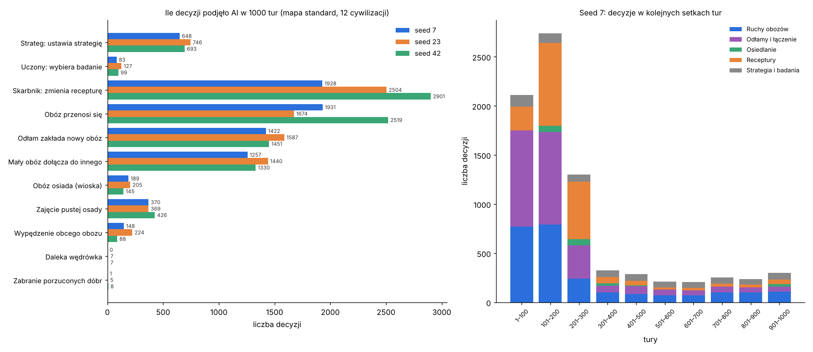
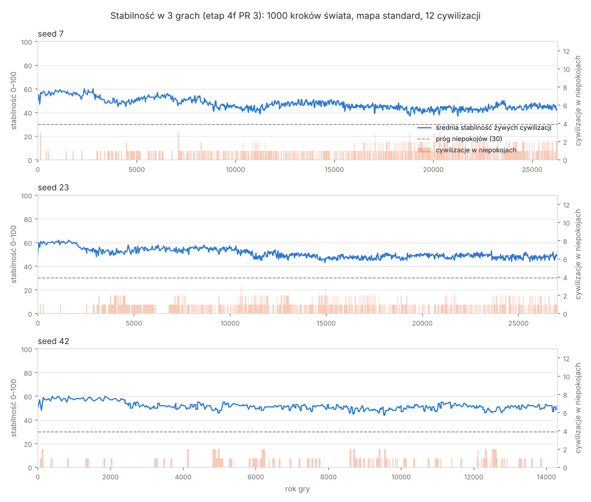
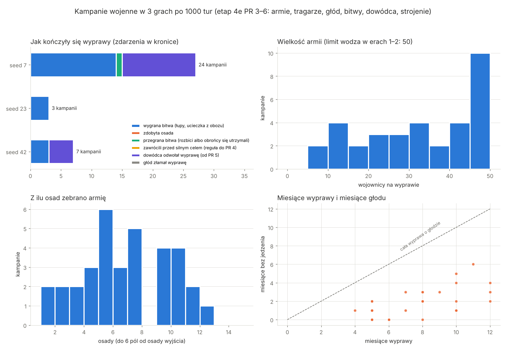
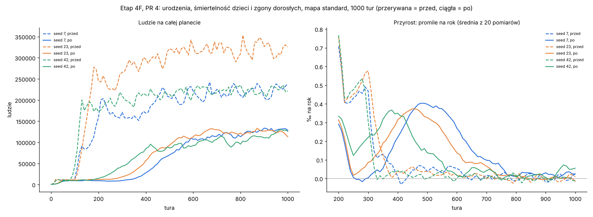
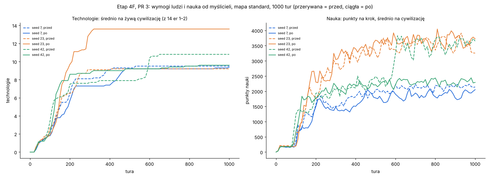
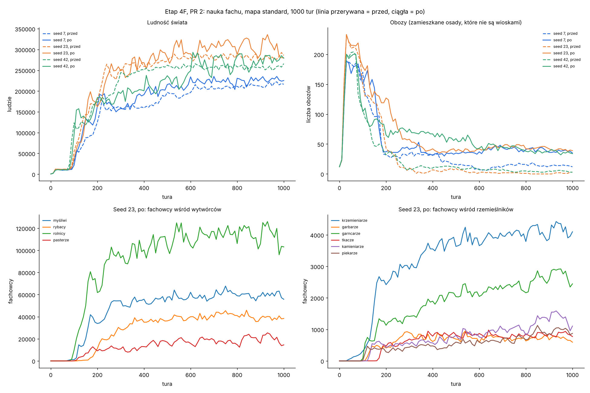
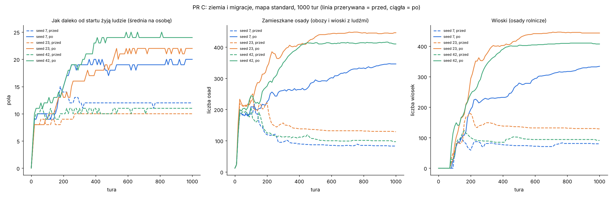
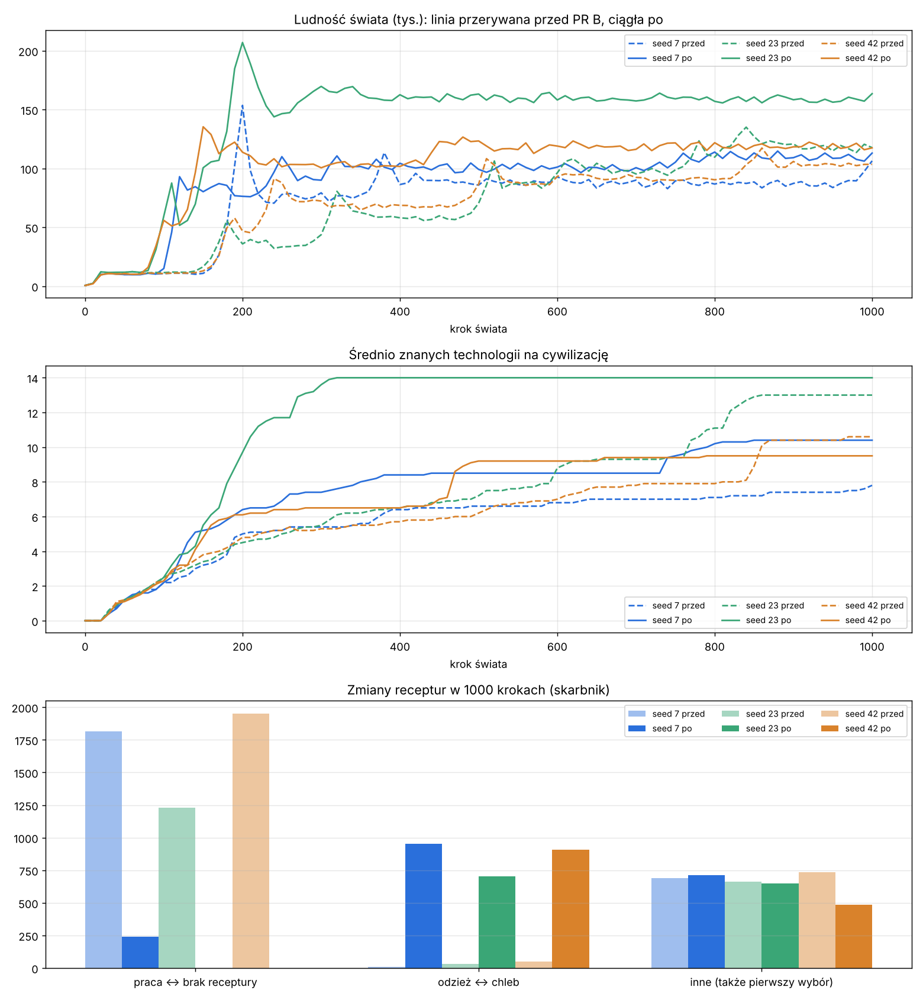
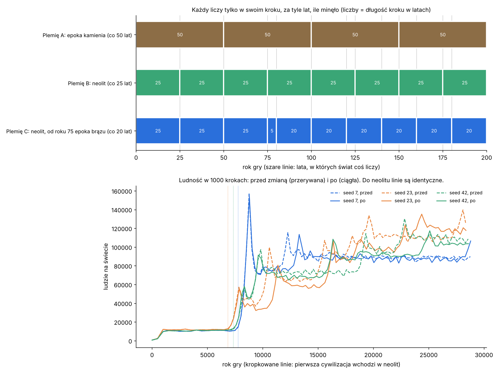

# Statystyki: co AI robi w prawdziwych grach

[← spis treści](README.md)

Trzy gry bez grafiki: mapa standard (256×160), 12 cywilizacji, seedy 7, 23 i 42; do etapu 5b 1000 kroków świata, od etapu 6 PR 1
18 000 taktów (30 minut przy ×1). Wykres decyzji jest z etapu 6 PR 1 (gałąź `feat/live-clock`); sekcje niżej mówią, z którego etapu są ich liczby. Tabela liczby decyzji niżej
jest jeszcze z końca etapu 4F (`feat/demography`; w nawiasach liczby po PR 3, commit `f993e4d`); po PR 1 liczba decyzji zmieniła się o mniej
niż 10% (4900–8000 na grę).
Polecenie:

```
dotnet run --project src/CivSim.Headless -c Release -- --seed 7 --turns 1000 --map-size standard --decisions why7.csv --stats stats7.csv
```

Wykres: `python3 docs/ai/tools/decisions_chart.py <katalog z why7.csv, why23.csv, why42.csv>` (potrzebuje matplotlib).



## Po czasie polityki w latach akcji (etap 6 PR 2)

3 seedy, 18 000 taktów (30 min przy ×1), gałąź `feat/live-pace`. W nawiasach PR 1.

| Seed | Decyzje | Wypowiedzenia wojny | Kampanie | Propozycje umów | Zmiany ustroju | Ludy żywe na końcu | Secesje |
| --- | --- | --- | --- | --- | --- | --- | --- |
| 7 | 7963 (13 735) | 41 (152) | 73 (329) | 199 (2111) | 69 (78) | 55 (64) | 45 (52) |
| 23 | 11 110 (17 083) | 52 (66) | 107 (122) | 261 (1639) | 67 (71) | 63 (64) | 52 (52) |
| 42 | 11 403 (17 355) | 43 (104) | 68 (300) | 224 (1780) | 70 (75) | 62 (58) | 52 (46) |

- Planowy przegląd dyplomaty co 5 minut (zamiast co kilka sekund) to główna przyczyna: propozycji umów jest 7–10 razy mniej.
- Wojny i kampanie: mniej, bo krzywdy szybciej blakną i rzadziej ktoś planowo o nich myśli; wojny wciąż wybuchają (41–52 na grę).
- Ocena i możliwa zmiana (`reviewEveryYears`): `08` pkt 20.

## Po zegarze gry na żywo (etap 6 PR 1, ADR 0025)

3 seedy, mapa standard, **18 000 taktów = 30 minut gry przy ×1**, gałąź `feat/live-clock`. Wykres decyzji wyżej jest z tych gier.
W nawiasach etap 5b (1000 kroków świata, tabela niżej). Polecenie jak wyżej, ale `--turns 18000` (Headless liczy teraz takty).

| Seed | Decyzje | Wypowiedzenia wojny | Kampanie | Propozycje umów | Ludy żywe na końcu | Secesje | Lata gry |
| --- | --- | --- | --- | --- | --- | --- | --- |
| 7 | 13 735 (5232) | 152 (54) | 329 (58) | 2111 (565) | 64 (39) | 52 (27) | 18 275 (12 100) |
| 23 | 17 083 (6400) | 66 (54) | 122 (40) | 1639 (566) | 64 (45) | 52 (34) | 18 750 (12 100) |
| 42 | 17 355 (5442) | 104 (59) | 300 (62) | 1780 (539) | 58 (33) | 46 (21) | 17 925 (10 551) |

- **Więcej wszystkiego, bo więcej lat i ludów:** 30 minut to ok. 18 tys. lat zamiast 10–12 tys., bo wojny nie spowalniają już
  licznika lat. Ludów jest 58–64 (w dwóch seedach limit 64, znany problem 5), więc i decyzji jest 2–3 razy więcej.
- **Wzory decyzji bez zmian;** inaczej jest tylko kiedy: w pulsie (co 3 s) i, dla kampanii, co miesiąc akcji (0,5 s).
- **Neolit po 5,8–7,5 minuty, wszystkie technologie er 1–2 po 6,7–9 minutach** (wykres w `docs/systems/turn-loop.md`).
- Odstępy w latach licznika są teraz bardzo krótkie w czasie rzeczywistym (ocena pkt 20): do strojenia w PR 2.

## Po 4-godzinnym biegu (etap 5b)

3 seedy, mapa standard, 1000 kroków świata, gałąź `claude/project-thread-04udi9` (PR #63). Wykres decyzji wyżej jest z tych gier.
W nawiasach stan przed etapem 5b (commit `14cd39c`).

| Seed | Decyzje | Wypowiedzenia wojny | Kampanie | Propozycje umów | Ludy żywe na końcu | Secesje | Lata gry |
| --- | --- | --- | --- | --- | --- | --- | --- |
| 7 | 5232 (9289) | 54 (11) | 58 (4) | 565 (91) | 39 (10) | 27 (0) | 12 100 (25 450) |
| 23 | 6400 (10057) | 54 (3) | 40 (2) | 566 (75) | 45 (10) | 34 (0) | 12 100 (26 975) |
| 42 | 5442 (13977) | 59 (3) | 62 (1) | 539 (392) | 33 (12) | 21 (0) | 10 551 (27 375) |

- **Mniej decyzji, bo mniej lat:** wojny skracają kroki świata do miesiąca, więc 1000 kroków to ok. 11–12 tys. lat zamiast 25–27 tys.
  Na rok gry decyzji jest więcej niż wcześniej.
- **Dużo więcej dyplomacji i wojny:** ok. 40 małych ludów zamiast 10–12 dużych; każdy ma więcej sąsiadów. Kampanii jest kilkanaście
  razy więcej (wcześniej 1–4 na grę).

## Poprawki po 100 grach (etap 4g)

3 seedy, mapa standard, 1000 kroków świata, gałąź `feat/ai-fixes`. Wykres decyzji wyżej jest z tych gier. W nawiasach 4f PR 5.

| Seed | Lata gry | Wojny | o odwet / łupy / ziemię | Pakty | Sojusze | Sojusznik przystąpił | Wioska wysyła osadników | Dołączenia (obozy i głodne wioski) | Decyzji AI |
| --- | ---: | ---: | --- | ---: | ---: | ---: | ---: | ---: | ---: |
| 7 | 19 105 (26 275) | 29 (3) | 23 / 3 / 10 (wliczając sojuszników) | 16 | 5 | 7 | 503 | 560 | 6181 (7594) |
| 23 | 28 650 (27 025) | 0 (3) | — | 14 | 7 | 0 | 1290 | 1364 | 11 752 (8119) |
| 42 | 25 400 (14 300) | 11 (30) | 0 / 9 / 2 | 15 | 2 | 0 | 789 | 914 | 10 089 (6914) |

- **Seed 42 spokojniejszy, seed 7 bardziej wojenny:** w 42 pakty zablokowały napady obozów, a z nimi pętlę odwetu (30 → 11 wojen, prawie
  wszystkie o łupy). W 7 sojusze wciągnęły sojuszników do wojen (7 razy), stąd 29 wojen; świat liczył wtedy co miesiąc, więc gra doszła
  do 19 tysięcy lat zamiast 26. Na 100 grach liczba wojen spadła (mediana 17 → 10,5), patrz [testy wsadowe](12-testy-wsadowe.md).
- **Wioski reagują na głód:** wysyłanie osadników i dołączanie małych wiosek to teraz druga i trzecia najczęstsza decyzja gubernatora
  po przeprowadzkach obozów.

## AI wobec państwa (etap 4f, PR 5)

3 seedy, mapa standard, 1000 kroków świata, gałąź `feat/state-ai`. Wykres stabilności niżej jest z tych gier.
W nawiasach PR 4.



| Seed | Lata gry | Wojny | O odwet | Zmiany ustroju (S2) | z tego w niepokojach | Przewroty | Secesje | Średnia stabilność | Lat w niepokojach | Decyzji AI |
| --- | ---: | ---: | ---: | ---: | ---: | ---: | ---: | ---: | ---: | ---: |
| 7 | 26 275 (21 700) | 3 (19) | 3 (18) | 30 | 5 | 3 (4) | 0 (1) | 48 (50) | 7% (2%) | 7594 (9052) |
| 23 | 27 025 (25 750) | 3 (9) | 3 (9) | 22 | 10 | 3 (3) | 0 (1) | 51 (53) | 7% (4%) | 8119 (13 638) |
| 42 | 14 300 (14 525) | 30 (40) | 23 (35) | 6 | 2 | 2 (2) | 0 (1) | 52 (51) | 2% (3%) | 6914 (8642) |

- **Pętla odwetu zamknięta:** pokój zamyka rachunek, więc wojen jest 3–30 zamiast 9–40. W seedzie 42 ta sama para walczy najwyżej
  5 razy (wcześniej 13), i za każdym razem z nowego powodu (nowa napaść po pokoju).
- **Ustrój zmienia się rzadko i zwykle po zmianie władcy:** 6–30 zmian na grę (12 ludów, 14–27 tysięcy lat), czyli około jednej
  na lud na 1000–2000 lat. Większość przychodzi, gdy nowy przywódca przesuwa charakter (np. ostrożny wódz → rada), tylko 2–10 w
  niepokojach. Najczęściej zmienia się ten sam lud (seed 7: Thethvaeli 10 razy, na zmianę rada i wodzostwo co kilkaset lat).
- **Niepokojów jest więcej w seedach 7 i 23 (7% zamiast 2–4%)**: nie było secesji (wcześniej każda gra miała jedną dużą, która
  odcinała dalekie, nielojalne osady), a każda zmiana ustroju to 2 lata bezkrólewia. Do obserwacji w etapie 4g na 100 grach.

## Bunty i secesja (etap 4f, PR 4)

3 seedy, mapa standard, 1000 kroków świata, gałąź `feat/state-revolts`. W nawiasach PR 3.

| Seed | Lata gry | Secesje | Przewroty | Średnia stabilność | Lat w niepokojach | Wojny | Z udziałem nowego ludu |
| --- | ---: | ---: | ---: | ---: | ---: | ---: | ---: |
| 7 | 21 700 (21 000) | 1 | 4 | 50 (47) | 2% (8%) | 19 (16) | 7 |
| 23 | 25 750 (24 275) | 1 | 3 | 53 (49) | 4% (12%) | 9 (15) | 3 |
| 42 | 14 525 (18 951) | 1 | 2 | 51 (46) | 3% (12%) | 40 (31) | 8 |

- **Secesje są duże:** 11–27 osad naraz (np. „Qusspeagu and 23 other settlements broke away from the Chiefdom of Hardtusu and founded
  the Council of Hardtu”). Dalekie osady przeciążonego wodzostwa mają najniższą lojalność.
- **Przewroty zmieniają ustrój** (wodzostwo ↔ rada starszych), a rada ma premię +10, więc po buncie stabilność wraca. Dlatego niepokoi
  się 2–4% lat cywilizacji zamiast 8–12%.
- **Nowy lud bywa trwalszy niż rodzic:** w seedzie 7 rodzic (Hardtusu) wymarł w turze 383, a lud, który się od niego odłączył, żyje.
  Nowe ludy biorą udział w 3–8 wojnach na grę: rodzic wypędza ich obozy ze swojej strefy (G2), co daje powód do odwetu.

## Stabilność (etap 4f, PR 3)

3 seedy, mapa standard, 1000 kroków świata, gałąź `feat/state-stability`. W nawiasach PR 2.


| Seed | Lata gry | Średnia stabilność | Lat cywilizacji w niepokojach | Wpisów „Unrest spread” | Wojny | Najczęstszy agresor |
| --- | ---: | ---: | ---: | ---: | ---: | --- |
| 7 | 21 000 (20 600) | 47 | 8% | 285 | 16 (20) | cywilizacja 0: 8 wojen |
| 23 | 24 275 (25 275) | 49 | 12% | 379 | 15 (8) | cywilizacja 7: 15 wojen |
| 42 | 18 951 (13 525) | 46 | 12% | 294 | 31 (45) | cywilizacja 1: 25 wojen |

- **Stabilność spada z wiekiem gry** z około 58 do 42–46: plemiona rosną do kilkunastu i kilkudziesięciu osad, a administracja
  przekracza limit ustroju (pełna kara 25 przy kilkudziesięciu obozach). Średnio 1–2 cywilizacje naraz są w niepokojach
  (wydajność −1% za punkt poniżej 30).
- **AI jeszcze nie reaguje** na stabilność (PR 5); działa na nią tylko pośrednio: niepokoje zmniejszają zapasy, bezkrólewie blokuje
  wojny. Zmian ustroju w tych grach nie było (AI ich nie wybiera do PR 5), więc bezkrólewia też nie.
- **Stolica nie padła ani razu:** osady wciąż prawie nie zmieniają właściciela (pkt 14 oceny).
- Pętla odwetu nadal jest (seed 23: wszystkie 15 wojen wypowiedziała cywilizacja 7; seed 42: 25 z 31 cywilizacja 1).

## Przywódcy (etap 4f, PR 2)

3 seedy, mapa standard, 1000 kroków świata, gałąź `feat/state-leaders`. W nawiasach PR 1 (same ustroje).

| Seed | Lata gry | Ustroje na końcu (żywe) | Następstw | Lat na panowanie | Wojny | Z zerwaniem umowy | Najczęstszy agresor | Kampanie | Pokój z okupem |
| --- | ---: | --- | ---: | ---: | ---: | ---: | --- | ---: | ---: |
| 7 | 20 600 (16 000) | 6 wodzostw, 4 rady | 11 621 | 21 | 20 (30) | 13 (21) | cywilizacja 0: 18 wojen | 23 | 3 |
| 23 | 25 275 (8 901) | 5 rad, 4 wodzostwa | 14 544 | 20 | 8 (48) | 2 (42) | cywilizacje 7 i 10: po 4 | 4 | 1 |
| 42 | 13 525 (21 200) | 5 rad, 4 wodzostwa | 8 258 | 19 | 45 (26) | 29 (18) | cywilizacje 1 i 8: 18 i 17 | 39 | 6 |

- **Przywódca żyje średnio 19–21 lat u władzy.** Śmierć z wiekiem (tabela w `data/leaders.json`), w wodzostwie każda zmiana wodza
  przynosi 5 lat walki o władzę (na razie bez skutków; stabilność przychodzi w PR 3).
- **Cechy przywódcy przesuwają charakter** (np. zdobywca: agresja +200‰), więc ta sama cywilizacja raz jest bardziej wojownicza, raz
  mniej. Dlatego liczby wojen skaczą między seedami w obie strony: seed 23 z 48 wojen spadł do 8, seed 42 wzrósł z 26 do 45.
  Pętla odwetu (pkt 14 oceny) nie zniknęła, tylko trafia teraz na inne cywilizacje; poprawka w PR 5.
- Kronika: jeden wpis o przywódcach na krok cywilizacji (gdy w jednym kroku następuje kilku po sobie, wpis mówi ilu).

## Ustroje (etap 4f, PR 1)

3 seedy, mapa standard, 1000 kroków świata, gałąź `feat/state-governments`. W nawiasach PR 6.

| Seed | Lata gry | Ustroje na końcu (żywe) | Wojny | Z zerwaniem umowy | Najczęstszy agresor | Kampanie | Pokój z okupem |
| --- | ---: | --- | ---: | ---: | --- | ---: | ---: |
| 7 | 16 000 (21 100) | 7 wodzostw, 3 rady | 30 (32) | 21 (25) | cywilizacja 0: 23 wojny | 79 | 5 |
| 23 | 8 901 (27 625) | 7 rad, 5 wodzostw | 48 (5) | 42 (0) | cywilizacja 10: 47 wojen | 113 | 8 |
| 42 | 21 200 (25 700) | 6 wodzostw, 5 rad | 26 (10) | 18 (6) | cywilizacja 5: 11 wojen | 24 | 1 |

- **Mniej lat w 1000 krokach:** wojny i gotowość armii dodają kroki świata (miesiąc po miesiącu), więc 1000 kroków obejmuje mniej lat.
  Na rok gry gra liczy się podobnie jak w PR 6 (seed 7: +9%, seed 42: +2%), poza seedem 23, gdzie trwa pętla odwetu (+43%).
- **Pętla odwetu** opisana w [ocenie, pkt 14](08-ocena-i-uwagi.md#14-ustroje-i-pętla-odwetu-etap-4f-pr-1): jedna cywilizacja co 50 lat
  wypowiada wojnę temu samemu sąsiadowi. Była i wcześniej; wodzostwo (podbój ×1,2, częstsze przeglądy) ją wzmacnia.
- **Decyzji** jest 7 200–12 500 na grę (wcześniej 4 900–8 000 w 4e PR 1): więcej kampanii i ruchów obozów w dłuższych wojnach.

## Strojenie wojny (etap 4e, PR 6)

3 seedy, mapa standard, 1000 kroków świata. W nawiasach PR 5 (ten sam kod gry przed strojeniem). Wykres `img/kampanie_3_seedy.png` jest z tych gier.

| Seed | Kampanie | Miesiące wypraw | Miesiące głodu | Dostawy tragarzy | Bitwy | Wygrane | Odwołane (K2) | Głód złamał | Wojny | Pokój z okupem |
| --- | ---: | ---: | ---: | ---: | ---: | ---: | ---: | ---: | ---: | ---: |
| 7 | 24 (38) | 192 (258) | 47 (110) | 41 (64) | 15 (14) | 14 (8) | 12 (27) | 0 (1) | 32 (20) | 1 (0) |
| 23 | 3 (17) | 20 (124) | 2 (49) | 5 (30) | 3 (8) | 3 (7) | 0 (7) | 0 (2) | 5 (11) | 0 (1) |
| 42 | 7 (7) | 48 (49) | 12 (24) | 10 (13) | 3 (2) | 3 (1) | 4 (4) | 0 (2) | 10 (4) | 0 (0) |

- **Głód:** armie głodują w 23% miesięcy wypraw (61 z 260), wcześniej w 42% (183 z 431). Głód nie złamał żadnej wyprawy (wcześniej 5).
  Przyczyna była prosta: tragarze szli z najbliższej osady, często prawie pustej (1–2 osoby z garścią jedzenia), a ich wyprawa blokowała
  inne osady. Teraz idą z osady, która może dać najwięcej, szybciej (6 pól na miesiąc) i wcześniej (poniżej 3 miesięcy jedzenia); armia
  w czasie zbiórki je z zapasów domu, a dowódca liczy jedzenie okolicy na całą wyprawę.
- **Mniej, ale lepiej przygotowanych kampanii:** dowódca nie wysyła armii, której okolica nie wyżywi. W seedzie 23 to tylko 3 kampanie
  w 5 wojnach; z `minFoodMonths` 0 byłoby ich 19, ale z głodem w 27% miesięcy. Zostawiłem 1 (ostrożniej). Gra jest chaotyczna: różnice
  w liczbie wojen między PR 5 i PR 6 to w dużej części inna historia świata, nie skutek jednej zmiany.
- **Pokój z warunkami** wciąż jest rzadki (1 okup w 3 grach). Prawie każda wojna kończy się ciszą: po kampanii nikt nie walczy przez 5 lat
  i przychodzi biały pokój. Patryk zdecydował 2026-11-07, że tak zostaje (warunki tylko wtedy, gdy strony same się dogadają). Nowy czynnik
  „wynik wojny” i ponowna propozycja pokoju po roku działają (test `WarTuningTests`), ale rzadko mają okazję.
- **Podbój:** żadna wioska nie zmieniła właściciela w tych grach. Wojny są prawie zawsze o odwet (wojna o ziemię wymaga roszczenia).
- **Długi przebieg 10 000 tur** (seed 42, kod PR 5): 203 150 lat gry, średnio 46 ms na turę (p95 82 ms; cel < 50 ms), pamięć danych 32 MB,
  cały program 258 MB (cel < 1 GB). Średni czas tury w kolejnych 2000 turach: 38, 54, 55, 49, 34 ms (najwięcej osad w środku gry).

## Dowódca: bitwa w głowie i odwołanie co miesiąc (etap 4e, PR 5)

Z `--campaigns`, `--decisions` i kroniki, 3 seedy, mapa standard, 1000 kroków świata. W nawiasach PR 4. Wykres `img/kampanie_3_seedy.png` (niżej) jest z tych gier.

| Seed | Kampanie | Bitwy | Wygrane | Zabici atakujący | Zabici obrońcy | Odwołane przez dowódcę (K2) | Głód złamał | Śr. wojowników |
| --- | ---: | ---: | ---: | ---: | ---: | ---: | ---: | ---: |
| 7 | 38 (40) | 14 (4) | 8 (3) | 54 (1) | 43 (10) | 27 | 1 (18) | 35 (38) |
| 23 | 17 (61) | 8 (31) | 7 (31) | 18 (28) | 37 (144) | 7 | 2 (13) | 45 (47) |
| 42 | 7 (6) | 2 (2) | 1 (2) | 0 (0) | 3 (5) | 4 | 2 (1) | 33 (38) |

W PR 4 zamiast odwołań była reguła systemu „zobaczyli, jak silny jest cel, i zawrócili”: 19, 18 i 3 razy.

- **Głód prawie przestał łamać wyprawy** (32 → 5 w 3 grach): dowódca nie wysyła armii dalej niż 3 pola poza zasięg tragarzy. Wyprawy
  dalej **głodują** średnio 2–4 miesiące (słabe dostawy tragarzy, prawy dolny wykres), ale wracają.
- **Mniej kampanii w seedzie 23** (61 → 17): dowódca odrzuca cele, do których jedzenie nie wystarczy, i takie, przy których spodziewa się
  dużych strat. W seedzie 7 jest więcej bitew (4 → 14) i są bardziej wyrównane: armia rusza na cel, który zobaczy dopiero na miejscu,
  a od PR 5 atakuje, gdy dowódca uzna, że szansa jest co najmniej 45%, a nie 60%.
- **Odwołania (K2):** wszystkie 38 z powodu spodziewanej bitwy (`win chance` 0–32%), gdy armia zobaczyła cel z bliska. Odwołanie z braku
  jedzenia w tych grach nie wystąpiło, bo sprawdzenie drogi przy wysłaniu już odrzuca za dalekie cele (działa w teście `CommanderTests`).
- **Zgrzyt do PR 6:** dowódca podejmuje więcej decyzji „wysłać” (61, 19, 7) niż jest kampanii (38, 17, 7). Część komend odrzuca serwer
  (np. dwie wojny naraz chcą tych samych wojowników); tak było już w PR 4 (58 decyzji, 40 kampanii w seedzie 7).

## Bitwy w rundach (etap 4e, PR 4)

Z `--campaigns` i kroniki, 3 seedy, mapa standard, 1000 kroków świata.

| Seed | Kampanie | Bitwy | Wygrane | Zabici atakujący | Zabici obrońcy | Zawrócili przed silnym celem | Głód złamał | Rundy w bitwie |
| --- | ---: | ---: | ---: | ---: | ---: | ---: | ---: | --- |
| 7 | 40 | 4 | 3 | 1 | 10 | 19 | 18 | zawsze 1 |
| 23 | 61 | 31 | 31 | 28 | 144 | 18 | 13 | 26× 1, 4× 2, 1× 3 |
| 42 | 6 | 2 | 2 | 0 | 5 | 3 | 1 | zawsze 1 |

- **Bitwy są krótkie i prawie zawsze wygrane przez atakujących:** dowódca rusza tylko przy szansie co najmniej 60% (udział w sile), więc
  atakuje słabsze obozy i wioski; obrońcy tracą w pierwszej rundzie tyle ludzi, że uciekają. Równe bitwy (test `BattleTests`) trwają 3–4 rundy.
- **Żadna wioska nie zmieniła właściciela** w tych grach: wojny o ziemię są rzadkie, a wyprawy częściej zawracają albo głodują. Podbój działa
  w teście `AWarForLandTakesTheVillageWithItsPeople`.
- **Głód i zawracanie** dalej kończą większość wypraw (patrz PR 3). Do PR 5 (dowódca liczy spodziewaną bitwę, drogę i jedzenie) i PR 6.

## Armie, uzbrojenie i zaopatrzenie (etap 4e, PR 3)

Z `--campaigns` (nowy raport: jeden wiersz na kampanię) i z kroniki, 3 seedy, mapa standard, 1000 kroków świata. Wykres:
`python3 docs/ai/tools/campaign_chart.py <katalog z camp_7.csv… i log_7.txt…>`.

| Seed | Wojny (przed PR 3) | Kampanie | Z kilku osad | Średnio wojowników | Uzbrojenie średnio | Głodne kampanie | Głód złamał | Napady po jedzenie | Dostawy tragarzy | Średnio trwa |
| --- | ---: | ---: | ---: | ---: | ---: | ---: | ---: | ---: | ---: | ---: |
| 7 | 37 (42) | 67 | 67 | 34 | 70% | 50 | 21 | 5 | 111 | 7 mies. |
| 23 | 6 (7) | 14 | 14 | 35 | 69% | 9 | 5 | 3 | 20 | 6 mies. |
| 42 | 9 (24) | 13 | 9 | 34 | 75% | 10 | 1 | 3 | 21 | 8 mies. |



- **Armie są z kilku osad:** prawie każda kampania zbiera wojowników z 4–8 osad i ma 30–50 ludzi (limit wodza 50).
- **Uzbrojenie to głównie drewniane włócznie (70%):** kamienne narzędzia rzadko leżą w zapasach osad, bo ludzie ich używają;
  proce i kamienne groty dostaje mniejszość wojowników.
- **Głód jest częsty:** 3 z 4 kampanii przynajmniej miesiąc nie mają jedzenia, bo idą dalej niż 12 pól od własnych osad (tragarze nie
  sięgają) albo osady mają mało zapasów. W seedzie 7 głód złamał 21 z 67 wypraw. To zgodne z zasadą „poza zasięgiem zaopatrzenia armia
  słabnie”, ale może być za ostre: do strojenia w PR 5 (dowódca liczy drogę i jedzenie) i PR 6 (liczby).
- **Liczba wojen zmienia się mocno między przebiegami** (seed 42: 24 → 9), bo każda zmiana w walce zmienia całą dalszą historię;
  liczby z jednego seeda nie są porównaniem przyczynowym.

## Kampanie co miesiąc (etap 4e, PR 2)

Z `--wars` i `--decisions` (3 seedy, mapa standard, 1000 kroków świata); w nawiasach po PR 1:

| Seed | Wojny | Średnio trwa | Kampanie (miesiące) | Zabici razem | Pokój | Decyzje razem |
| --- | ---: | --- | --- | ---: | --- | ---: |
| 7 | 17 (11) | 65 mies. (205 lat) | 19 (80) | 352 (122) | biały 17 | 5428 (4920) |
| 23 | 5 (2) | 65 mies. (225 lat) | 4 (27) | 4 (38) | biały 5 | 4874 (5430) |
| 42 | 10 (4) | 62 mies. (187 lat) | 4 (12) | 96 (31) | biały 10 | 8549 (7993) |

- **Wojny trwają 5–6 lat zamiast 150–300.** Kampania trwa od 2 do kilkunastu miesięcy; po 5 latach bez kampanii wojna wygasa.
- **Dowódca wysłał 4–26 kampanii na grę.** Wojownicy częściej najeżdżają, niż zdobywają osady; kilka razy zawrócili przed silniejszym celem.
- **Wszystkie pokoje są białe:** przegrany odrzuca warunki (opinia o wrogu bliska −100), a odrzucona propozycja wraca dopiero po 100 latach
  ([uwagi, punkt 12](08-ocena-i-uwagi.md)). Do strojenia w PR 6.
- Gra przechodzi przez 26–29 tys. lat w 1000 krokach świata (było 29 tys.): kroki kampanii i alarmów dzielą długie kroki.

## Wojny z celem (etap 4e, PR 1)

Z `--wars` (3 seedy, mapa standard, 1000 tur; wykres decyzji wyżej jest już z tych gier):

| Seed | Wojny | Cel | Średnio lat | Zabici razem | Pokój: okup / biały | Okup (% zapasów) |
| --- | ---: | --- | ---: | ---: | --- | --- |
| 7 | 11 | odwet 11 | 204 | 122 | 6 / 5 | 3–33 |
| 23 | 2 | odwet 2 | 225 | 38 | 1 / 1 | 33 |
| 42 | 4 | odwet 4 | 187 | 31 | 2 / 2 | 3–15 |

- **Wszystkie wojny to odwet:** wojna o ziemię wymaga osady z roszczeniem, a roszczenie trwa krótko po wypędzeniu. Wojny o łupy przyjdą
  z dowódcą (PR 4).
- **Wojny trwają 150–300 lat**, bo w epoce kamienia krok ma 50 lat, a zmęczenie rośnie o 1 punkt na rok: na końcu każda strona ma
  zmęczenie 100 z samych lat. Straty prawie nie mają znaczenia (kilka do kilkudziesięciu zabitych). Do strojenia w PR 5, gdy będą bitwy wypraw.
- **Okupy działają:** zwycięzca z wynikiem 25–85 dostaje 3–33% zapasów przegranego.
- Liczba decyzji prawie bez zmian (4900–8000 na grę).

## Demografia (etap 4F, PR 4)

Ludność przed PR 4 i po nim (`python3 docs/ai/tools/population_chart.py <katalog>`):



| Seed | Pierwszy neolit (rok) | Ludzie w kroku 200 | Ludzie na końcu | Technologie (średnio) | Obozy na końcu | Odległość od startu (pola) |
| --- | --- | ---: | ---: | ---: | ---: | ---: |
| 7 | 8450 (5800) | 9 276 (158 976) | 128 403 (238 508) | 9,8 (9,4) | 32 (40) | 13 (18) |
| 23 | 8800 (5825) | 11 815 (244 646) | 113 062 (325 519) | 12,0 (13,6) | 32 (52) | 12 (20) |
| 42 | 8950 (4800) | 14 837 (172 200) | 126 284 (221 459) | 8,6 (9,6) | 59 (54) | 17 (23) |

Co widać (AI się nie zmieniło, zmienił się świat, w którym decyduje):

- **Obozy przenoszą się 5–9 razy rzadziej** (1000–2000 zamiast 7600–9600 przeprowadzek), a dalekich wędrówek, zajęć pustych osad
  i osadników jest 3–10 razy mniej. Ludzi przybywa powoli, więc obóz rzadko wyjada okolicę i rzadko głoduje; gubernator nie ma
  powodu się ruszać. Cywilizacje rozchodzą się mniej daleko od startu.
- **Neolit 3000–4000 lat później:** 10 myślicieli do rolnictwa to cywilizacja ok. 330 ludzi, a do takiej liczby dochodzi się teraz wolniej.
- **Badania i strategia bez zmian** (ok. 120 wyborów badań i 600 przeglądów strategii na grę).
- **Receptur mniej o połowę** (900–1000 zmian): mniej osad z rzemieślnikami i spokojniejsze ceny jedzenia.

## Ludzie w technologiach (etap 4F, PR 3)

Technologie i nauka przed PR 3 i po nim (`python3 docs/ai/tools/research_chart.py <katalog>`):



| Seed | Pierwszy neolit (krok, rok) | Technologie na końcu (średnio, najwięcej) | Ludzie na końcu | Żywe cywilizacje |
| --- | --- | --- | ---: | ---: |
| 7 | 120, rok 5800 (110, rok 5500) | 9,4 / 14 (9,5 / 14) | 238 508 (225 307) | 12 (11) |
| 23 | 120, rok 5825 (100, rok 5000) | 13,6 / 14 (9,2 / 14) | 325 519 (279 639) | 9 (9) |
| 42 | 100, rok 4800 (100, rok 4825) | 9,6 / 14 (10,8 / 14) | 221 459 (279 158) | 10 (8) |

- **Nauka ma to samo tempo** (prawy wykres): myśliciele dają jej większość, a liczby przeskalowałem tak, żeby cywilizacja o zwykłym
  składzie badała jak przedtem.
- **Neolit 0–20 kroków później:** rolnictwo czeka na 10 myślicieli (cywilizacja ok. 330 ludzi).
- **Małe cywilizacje stają na 8–10 technologiach:** nie mają np. 30 rolników do nawadniania ani 20 do garncarstwa i chleba. Duże
  dochodzą do wszystkich 14.
- Gra jest chaotyczna: wyniki seedów rozjeżdżają się w obie strony (seed 23 więcej ludzi i technologii, seed 42 mniej).

## Fachy (etap 4F, PR 2)

Ludność, obozy i fachowcy przed PR 2 i po nim (`python3 docs/ai/tools/skills_chart.py <katalog>`, pliki `before*.csv` i
`after*.csv` z `--stats`):



| Seed | Pierwszy neolit (krok, rok) | Ludzie na końcu | Żywe cywilizacje | Technologie (średnio) | Wioski | Obozy | Odległość od startu (pola) |
| --- | --- | ---: | ---: | ---: | ---: | ---: | ---: |
| 7 | 110, rok 5500 (110, rok 5275) | 225 307 (216 297) | 11 (10) | 9,5 (9,2) | 260 (334) | 35 (12) | 19 (20) |
| 23 | 100, rok 5000 (100, rok 4950) | 279 639 (285 848) | 9 (7) | 9,2 (14,0) | 396 (443) | 39 (3) | 27 (22) |
| 42 | 100, rok 4825 (90, rok 4475) | 279 158 (266 084) | 8 (7) | 10,8 (12,1) | 335 (407) | 34 (3) | 24 (24) |

Fachowcy na końcu (seed 23): rolnicy 103 tys., myśliwi 56 tys., rybacy 38 tys., pasterze 15 tys., krzemieniarze 4,1 tys.,
garncarze 2,4 tys., kamieniarze 1,1 tys., piekarze 870, tkacze 770, garbarze 600.

Co z tego widać:

- **Rolnictwo rozchodzi się z mistrzami.** Obóz osiada dopiero z rolnikiem, więc wioski powstają wolniej, a część ludzi zostaje
  koczownikami na stałe (30–40 obozów zamiast 3–12). Przeprowadzek obozów jest 3–4 razy więcej (6700–8600 zamiast 1500–2600),
  bo tych obozów jest więcej. Historycznie zbieracze też długo żyli obok rolników.
- **Osiedlenie:** mediana jedzenia wioski przy osiedleniu 183% potrzeb (150–279%), z rolnikami jako połową producentów.
- **Receptur jest mniej** (1500–1900 zmian zamiast 2700–5000): receptura bez fachowców jest warta zero, więc skarbnik rzadziej skacze
  między nimi.
- **Wysyłanie osadników** (G7) 600–900 razy zamiast 420–470: wioski dzielą się częściej, bo mniej obozów osiada samodzielnie.
- **Neolit 0–10 kroków później**, średnio mniej technologii u żywych cywilizacji, ale więcej cywilizacji przeżywa (także małe).
  To jeszcze bez wymogów ludzi w technologiach (PR 3).

## Ziemia i migracje (PR C)

Przed PR C i po nim: jak daleko od startu żyją ludzie, zamieszkane osady i wioski (`python3 docs/ai/tools/land_chart.py <katalog>`,
pliki `before*.csv` i `after*.csv` z `--stats`):



| Seed | Pierwszy neolit (krok, rok) | Ludzie na końcu | Żywe cywilizacje | Technologie (średnio) | Zamieszkane osady | Wioski | Odległość od startu (pola) |
| --- | --- | ---: | ---: | ---: | ---: | ---: | ---: |
| 7 | 110, rok 5275 (120, rok 5850) | 216 297 (113 050) | 10 (10) | 9,2 (10,4) | 346 (83) | 334 (80) | 20 (12) |
| 23 | 100, rok 4950 (100, rok 4800) | 285 848 (163 527) | 7 (9) | 14,0 (14,0) | 446 (129) | 443 (129) | 22 (10) |
| 42 | 90, rok 4475 (90, rok 4425) | 266 084 (117 473) | 7 (8) | 12,1 (9,5) | 410 (97) | 407 (91) | 24 (11) |

Co z tego widać:

- **Ludzie rozchodzą się po świecie.** Przed PR C liczba osad spadała po turze ~200 (obozy osiadały i stały w miejscu), a ludzie
  zostawali ok. 10–12 pól od startu. Teraz wioski wysyłają osadników (G7, 424–473 grup na grę), osad przybywa do tury ~500–800,
  a ludzie żyją średnio 20–24 pola od startu. Ludności jest 1,6–2,3 razy więcej.
- **Osiedlenie jest prawdziwym rachunkiem.** Mediana plonu z pól przy osiedleniu spadła z ok. 1640% do 280%, a rolnictwo musi
  dać więcej niż zbieractwo (mediana `over gathering` 292%). Osiedleń jest 2–3 razy więcej, bo osiadają też obozy osadników.
- **Wyprawy w nieznane (G8) są rzadkie**: 8, 12 i 97 na grę, prawie tylko w cywilizacjach ciekawych i ekspansywnych
  (`exploreAbovePerMille` = 1,5). Dalekich wędrówek (G3) jest więcej (23–38 zamiast 1–11), bo obóz idzie teraz 20 pól na stulecie.
- **Więcej zmian receptur** (2700–5000 zamiast 1350–1900): osad jest więcej, a każda wybiera recepturę.
- **Neolit w tym samym czasie** (±10 kroków): zmiana dotyczy tego, co dzieje się po osiedleniu, a nie tempa rolnictwa.
- Tura jest dłuższa, bo osad jest więcej ([uwagi, pkt 10](08-ocena-i-uwagi.md)).

Przed PR B i po nim: ludność, technologie i zmiany receptur (`python3 docs/ai/tools/values_chart.py <przed> <po>`, katalogi ze
`stats*.csv` i `why*.csv`):



Rytmy cywilizacji i ludność przed zegarem i po nim (ADR 0018, `python3 docs/ai/tools/clock_chart.py <przed> <po>`):



## Najważniejsze liczby przed PR B i po nim (historia)

| Seed | Pierwszy neolit (krok, rok) | Ludzie na końcu | Żywe cywilizacje | Technologie (średnio) | Wioski |
| --- | --- | ---: | ---: | ---: | ---: |
| 7 | 120, rok 5850 (160, rok 7800) | 113 050 (106 452) | 10 (8) | 10,4 (7,8) | 80 (79) |
| 23 | 100, rok 4800 (140, rok 6875) | 163 527 (117 698) | 9 (7) | 14,0 (13,0) | 129 (81) |
| 42 | 90, rok 4425 (150, rok 7350) | 117 473 (103 500) | 8 (7) | 9,5 (10,6) | 91 (66) |

## Liczba decyzji w 1000 tur (etap 4e po PR 5; w nawiasach etap 4F po PR 4)

| Decyzja | Id | Seed 7 | Seed 23 | Seed 42 |
| --- | --- | ---: | ---: | ---: |
| strateg ustawia strategię | S1 | 477 (653) | 474 (620) | 544 (629) |
| uczony wybiera badanie | U1 | 112 (125) | 119 (126) | 111 (127) |
| skarbnik zmienia recepturę | T1 | 1126 (957) | 1525 (909) | 1594 (994) |
| obóz przenosi się | G2 | 3275 (993) | 4476 (1070) | 5891 (1983) |
| zajęcie pustej osady (przeniesienie albo odłam) | G2, G5 | 220 (97) | 223 (54) | 291 (175) |
| wypędzenie obcego obozu | G2 | 260 (47) | 19 (16) | 15 (25) |
| odłam zakłada nowy obóz | G5 | 456 (631) | 496 (661) | 562 (669) |
| mały obóz dołącza do innego | G1 | 524 (397) | 733 (421) | 1264 (761) |
| obóz osiada (wioska) | G4 | 322 (380) | 482 (439) | 343 (363) |
| wioska wysyła osadników | G7 | 450 (153) | 745 (211) | 701 (164) |
| wyprawa w nieznane | G8 | 13 (6) | 16 (8) | 387 (328) |
| daleka wędrówka | G3 | 66 (6) | 98 (15) | 128 (32) |
| zabranie porzuconych dóbr | G6 | 0 (0) | 0 (0) | 0 (0) |
| dyplomata proponuje umowę albo pokój | D2 | 213 (308) | 143 (235) | 1053 (1009) |
| dyplomata przyjmuje propozycję | D1 | 24 (34) | 21 (21) | 14 (27) |
| dyplomata odrzuca propozycję | D1 | 169 (254) | 111 (205) | 1025 (961) |
| dyplomata wypowiada wojnę | D2 | 20 (13) | 11 (4) | 4 (5) |
| dowódca wysyła kampanię | K1 | 61 (–) | 19 (–) | 7 (–) |
| dowódca odwołuje kampanię | K2 | 27 (–) | 7 (–) | 4 (–) |
| **razem** | | **7815** (5054) | **9718** (5015) | **13938** (8252) |

Wykres: `img/decyzje_1000_tur.png`. Od etapu 4F gra zmieniła się bardzo (fachy, ludzie, demografia, wojna, epizody), więc różnice w nawiasach
to skutek wielu PR-ów, nie tylko dowódcy. Kampanii jest mało w porównaniu z decyzjami obozów: wojny w erach 1–2 to kilka wypraw na grę.

Tabele po PR 2 i po PR C są w historii tej strony w gicie (commity `f993e4d` i `448a104`).

Co widać po PR B (historia):

- **Rolnictwo przychodzi wcześniej.** Uczony wycenia wioski z żyzności strefy, a ogień i krzemień z drogi do rolnictwa, więc
  rolnictwo jest zwykle 2. albo 3. badaniem. Pierwszy neolit wypada o 40–60 kroków (ok. 2000–2900 lat) wcześniej. **To duża zmiana
  tempa gry, do Twojej oceny.** Jeśli neolit ma przychodzić później, wystarczy obniżyć `scholar.villageWorthPerPerson` w
  `data/ai.json` (dziś 0,1).
- **Mniej decyzji obozów** (przeprowadzki, odłamy, dołączenia o ok. 30–50% mniej): obozy wcześniej stają się wioskami, a wioski nie
  mają decyzji gubernatora. Więcej ludzi i więcej żywych cywilizacji na końcu.
- **Mniej wypędzeń** (o 50–80%): obcy obóz można zaatakować tylko wtedy, gdy cywilizacja widziała go w swoim ostatnim kroku.
- **Mniej dyplomacji:** mniej propozycji i odrzuceń, bo mniej cywilizacji się kłóci o te same obozowiska. Wojen 2–8 (1–19).
- **Strateg robi więcej przeglądów** w seedach 7 i 23, bo więcej cywilizacji przeżywa i wcześniej zmienia erę (przegląd od razu po
  wejściu w nową erę).
- **Skarbnik:** przełączanie „receptura 1 ↔ brak receptury” prawie zniknęło (1811, 1109 i 1950 zmian → 242, 0 i 0). Zostało
  przełączanie odzież ↔ chleb (955, 703 i 907 zmian): cena jedzenia skacze z plonami, więc raz wygrywa chleb, raz odzież. To już
  prawdziwa zmiana sytuacji, ale jest jej dużo ([uwagi](08-ocena-i-uwagi.md)).
- Gra jest chaotyczna: od neolitu każda drobna zmiana prowadzi do innej historii, więc pojedyncze różnice w tabeli nie są „skutkiem”
  PR B. Wnioski wyżej powtarzają się we wszystkich trzech seedach.

## Przykładowe wpisy „Dlaczego?” (jeden na rodzaj decyzji)

| Seed, tura | Cywilizacja | Decyzja | Ocena | 3 najważniejsze czynniki |
| --- | --- | --- | ---: | --- |
| 7, 1 | Civilization 1 | S1 SetStrategy | 1000 | crowding 33%, fed 1000, food 59917 |
| 7, 1 (PR B) | Niakiia | U1 SetResearch (ogień) | 1 044 | serves security, leads to 322, research cost 100% (koszt 4200) |
| 23, 3 | Civilization 4 | G2 MoveCamp | 46 209 | distance 73% (9 pól), direction 115% (2 pola bliżej celu), character 89% |
| 7, 25 | Civilization 8 | G2 Conquer | 19 983 | character 112% (agresja 620), distance 91% (3 pola), opinion 98% (sympatia +4) |
| 7, 26 | Civilization 10 | G2 Occupy | 23 112 | distance 79% (7 pól), direction 115%, own old campsite 110% |
| 23, 24 | Civilization 1 | G3 Journey | 37 161 | goal weight 137% (ekspansja), character 81%, distance 83% (17 pól) |
| 7, 168 | Civilization 1 | G4 Settle | 126 000 | farm yield 1563%, people 78 |
| 7, 84 (PR C) | Lakhaem | G4 Settle | 28 314 | farm yield 299%, over gathering 191, people 92 |
| 7, 83 (4F) | Lakhaem | G4 Settle | 12 600 | farm yield 159%, over gathering 100, people 77 |
| 7, 93 (PR C) | Lakhaem | G7 SendSettlers | 10 538 | character 76%, distance 82% (6 pól), food 16713 |
| 42, 2 (PR C) | Osxou | G8 Explore | 37 | character 155%, direction 115% (4), unknown 21 |
| 7, 5 | Civilization 1 | G5 SplitCamp | 78 669 | character 120%, direction 115%, distance 88% (4 pola) |
| 7, 21 | Civilization 10 | G1 JoinCamp | 13 | people 13 |
| 7, 419 | Civilization 4 | G6 Plunder | 22 081 | goods left 22081 |
| 7, 27 (PR B) | Lakhaem | T1 SetRecipe (narzędzia kamienne) | 274 488 | value added 313700, serves prosperity, inputs available 100% |
| 7, 55 (PR B) | Rishboy | T1 SetRecipe (narzędzia kamienne) | 527 438 | value added 313700, serves prosperity, for trade 363 |
| 7, 12 (4d) | Civilization 8 | D2 ProposeTreaty → Civ 11 | 1 042 | character 91%, opinion 108% (sympatia +4), trade gain 105% (28%) |
| 7, 13 (4d) | Civilization 12 | D1 AcceptTreaty ← Civ 7 | 1 353 | character 124%, trade gain 108% (29%), opinion 100% |
| 7, 20 (4d) | Civilization 12 | D1 DeclineTreaty ← Civ 7 | 695 | threat 70% (ich wojownicy 81% naszych), character 98%, opinion 100% |
| 7, 43 (4d) | Civilization 12 | D2 DeclareWar → Civ 7 | 2 134 | opinion 153% (sympatia −38), strength 150% (przewaga 293%), character 93% |

Wiersze bez „(4d)”, „(PR B)”, „(PR C)” i „(4F)” pochodzą z gier w wersji 4c; reguły tych decyzji zmieniły się tylko w szczegółach (G2: umowy, wojna,
widzenie obcych obozów i połowa wagi ekspansji dla „zostać”, patrz gubernator). Od PR #38 cywilizacje mają nazwy zamiast numerów.

Jak czytać czynnik: `distance 73% (9)` znaczy „bliskość obniżyła ocenę do 73%, bo miejsce jest 9 pól dalej”. Liczba w nawiasie to
wartość ze świata. Notatki bez procentu (np. `food 59917`, `people 13`) tylko wyjaśniają.
