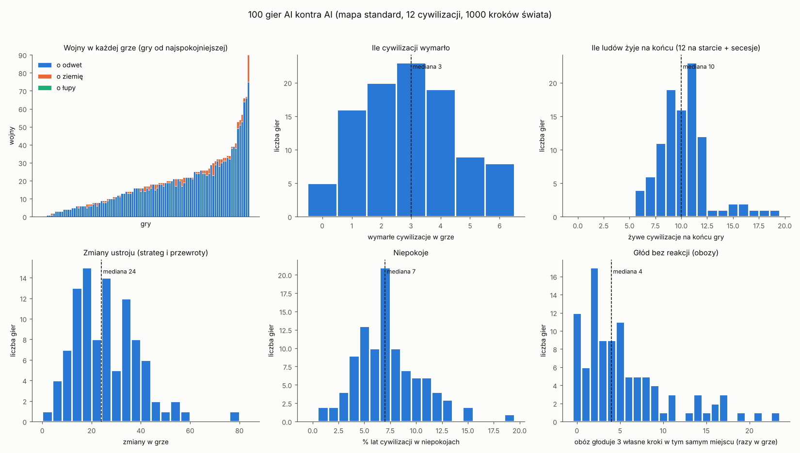
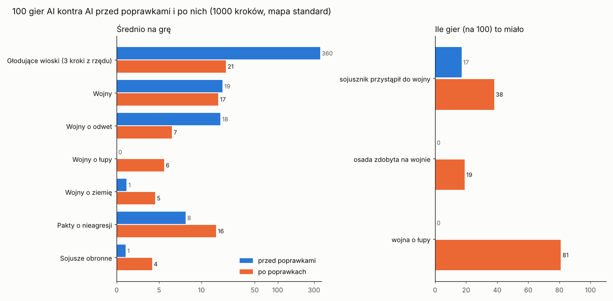

# Testy wsadowe: 100 gier AI kontra AI (etap 4g)

[← spis treści](README.md) · GDD 8.7 · kod: `src/CivSim.Headless/BatchRun.cs`, `GameTally.cs` · dane: [`dane/100_gier.csv`](dane/100_gier.csv)

GDD 8.7 mówi: „AI strojemy wsadowo: 100 gier bez grafiki na różnych seedach i porównanie metryk”. Ta strona to pierwszy taki raport.
Stan kodu: koniec etapu 4f (gałąź `feat/batch-games`, na `feat/state-ai`).

## Jak to zostało policzone

- 100 gier, seedy 1–100, mapa standard (256×160), 12 cywilizacji, 1000 kroków świata, 4 gry naraz.
- Każda gra w trybie wsadowym jest **bit w bit** taka sama jak pojedyncza gra tego seeda (test `SmokeTests`, hash stanu w ostatniej kolumnie).
- Polecenie (ok. 1,5 godziny na 4 rdzeniach):

```
dotnet run --project src/CivSim.Headless -c Release -- --seed 1 --turns 1000 --batch 100 --batch-out 100_gier.csv --jobs 4
python3 docs/ai/tools/batch_report.py 100_gier.csv
```

- **Uwaga o czasie gry:** 1000 kroków świata to nie stała liczba lat. W pokoju krok epoki kamienia trwa 50 lat, ale w czasie wojny
  świat liczy co miesiąc (ADR 0022). Dlatego gry trwają od 6 600 do 28 400 lat (mediana 21 600). Najkrótsza gra (seed 56) to ta z
  największą liczbą wojen (90): przez wojny świat szedł miesiąc po miesiącu i nie doszedł nawet do neolitu.



## Wyniki w jednej tabeli

„10% gier ≤” i „90% gier ≤” pokazują rozrzut: w 80 grach na 100 wynik leży pomiędzy.

| Co | Mediana | 10% gier ≤ | 90% gier ≤ | Min–max | Gier z zerem |
| --- | ---: | ---: | ---: | ---: | ---: |
| wojny | 17 | 3 | 34 | 0–90 | 2 |
| w tym o odwet | 16 | 3 | 33 | 0–75 | 2 |
| w tym o ziemię | 1 | 0 | 3 | 0–15 | 46 |
| w tym o łupy | 0 | 0 | 0 | 0–0 | 100 |
| wojny łamiące umowę | 0 | 0 | 2 | 0–16 | 56 |
| pokoje (koniec wojny) | 17 | 3 | 34 | 0–85 | 2 |
| umowy handlowe | 23 | 12 | 46 | 7–94 | 0 |
| pakty o nieagresji | 8 | 3 | 13 | 2–35 | 0 |
| sojusze obronne | 1 | 0 | 3 | 0–5 | 45 |
| sojusznik przystąpił do wojny | 0 | 0 | 2 | 0–8 | 83 |
| osady podbite (kampania albo pokój) | 0 | 0 | 0 | 0–0 | 100 |
| cywilizacje wymarłe | 3 | 1 | 5 | 0–6 | 5 |
| żywe na końcu (z 12 i nowych z secesji) | 10 | 7 | 12 | 6–19 | — |
| secesje | 0 | 0 | 3 | 0–11 | 52 |
| przewroty | 2 | 0 | 4 | 0–6 | 15 |
| zmiany ustroju (strateg i przewroty) | 24 | 10 | 41 | 3–78 | 0 |
| średnia stabilność | 50 | 46 | 53 | 42–58 | — |
| % lat cywilizacji w niepokojach | 7 | 4 | 12 | 1–19 | 0 |
| obóz głoduje 3 własne kroki w miejscu | 4 | 0 | 14 | 0–23 | 12 |
| wioska głoduje 3 własne kroki | 322 | 132 | 668 | 0–1245 | 1 |
| osady na końcu | 363 | 243 | 464 | 181–541 | — |
| ludzie na końcu | 255 000 | 153 000 | 329 000 | 23 000–369 000 | — |

**Ery:** w 99 grach na 100 ktoś doszedł do neolitu (mediana: rok 6 600 gry, od 5 150 do 10 000); dalej nie da się dojść, bo technologii
epoki brązu jeszcze nie ma w danych (etap 6). W 1 grze (seed 56, wojny co miesiąc) świat został w epoce kamienia.

**Czas tury:** średnio 27 ms przy 4 grach naraz (najgorsza gra 57 ms średnio); cel 50 ms dla mapy standard jest spełniony.

## Co z tego wynika

### Co działa

1. **Wojny się kończą.** Pokojów jest prawie tyle samo, co wojen (17 i 17 w medianie), więc zmęczenie wojną i warunki pokoju działają.
   Po naprawie pętli odwetu (PR 5 etapu 4f) żadna gra nie ma już jednej pary walczącej w każdym kroku.
2. **Dyplomacja żyje:** w każdej grze są umowy handlowe (7–94) i pakty (2–35); sojusze w ponad połowie gier.
3. **Imperia rosną i upadają:** w 95 grach na 100 wymiera co najmniej jedna cywilizacja (mediana 3, pierwsza zwykle około roku 8 000),
   a w 48 grach z secesji powstają nowe ludy (w seedzie 70 aż 11 secesji i 19 żywych ludów na końcu).
4. **Ustroje się zmieniają, ale nie co chwilę:** mediana 24 zmiany na grę, czyli około jednej na lud na 1 000 lat.
5. **Obozy reagują na głód:** obóz rzadko głoduje 3 własne kroki w tym samym miejscu (mediana 4 razy na grę z kilkuset obozów);
   zwykle wcześniej się przenosi, dzieli albo dołącza do innego.
6. **Wydajność:** czas tury mieści się w celu, symulacja jest deterministyczna także przy 4 grach naraz.

### Co jest za proste albo nie działa (do decyzji)

1. **Wioski głodują bez reakcji (najważniejsze).** Wioska nie może się przenieść, a jedyna jej decyzja (G7: osadnicy) uruchamia się
   tylko przy tłoku albo wyjałowionych polach, **nie przy głodzie**. Mediana: 322 razy na grę wioska głoduje 3 własne kroki z rzędu
   (w epoce kamienia to 150 lat). Głód bierze się z suszy, niepokojów (wydajność −1% za punkt), wojny albo złej ziemi.
   Propozycja: G7 wysyła osadników także, gdy wioska je mniej niż połowę potrzeb, a skarbnik w głodzie przestawia ludzi na jedzenie.
2. **Nikt nie wypowiada wojny o łupy.** We wszystkich 100 grach 0 takich wojen. Dyplomata wypowiada tylko wojny o odwet i o ziemię,
   a decyzja o łupach miała przejść do dowódcy (etap 4e PR 4), ale dowódca prowadzi tylko trwające wojny. Cel „łupy” jest więc
   martwy w AI (gracz może go użyć). Propozycja: dyplomata rozważa łupy u bogatego, słabszego sąsiada, gdy własne zapasy są niskie.
3. **Prawie wszystkie wojny to odwet (94%).** Wojny o ziemię są w co drugiej grze, o łupy nigdy. Powodem odwetu są głównie napaści
   obozów i wypędzenia (G2). Świat jest więc „mściwy”, ale nie „zachłanny”: nikt nie zaczyna wojny, żeby coś zyskać.
4. **Sojusze rzadko działają:** sojusznik przystąpił do wojny tylko w 17 grach na 100. Sojuszy jest mało (mediana 1).
5. **Żadna zamieszkana osada nie zmienia właściciela na wojnie.** W 100 grach 0 podbojów i 0 osad oddanych w pokoju. Wojny o ziemię
   się zdarzają (w 54 grach), kampanie wygrywają bitwy, ale wioska jest zajmowana tylko wtedy, gdy jest celem wojny o ziemię, a obóz
   (wędrowny) nigdy: jego ludzie uciekają. W epoce kamienia prawie wszystko to obozy, a w neolicie wojny o ziemię celują w rzadkie
   osady z roszczeniem. Granice zmieniają się więc tylko przez wymieranie, secesje i zajmowanie pustych osad. To był otwarty punkt
   z etapu 4e; testy wsadowe potwierdzają go na 100 grach. Propozycja: wojna o ziemię może celować w każdą obcą wioskę w naszej
   strefie wpływów (nie tylko z roszczeniem), a zwycięzca w pokoju może żądać wioski, którą okupuje.
6. **Niepokoje 7% lat** (w 4f PR 4 było 2–4% na 3 seedach): każda zmiana ustroju daje 2 lata bezkrólewia, a secesji, które odcinają
   nielojalne osady, jest w połowie gier zero. Do obserwacji, nie do pilnej zmiany.
7. **Wojny spowalniają zegar świata.** Gra z 90 wojnami doszła tylko do roku 6 600. To zgodne z zasadami (ADR 0022: wojna liczy co miesiąc),
   ale w przyszłych testach wsadowych lepiej porównywać gry po tej samej liczbie lat, nie kroków (opcja do dodania).

## Po poprawkach AI (decyzja Patryka z 2026-11-07: „Poprawki AI wszystkie”)

Te same seedy 1–100 po poprawkach z gałęzi `feat/ai-fixes` (punkty 1, 2, 4 i 5 z listy wyżej). Dane:
[`dane/100_gier_po_poprawkach.csv`](dane/100_gier_po_poprawkach.csv), wykres: `python3 docs/ai/tools/batch_compare.py dane/100_gier.csv dane/100_gier_po_poprawkach.csv`.



| Co | Przed (mediana / średnia) | Po (mediana / średnia) | Gier z zerem przed → po |
| --- | ---: | ---: | ---: |
| Głodujące wioski (3 własne kroki z rzędu) | 322 / 360 | **21 / 21** | 1 → 0 |
| Wojny | 17 / 19 | 10,5 / 16,7 | 2 → 10 |
| z tego o odwet | 16 / 17,8 | 4 / 6,5 | 2 → 24 |
| z tego o łupy | 0 / 0 | **4 / 5,6** | 100 → 19 |
| z tego o ziemię | 1 / 1,2 | 0,5 / 4,5 | 46 → 50 |
| Wojny łamiące umowę | 0 / 0,8 | 0 / 1,0 | 56 → 64 |
| Pakty o nieagresji | 8 / 8,1 | 15 / 15,6 | 0 → 0 |
| Sojusze obronne | 1 / 1,1 | **4 / 4,2** | 45 → 11 |
| Sojusznik przystąpił do wojny | 0 / 0,4 | 0 / 1,1 | 83 → **62** |
| Osady zdobyte na wojnie | 0 / 0 | 0 / 0,9 | 100 → **81** |
| Wymarłe ludy | 3 / 2,9 | 2 / 2,2 | 5 → 7 |
| Lata gry | 21 625 | 25 350 | |
| Ludzie na końcu | 255 210 | 260 010 | |
| Osady na końcu | 363 | 319 | |
| Niepokoje (% lat) | 7 | 7 | |
| Średni czas kroku | 27,0 ms | 27,4 ms | |

Co zmieniono (szczegóły w [gubernatorze](03-gubernator.md#g7-wioska-wysyła-osadników-od-pr-c) i [dyplomacie](10-dyplomata.md)):

1. **Głód wiosek:** głodna wioska (najedzona poniżej 70%) wysyła osadników co 20 lat, tylu, ilu nie wyżywi; mała głodna wioska
   (poniżej 60 osób) przenosi się do najedzonej własnej osady obok. Ten drugi krok dał prawie całą poprawę: drugie 100 gier pokazało,
   że 4 z 5 głodujących wiosek są za małe na grupę osadników.
2. **Wojny o łupy:** głodny lud napada sąsiada, którego widziane spichlerze są pełniejsze od jego i którego może pokonać. Są w 81 grach.
3. **Wojny o ziemię (podbój):** dyplomata wybiera widzianą wioskę sąsiada, którą armia zdobędzie z szansą co najmniej 75% (bitwa w głowie
   jak u dowódcy), gdy lud chce się rozszerzać. Osada zmieniła właściciela na wojnie w 19 grach (wcześniej w żadnej).
4. **Sojusze:** pakt pasuje też silniejszemu, sojusz potrzebuje mniej zaufania, a wspólny wróg liczy się w pełni. Sojuszy jest
   4 razy więcej, a sojusznik przystąpił do wojny w 38 grach zamiast 17.
5. **Chciwość nie łamie umów:** pierwsza wersja (wojny z chciwości mogły łamać pakt jak odwet) dała medianę 44 wojen, z czego co trzecia
   łamała pakt, a zegar świata zwalniał (mediana 14 100 lat). Po zakazie wojen jest mniej niż przed poprawkami.

Co zostało (uczciwie):

- **Podboje są wciąż rzadkie** (19 gier, mediana 0): dyplomata i dowódca liczą bitwę z tego, co widzą, a wioski z 150+ ludźmi bronią
  się dobrze przy armii do 50 wojowników. W neolicie to raczej dobrze; w erze brązu (większe armie, broń z metalu) podbojów powinno być więcej.
- **Wojen o odwet jest mniej** (mediana 4), bo pakty i sojusze blokują napady obozów, a z nimi powody do odwetu.
- **Mniej osad na końcu** (319 zamiast 363): małe głodne wioski łączą się z sąsiadami, ludzi jest tyle samo.

## Kolumny pliku CSV

`seed`, `turns`, `years`, `alive_end`, `peak_alive`, `died_out`, `first_death_year`, `secessions`, `coups`, `government_changes`,
`max_era` (0 = epoka kamienia, 1 = neolit), `era_years` (rok, w którym ktoś pierwszy wszedł w każdą erę), `wars`, `wars_loot`,
`wars_land`, `wars_revenge`, `wars_breaking_treaty`, `peaces`, `trade`, `pacts`, `alliances`, `allies_joined`, `allies_failed`,
`conquests` (zamieszkane osady przejęte przez inną cywilizację, bez secesji i bez zajęcia pustych osad), `stability_avg`,
`unrest_percent`, `capitals_lost`, `hungry_settlement_years` (lata osad z jedzeniem poniżej połowy potrzeb), `hunger_without_reaction`
(obóz głoduje 3 własne kroki w tym samym miejscu), `village_hunger` (to samo dla wiosek), `settlements`, `people`, `leaders`,
`avg_turn_ms`, `max_turn_ms`, `state_hash`.
