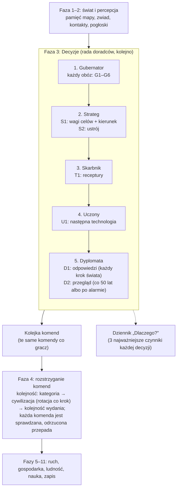

# Jak decyduje AI: pełny opis

Ten katalog opisuje **każdą decyzję**, którą podejmuje sztuczna inteligencja cywilizacji w CivSim 2: kiedy ją podejmuje,
na podstawie jakich danych, według jakiego wzoru, z jakimi progami i gdzie to jest w kodzie. Jest pisany dla Patryka:
żeby można było ocenić, czy mechanika nie jest za prosta albo za skomplikowana i bez sensu.

**Stan opisu:** etap 4d + zegar świata (ADR 0018) + wartości i priorytety (PR B, ADR 0019) + ziemia i migracje (PR C) + fachy, ludzie i demografia (cały etap 4F) + wojna z celem i pokój z warunkami (etap 4e PR 1) + epizody i pierwszy dowódca (etap 4e PR 2) + armie z wielu osad, uzbrojenie i zaopatrzenie (etap 4e PR 3) + bitwy w rundach (etap 4e PR 4) + dowódca, który rozgrywa bitwę w głowie i co miesiąc patrzy jeszcze raz (etap 4e PR 5) + strojenie wojny (etap 4e PR 6) + ustroje (etap 4f PR 1) + przywódcy (etap 4f PR 2) + stabilność (etap 4f PR 3) + bunty i secesja (etap 4f PR 4) + AI wobec państwa: przeciążenie, niepokoje, wybór ustroju i koniec pętli odwetu (etap 4f PR 5) + testy wsadowe (etap 4g) + poprawki po 100 grach: głód wiosek, wojny o łupy i ziemię, sojusze (gałąź `feat/ai-fixes`) + poprawki po 4-godzinnym biegu: wojna o odwet tylko w zasięgu, zasięg władzy i dryf osad (etap 5b, PR #63) + zegar gry na żywo: pulsy i takty (etap 6 PR 1, ADR 0025) + czas polityki (PR 2) + oddziały (PR 3a, 3b) + bitwa w czasie i wędrówka z zapamiętaną drogą (gałąź `feat/battle-time`, od commita `51bb3ef`) + dźwignie sternika: AI decyduje to, czego gracz nie wziął, a rozkaz gracza trzyma (etap 6 PR P1, ADR 0027, commit `80472dd`).
**Aktualizacja:** po każdym etapie, który zmienia AI (zasada w `CLAUDE.md`). Historia zmian jest na dole tej strony.

## Jak czytać

1. Zacznij od schematu niżej i od [katalogu decyzji](#katalog-wszystkich-decyzji).
2. [Wspólne mechanizmy](01-wspolne-mechanizmy.md): jak AI liczy ocenę, jak wybiera, czym jest charakter i waga celu. Bez tego reszta
   jest niezrozumiała, bo wszyscy doradcy liczą tak samo.
3. Doradcy, każdy w osobnym pliku: [Strateg](02-strateg.md), [Gubernator](03-gubernator.md), [Skarbnik](04-skarbnik.md),
   [Uczony](05-uczony.md), [Dyplomata](10-dyplomata.md), [Dowódca](11-dowodca.md) (od etapu 4e).
4. [Co AI wie](06-wiedza-i-relacje.md): pamięć mapy, kontakty, sympatia i zaufanie.
5. [Wszystkie liczby](07-parametry.md): każdy parametr z plikiem, wartością i decyzją, na którą wpływa. Także liczby zaszyte w kodzie.
6. [Ocena i uwagi](08-ocena-i-uwagi.md): co naprawdę działa, co jest tylko „na papierze”, gdzie AI jest za proste, a gdzie
   zbyt skomplikowane. **To najważniejsza strona do Twojej oceny.**
7. [Statystyki](09-statystyki.md): ile i jakich decyzji AI podejmuje w prawdziwych grach (3 seedy; od etapu 6: 30 minut gry przy ×1).
   [Testy wsadowe](12-testy-wsadowe.md): 100 gier AI kontra AI i co z nich wynika (etap 4g).
8. Plan zmian po uwagach Patryka (czas w latach, priorytety, migracje): [`docs/prompts/04-ai-czas-wartosci-migracje.md`](../prompts/04-ai-czas-wartosci-migracje.md).
   Zrobione: zegar (ADR 0018), wartości (PR B, ADR 0019), ziemia i migracje (PR C) i etap 4F (ludzie i fachy, ADR 0020). Następne: 4e (wojna).

Każda decyzja ma stały identyfikator (np. **G2**), którego używają wszystkie strony. Ścieżki do kodu mają postać
`plik:linia` dla commita podanego wyżej; linie mogą się przesunąć, nazwy metod zostają.

## Schemat jednego kroku świata z punktu widzenia AI

Od ADR 0018 każda cywilizacja ma **własny rytm** (krok o długości tury swojej ery, przypięty do kalendarza). W kroku świata rada
liczy decyzje proaktywne tylko cywilizacji, które mają swój krok, a reaktywne (alarmy, propozycje, wybór badania) wszystkich.
Szczegóły: [wspólne mechanizmy, pkt 7](01-wspolne-mechanizmy.md#7-rytm-cywilizacji-decyzje-proaktywne-i-reaktywne-adr-0018).

**Dźwignie sternika (ADR 0027, od etapu 6 PR P1).** Każda decyzja AI należy do jednej z pięciu dźwigni gracza (tabela w
[wspólnych mechanizmach, pkt 10](01-wspolne-mechanizmy.md#10-dźwignie-sternika-adr-0027)). AI decyduje dla każdej cywilizacji, także
prowadzonej przez gracza, wszystko poza dźwigniami, które gracz wziął. Receptury (T1) nie należą do żadnej dźwigni: liczy je zawsze AI.

AI **niczego nie zmienia samo**. Czyta stan gry i wydaje komendy, dokładnie takie, jakie wyda kiedyś gracz. Serwer sprawdza każdą
komendę (`Validate`) i dopiero wtedy ją wykonuje. Decyzje we własnym kroku widzą stan po poprzednim własnym kroku (np. „ile ludzie
zjedli” to wynik poprzedniego kroku tej cywilizacji).

## Katalog wszystkich decyzji

| Id | Kto | Decyzja | Komenda | Kiedy | Opis |
| --- | --- | --- | --- | --- | --- |
| **S1** | Strateg | wagi 6 celów i kierunek ekspansji | `SetStrategyCommand` | co 15 własnych kroków (rozłożone) i od razu po wejściu w nową erę | [02-strateg.md](02-strateg.md) |
| **S2** | Strateg | nowy ustrój, gdy pasuje do ludu wyraźnie lepiej (w niepokojach liczy się też stabilność) | `ChangeGovernmentCommand` | w przeglądzie S1 | [02-strateg.md](02-strateg.md#s2-wybór-ustroju) |
| **G1** | Gubernator | mały obóz (< 15 osób) dołącza do najbliższego własnego | `AbandonSettlementCommand` | własny krok na decyzje wolne | [03-gubernator.md#g1](03-gubernator.md#g1-mały-obóz-dołącza-do-innego) |
| **G2** | Gubernator | głodny lub zmarznięty obóz zmienia miejsce w zasięgu 10 pól: przenosi się, zajmuje pustą osadę albo wypędza słabszy obcy obóz | `MoveSettlementCommand`, `OccupySettlementCommand`, `ConquerSettlementCommand` | w każdym własnym kroku (gdy głoduje), inaczej co 3 własne kroki; od razu po napadzie | [03-gubernator.md#g2](03-gubernator.md#g2-przeniesienie-obozu-zajęcie-albo-wypędzenie) |
| **G3** | Gubernator | daleka wędrówka (11–40 pól), gdy w zasięgu nic nie ma | `JourneyCommand` | własny krok na decyzje wolne, po nieudanym G2 | [03-gubernator.md#g3](03-gubernator.md#g3-daleka-wędrówka) |
| **G4** | Gubernator | obóz z rolnikiem osiada jako wioska rolnicza, gdy jedzenie wioski (plon rolników + zbieractwo reszty) przewyższy zbieractwo (ekspansywni dłużej wędrują) | `SettleCommand` | własny krok na decyzje wolne | [03-gubernator.md#g4](03-gubernator.md#g4-osiedlenie-się-wioska) |
| **G5** | Gubernator | zatłoczony obóz wysyła 40% ludzi na nowe miejsce | `SplitSettlementCommand` albo `OccupySettlementCommand` | własny krok na decyzje wolne | [03-gubernator.md#g5](03-gubernator.md#g5-odłam-nowy-obóz) |
| **G6** | Gubernator | zabranie dóbr z porzuconej osady w pobliżu | `PlunderSettlementCommand` | własny krok na decyzje wolne | [03-gubernator.md#g6](03-gubernator.md#g6-zabranie-porzuconych-dóbr) |
| **G7** | Gubernator | wioska (pełna albo z wyjałowionymi polami) wysyła 60 osadników (najwyżej raz na 100 lat), którzy zakładają obóz; głodna wysyła co 20 lat tylu, ilu nie wyżywi, a mała głodna przenosi się do najedzonej własnej osady (po 4g) | `SplitSettlementCommand`, `AbandonSettlementCommand` | własny krok na decyzje wolne | [03-gubernator.md#g7](03-gubernator.md#g7-wioska-wysyła-osadników-od-pr-c) |
| **G8** | Gubernator | ciekawy i ekspansywny obóz wysyła 25% ludzi ku nieznanej ziemi | `SplitSettlementCommand` | własny krok na decyzje wolne | [03-gubernator.md#g8](03-gubernator.md#g8-wyprawa-w-nieznane-od-pr-c) |
| **T1** | Skarbnik | jaką recepturę robią rzemieślnicy osady | `SetRecipeCommand` | własny krok na decyzje wolne | [04-skarbnik.md](04-skarbnik.md) |
| **U1** | Uczony | jaką technologię badać: priorytet (co da tej cywilizacji) × przeszkoda kosztu | `SetResearchCommand` | gdy nic nie jest badane (reaktywnie, każdy krok świata) | [05-uczony.md](05-uczony.md) |
| **D1** | Dyplomata | przyjąć czy odrzucić propozycję umowy | `AnswerProposalCommand` | każdy krok świata (reaktywnie) | [10-dyplomata.md](10-dyplomata.md#d1-odpowiedź-na-propozycję-reaktywna) |
| **D2** | Dyplomata | jeden krok wobec spotkanych: handel, pakt o nieagresji, sojusz obronny, wojna o odwet, o łupy albo o ziemię (dwie ostatnie po 4g), pokój | `ProposeTreatyCommand`, `DeclareWarCommand` | co 50 lat we własnym kroku (rozłożone); od razu po wypowiedzianej wojnie albo napadzie; pokój także w każdym kroku świata między kampaniami, gdy strona jest zmęczona albo wynik pozwala żądać warunków (od 4e PR 2) | [10-dyplomata.md](10-dyplomata.md#d2-przegląd-stosunków-proaktywny) |
| **K1** | Dowódca | wysłać kampanię: armia z osady wyjścia i osad w pobliżu przeciw osadzie wroga (od 4e PR 2; wiele osad od PR 3) | `LaunchCampaignCommand` | własny krok i miesiąc po alarmie (wojna, napaść) | [11-dowodca.md](11-dowodca.md) |
| **K2** | Dowódca | odwołać kampanię: armia zawraca, gdy spodziewana bitwa jest przegrana albo jedzenie nie wystarczy na drogę (od 4e PR 5) | `RecallCampaignCommand` | co miesiąc kampanii | [11-dowodca.md](11-dowodca.md) |

**Własny krok na decyzje wolne:** własny krok cywilizacji, który zaczyna okres o długości kroku jej ery (`WorldClock.PlansNow`). Na
Ziemi to każdy własny krok (poza krótszym krokiem zaraz po zmianie ery); na planecie z porami roku na żywo krok jest krótszy, a
decyzje „wolne” zapadają raz na długość kroku ery (ADR 0013, ADR 0018).

Procesy, które **nie są decyzjami**, ale dostarczają AI danych (opisane w [06-wiedza-i-relacje.md](06-wiedza-i-relacje.md)):

| Id | Proces | Wpływa na decyzję |
| --- | --- | --- |
| **W1** | pamięć mapy: widzenie 6 pól, zwiadowcy (2 na stulecie, każdy 15 pól), pamięć 300 lat | G2, G3, G7, G8, S1 (AI wybiera tylko znane pola) |
| **W2** | ścieżka po znanym lądzie (wędrówka) | G3 |
| **R1** | pierwszy kontakt (zobaczenie, zetknięcie stref, napaść) | D1, D2 (dyplomacja tylko po kontakcie) |
| **R2** | pierwsze wrażenie z otwartości | G2 (wypędzenie), D1, D2 przez sympatię |
| **R3** | pamięć napaści (mściwość wydłuża) | G2, D1, D2 przez sympatię; powód wojny |
| **R4** | spór graniczny o zajętą osadę | G2, D1, D2 przez sympatię; powód wojny |
| **R6** | wspomnienia z dyplomacji: złamanie umowy, aktywny handel, wspólny wróg, pomoc w wojnie | G2, D1, D2 przez sympatię i zaufanie |
| **R5** | pogłoski o dalekich ludach | — (na razie tylko kronika) |
| **C1** | charakter: 8 cech losowanych raz na grę | prawie wszystkie decyzje (mnożnik i ostrożność) |

## Kogo dotyczy AI

- Każda żywa cywilizacja z kontrolerem `PlayerId.Ai` (dziś wszystkie, bo trybu gracza jeszcze nie ma).
- Gubernator zajmuje się głównie **obozami koczowniczymi** (poziom `mobile: true`). Wioska po osiedleniu ma od PR C jedną decyzję:
  wysłanie osadników (G7); nie przenosi się i nie łączy. Do tego receptury (T1) i badania całej cywilizacji (U1).
- Tylko Ziemia (świat 0) ma pełną obsługę; kod innych światów jest przygotowany, ale nieużywany.

## Granica: co jest decyzją AI, a co zwykłą zasadą gry

Te rzeczy dzieją się **automatycznie dla wszystkich** (także dla przyszłego gracza) i **nie są** decyzjami AI. Opisują je pliki
w `docs/systems/`:

- wzrost i śmierć ludności, przesuwanie się warstw (producenci, rzemieślnicy, wojownicy) — `population.md`;
- kto zbiera i ile, odrastanie dzikiej żywności — `population.md`, `influence-migration.md`;
- które pola uprawia wioska (zawsze najlepsze najpierw) — `farming.md`;
- podział towarów w sieci handlowej, kolejność zaspokajania potrzeb — `economy-trade.md`;
- ile punktów nauki powstaje i kiedy technologia jest odkryta — `research.md`;
- kierunek zwiadowcy (losowy) — `perception.md`;
- dokąd uciekają wypędzeni (najbliższe wolne pole albo własna osada) — `settlement-assets.md`;
- krok po kroku marsz w trakcie wędrówki — `perception.md`;
- wynik walki o obóz (los z szansą: siła atakujących / suma sił) — `settlement-assets.md`;
- opuszczanie pustych osad, ruiny — `settlement-assets.md`.

## Czego AI jeszcze nie ma (zaplanowane)

| Etap | Co dojdzie | Opis w GDD |
| --- | --- | --- |
| 4e | dowódca: wojny, armie; waga celu „podbój” zacznie zależeć od sytuacji | 8.1, 9.3 |
| 4f | frakcje, zmiana charakteru z doświadczeniem, sukcesja przywódców | 8.4 |
| później | plany wieloetapowe (GDD 8.6), mapy wpływów i zagrożeń (8.2), prognozy zasobów | 8.2, 8.6 |

## Historia zmian tego opisu

| Data | Etap | Co zmieniono |
| --- | --- | --- |
| 2026-11-06 | 4c | Pierwsza wersja: wszystkie decyzje etapów 3c–4c, parametry, uwagi, statystyki z 3 seedów. |
| 2026-11-06 | 4d | Dyplomata (D1, D2, wojna i pokój, sojusznicy), zakaz wypędzeń przez umowy i premia w wojnie (G2), wagi celów i cechy używane w dyplomacji, nowe parametry z `data/diplomacy.json`, nowe statystyki i wykres. |
| 2026-11-06 | zegar (ADR 0018) | Rytm każdej cywilizacji: decyzje proaktywne we własnym kroku, reaktywne (alarmy wojny i napadu, propozycje, wybór badania) w każdym kroku świata; nowe reakcje D2 i G2; odstępy AI w własnych krokach (`reviewEverySteps`, `searchEverySteps`, `minStepsBetweenMoves`); zwiad, widzenie i pogłoski w własnym kroku; nowe statystyki, wykres rytmów i ludności przed/po. |
| 2026-11-06 | wartości (PR B, ADR 0019) | Uczony od nowa (priorytet z położenia, braków i charakteru, koszt jako przeszkoda łagodzona ciekawością); skarbnik: cele towarów, koordynacja sieci, koniec przełączania „praca ↔ brak”, premia za handel; strateg: wagi nauki i wpływu; „zostać” z połową wagi ekspansji; obce obozy i wojownicy tylko z pól widzianych teraz; 11 liczb z kodu do `data/ai.json` (sekcja `scholar`); test martwych wartości; nowe statystyki z 3 seedów, wykresy decyzji i „przed/po”. |
| 2026-11-06 | ziemia i migracje (PR C) | Gubernator wycenia ziemię z technologiami zbierania cywilizacji, rybacy liczą wodę; G4 osiedlenie dla prawdziwej liczby producentów i w porównaniu ze zbieractwem i ekspansywnością (`settleOverGatheringPercent`); nowe decyzje G7 (wioska wysyła osadników) i G8 (wyprawa w nieznane); osadnicy omijają strefy własnych osad; zwiad i marsz na stulecie (`data/perception.json`); nowe parametry w `data/ai.json`; punkty 4, 5, 6 i 8 oceny zamknięte, nowy punkt 10 (wydajność); statystyki z 3 seedów, wykres ziemi i migracji, wykres decyzji z G7 i G8. |
| 2026-11-07 | ustroje (etap 4f, PR 1) | Ustrój z `data/governments.json` (rada starszych, wodzostwo; despotia i republika miejska od brązu) przechyla wagi celów stratega (S1), przesuwa ostrożność w wyborze opcji (wszyscy doradcy), zmienia tempo przeglądów stratega i dyplomaty i opóźnia decyzje państwowe: armie wypowiadającego wojnę ruszają po `enactYears` (K1), w czasie zmiany ustroju bez wypowiedzeń (D2). Nowe parametry w `07-parametry.md`, ocena i pętla odwetu w `08` (pkt 14), statystyki i wykres decyzji z 3 seedów. |
| 2026-11-07 | strojenie wojny (etap 4e, PR 6) | K1: dowódca liczy jedzenie okolicy (osady do 12 pól od domu i od celu) na całą wyprawę. D1/D2: nowy czynnik „wynik wojny” (krzywa `warScore`: przegrywający chce pokoju), `peaceOpinion` przy −100 daje 0,5, odrzucony pokój wraca po roku (`peaceRetryYears`). Reguły zaopatrzenia: tragarze z osady z największym zapasem, szybsi i wcześniej, armia przy zbiórce je w domu. Statystyki i długi przebieg w `09-statystyki.md`. |
| 2026-11-07 | dowódca (etap 4e, PR 5) | K1: spodziewana bitwa bez losowania (25 bitew w głowie, `Battles.Expect`) z tego, co widać, próg szansy 60% i strat 50%, jedzenie na marsz poza zasięgiem tragarzy tam i z powrotem; nowa decyzja K2: odwołanie kampanii co miesiąc (szansa poniżej 45% albo brak jedzenia na drogę); armia atakuje miesiąc po dojściu do celu; nowe czynniki `expected losses`, `cells beyond supply`; sekcja `commander` w `data/ai.json` (próg szansy i jedzenia przeniesione z `war.json`); sytuacja wojny w `DeadValueTests`. Statystyki w `09-statystyki.md`. |
| 2026-11-07 | bitwy w rundach (etap 4e, PR 4) | Dowódca (K1) liczy szansę z premią terenu celu; na miejscu armia liczy ją jeszcze raz z rzeką i głodem. Bitwa sama jest regułą systemu (nie decyzją AI). Statystyki bitew w `09-statystyki.md`. |
| 2026-11-07 | armie, uzbrojenie, zaopatrzenie (etap 4e, PR 3) | Dowódca (K1) zbiera armię z osad do 6 pól (do 50 wojowników), liczy siłę z uzbrojeniem obu stron i nie wysyła armii bez jedzenia na co najmniej miesiąc (nowy czynnik „food months”, tylko zapis). Statystyki kampanii i wykres w `09-statystyki.md`. |
| 2026-11-07 | epizody i kampanie (etap 4e, PR 2) | Nowy doradca: dowódca (K1) wysyła kampanie (szansa z tego, co widzi, próg 60%; cel niewidoczny: idą zobaczyć i zawracają przed silniejszym). Dyplomata myśli o pokoju w każdym kroku świata między kampaniami (zmęczenie ≥ 60 albo wynik ≥ 20). Alarmy dają krok świata po miesiącu (reakcje szybciej). Zmęczenie z miesięcy kampanii, nie z lat. Parametry dowódcy chwilowo w `data/war.json` (do `ai.json` w PR 5). |
| 2026-11-07 | wojna z celem (etap 4e, PR 1) | Dyplomata: cel wojny (ziemia przy roszczeniu, inaczej odwet), zmęczenie wojną (lata + straty, `data/war.json`) zamiast lat wojny w ocenie pokoju, nowy czynnik „warunki pokoju”, pokój proponowany z warunkami (osada, okup, biały) i przy zmęczeniu ≥ 60 w każdym kroku; agresja jako powód wojny. Nowe parametry w `07-parametry.md`, statystyki wojen w `09-statystyki.md`, nowy wykres decyzji. |
| 2026-11-06 | koniec etapu 4F (PR 5) | Bez zmian w decyzjach AI. Statystyki z 3 seedów po całym etapie 4F (obozy przenoszą się 5–9 razy rzadziej przy wolniejszym przyroście), nowy wykres decyzji, sekcja „Demografia” w statystykach; graf technologii i fachów z danych: `docs/systems/graf-technologii.md`. |
| 2026-11-06 | demografia (etap 4F, PR 4) | Bez zmian w decyzjach AI i w `data/ai.json`. Ludzie rosną wolniej (+1,0‰ na rok na start), więc po kilku turach rzadziej są obce odłamy: w teście martwych wartości sytuacja „wypędzenie” dostaje w razie potrzeby małą placówkę sąsiada i stary uraz (sympatia −5000). |
| 2026-11-06 | ludzie (etap 4F, PR 3) | U1: uczony wybiera tylko technologie, dla których cywilizacja ma ludzi (`requiresPeople`), i wybiera od nowa, gdy ich ubyło; warstwy myślicieli i przywódców; nauka głównie od myślicieli; statystyki badań z 3 seedów i wykres. |
| 2026-11-06 | fachy (etap 4F, PR 2) | G4: osiedlenie wymaga rolnika, liczy rolników, których wioska wyuczy (50% producentów), i zbieractwo pozostałych producentów; skarbnik widzi recepturę tylko z jej fachowcami (`Demand.Runs`); wiedza AI o ziemi liczy dobra technologii bez pokrycia fachowcami (uwaga w ocenie); nowe statystyki z 3 seedów. |
| 2026-11-07 | przywódcy (etap 4f, PR 2) | Cechy przywódcy przesuwają charakter, który czytają wszyscy doradcy (`CivilizationState.Trait` = cecha ludu + przesunięcie przywódcy; ustrój na starcie liczy się z cech samego ludu), rada starszych wybiera pasującego kandydata; nowe parametry z `data/leaders.json` i `data/governments.json`; ocena pkt 15, statystyki z 3 seedów, nowy wykres. |
| 2026-11-07 | stabilność (etap 4f, PR 3) | Bez nowych decyzji AI. D2: przez 2 lata bezkrólewia po zmianie ustroju bez wypowiedzeń wojny; niepokoje (stabilność poniżej 30) obniżają wydajność osad, więc i zapasy w ocenach. Nowe parametry z `data/stability.json` i pola ustroju w `07`, ocena pkt 16 (AI jeszcze nie reaguje na stabilność), statystyki i wykres stabilności z 3 seedów, nowy wykres decyzji. |
| 2026-11-07 | bunty i secesja (etap 4f, PR 4) | Bez nowych decyzji AI. D2: secesja to nowy powód wojny o odwet (`HasGrievance`), wspomnienie „secesja” w relacjach (06); nowe ludy w trakcie gry dostają charakter rodzica ±0,15, inny ustrój, kopię technologii, mapy i kontaktów (wszyscy doradcy działają dla nich od następnego kroku). Parametry buntów w `07`, ocena pkt 17, statystyki z 3 seedów, nowy wykres decyzji. |
| 2026-11-07 | AI wobec państwa (etap 4f, PR 5) | Nowa decyzja **S2** (strateg wybiera ustrój: dopasowanie cech, w niepokojach premia stabilności, histereza 30%, 200 lat spokoju po zmianie). S1: przeciążona administracja obniża wagę ekspansji (do 50%), niepokoje podnoszą bezpieczeństwo × 1,5. D2: w niepokojach wojna × 0,5, w bezkrólewiu bez wojen; pokój zamyka rachunek krzywd (`Relation.SettledMonth`, koniec pętli odwetu, ocena pkt 14). Nowe czynniki *stability*, *administration*, *suitability*; 6 nowych parametrów w `ai.json`; nowa sytuacja w `DeadValueTests`; statystyki z 3 seedów, wykres decyzji i stabilności. |
| 2026-11-07 | testy wsadowe (etap 4g) | Bez zmian decyzji AI. Nowy tryb `--batch` w Headless i raport ze 100 gier ([12-testy-wsadowe.md](12-testy-wsadowe.md)): wojny się kończą, dyplomacja i upadki działają; za proste: wioski głodują bez reakcji (G7 nie patrzy na głód), nikt nie wypowiada wojny o łupy, żadna osada nie zmienia właściciela na wojnie, sojusze rzadko działają. Ocena w `08` (pkt 18). |
| 2026-11-07 | poprawki po 100 grach (etap 4g) | G7: głodna wioska (< 70%) wysyła osadników co 20 lat, tylu, ilu nie wyżywi; mała głodna wioska (< 60 osób) przenosi się do najedzonej własnej osady. D2: wojny z chciwości bez powodu: o łupy (głód, widziane spichlerze, przewaga) i o ziemię (widziana wioska, którą armia zdobędzie z szansą ≥ 75%, waga ekspansji); nigdy nie łamią umowy. Pakt i sojusz: krzywa zagrożenia od 0,8, zaufanie do sojuszu od 0,5, wspólny wróg w pełni. Nowe czynniki *loot*, *expansion*; 2 nowe parametry w `ai.json`, 4 nowe krzywe w `diplomacy.json`; sytuacja „głodne wioski” w `DeadValueTests`. Porównanie 100 gier w `12-testy-wsadowe.md` (głodujące wioski 21 zamiast 322 na grę, podboje w 19 grach, łupy w 81, sojusze 4 na grę), statystyki z 3 seedów w `09`. |
| 2026-11-08 | poprawki po 4-godzinnym biegu (etap 5b) | D2: wojna o odwet wymaga sąsiada w zasięgu `reachCells` (16 pól), jak wojna o łupy; na kontynentach (seed 7) wojen o odwet 178 zamiast 336. Wokół AI: zasięg władzy ustroju (`reach` w `governments.json`) i dryf dalekich osad (`driftPerMillePerYear` w `stability.json`) dają ok. 40 małych ludów zamiast 11 dużych; własna ziemia band łowców; stolice. Ocena pkt 19, statystyki z 3 seedów i nowy wykres decyzji w `09`. |
| 2026-11-09 | zegar gry na żywo (etap 6 PR 1, ADR 0025) | Bez zmian wzorów decyzji. Kiedy: decyzje proaktywne w **pulsie** cywilizacji (co 30 taktów = 3 s przy ×1, każda cywilizacja w innym takcie; puls liczy tyle lat co dawny własny krok), reaktywne (alarmy, propozycje, wybór badania) w następnym takcie. Dowódca: kampania robi krok co miesiąc akcji (5 taktów), gotowość wojny i cicha wojna w taktach (`ReadyTick`, `QuietSince`), więc wojna nie zatrzymuje świata. Odstępy w latach licznika (przegląd dyplomaty co 50 lat, krzywdy, rozejmy) są teraz bardzo krótkie w czasie rzeczywistym: do strojenia w PR 2 (ocena pkt 20). Statystyki z 3 seedów w `09`. |
| 2026-11-09 | czas polityki (etap 6 PR 2) | Decyzja Patryka: czasy wojny, dyplomacji i polityki w **latach akcji** (rok = 6 s przy ×1). D2: przegląd planowy raz na 50 lat akcji (5 min; rada 7,5 min, wódz 3,75 min) zamiast co ok. 6 s; ponowienie propozycji po 20 latach akcji (było 100 lat); rozejm 20 lat akcji (było 100). S2: nowy ustrój trzymany 20 lat akcji (było 200 lat). Pamięć krzywd skrócona 5 razy (napad 30–60, secesja 40–80 lat akcji). Nowa sytuacja „czas polityki” w `DeadValueTests`. Skutek (3 seedy, 30 min): umów i sojuszy ok. 4–15 razy mniej, wojen 1–3 razy mniej (ocena pkt 20, statystyki w `09`). |
| 2026-11-09 | oddziały (etap 6 PR 3a) | Odłamy obozów (G3) i osadnicy wiosek (G7) wychodzą jako **oddziały osadników** (`docs/systems/units.md`): idą do celu w taktach i zakładają obóz na miejscu; wzory decyzji bez zmian. Usunięta reguła „mała głodna wioska przenosi się do innej osady” (decyzja Patryka: wioska zostaje do końca). Zwiad to widoczne oddziały zamiast wypraw w pulsie. Nowa sytuacja „pełne wioski” w `DeadValueTests` (okres osadników). AI nie wydaje jeszcze rozkazów oddziałom w drodze (`MoveUnitCommand` i reszta są dla gracza; AI: PR 3b). |
| 2026-11-09 | armie jako oddziały (etap 6 PR 3b) | K1: czas marszu z drogi A* armii (jej rodzaj i teren) zamiast 3 pól na miesiąc; osady, których wojownicy odpoczywają po kampanii (`war.json` `restMonths`), nie wychodzą i nie dołączają. K2: potrzeba jedzenia z prędkości rodzaju armii; pobitej, uciekającej armii nie da się odwołać. Wartości wojny na miesiąc przeskalowane do wolniejszego marszu (`war.json`). Wzory ocen bez zmian. |
| 2026-11-09 | bitwa w czasie i wędrówka z zapamiętaną drogą (etap 6, po PR 3b) | Bez zmian wzorów decyzji. K2: armii w bitwie (nowa faza kampanii `Battle`, runda co sekundę) nie da się odwołać; dowódca decyduje do pierwszej rundy. G3 (wędrówka obozu): droga liczona raz na cel i zapamiętana zamiast przy każdym polu; obóz mija pola zajęte po drodze. Statystyki z 3 seedów i nowy wykres decyzji w `09` (wojen 16 / 25 / 10, kampanii 13 / 36 / 14; przebieg wojen jest inny, bo bitwa trwa). |
| 2026-11-13 | dźwignie sternika (etap 6 PR P1, ADR 0027) | Wzory decyzji bez zmian. Doradcy liczą teraz także cywilizacje prowadzone przez gracza (wcześniej je pomijali, więc lud gracza stał), a `Advisor.Issue` nie wydaje komend z dźwigni, które gracz wziął (`Levers.Of(AiAction)`: 1 G1–G4, G7, G8, zwiad; 2 S1, U1; 4 G5–G6 napaści, D1–D2, K1–K2; 5 S2; T1 bez dźwigni). Gracz, który nie bierze żadnej dźwigni, gra tę samą partię co AI (ten sam hasz, test `LeverTests`). Statystyki bez zmian (gry bez gracza mają ten sam hasz). |
| 2026-11-13 | rozkaz gracza trzyma (etap 6 PR P1, pytanie Patryka) | Nowy parametr `playerOrderHoldYears` (10 lat akcji). AI nie wydaje komend na osadę, której gracz wydał rozkaz (przeprowadzka, odłam, połączenie, napaść, zadanie), ani na obóz założony przez osadników gracza przez ten czas, ani na dom grupy roboczej gracza, dopóki grupa jest w terenie; dowódca nie odwołuje kampanii skierowanej przez gracza, a dyplomata nie proponuje i nie przyjmuje pokoju z jej wrogiem, dopóki trwa. Komendy AI z tego samego taktu są odrzucane przy rozstrzyganiu. Nowa sytuacja „rozkaz gracza” na końcu `DeadValueTests`. Gry bez gracza: ten sam hasz. |
| 2026-11-13 | komendy każdej dźwigni (etap 6 PR P1, część 2) | Wzory bez zmian. Dyplomata (D1, D2) nie proponuje ludowi X, nie odpowiada mu i nie wypowiada mu wojny przez `playerOrderHoldYears` po decyzji gracza wobec X (`Relation.PlayerOrderTick`); komendy AI z tego samego taktu są odrzucane. Zwiadowcy gracza po „idź” wracają do domu sami (bez tego osada nie wysyłała następnych). Gry bez gracza: ten sam hasz (7, 23, 42 po 3000 taktach: `DDEDC8D18A727E6B`, `1795958B85572F72`, `0EB32AEE98E9BAE7`, identyczne z `development`), więc statystyki z 3 seedów bez zmian. |
