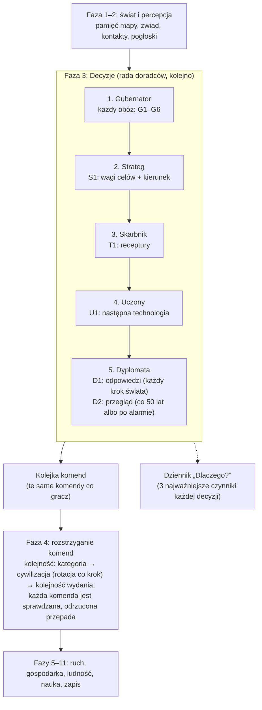

# Jak decyduje AI: pełny opis

Ten katalog opisuje **każdą decyzję**, którą podejmuje sztuczna inteligencja cywilizacji w CivSim 2: kiedy ją podejmuje,
na podstawie jakich danych, według jakiego wzoru, z jakimi progami i gdzie to jest w kodzie. Jest pisany dla Patryka:
żeby można było ocenić, czy mechanika nie jest za prosta albo za skomplikowana i bez sensu.

**Stan opisu:** etap 4d + zegar świata (ADR 0018, gałąź `feat/world-clock`, commit `be7e645`). Dowódca i armie (4e) jeszcze nie istnieją.
**Aktualizacja:** po każdym etapie, który zmienia AI (zasada w `CLAUDE.md`). Historia zmian jest na dole tej strony.

## Jak czytać

1. Zacznij od schematu niżej i od [katalogu decyzji](#katalog-wszystkich-decyzji).
2. [Wspólne mechanizmy](01-wspolne-mechanizmy.md): jak AI liczy ocenę, jak wybiera, czym jest charakter i waga celu. Bez tego reszta
   jest niezrozumiała, bo wszyscy doradcy liczą tak samo.
3. Doradcy, każdy w osobnym pliku: [Strateg](02-strateg.md), [Gubernator](03-gubernator.md), [Skarbnik](04-skarbnik.md),
   [Uczony](05-uczony.md), [Dyplomata](10-dyplomata.md).
4. [Co AI wie](06-wiedza-i-relacje.md): pamięć mapy, kontakty, sympatia i zaufanie.
5. [Wszystkie liczby](07-parametry.md): każdy parametr z plikiem, wartością i decyzją, na którą wpływa. Także liczby zaszyte w kodzie.
6. [Ocena i uwagi](08-ocena-i-uwagi.md): co naprawdę działa, co jest tylko „na papierze”, gdzie AI jest za proste, a gdzie
   zbyt skomplikowane. **To najważniejsza strona do Twojej oceny.**
7. [Statystyki](09-statystyki.md): ile i jakich decyzji AI podejmuje w prawdziwych grach (3 seedy po 1000 tur).
8. Plan zmian po uwagach Patryka (czas w latach, priorytety, migracje): [`docs/prompts/04-ai-czas-wartosci-migracje.md`](../prompts/04-ai-czas-wartosci-migracje.md).

Każda decyzja ma stały identyfikator (np. **G2**), którego używają wszystkie strony. Ścieżki do kodu mają postać
`plik:linia` dla commita podanego wyżej; linie mogą się przesunąć, nazwy metod zostają.

## Schemat jednego kroku świata z punktu widzenia AI

Od ADR 0018 każda cywilizacja ma **własny rytm** (krok o długości tury swojej ery, przypięty do kalendarza). W kroku świata rada
liczy decyzje proaktywne tylko cywilizacji, które mają swój krok, a reaktywne (alarmy, propozycje, wybór badania) wszystkich.
Szczegóły: [wspólne mechanizmy, pkt 7](01-wspolne-mechanizmy.md#7-rytm-cywilizacji-decyzje-proaktywne-i-reaktywne-adr-0018).

AI **niczego nie zmienia samo**. Czyta stan gry i wydaje komendy, dokładnie takie, jakie wyda kiedyś gracz. Serwer sprawdza każdą
komendę (`Validate`) i dopiero wtedy ją wykonuje. Decyzje we własnym kroku widzą stan po poprzednim własnym kroku (np. „ile ludzie
zjedli” to wynik poprzedniego kroku tej cywilizacji).

## Katalog wszystkich decyzji

| Id | Kto | Decyzja | Komenda | Kiedy | Opis |
| --- | --- | --- | --- | --- | --- |
| **S1** | Strateg | wagi 6 celów i kierunek ekspansji | `SetStrategyCommand` | co 15 własnych kroków (rozłożone) i od razu po wejściu w nową erę | [02-strateg.md](02-strateg.md) |
| **G1** | Gubernator | mały obóz (< 15 osób) dołącza do najbliższego własnego | `AbandonSettlementCommand` | własny krok na decyzje wolne | [03-gubernator.md#g1](03-gubernator.md#g1-mały-obóz-dołącza-do-innego) |
| **G2** | Gubernator | głodny lub zmarznięty obóz zmienia miejsce w zasięgu 10 pól: przenosi się, zajmuje pustą osadę albo wypędza słabszy obcy obóz | `MoveSettlementCommand`, `OccupySettlementCommand`, `ConquerSettlementCommand` | w każdym własnym kroku (gdy głoduje), inaczej co 3 własne kroki; od razu po napadzie | [03-gubernator.md#g2](03-gubernator.md#g2-przeniesienie-obozu-zajęcie-albo-wypędzenie) |
| **G3** | Gubernator | daleka wędrówka (11–40 pól), gdy w zasięgu nic nie ma | `JourneyCommand` | własny krok na decyzje wolne, po nieudanym G2 | [03-gubernator.md#g3](03-gubernator.md#g3-daleka-wędrówka) |
| **G4** | Gubernator | obóz osiada jako wioska rolnicza | `SettleCommand` | własny krok na decyzje wolne | [03-gubernator.md#g4](03-gubernator.md#g4-osiedlenie-się-wioska) |
| **G5** | Gubernator | zatłoczony obóz wysyła 40% ludzi na nowe miejsce | `SplitSettlementCommand` albo `OccupySettlementCommand` | własny krok na decyzje wolne | [03-gubernator.md#g5](03-gubernator.md#g5-odłam-nowy-obóz) |
| **G6** | Gubernator | zabranie dóbr z porzuconej osady w pobliżu | `PlunderSettlementCommand` | własny krok na decyzje wolne | [03-gubernator.md#g6](03-gubernator.md#g6-zabranie-porzuconych-dóbr) |
| **T1** | Skarbnik | jaką recepturę robią rzemieślnicy osady | `SetRecipeCommand` | własny krok na decyzje wolne | [04-skarbnik.md](04-skarbnik.md) |
| **U1** | Uczony | jaką technologię badać | `SetResearchCommand` | gdy nic nie jest badane (reaktywnie, każdy krok świata) | [05-uczony.md](05-uczony.md) |
| **D1** | Dyplomata | przyjąć czy odrzucić propozycję umowy | `AnswerProposalCommand` | każdy krok świata (reaktywnie) | [10-dyplomata.md](10-dyplomata.md#d1-odpowiedź-na-propozycję-reaktywna) |
| **D2** | Dyplomata | jeden krok wobec spotkanych: handel, pakt o nieagresji, sojusz obronny, wojna, pokój | `ProposeTreatyCommand`, `DeclareWarCommand` | co 50 lat we własnym kroku (rozłożone); od razu po wypowiedzianej wojnie albo napadzie | [10-dyplomata.md](10-dyplomata.md#d2-przegląd-stosunków-proaktywny) |

**Własny krok na decyzje wolne:** własny krok cywilizacji, który zaczyna okres o długości kroku jej ery (`WorldClock.PlansNow`). Na
Ziemi to każdy własny krok (poza krótszym krokiem zaraz po zmianie ery); na planecie z porami roku na żywo krok jest krótszy, a
decyzje „wolne” zapadają raz na długość kroku ery (ADR 0013, ADR 0018).

Procesy, które **nie są decyzjami**, ale dostarczają AI danych (opisane w [06-wiedza-i-relacje.md](06-wiedza-i-relacje.md)):

| Id | Proces | Wpływa na decyzję |
| --- | --- | --- |
| **W1** | pamięć mapy: widzenie 6 pól, zwiadowca 15 pól, pamięć 300 lat | G2, G3, S1 (AI wybiera tylko znane pola) |
| **W2** | ścieżka po znanym lądzie (wędrówka) | G3 |
| **R1** | pierwszy kontakt (zobaczenie, zetknięcie stref, napaść) | D1, D2 (dyplomacja tylko po kontakcie) |
| **R2** | pierwsze wrażenie z otwartości | G2 (wypędzenie), D1, D2 przez sympatię |
| **R3** | pamięć napaści (mściwość wydłuża) | G2, D1, D2 przez sympatię; powód wojny |
| **R4** | spór graniczny o zajętą osadę | G2, D1, D2 przez sympatię; powód wojny |
| **R6** | wspomnienia z dyplomacji: złamanie umowy, aktywny handel, wspólny wróg, pomoc w wojnie | G2, D1, D2 przez sympatię i zaufanie |
| **R5** | pogłoski o dalekich ludach | — (na razie tylko kronika) |
| **C1** | charakter: 8 cech losowanych raz na grę | prawie wszystkie decyzje (mnożnik i ostrożność) |

## Kogo dotyczy AI

- Każda żywa cywilizacja z kontrolerem `PlayerId.Ai` (dziś wszystkie, bo trybu gracza jeszcze nie ma).
- Gubernator zajmuje się **tylko obozami koczowniczymi** (poziom `mobile: true`). Wioska po osiedleniu nie dostaje już żadnej
  decyzji gubernatora (nie przenosi się, nie dzieli, nie łączy). Zostają jej tylko receptury (T1) i badania całej cywilizacji (U1).
- Tylko Ziemia (świat 0) ma pełną obsługę; kod innych światów jest przygotowany, ale nieużywany.

## Granica: co jest decyzją AI, a co zwykłą zasadą gry

Te rzeczy dzieją się **automatycznie dla wszystkich** (także dla przyszłego gracza) i **nie są** decyzjami AI. Opisują je pliki
w `docs/systems/`:

- wzrost i śmierć ludności, przesuwanie się warstw (producenci, rzemieślnicy, wojownicy) — `population.md`;
- kto zbiera i ile, odrastanie dzikiej żywności — `population.md`, `influence-migration.md`;
- które pola uprawia wioska (zawsze najlepsze najpierw) — `farming.md`;
- podział towarów w sieci handlowej, kolejność zaspokajania potrzeb — `economy-trade.md`;
- ile punktów nauki powstaje i kiedy technologia jest odkryta — `research.md`;
- kierunek zwiadowcy (losowy) — `perception.md`;
- dokąd uciekają wypędzeni (najbliższe wolne pole albo własna osada) — `settlement-assets.md`;
- krok po kroku marsz w trakcie wędrówki — `perception.md`;
- wynik walki o obóz (los z szansą: siła atakujących / suma sił) — `settlement-assets.md`;
- opuszczanie pustych osad, ruiny — `settlement-assets.md`.

## Czego AI jeszcze nie ma (zaplanowane)

| Etap | Co dojdzie | Opis w GDD |
| --- | --- | --- |
| 4e | dowódca: wojny, armie; waga celu „podbój” zacznie zależeć od sytuacji | 8.1, 9.3 |
| 4f | frakcje, zmiana charakteru z doświadczeniem, sukcesja przywódców | 8.4 |
| później | plany wieloetapowe (GDD 8.6), mapy wpływów i zagrożeń (8.2), prognozy zasobów | 8.2, 8.6 |

## Historia zmian tego opisu

| Data | Etap | Co zmieniono |
| --- | --- | --- |
| 2026-11-06 | 4c | Pierwsza wersja: wszystkie decyzje etapów 3c–4c, parametry, uwagi, statystyki z 3 seedów. |
| 2026-11-06 | 4d | Dyplomata (D1, D2, wojna i pokój, sojusznicy), zakaz wypędzeń przez umowy i premia w wojnie (G2), wagi celów i cechy używane w dyplomacji, nowe parametry z `data/diplomacy.json`, nowe statystyki i wykres. |
| 2026-11-06 | zegar (ADR 0018) | Rytm każdej cywilizacji: decyzje proaktywne we własnym kroku, reaktywne (alarmy wojny i napadu, propozycje, wybór badania) w każdym kroku świata; nowe reakcje D2 i G2; odstępy AI w własnych krokach (`reviewEverySteps`, `searchEverySteps`, `minStepsBetweenMoves`); zwiad, widzenie i pogłoski w własnym kroku; nowe statystyki, wykres rytmów i ludności przed/po. |
