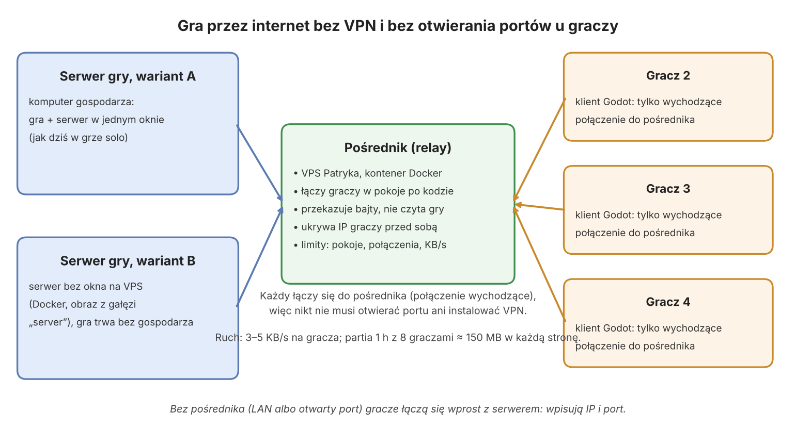

# Multiplayer przez sieć: plan

**Stan:** plan w trakcie uzgadniania z Patrykiem. Runda pytań 1 zamknięta (2026-11-25), runda 2 otwarta (rozdz. 15).
Kodu jeszcze nie zmieniamy; Patryk chce co najmniej dwóch kolejnych rund pytań przed budową.
Podstawa: kod `development` z 2026-11-25 (`645f2b0`), ADR 0008, 0010, 0028, `docs/projekt-gry.md` (rozdz. 2 i 9), `docs/known-issues.md`.
Pomysły na później (m.in. kooperacja jednym ludem): `docs/multiplayer/pomysly-na-przyszlosc.md`.

## 1. Decyzje Patryka (runda 1, 2026-11-25)

| # | Pytanie | Decyzja |
| --- | --- | --- |
| P1 | Ilu ludzi? | **2–8 ludzi.** Liczbę ludów (ludzie + AI) ustala się przy zakładaniu serwera. Najpierw dobry plan konfiguracji serwera (rozdz. 6). |
| P2 | Jak się łączyć? | **Bez VPN i bez Steam/EOS.** Wpisanie IP i portu serwera albo IP i portu **pośrednika** (relay). Pośrednik na VPS Patryka w Dockerze (rozdz. 4); konfiguracja pośrednika na sam koniec. **Gałąź serwerowa** z samym kodem serwera, aktualizowana z każdą wersją gry, z CI (rozdz. 8). |
| P3 | Rywalizacja czy kooperacja? | **Każdy swój lud.** Kooperacja jednym ludem kiedyś jako dodatkowy tryb (zapisane w `pomysly-na-przyszlosc.md`). |
| P4 | Prędkość? | **×1 albo ×2.** Gospodarz widzi informację, że ×2 jest trudniejsze. Zmiana prędkości w trakcie wymaga **głosowania i zgody większości**. Pauzy: 3 na gracza, po 30 s inni mogą przerwać. |
| P5 | Rozłączony gracz? | Jego lud od razu przejmuje AI; po powrocie gracz go odzyskuje. |
| P6 | Gracz, którego lud upadł? | **Widzi całą mapę.** Gra to „1 na wszystkich”; sojusze pomagają, ale odpadnięcie to sprawa gracza. |
| P7 | Kiedy? | **Osobny wątek, równolegle** z poprawianiem gry. Najpierw stabilna pętla rozgrywki (ok. 45 min do średniowiecza), potem nowe treści (zarządca itd.). |
| — | Docelowo | **Hostowanie gry ma być możliwe na VPS** (serwer bez okna, rozdz. 5). |

## 2. Pomiary (2026-11-25, kod `development`)

Osobny program w chmurze: serwer gry (`PlayHost`) i 1–8 klientów w pamięci, prędkość ×1; liczone bajty dokładnie tak, jak poszłyby przez sieć.

**Ruch na gracza**

| Partia | Start (jednorazowo) | Potem | Po kompresji (Brotli) |
| --- | --- | --- | --- |
| Nowa gra, 1. minuta | 99 KB | 3,6 KB/s | 2,1 KB/s |
| Scenariusz `02_bronze_age_empire` | 1,1 MB | 4,9 KB/s | 2,6 KB/s |
| Scenariusz `04_middle_ages` | 1,1 MB | 5,2 KB/s | 2,8 KB/s |

**Procesor i pamięć serwera** (cały proces, 40 s gry ×1, razem z liczeniem pomiaru)

| Partia | Klienci | Procesor | Pamięć |
| --- | --- | --- | --- |
| Nowa gra, 8 ludów | 1 | 3,4 s na 40 s (ok. 9% jednego rdzenia) | 109 MB |
| Nowa gra, 8 ludów | 8 | 3,5 s na 40 s (ok. 9%) | 214 MB |
| `04_middle_ages` | 1 | 3,5 s na 40 s | 125 MB |
| `04_middle_ages` | 4 | 3,5 s na 40 s | 201 MB |

Wnioski: widok dla kolejnego gracza prawie nie kosztuje procesora; pamięć rośnie o ok. 15–25 MB na gracza (bufory widoku).
Jedna partia zmieści się na najmniejszym VPS (1 rdzeń, 1–2 GB). Pośrednik przy 8 graczach przenosi ok. 40 KB/s w każdą stronę,
czyli ok. 150 MB w każdą stronę na godzinę partii. Do sprawdzenia w MP1: późna gra (90+ minut) z 8 ludami i najgorszy takt.

## 3. Architektura (bez zmian po rundzie 1)

- **Serwer autorytatywny:** tylko serwer liczy grę, sprawdza każdy rozkaz i wysyła każdemu graczowi widok przez jego mgłę wojny
  (ADR 0008; tak działa już gra solo). Nie ma rozjazdów stanu i nie da się podejrzeć mapy innych.
- **Gdzie działa serwer:**
  - **A. U gospodarza** (gra + serwer w jednym oknie, jak dziś solo);
  - **B. Na VPS** jako program bez okna w Dockerze (docelowo). Gra trwa, gdy gospodarz wyjdzie, a gospodarz nie ma przewagi
    (w wariancie A proces gospodarza zna cały stan gry).
- **Połączenie:** TCP z czystego .NET (`System.Net.Sockets`), ramka = 4 bajty długości + dzisiejsza ramka (wersja protokołu + MessagePack).
  Nowa klasa `TcpConnection` za istniejącym `IConnection`. Duże wiadomości (kawałki mapy) kompresowane Brotli.
- **Trzy sposoby dołączenia** (gracz wybiera w menu):
  1. **IP i port serwera** (LAN, serwer na VPS, otwarty port u gospodarza);
  2. **IP i port pośrednika + kod pokoju** (internet bez otwierania portów; rozdz. 4);
  3. (później) lista serwerów na pośredniku.

## 4. Pośrednik (relay) na VPS

### Tylko „zapoznanie” czy przekazywanie całego ruchu?

Patryk zaproponował pośrednika tylko do nawiązania połączenia. Tak działa tzw. *hole punching*: pośrednik podaje graczom swoje adresy,
a oni próbują połączyć się wprost. Ograniczenia:

- działa dobrze tylko dla UDP; dla TCP jest zawodne (zależy od routera);
- nie działa przy „symetrycznym” NAT i CGNAT (częste u operatorów komórkowych i części dostawców): wtedy i tak potrzebne jest przekazywanie;
- każdy gracz widzi IP gospodarza (a gospodarz IP wszystkich), więc łatwiej o atak na domowe łącze.

Dlatego **rekomendacja: pośrednik przekazuje cały ruch.** Kosztuje to mało (pomiar wyżej), działa zawsze i ukrywa adresy graczy.
Bezpośrednie połączenie po „zapoznaniu” można dodać później jako oszczędność, z przekazywaniem jako zapasem (tak robi np. Steam).

### Jak działa

1. Serwer gry (u gospodarza albo na VPS) łączy się do pośrednika i zakłada **pokój**; dostaje **kod** (np. `K7M-4QD`).
2. Gospodarz podaje kod znajomym. Gracz wpisuje adres pośrednika i kod.
3. Pośrednik łączy gracza z serwerem pokoju i od tej chwili tylko przekazuje bajty w obie strony. **Nie czyta gry** (nie dekoduje wiadomości),
   więc nie musi być aktualizowany z każdą wersją gry, a błąd w protokole gry go nie dotyczy.
4. Pokój znika, gdy serwer się rozłączy.

### Wdrożenie na VPS Patryka

- Osobny mały program .NET (`CivSim.Relay`), obraz Docker z gałęzi serwerowej, jeden port TCP (np. 7700).
- Plik konfiguracji albo zmienne środowiskowe: port, najwięcej pokoi, najwięcej połączeń z jednego IP, limit KB/s na pokój,
  czas bezczynności do zamknięcia, opcjonalne hasło do zakładania pokoi (żeby obcy nie robili sobie pokoi na Twoim VPS).
- Docker: osobna sieć od drugiej aplikacji, użytkownik bez uprawnień roota, system plików tylko do odczytu, limit pamięci (np. 128 MB) i procesora.
- Szyfrowanie TLS (rozdz. 9), jeśli VPS ma domenę.
- Instrukcja krok po kroku po polsku w `docs/multiplayer/vps.md` (powstanie w MP6).

## 5. Serwer na VPS (docelowo)

- Program bez okna: `CivSim.Server` + nowy punkt startu (np. `CivSim.DedicatedServer` albo `CivSim.Headless --serve`), bez Godota.
- Obraz Docker z gałęzi serwerowej; uruchomienie np. `docker compose up -d`.
- Konfiguracja w `server.json` (rozdz. 6) albo w zmiennych środowiskowych; zapisy w katalogu podpiętym z zewnątrz (volume).
- **Administrator:** hasło administratora w konfiguracji; gracz, który je poda w lobby, zarządza partią (start, wyrzucenie gracza, zapis, koniec).
- Konsola serwera: lista graczy, zapis, wyrzucenie, zatrzymanie; dziennik do pliku (bez adresów IP, rozdz. 9).
- Może sam połączyć się z pośrednikiem (kod pokoju), albo przyjmować graczy wprost na swój port.
- Jeden proces = jedna partia; kilka partii = kilka kontenerów.

## 6. Konfiguracja serwera (plan ustawień)

Te same ustawienia w menu „Załóż grę” (wariant A) i w `server.json` (wariant B). Kto może zmienić: **G** gospodarz/administrator w lobby,
**P** tylko w pliku przed startem serwera.

| Grupa | Ustawienie | Domyślnie | Zakres | Kto |
| --- | --- | --- | --- | --- |
| Serwer | Nazwa partii | „CivSim game” | tekst do 32 znaków | G |
| | Hasło do partii | brak | tekst | G |
| | Hasło administratora (VPS) | brak | tekst | P |
| | Port | 7777 | 1024–65535 | P / G przed startem |
| | Pośrednik: adres, port, hasło | puste (bez pośrednika) | — | P / G |
| | Autozapis | co 5 min | 0 (wył.) – 30 min | G |
| Gracze | Miejsca dla ludzi | 2 | 2–8 | G |
| | Ludy razem (ludzie + AI) | 4 | liczba ludzi – 8 (więcej po pomiarach) | G |
| | Puste miejsca przy starcie | prowadzi AI | AI / lud nie powstaje | G (pytanie R2-6) |
| | Dołączanie w trakcie | tylko powrót na swój lud | — | pytanie R2-5 |
| Gra | Cel partii | pierwszy w średniowieczu | jak w grze solo | G |
| | Prędkość startowa | ×1 | ×1, ×2 (×2 z ostrzeżeniem „trudniej”) | G; w grze tylko głosowanie |
| | Pauzy na gracza | 3 | 0–10 | G |
| | Czas na wybór startu | 30 s | 15–60 s | G |
| | Rudy | sprawiedliwe | jak w grze solo | G |
| Świat | Seed, rozmiar, ląd, morze | jak w grze solo | jak w grze solo | G |
| | **Zaawansowane ustawienia świata** (rozdz. 7) | zwinięte, „jak preset” | — | G |

W lobby gracze widzą wszystkie ustawienia (tylko do odczytu), a przy zmianie ustawienia wszystkim kasuje się „Gotowy”.

## 7. Zaawansowane ustawienia świata

**Gdzie są dziś:** w nowym menu (od `88a9be4`, „Save and load the game; a new start menu”) zostały tylko: seed, rozmiar mapy, ląd
(kontynenty / jeden ląd / wyspy), morze, liczba ludów, cel, rudy, wybór startu, samouczek. Zaawansowane ustawienia ze starego menu
**zniknęły z menu**, ale **generator świata nadal je obsługuje** (`WorldGenOptions` w `CivSim.Core/WorldGen`): nowa gra przekazuje mu
dziś tylko ląd i morze. Stare pola przeżyły jedynie jako parametry wiersza poleceń starego podglądu (`ViewerSettings`, legacy).

| Ustawienie ze starego menu | Generator dziś | Uwagi |
| --- | --- | --- |
| Wilgotność (suchy / normalny / wilgotny) | tak | |
| Wilgotność w głębi lądu (sucha / normalna / wilgotna) | tak | |
| Rzeźba (płaska / normalna / górzysta) | tak | |
| Złoża (skąpe / normalne / bogate) | tak | dziś nowa gra ma też własne „Rudy: sprawiedliwe / realistyczne” |
| Preset planety (Ziemia, Mars, Uran…) | tak | presety są w `data/planets.json` (plik legacy): trzeba je przenieść do `data/sim/` |
| Nachylenie osi, mimośród, jasność gwiazdy, odległość, rok, światło, CO₂, ciśnienie, wulkanizm, zmienność gwiazdy | tak (klimat przy generacji) | nowa gra ma własne pory roku; te liczby zmienią mapę (biomy, temperatura), ale nie długość zimy w grze |

**Plan (osobny mały PR „W1”, niezależny od multiplayera):** w „New game” zwijana sekcja **„Advanced world settings”** (domyślnie
zamknięta) z polami jak w starym menu, w dwóch poziomach: najpierw wilgotność, głąb lądu, rzeźba, złoża, preset planety;
niżej „Planet and star” z liczbami fizyki. `PlayOptions` i zapis gry dostają te pola; ta sama sekcja trafia do „Załóż grę”
i do `server.json`. Podgląd mapy (jak w starym menu) do decyzji w rundzie 2.

## 8. Gałąź serwerowa i CI

**Cel:** na GitHubie gałąź `server` z samym tym, czego potrzebuje serwer i pośrednik, aktualizowana razem z każdą wersją gry, z CI.

- **Zawartość:** `src/CivSim.Core`, `src/CivSim.Sim`, `src/CivSim.Protocol`, `src/CivSim.Server`, nowy punkt startu serwera,
  `src/CivSim.Relay`, `data/sim/`, testy serwera, `Dockerfile`, `docker-compose.yml`, `server.example.json`, krótki `README.md`.
  Bez `game/`, `art/`, `audio/`, legacy i dokumentów gry.
- **Aktualizacja:** gdy Patryk wydaje wersję gry (np. tag `v0.3` na `main` albo `development`), workflow kopiuje te pliki na gałąź `server`
  jednym commitem „Server for v0.3” i taguje go `server-v0.3`. Ręcznie nikt tam nie pisze.
- **CI na gałęzi `server`:** build, testy serwera, test „dwóch klientów przez sieć”, budowa obrazów Docker serwera i pośrednika,
  publikacja w GitHub Container Registry (`ghcr.io/costellar/civsim2-server:v0.3`). VPS pobiera gotowy obraz zamiast budować.
- **Koszt:** repo jest **publiczne**, a dla publicznych repozytoriów GitHub Actions na zwykłych maszynach i publiczne obrazy w GHCR są
  darmowe. Ograniczenie minut z 2026-11-04 dotyczy repozytoriów prywatnych (do potwierdzenia przez Patryka: R2-9).
- **Zgodność wersji:** serwer i klient sprawdzają przy połączeniu wersję protokołu, wersję gry i skrót danych `data/sim`; gracz z inną
  wersją dostaje czytelny komunikat („Serwer ma wersję v0.3, Ty v0.2”).
- **Dokumentacja:** opis gałęzi w `docs/multiplayer/serwer.md` i zasada w `CLAUDE.md` („nie commituj ręcznie na `server`”) w PR, który ją tworzy.

## 9. Bezpieczeństwo (research)

### Czego uczą inne gry

- Komputer gracza atakuje się przez dane, które jego gra **odczytuje z sieci**. Przykłady: w grach na silniku Source atakujący wysyłał
  zaproszenie albo prowadził własny serwer i przez błąd w odczycie danych uruchamiał swój kod u gracza (CVE-2021-30481, zaproszenia Steam;
  wcześniej exploit z animacją zabójstwa w TF2/CS). Check Point znalazł podobne błędy w bibliotece sieciowej Valve (2020).
  Wszystkie dotyczyły kodu w C++, gdzie błąd w odczycie daje dostęp do pamięci.
- Biblioteka MessagePack dla C#, której używamy, miała własne podatności: zalewanie kolizjami haszy (CVE-2024-48924, naprawione w 3.0.214),
  obejście blokady typów w trybie *Typeless* (CVE-2026-48517) i ogromne bufory przy dekompresji LZ4 (CVE-2026-48510), obie naprawione w 3.1.7.
  **Mamy 3.1.12** i tryb `UntrustedData`; nie używamy *Typeless* ani LZ4.

### Jak chronimy komputery graczy

| Zasada | Co to daje | Stan |
| --- | --- | --- |
| Kod gry w C# (.NET), nie C++ | błąd w odczycie daje wyjątek, a nie przejęcie pamięci | jest |
| MessagePack w trybie `UntrustedData`, aktualna wersja, bez *Typeless* i LZ4 | znane ataki na bibliotekę nie działają | jest; pilnować przy aktualizacjach (Dependabot w CI gałęzi `server`) |
| Limit rozmiaru ramki (np. 4 MB) **przed** przydzieleniem pamięci, limit po dekompresji | wiadomość nie zapcha pamięci | MP1 |
| Z sieci przychodzą tylko dane gry: nigdy kod, skrypty, mody, pliki ani ścieżki | serwer nie może niczego zainstalować ani nadpisać u gracza | zasada w CLAUDE.md (MP1) |
| Żadnych zasobów Godota z sieci (`bytes_to_var` z obiektami, `.tres`, `.tscn`) | zasoby Godota mogą zawierać skrypty | zasada w CLAUDE.md |
| Czat i nazwy jako zwykły tekst (bez BBCode i linków) | nikt nie wstawi linku ani obrazu do okna gry | MP4 |
| Klient sprawdza identyfikatory z widoku (zły numer nie wyłącza gry) | złośliwy serwer nie zawiesi klienta | MP1–MP4 (testy z losowymi danymi) |
| Gracze łączą się tylko „na zewnątrz” do pośrednika albo serwera | żadnych otwartych portów u graczy; adres IP gospodarza ukryty przez pośrednika | MP6 |
| Gra pobierana tylko z GitHub Releases, z sumą kontrolną | nikt nie podsunie podrobionej wersji | przy wydaniu |

### Jak chronimy serwer i pośrednika

- **Serwer sprawdza każdy rozkaz** (już jest: `SimGame.Apply`) i wysyła tylko to, co lud widzi (mgła na serwerze).
- **Błąd jednego klienta nie zatrzymuje gry.** Dziś wyjątek przy obsłudze rozkazu kończy wątek gry dla wszystkich (`PlayHost.Run`
  łapie wyjątek i staje). W multiplayerze: wyjątek przy wiadomości klienta = odrzucenie tej wiadomości (i ew. rozłączenie klienta), gra idzie dalej.
- Limity: rozkazów na sekundę na gracza (np. 30), wiadomości czatu, połączeń z jednego IP, czasu na przywitanie (np. 5 s), rozmiaru ramki.
- Hasło partii i hasło administratora; wyrzucenie gracza; porównanie haseł odporne na pomiar czasu.
- Pośrednik nie dekoduje gry, ma limity pokoi i transferu, kody pokoi z kryptograficznego generatora (poza symulacją, więc wolno),
  osobna sieć Docker, bez roota, tylko do odczytu, zaktualizowany obraz bazowy z CI.
- **Szyfrowanie TLS** (`SslStream` w .NET) do pośrednika i serwera na VPS: chroni hasła i czat przed podsłuchem w kawiarnianym Wi-Fi.
  Wymaga domeny wskazującej na VPS i certyfikatu Let's Encrypt (darmowy). Bez domeny: połączenie bez TLS albo certyfikat
  własny „przypięty” w grze.
- **Prywatność:** brak kont; dziennik bez adresów IP albo z krótkim terminem (w UE adres IP to dane osobowe).

### Oszustwa

- Podglądanie mapy innych: niemożliwe (klient nie dostaje pełnego stanu).
- Przyspieszanie gry, edycja zasobów: niemożliwe (liczy tylko serwer).
- Gospodarz w wariancie A ma pełny stan w swoim procesie i mógłby go podejrzeć: uczciwe partie na serwerze na VPS (wariant B).

## 10. Optymalizacja serwera (research + plan)

Co już mamy (i co robią gry RTS z serwerem autorytatywnym): **widok przez mgłę** (gracz dostaje tylko swoje okolice, tzw. *interest management*),
**różnice zamiast całości** (`PlayHost.Diff` wysyła tylko zmienione budynki, osady i jednostki), **stały rytm** (takt 100 ms,
widok co 100 ms, pełny widok co 250 ms) i **pomijanie spóźnionego klienta** (`Backlog`).

Do zrobienia:

| Pomysł | Po co | Kiedy |
| --- | --- | --- |
| Kompresja Brotli dużych wiadomości (kawałki mapy) | start partii 1,1 MB → ok. 125 KB | MP1 |
| Pomiar w serwerze: czas taktu (średni, 99. percentyl, najgorszy), czas widoku na gracza, bajty na gracza; zapis do dziennika co minutę | wiemy, kiedy VPS jest za mały | MP1 |
| Kompilacja z góry (ReadyToRun) obrazu serwera | mniej skoków przy pierwszych taktach (znane z pomiarów `--sim-report`) | MP6 |
| Mały obraz .NET (`runtime:10.0-noble-chiseled`), limit pamięci GC w kontenerze | serwer zajmuje ok. 150–250 MB i nie zabiera pamięci drugiej aplikacji | MP6 |
| Rzadszy widok dla graczy z wolnym łączem (np. co 200 ms) | płynna gra przy słabym internecie | MP4, jeśli potrzeba |
| Widoki dla graczy liczone równolegle | dopiero gdy pomiar pokaże, że to wąskie gardło (dziś nie: 8 graczy ≈ 1 gracz) | później |

## 11. Prędkość, pauzy, głosowanie

- Przy zakładaniu: ×1 albo ×2; przy ×2 napis „Gra na ×2 jest trudniejsza: mniej czasu na decyzje”.
- W grze: każdy gracz może zaproponować zmianę prędkości; okienko głosowania
  u wszystkich ludzi, którzy jeszcze grają, 20 s; zmiana, gdy **ponad połowa** głosujących zagłosuje „tak”; nie głosujący = „nie”.
  Ten sam gracz może zaproponować zmianę raz na 2 minuty. Widzowie (upadłe ludy) nie głosują.
- Pauzy: 3 na gracza; po 30 s każdy inny gracz może pauzę przerwać (już w kodzie, `PlayHost.SetSpeed`). Spowolnienie przy bitwie
  działa tylko w grze solo (już tak jest).

## 12. Co w kodzie zakłada dziś jednego gracza

| # | Gdzie | Co jest dziś | Co trzeba |
| --- | --- | --- | --- |
| 1 | `PlayHost.Receive` / `Pump` | Rozłączony gracz znika, ale jego lud zostaje „ludzki” i nikt go nie prowadzi (znany problem 19). | AI przejmuje lud; powrót oddaje go graczowi. |
| 2 | `PlayHost.Run` | Wyjątek przy rozkazie jednego gracza zatrzymuje grę dla wszystkich. | Odrzucić wiadomość, ew. rozłączyć klienta. |
| 3 | `PlayHost.Advance` | Kronika tylko dla ludu 0. | Każdy gracz dostaje swoją. |
| 4 | `PlaySaves`, `Replay` | Zapis zna tylko ludy ludzi w chwili zapisu (znany problem 11). | Dołączenie, wyjście, przejęcie przez AI jako komenda z taktem. |
| 5 | `PlayHost.Create` | Wybór startu czeka bez limitu. | W multiplayerze limit z ustawień (30 s). |
| 6 | `Receive` (`HelloMessage`) | „Następny wolny lud”, bez imienia gracza, bez hasła. | Miejsca z lobby, imię, kolor, hasło, klucz powrotu. |
| 7 | `SetSpeed` | Prędkość ustawia ostatni pytający, także Max. | ×1/×2, głosowanie (rozdz. 11). |
| 8 | `Receive` (debug) | Klawisze debug ma gospodarz. | Wyłączone w multiplayerze. |
| 9 | `HelloMessage` | Tylko wersja protokołu. | Też wersja gry i skrót danych. |
| 10 | Klient (`PlayGame.cs`) | Zawsze sam uruchamia serwer. | Tryb „dołącz”: samo połączenie. |
| 11 | `Save` | Nazwa i era od ludu 0, zapisać może każdy. | Zapis robi gospodarz/administrator; w zapisie gracze. |
| 12 | `SimGame.Create`, menu | Zaawansowane ustawienia świata nieprzekazywane. | PR W1 (rozdz. 7). |

## 13. Plan prac (PR-y)

| PR | Co | Jak sprawdzić |
| --- | --- | --- |
| **W1. Zaawansowane ustawienia świata** (niezależny) | Zwijana sekcja „Advanced world settings” w „New game”, pola w `PlayOptions` i zapisie, presety planet w `data/sim/`. | Zrzuty menu; te same mapy dla tych samych ustawień (test). |
| **MP1. Połączenie i serwer bez okna** | `TcpConnection`, nasłuch, limity ramek, Brotli, pomiary w serwerze; punkt startu serwera bez okna; bot `--join`. | Test: dwóch klientów przez sieć lokalną, ten sam hasz co w pamięci; pomiar późnej gry z 8 ludami. |
| **MP2. Serwer dla kilku ludzi** | Punkty 1–9 z rozdz. 12, limity rozkazów, hasło. | Testy: rozłącz/wróć, wyjątek klienta nie zatrzymuje gry, wczytanie partii z dołączeniem daje ten sam hasz. |
| **MP3. Konfiguracja i lobby** | Ustawienia z rozdz. 6, lobby (miejsca, gotowość, czat, ustawienia tylko do odczytu), menu „Multiplayer: Załóż / Dołącz (IP i port)”. | Zrzuty z dwóch okien; **pierwsza partia przez LAN albo otwarty port.** |
| **MP4. Gra z ludźmi** | Lista graczy z pingiem, czat, głosowanie o prędkość, pauzy widoczne dla wszystkich, odpowiedzi na propozycje innego gracza, widz po upadku (cała mapa). | Scenariusz z dwoma botami; zrzuty. |
| **MP5. Zapis i wczytanie** | Zapis u gospodarza/administratora, wczytanie do lobby, powrót na swoje miejsca. | Zapis po 10 min z 2 graczami, wczytanie, ten sam hasz. |
| **MP6. Pośrednik, Docker, gałąź `server`** | `CivSim.Relay`, kody pokoi, TLS, obrazy Docker, workflow gałęzi `server` z CI i GHCR, instrukcja VPS po polsku. | Partia Patryka ze znajomym przez pośrednika na VPS; pomiar pingu i ruchu. |

Po rundach pytań: ADR 0031 („Multiplayer: serwer autorytatywny, TCP, pośrednik, serwer na VPS”) i wiersze w `ROADMAP.md`.

## 14. Ryzyka

| Ryzyko | Co robimy |
| --- | --- |
| Późna gra z 8 ludami może być cięższa niż zmierzone 9% rdzenia. | Pomiar w MP1 przed obietnicą „najmniejszy VPS wystarczy”. |
| Gospodarz w wariancie A wychodzi = koniec partii. | Autozapis; wariant B na VPS. |
| Pośrednik jest jednym punktem awarii i kosztem transferu VPS. | Limity transferu; połączenie wprost jako zapas; sprawdzić limit transferu u dostawcy VPS. |
| Długie wczytywanie dużej partii (zapis = lista rozkazów). | Pomiar w MP5; w razie potrzeby migawka stanu co N minut. |
| Różne wersje gry u graczy. | Wersja gry + skrót danych przy dołączeniu; gałąź `server` z tagami wersji. |
| Druga aplikacja na VPS. | Osobna sieć Docker, limity pamięci i procesora, bez roota. |

## 15. Runda 2: pytania do Patryka (z rekomendacją)

| # | Pytanie | Rekomendacja |
| --- | --- | --- |
| R2-1 | Pośrednik przekazuje cały ruch czy tylko „zapoznaje” graczy? | **Cały ruch** (działa zawsze, ukrywa IP; ok. 150 MB w każdą stronę na godzinę partii z 8 graczami). Połączenie wprost później jako oszczędność. |
| R2-2 | Czy VPS ma domenę (do darmowego certyfikatu TLS)? Jaki ma limit transferu i ile wolnej pamięci? | Z domeną: TLS z Let's Encrypt. Bez domeny: certyfikat własny przypięty w grze. |
| R2-3 | Kto może zakładać pokoje na pośredniku? | **Każdy, kto zna hasło pośrednika** (wpisane w grze raz); bez hasła obcy mogliby korzystać z Twojego VPS. |
| R2-4 | Kto zarządza partią na serwerze VPS? | **Hasło administratora w `server.json`**; administrator w lobby startuje partię, wyrzuca graczy, zapisuje. |
| R2-5 | Czy nowy gracz może dołączyć do trwającej partii (przejąć lud AI)? | **Nie**, tylko powrót na swój lud. Nowi gracze tylko w lobby (uczciwiej i prościej). |
| R2-6 | Wolne miejsca dla ludzi przy starcie: prowadzi je AI czy te ludy nie powstają? | **Prowadzi AI** (liczba ludów jest ustalona w konfiguracji). |
| R2-7 | Zaawansowane ustawienia świata: wszystkie ze starego menu (z fizyką gwiazdy), czy tylko wilgotność, głąb lądu, rzeźba, złoża i preset planety? Z podglądem mapy? | **Wszystkie, w dwóch poziomach** (rozdz. 7); podgląd mapy później. Robię to jako osobny PR W1, także dla gry solo. |
| R2-8 | Co jest „wersją gry” dla gałęzi `server`? | **Tag `vX.Y`**, który zakładasz przy wydaniu paczki gry; workflow sam aktualizuje `server` i obrazy Docker. |
| R2-9 | Repo jest publiczne, więc GitHub Actions jest za darmo. Czy włączamy też CI na `development` (testy przy każdym PR)? | **Tak**, krótkie testy (kilka sekund) przy każdym PR; długie pomiary dalej lokalnie. |
| R2-10 | Czat: do wszystkich, do jednego ludu, do sojuszników? | **Do wszystkich i do jednego ludu** (sojusznicy później). |
| R2-11 | Głosowanie o prędkość: ponad połowa grających, 20 s, nie głosujący = „nie”? | **Tak** (rozdz. 11). |
| R2-12 | Ludy razem przy 8 ludziach: do 8 (jak dziś) czy więcej (np. 12 na dużej mapie)? | **Do 8 teraz**, 12 po pomiarze późnej gry w MP1. |

## Źródła (research 2026-11-25)

- Source engine RCE przez zaproszenia Steam (CVE-2021-30481): https://secret.club/2021/04/20/source-engine-rce-invite.html
- Exploit przez animację zabójstwa (Source): https://www.pcgamer.com/hackers-hijacked-pcs-using-source-engine-kill-animation-exploit
- Check Point: podatności w bibliotece sieciowej Steam (2020): https://research.checkpoint.com/2020/game-on-finding-vulnerabilities-in-valves-steam-sockets/
- Bezpieczeństwo gier sieciowych (Black Hat EU 2013): https://media.blackhat.com/eu-13/briefings/Ferrante/bh-eu-13-multiplayer-online-games-ferrante-wp.pdf
- Granica klient–serwer (Roblox): https://create.roblox.com/docs/scripting/security/client-server-boundary.md
- MessagePack CVE-2026-48517: https://advisories.gitlab.com/nuget/messagepack/CVE-2026-48517/
- MessagePack CVE-2026-48510: https://advisories.gitlab.com/nuget/messagepack/CVE-2026-48510/
- MessagePack CVE-2024-48924: https://osv.dev/vulnerability/CVE-2024-48924
- Pośrednik Steam Datagram Relay (jak działa przekazywanie z ukrywaniem IP): https://partner.steamgames.com/doc/features/multiplayer/steamdatagramrelay
- Pośrednik dla gier (otwarte źródła, przykład): https://github.com/RoccoDevs/RoccoRelayServer
- RTS: przepustowość przy 1000 jednostek: https://www.construct.net/en/blogs/ashleys-blog-2/rts-devlog-units-bandwidth-1603
- Architektura MMORTS: https://www.gamedeveloper.com/programming/-i-massively-multiplayer-game-development-2-i-architecture-and-techniques-for-an-mmorts
