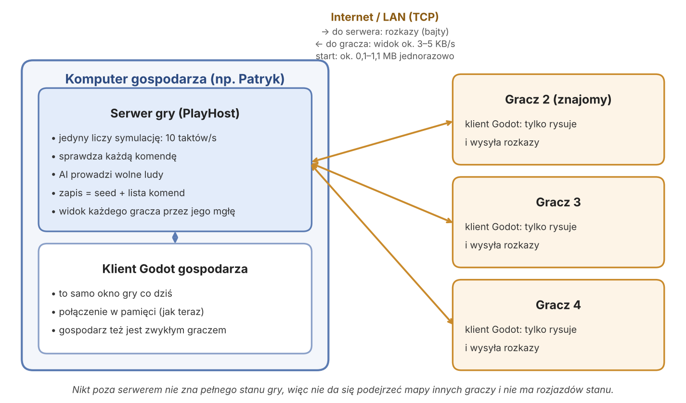

# Multiplayer przez sieć: plan

**Stan:** propozycja do decyzji Patryka, 2026-11-25. Tylko plan; kodu jeszcze nie zmieniamy.
Podstawa: kod `development` z 2026-11-25 (`b78ba9b`), ADR 0008, 0010, 0028, `docs/projekt-gry.md` (rozdz. 2 i 9), `docs/known-issues.md`.

## 1. W skrócie

- **Gra jest już przygotowana na multiplayer w ok. 70%.** Od początku działa jako klient i serwer (ADR 0008): serwer (`PlayHost`)
  jako jedyny liczy symulację, sprawdza każdą komendę i wysyła każdemu graczowi widok przez jego mgłę wojny. Serwer już dziś
  przyjmuje kilku klientów naraz, daje każdemu wolny lud i ma zasady pauz z projektu gry (3 pauzy, ochrona 30 s).
- **Brakuje:** połączenia przez sieć (dziś tylko „w pamięci”), lobby, obsługi rozłączeń i powrotów, zapisu partii wieloosobowej
  i kilku poprawek w serwerze, które dziś zakładają jednego gracza (lista w rozdz. 4).
- **Rekomendacja:** zostajemy przy **serwerze autorytatywnym**; gospodarz gra i jednocześnie jest serwerem w swoim procesie
  (tzw. listen server). Połączenie **TCP** z czystego .NET, bez dodatkowych bibliotek. Granie przez internet na start **za darmo**:
  przekierowanie portu u gospodarza albo darmowa sieć typu Tailscale/ZeroTier. Serwer w chmurze dopiero, gdy będzie potrzebny.
- **Ruch sieciowy jest mały** (pomiar niżej): ok. 3–5 KB/s na gracza, więc gospodarz na zwykłym domowym łączu obsłuży 4–8 graczy.
- **Plan prac:** 6 kroków (PR-y MP1–MP6), pierwsza partia ze znajomym po MP3 (lobby), pełna wersja po MP6.

## 2. Pomiar: ile danych idzie przez sieć

Bieg z 2026-11-25: serwer na tym kodzie, dwóch graczy, prędkość ×1, 60 s; liczone bajty dokładnie tak, jak poszłyby przez sieć
(te same ramki MessagePack co dziś w pamięci). „Po kompresji” to Brotli na każdą wiadomość osobno.

| Partia | Start (jednorazowo) | Potem, na gracza | Po kompresji |
| --- | --- | --- | --- |
| Nowa gra, 1. minuta | 99 KB | 3,6 KB/s | 2,1 KB/s |
| Scenariusz `02_bronze_age_empire` | 1,1 MB | 4,9 KB/s | 2,6 KB/s |
| Scenariusz `04_middle_ages` (duże ludy) | 1,1 MB | 5,2 KB/s | 2,8 KB/s |

Co to znaczy: 8 graczy × 5 KB/s = 40 KB/s wysyłania u gospodarza (ok. 0,3 Mb/s). Każde domowe łącze to udźwignie. Start partii
to głównie kawałki mapy (1 MB w scenariuszach z odkrytą mapą); po kompresji ok. 125 KB.

## 3. Możliwe architektury

| | **A. Serwer autorytatywny** (rekomendacja) | **B. Lockstep** (jak Age of Empires) | **C. Wbudowany multiplayer Godota** |
| --- | --- | --- | --- |
| Kto liczy grę | tylko serwer | każdy komputer to samo | serwer w Godocie |
| Co idzie przez sieć | rozkazy do serwera, widok do gracza (3–5 KB/s) | tylko rozkazy (bajty) | zależy |
| Podglądanie mapy innych | **niemożliwe** (klient nie ma pełnego stanu) | łatwe (każdy ma cały stan) | jak A |
| Rozjazd stanu (desync) | **nie istnieje** (jeden stan) | trzeba wykrywać i naprawiać; trudne | jak A |
| Wpływ słabego komputera | tylko gospodarz musi liczyć grę | najwolniejszy komputer spowalnia wszystkich | jak A |
| Co już mamy | prawie wszystko (ADR 0008) | determinizm tak, reszta od zera | nic; serwer musiałby działać w Godocie |
| Wada | gospodarz liczy grę i widoki dla wszystkich | pełny stan u każdego, przebudowa klienta | wiąże symulację z silnikiem (zakaz z CLAUDE.md) |

**Wybór: A.** Mamy go już zbudowanego, chroni mgłę wojny i nie ma rozjazdów. Determinizm i tak zostaje: służy do zapisów (zapis =
seed + lista rozkazów) i do testów.

### Gdzie działa serwer

| Wariant | Koszt | Uwagi |
| --- | --- | --- |
| **1. Gospodarz = serwer** (listen server, rekomendacja na start) | 0 zł | Gospodarz gra w tym samym oknie co dziś. Gdy wyjdzie, partia się kończy (można ją wczytać z zapisu). |
| 2. Serwer bez okna na komputerze gracza (`CivSim.Headless --serve`) | 0 zł | Ten sam serwer, bez Godota; przydatny do testów i długich partii. Robi się prawie sam po wariancie 1. |
| 3. Serwer w chmurze (VPS z Linuksem) | ok. 15–25 zł/mies. (np. Hetzner), albo darmowe Oracle Cloud Free Tier | Gra trwa, gdy gospodarz wyjdzie; nie trzeba przekierowywać portów. Dopiero gdy będzie potrzebny. |

### Jak połączyć się przez internet bez kosztów

Komputer gracza musi „dojść” do komputera gospodarza. Kolejno od najprostszego:

1. **LAN** (ta sama sieć domowa): działa od razu, wpisuje się adres IP gospodarza.
2. **Tailscale albo ZeroTier** (darmowe dla małych grup): każdy instaluje program, loguje się, a komputery widzą się jak w jednej
   sieci domowej. Zero pracy w kodzie, działa nawet przy dostawcach bez publicznego IP (CGNAT, częste u operatorów komórkowych).
3. **Przekierowanie portu** na routerze gospodarza (np. 7777 TCP); opcjonalnie gra ustawi je sama przez UPnP. Nie zadziała
   przy CGNAT.
4. Później, jeśli gra trafi do ludzi spoza grona znajomych: pośrednik (relay) — Steam (jednorazowo 100 USD za wydanie gry na Steamie,
   daje lobby, zaproszenia i pośrednika za darmo) albo Epic Online Services (darmowe, więcej pracy), albo własny pośrednik na VPS.

**Rekomendacja:** 1 + 2 + 3 na start (koszt 0 zł), 4 dopiero przy wydaniu gry.

### Technologia połączenia

- **TCP z czystego .NET** (`System.Net.Sockets`): bez nowych bibliotek, działa po stronie serwera bez Godota (zasada z CLAUDE.md).
  Każda ramka: 4 bajty długości + ta sama ramka co dziś (wersja protokołu + MessagePack). Nowa klasa `TcpConnection` implementuje
  istniejący `IConnection`, więc serwer i klient prawie się nie zmieniają.
- Dlaczego nie UDP: gra wysyła rozkazy i widoki co 100 ms, nie celuje co klatkę; TCP wystarcza i jest prostsze. Gdyby kiedyś było
  trzeba, LiteNetLib (UDP) da się podpiąć za tym samym `IConnection`.
- Kompresja (Brotli) dużych wiadomości, np. kawałków mapy: start partii 1,1 MB → ok. 125 KB.

### Opóźnienie

Rozkaz trafia do serwera w ok. połowie pingu, wchodzi w najbliższym takcie (co 100 ms), a widok wraca co 100 ms. Przy pingu 50 ms
gracz widzi skutek po ok. 150–250 ms. W tej grze (rozkazy dla oddziałów i budów, nie celowanie) to w porządku; Age of Empires
działał z 200–500 ms. Klient może od razu rysować znacznik rozkazu (np. cel marszu), zanim przyjdzie widok.

## 4. Co w kodzie zakłada dziś jednego gracza

Znalezione przy czytaniu `PlayHost.cs` i `SimGame`; każde to mała zmiana w MP2.

| # | Gdzie | Co jest dziś | Co trzeba |
| --- | --- | --- | --- |
| 1 | `PlayHost.Receive` / `Pump` | Rozłączony gracz znika z listy, ale jego lud zostaje „ludzki” (`IsAi = false`) i **nikt go nie prowadzi**. | AI przejmuje lud (CLAUDE.md: „rozłączoną cywilizację przejmuje AI”); powrót gracza oddaje mu lud. |
| 2 | `PlayHost.Advance` | Wiadomości kroniki trafiają tylko do ludu 0. | Każdy gracz dostaje swoje. |
| 3 | `PlaySaves`, `Replay` | Zapis zna tylko listę ludzkich ludów w chwili zapisu (znany problem 11). Przejęcie przez AI zmienia przebieg gry, więc wczytanie dałoby inną partię. | Dołączenie, wyjście i przejęcie przez AI zapisywać jako komendę z taktem. |
| 4 | `PlayHost.Create` | Wybór startu czeka na gracza bez limitu (`PickWaitsForPlayers`). | Bez limitu tylko dla jednego gracza; w multiplayerze 30 s na wybór. |
| 5 | `Receive` (`HelloMessage`) | Gracz dostaje „następny wolny lud”; prośba o konkretny lud jest pomijana; brak imienia gracza w grze. | Miejsca rozdaje lobby; imię i kolor gracza widać w grze. |
| 6 | `SetSpeed` | Prędkość ustawia ten, kto zapytał ostatni; dostępna też „Max”. | Zasady prędkości z pytania P4. |
| 7 | `Receive` (debug) | Klawisze debug ma gospodarz. | W partii wieloosobowej wyłączone (poza scenariuszem testowym). |
| 8 | `HelloMessage` | Sprawdzana jest tylko wersja protokołu. | Także wersja gry i skrót danych (`game.json`): różne dane = inna gra. |
| 9 | Klient (`PlayGame.cs`) | Zawsze sam uruchamia serwer. | Tryb „dołącz”: tylko połączenie, bez serwera. |
| 10 | `Save` | Nazwa i era zapisu od ludu 0; zapisać może każdy. | Zapisuje gospodarz; w zapisie imiona graczy i ich ludy. |

Symulacja (`CivSim.Sim`) jest gotowa: deterministyczna, w jednym wątku, bez liczb zmiennoprzecinkowych w logice gry (są tylko przy wyliczaniu rozmiaru mapy i wczytywaniu scenariusza); komendy niosą lud;
propozycje pokoju, umów i wymiany do ludu gracza czekają na jego odpowiedź (`SimGame.Diplomacy`), więc dyplomacja człowiek–człowiek
działa już w rdzeniu.

## 5. Przebieg partii wieloosobowej (propozycja)

1. **Menu → Multiplayer → Załóż grę:** ustawienia jak dziś (świat, cel, liczba ludów AI) + nazwa gracza, port, opcjonalne hasło.
   Gra pokazuje adresy do podania znajomym (LAN, Tailscale, publiczny).
2. **Menu → Multiplayer → Dołącz:** adres, imię, hasło.
3. **Lobby:** lista miejsc (ludy), kto siedzi na którym, kolor, gotowość, ping; czat. Wolne miejsca gra AI. Gospodarz klika „Start”,
   gdy wszyscy są gotowi.
4. **Wybór startu:** po kolei, 30 s na gracza (jak dziś przy kilku graczach).
5. **Gra:** wszystko jak w grze solo + lista graczy z pingiem, czat, komunikaty („Ania rozłączyła się, jej lud prowadzi AI”),
   kto zapauzował i ile pauz zostało.
6. **Rozłączenie:** lud od razu przejmuje AI; gracz wraca tym samym adresem i dostaje swój lud z powrotem (rozpoznaje go klucz
   zapisany przy pierwszym dołączeniu).
7. **Koniec:** ekran wyniku u wszystkich; przegrany gracz zostaje widzem swojej mgły (albo całej mapy, pytanie P6).
8. **Zapis:** robi gospodarz (i autozapis co 5 min). Wczytanie otwiera lobby z miejscami z zapisu; gracze zajmują swoje.

## 6. Plan prac (PR-y)

Każdy krok osobnym PR-em do `development`, z testami; gra solo działa po każdym kroku tak jak dziś.

| PR | Co | Jak sprawdzić | Szac. |
| --- | --- | --- | --- |
| **MP1. Połączenie sieciowe** | `TcpConnection` i `TcpListener` w `CivSim.Protocol` (ramki z długością, limit rozmiaru, kompresja dużych wiadomości, sprawdzanie życia połączenia); `PlayHost` przyjmuje połączenia z sieci; `CivSim.Headless --serve` i bot `--join`. | Test: dwóch klientów przez sieć lokalną gra 2 min, ten sam hasz co w pamięci. Pomiar ruchu. | 1 sesja |
| **MP2. Serwer dla kilku ludzi** | Punkty 1–8 z rozdz. 4: przejęcie przez AI i powrót, kronika na gracza, dołączenia w zapisie (problem 11), limit wyboru startu, prędkość, debug, sprawdzanie wersji gry i danych. | Testy: rozłącz/wróć, wczytanie partii z dołączeniem w trakcie daje ten sam hasz. | 1–2 sesje |
| **MP3. Lobby i menu** | Wiadomości lobby (miejsca, gotowość, ustawienia, czat); w Godocie: Załóż grę / Dołącz / lobby. | Zrzuty ekranu z dwóch okien; **pierwsza partia ze znajomym przez Tailscale albo LAN.** | 2 sesje |
| **MP4. Gra z ludźmi** | Lista graczy z pingiem, czat w grze, komunikaty o rozłączeniu, pauzy i prędkość widoczne dla wszystkich, okno odpowiedzi na propozycje innego gracza. | Scenariusz testowy z dwoma klientami-botami; zrzuty. | 1–2 sesje |
| **MP5. Zapis i wczytanie** | Zapis u gospodarza z graczami, wczytanie do lobby, powrót na swoje miejsca. | Test: zapis po 10 min z dwoma graczami, wczytanie, ten sam hasz. | 1 sesja |
| **MP6. Internet** | Instrukcja (po polsku) dla Tailscale i przekierowania portu, opcjonalny UPnP, pokazanie adresów w „Załóż grę”; test z opóźnieniem (sztuczne 100–300 ms w transporcie). | Partia Patryka ze znajomym przez internet; pomiar pingu i ruchu. | 1 sesja |
| MP7 (później) | Serwer w chmurze albo Steam/EOS, gdy gra wyjdzie poza znajomych. | — | — |

Po decyzjach dopiszemy ADR 0031 („Multiplayer: listen server, TCP, lobby”) i wiersze w `ROADMAP.md`.

## 7. Ryzyka

| Ryzyko | Co robimy |
| --- | --- |
| Gospodarz liczy grę i widoki dla wszystkich: przy 8 graczach więcej pracy procesora. | Pomiar w MP1 (czas budowy widoku na gracza); widoki już są różnicowe i rzadkie (co 100–250 ms). |
| Gospodarz wychodzi = koniec partii. | Autozapis co 5 min; później serwer bez okna albo w chmurze. |
| Router/CGNAT blokuje połączenie. | Tailscale/ZeroTier (działa mimo CGNAT); później pośrednik. |
| Długie wczytywanie dużej partii (zapis to lista rozkazów, wczytanie gra całą partię od nowa). | Zmierzyć w MP5 (60 min gry ≈ 36 000 taktów); gdyby trwało za długo: migawka stanu co N minut. |
| Różne wersje gry u graczy. | Sprawdzanie wersji gry i skrótu danych przy dołączeniu, czytelny komunikat. |
| Oszustwa (zmodyfikowany klient). | Serwer i tak sprawdza każdą komendę i nie wysyła tego, czego lud nie widzi; dodatkowo limit liczby komend na sekundę. |
| Wątki: serwer w osobnym wątku, sieć w kolejnych. | Kolejki jak dziś w `InMemoryConnection` (bezpieczne wątkowo); symulacja dalej w jednym wątku. |
| Zmiana zasad (pauzy, prędkość) w czasie partii z ludźmi. | Zasady z `docs/projekt-gry.md` + decyzje P3–P5 poniżej. |

## 8. Pytania do Patryka (z rekomendacją)

| # | Pytanie | Rekomendacja |
| --- | --- | --- |
| P1 | Ilu ludzi w jednej partii? | **2–4 ludzi**, reszta AI, razem do 8 ludów (tak jak dziś na mapie Normal). Więcej później po pomiarach. |
| P2 | LAN, internet czy oba? | **Oba**: LAN + internet przez Tailscale/przekierowanie portu, 0 zł. Serwer w chmurze i Steam później. |
| P3 | Każdy swój lud (rywalizacja, sojusze możliwe) czy też dwóch ludzi w jednym ludzie (kooperacja)? | **Każdy swój lud** (to już działa w rdzeniu); drużyny przez sojusze. Wspólny lud później, jeśli będzie potrzeba. |
| P4 | Prędkość w partii z ludźmi? | **Ustala gospodarz: ×1 albo ×2; bez ×4 i Max.** Pauzy jak w projekcie gry (3 na gracza, po 30 s można przerwać). |
| P5 | Co z ludem rozłączonego gracza? | **Od razu przejmuje AI**, gracz po powrocie dostaje lud z powrotem. |
| P6 | Co widzi gracz, którego lud upadł? | **Całą mapę jako widz** (jak dziś w podglądzie), ale tylko gdy w partii nie ma już jego sojuszników; inaczej swoją ostatnią mgłę. Prościej: zawsze całą mapę. |
| P7 | Czy na czas multiplayera wstrzymujemy inne prace po demo (zarządca, AI na statkach, pixel art)? | **Multiplayer po rundzie testów demo**, przed zarządcą i prowincjami; MP1–MP3 to ok. 4–5 sesji do pierwszej partii ze znajomym. |
