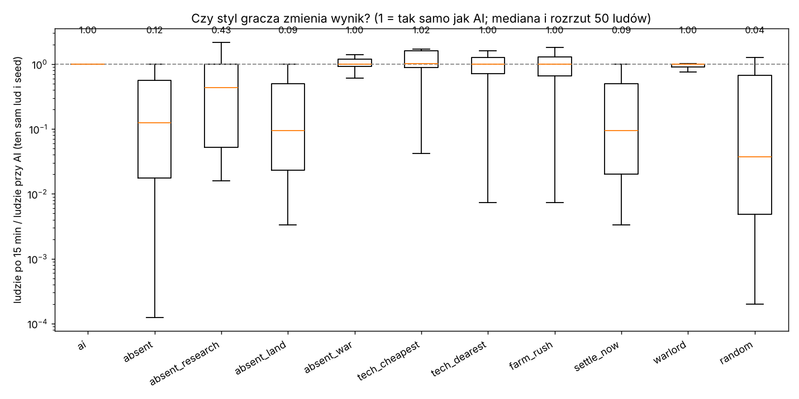
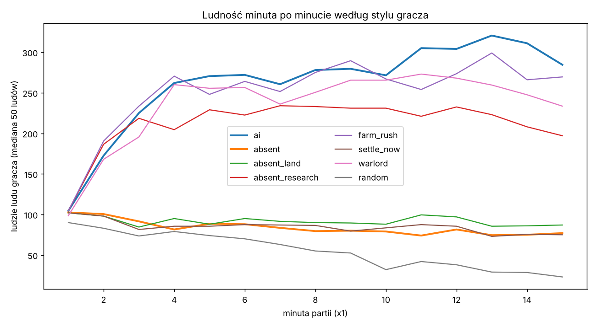
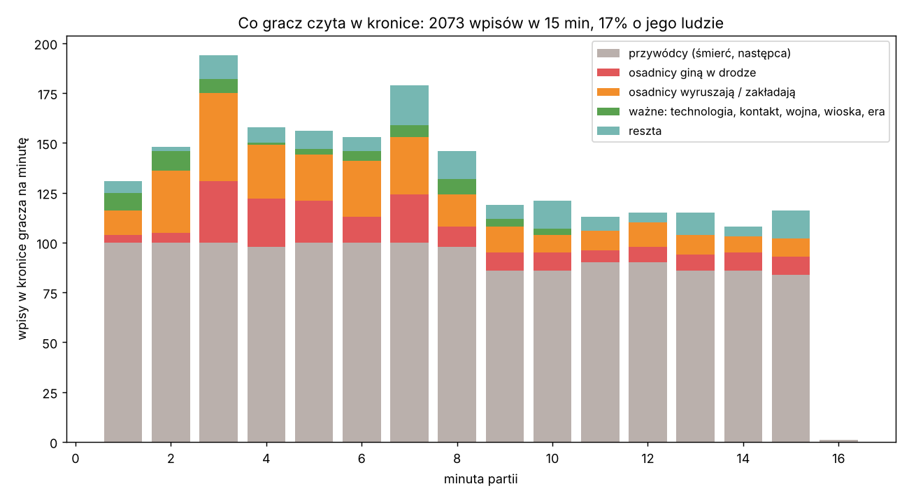

# Sesja 1 (2026-11-16): czy gracz ma wpływ na swój lud?

Stan gry: `development` po PR #90 (`b64d5cd`, etap 6: dźwignie, prototyp sterowania, tempo, zamrożenia, zadania 4b-1).
Mapa mała (98×60, 5 ludów), 15 minut gry przy ×1 (9000 taktów), seedy 1–10, czyli 50 ludów.
Narzędzie: gracz-bot `tools/CivSim.Playtest` (opis w [`README.md`](README.md)). Surowe dane: [`data/`](data/). Propozycje: [`propozycje.md`](propozycje.md).

## Najważniejsze w pięciu zdaniach

1. **Gracz może lud tylko zepsuć, nie poprawić.** Każdy styl z planem (technologie tanie, drogie, „szybko rolnictwo”, wojownik) daje
   po 15 minutach dokładnie tyle ludzi, co AI (mediana 1,00), a każdy styl, który bierze dźwignię i o niej zapomina, kończy z 4–43% ludzi AI.
2. **Wzięta dźwignia bez decyzji zatrzymuje lud bez ostrzeżenia:** nie ma badań (−7,8 technologii), obozy nie wędrują (9% ludzi),
   a na ekranie widać tylko „researching nothing”.
3. **Wojna gracza nie działa:** 23 ludy wypowiedziały 315 wojen i nie wysłały ani jednej wyprawy; świat sam zawiera biały pokój po
   ok. 36 sekundach, a następne wypowiedzenie gracza kronika nazywa „łamaniem umowy”.
4. **Kronika to szum:** 2073 wpisy w 15 minut (138 na minutę), 68% to śmierć przywódców (także ludów, których gracz nie zna), tylko 18% o własnym
   ludzie i ok. 3% to rzeczy warte zapamiętania.
5. **Osadnicy giną masowo:** na 10 seedach 2904 grupy osadników umarły z głodu w drodze, a 917 założyło obóz; po 4. minucie ludność stoi.

## 1. Pomiar sprawczości (600 partii)

Każdy z 50 ludów zagrał 15 minut w 11 stylach. Porównanie z AI na tym samym seedzie i tym samym ludzie:



| Styl | Ludzie po 15 min / AI (mediana) | Ludy lepsze od AI o >10% | Ludy z wioską | Technologie wobec AI | Osady (mediana) |
| --- | --- | --- | --- | --- | --- |
| `ai` (gracz nic nie bierze) | 1,00 | – | 22/50 | 0 | 4 |
| `tech_cheapest` | 1,02 | 21/50 | 21/50 | +0,06 | 5 |
| `tech_dearest` | 1,00 | 18/50 | 20/50 | −0,20 | 5 |
| `farm_rush` (rolnictwo jak najszybciej) | 1,00 | 19/50 | **17/50** | −0,58 | 4 |
| `warlord` (wojna z każdym) | 1,00 | 11/50 | 19/50 | −0,42 | 4 |
| `absent_war` (bierze dźwignię 4, nic) | 1,00 | 16/50 | 19/50 | −0,16 | 4 |
| `absent_research` (bierze dźwignię 2, nic) | 0,43 | 9/50 | 0/50 | −7,84 | 3 |
| `absent_land` (bierze dźwignię 1, nic) | 0,09 | 6/50 | 0/50 | −4,80 | 1 |
| `settle_now` (osiądź, gdy jest rolnictwo) | 0,09 | 6/50 | 0/50 | −5,00 | 1 |
| `absent` (bierze wszystko, nic) | 0,12 | 6/50 | 0/50 | −7,84 | 1 |
| `random` (losowy rozkaz co 10 s) | 0,04 | 10/50 | 2/50 | −5,26 | 1 |



**Co z tego wynika (oczami gracza):**
- Kolejność technologii nie ma znaczenia: trzy zupełnie różne plany badań kończą się tym samym wynikiem. Plan „szybko rolnictwo”, czyli
  najbardziej oczywisty plan nowego gracza, daje **mniej** wiosek niż AI (17 wobec 22). Gracz, który myśli, nie zostaje nagrodzony.
- Rozrzut „lepszy od AI” (18–21 ludów na 50) przy medianie 1,00 to raczej szum niż umiejętność: tyle samo ludów wypada gorzej.
- Dźwignia 1 („gdzie żyjemy”) wymaga ciągłego klikania: kto ją weźmie i nie przenosi obozów, gdy kończy się dzika żywność, ma po
  15 minutach 9% ludzi AI. To odwrotność zasady z ADR 0027 („mało dźwigni, każda mocna”): tu dźwignia to obowiązek, nie wybór.
- Dźwignia 2 („dokąd zmierzamy”) bez wyboru technologii zatrzymuje badania na zawsze. Gracz nie dostaje ostrzeżenia ani propozycji.
- `settle_now` pokazuje pułapkę dla nowego gracza: wziął dźwignię 1, żeby osiąść, i od tej chwili nikt nie przenosi jego obozów.
- Gracz, który nic nie bierze (`ai`), ma dobrą partię, ale **nie ma w niej żadnej swojej decyzji**. Gracz, który bierze dźwignię, ma
  tylko ryzyko. Brakuje środka: decyzji, która może dać więcej niż AI.

Przykład z seeda 7, lud 0 (Niakiia): przy AI ma ok. 60 ludzi przez całe 15 minut, a gracz, który **nic nie robi** i trzyma wszystkie
dźwignie, ma po 3 minutach 150 ludzi. Powód: AI wysyła z tego obozu osadników, którzy umierają w drodze (113 grup w 15 minut, punkt 4).

## 2. Wojna gracza (dźwignia 4)

Zapis ekranu: [`data/2026-11-16_ekran_gracza_seed7_lud1_wojownik.txt`](data/2026-11-16_ekran_gracza_seed7_lud1_wojownik.txt).
Bot robi to samo, co przyciski podglądu: „War” (wojna o łup) i „War campaign...” z 1/5 ludzi osady.

```
[00:43] Eakout declared war on Broukhudro for loot. Its warriors will be ready in 1 year.
REJECTED Not enough warriors stay home.            (x2)
[01:19] Eakout and Broukhudro made peace after 600 years of war. Nobody had fought for years.
REJECTED We are not at war with them.
[01:29] Eakout declared war on Broukhudro for loot, breaking their treaty. ...
... ta sama pętla co 45 sekund do końca partii
```

Na 50 ludach: 315 wypowiedzeń wojny, 1112 z 1475 rozkazów odrzuconych, **zero przyjętych wypraw**. Do tego trzy rzeczy, które gracz
odbierze jako błąd gry:
- „ready in 1 year” to 6 sekund (rok akcji), a „600 years of war” to 36 sekund (lata kalendarza neolitu): dwie różne jednostki lat w jednej
  kronice;
- biały pokój po 6 latach akcji bez walki (`war.json` `quietPeaceYears`) kończy wojnę gracza, zanim jego wojownicy są gotowi;
- następne wypowiedzenie to „breaking their treaty”: gracz płaci opinią za pokój, którego nie zawarł;
- odmowa „Not enough warriors stay home” nie mówi, ilu wojowników da się wysłać, więc gracz nie wie, co wpisać.

## 3. Co gracz czyta na ekranie

Zapis ekranu (kronika i panel „co AI zrobiła za mnie”) dla ludu 1 na seedzie 7 przy AI:
[`data/2026-11-16_ekran_gracza_seed7_lud1.txt`](data/2026-11-16_ekran_gracza_seed7_lud1.txt).



- **2073 wpisy w 15 minut**, w tym 1405 o przywódcach (śmierć, następca, „after a struggle for power”), 190 „settlers starved on the way”,
  281 o osadnikach; ważnych (technologia, kontakt, wojna, wioska, era): 56.
- Tylko **18%** wpisów dotyczy ludu gracza. Gracz od 0:00 czyta o przywódcach i niepokojach ludów, których nie spotkał
  („Unrest spread in the Chiefdom of Broukhudro”). To przeciek przez mgłę wojny: serwer wysyła każdemu klientowi całą kronikę
  (`GameServer.AddChronicle` nie zna ludu, którego wpis dotyczy), a zasada 10 z `CLAUDE.md` mówi, że widok gracza jest filtrowany.
- Przywódcy z imieniem i ustroje „Chiefdom” są w grze, choć ADR 0024 i 0026 mówią: w pierwszych erach bez postaci z imieniem i jeden ustrój
  do brązu (seed 7: 3 × Chiefdom, 2 × Council of Elders). Przy ok. 760 latach kalendarza na minutę przywódca zmienia się co 1–2 sekundy.
- Panel „co AI zrobiła za mnie” mówi językiem kodu: „Split camp: Bea; goal weight 133% (0), character 82% (0)”, „Set strategy; crowding 57%,
  fed 1000”, „Set research → Fire; serves security, leads to 387”. Gracz nie zrozumie, dlaczego AI to zrobiło.
- AI w tym samym takcie dzieli obóz i łączy z nim inny („Split camp: Bea” i „Join camp: Dog → Bea” w 1:54), a grupę po krzemień wysyła
  w 1:36 i odwołuje w 1:48 („stock months 187”). Dla gracza to krzątanina bez skutku.

## 4. Osadnicy, którzy giną w drodze

Headless, seedy 1–10, 15 minut, sama AI:

| Seed | Grupy zmarłe w drodze | Grupy, które założyły obóz | Wpisy o przywódcach | Wszystkie wpisy |
| --- | --- | --- | --- | --- |
| 1 | 66 | 81 | 1409 | 1957 |
| 2 | 456 | 94 | 1382 | 2529 |
| 3 | 50 | 63 | 1446 | 1903 |
| 4 | 540 | 140 | 1312 | 2608 |
| 5 | 453 | 136 | 1378 | 2607 |
| 6 | 98 | 60 | 1266 | 1795 |
| 7 | 190 | 56 | 1405 | 2059 |
| 8 | 200 | 91 | 1423 | 2140 |
| 9 | 548 | 116 | 1396 | 2633 |
| 10 | 303 | 80 | 1313 | 2282 |
| **razem** | **2904** | **917** | 13730 | 22513 |

Na każdą grupę, która założyła obóz, trzy umierają z głodu. Prawdopodobna przyczyna (do sprawdzenia przez agenta, hipoteza): zasada
z PR T2 „głodna wioska zawsze wysyła osadników” (`ai.json` opis gubernatora) plus twardy limit poziomu, którego nadmiar się rozprasza:
osadnicy wychodzą z głodnej osady bez jedzenia (`UnitSystem.Eat`), więc giną po kilku krokach. Wygląda to jak ukryty hamulec ludności, ale
gracz widzi tylko powtarzające się „starved on the way” i lud, który nie rośnie.

## 5. Tempo i nuda po 4. minucie

Raport `--milestones` na 10 seedach (50 ludów) dla kolejnych commitów `development`:

| Commit | Ludy z wioską w 15 min | Mediana minuty wioski | Pierwszy kontakt (mediana) | Ludy < 100 ludzi w 5. min |
| --- | --- | --- | --- | --- |
| `4c71046` (PR T2, hamulec rozrostu) | 31/50 | 4,2 | 3,2 | 13 |
| `980f264` (T3b) | 32/50 | 4,0 | 5,2 | 12 |
| `274a20c` (T3c: wspólny magazyn, mapa 98×60) | 24/50 | 7,2 | 0,7 | 14 |
| `b64d5cd` (dziś, 4b-1) | 22/50 | 6,4 | 0,7 | 10 |

- Cel ADR 0026 „era 1 ≤ 5 min” spełnia dziś mniej ludów niż przed T3c (wioska = era 1). Kontakt poprawił się dzięki mniejszej mapie.
- Cel „żaden lud < 100 ludzi po 5 min” nie jest spełniony (10 z 50).
- Mediana ludności AI rośnie do ok. 270 w 4. minucie, a potem stoi do 15. minuty (wykres wyżej). Od 4. minuty gracz widzi głównie
  nowe technologie i wpisy kroniki; mapa prawie się nie zmienia. To ta sama skarga, którą gracze mają na WorldBoxa (`porownanie-z-grami.md`).

## 6. Test sternika dla dzisiejszego prototypu

| Pytanie GDD 1.2 | Odpowiedź z pomiaru |
| --- | --- |
| 1. Do której dźwigni należy | wszystkie pięć istnieją; 5 (karty) nie ma jeszcze kart |
| 2. Czy AI zrobi to samo, gdy gracz nie klika | tak (styl `ai` = partia AI) |
| 3. Co widać w 2–3 minuty po decyzji | dźwignia 2: nic (wynik jak AI); dźwignia 4: nic (wyprawy odrzucane); dźwignia 1: tylko szkoda, gdy gracz przestanie klikać |
| 4. Co mówi kronika | przyczyny są, ale toną w 138 wpisach na minutę; panel AI w języku kodu |
| 5. Czy partia bez klikania jest ciekawa | do 4. minuty tak, potem ludność stoi |

## Ograniczenia pomiaru

- Bot nie zastąpi Patryka: gra prostymi planami i nie patrzy na mapę (oprócz `warlord`, który sprawdza w stanie serwera, z kim lud się zetknął).
  Brakuje stylu „dobry gracz na dźwigni 1” (przenosi obóz do najlepszej znanej ziemi); to następny krok, gdy widok gracza da mapę pamięci.
- 15 minut na mapie małej; wyniki dla dłuższych partii i map standard mogą być inne.
- FPS i wygoda podglądu nie są mierzone (Godot nie działa w chmurze).
