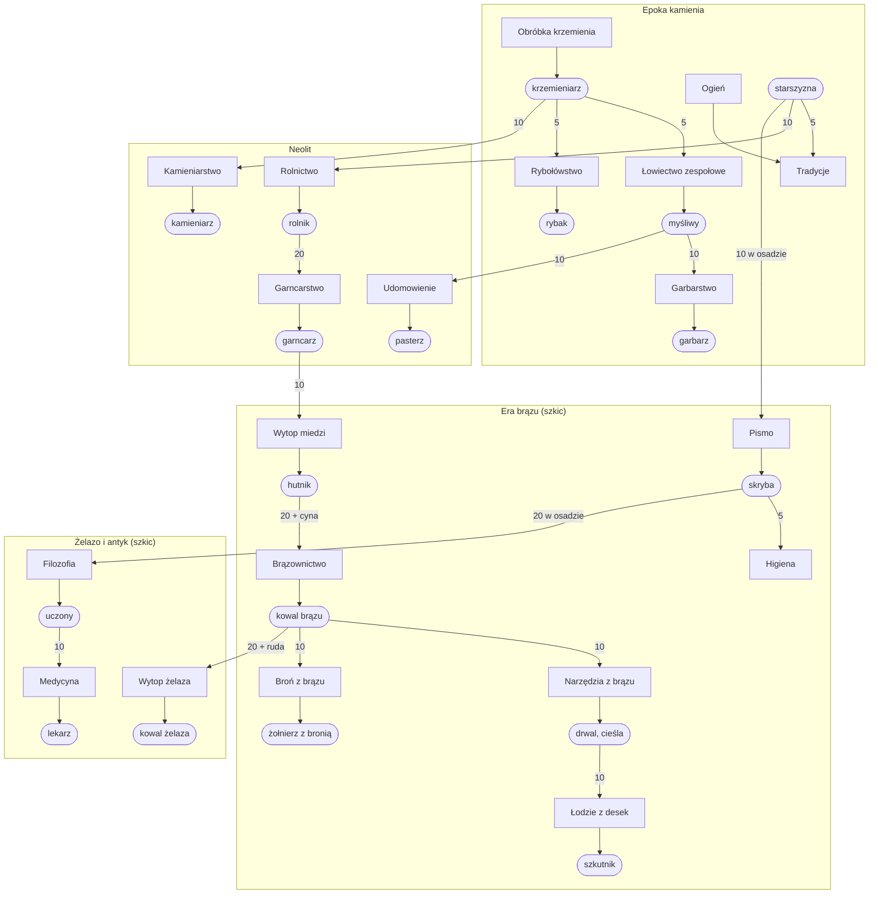

# Etap 4F: ludzie, fachy i przyczyny rozwoju (plan)

Decyzje Patryka z 2026-11-06 (dokument „Etap: ludzie, zawody i przyczyny rozwoju — propozycja”), ADR 0020, GDD 5.1, 5.2, 6.1.
Gałąź: `feat/skills` (od `feat/ai-land`, PR #40; po jego scaleniu baza to `development`). Robimy przed 4e.

## Warstwy i fachy er 1–2 (do `data/skills.json` i `data/strata.json`)

| Warstwa (klucz) | Fach (klucz) | Otwiera technologia | Lata nauki | Co robi |
| --- | --- | --- | ---: | --- |
| producers | gatherer | start | 0 | zbiera dzikie rośliny (każdy wytwórca) |
| producers | hunter | cooperative_hunting | 3 | plony z łowiectwa zespołowego |
| producers | fisher | fishing | 3 | plony z rybołówstwa |
| producers | farmer | agriculture | 5 | uprawa pól (wioski) |
| producers | herder | animal_husbandry | 5 | stada |
| artisans | knapper | flint_knapping | 3 | receptura narzędzi kamiennych, zbieranie krzemienia |
| artisans | tanner | tanning | 3 | receptura odzieży ze skór |
| artisans | potter | pottery | 5 | ceramika, glina |
| artisans | weaver | weaving | 5 | tkaniny |
| artisans | mason | stonemasonry | 5 | kamień |
| artisans | baker | bread_baking | 3 | chleb |
| warriors | warrior | start | 0 | jak dziś |
| thinkers | elder | start | 10 | nauka (30 punktów na tysiąc na rok), pamięć ustna |
| leaders | chief | start | 10 | na razie bez efektu poza potrzebami (ustroje w 4f) |

## Wymogi ludzi technologii er 1–2 (`requiresPeople`)

| Technologia | Wymaga technologii (dziś) | Wymaga ludzi |
| --- | --- | --- |
| fire | – | – (start) |
| flint_knapping | – | – (start) |
| cooperative_hunting | flint_knapping | 5 knapper |
| fishing | flint_knapping | 5 knapper |
| tanning | cooperative_hunting | 10 hunter |
| traditions | fire | 5 elder |
| agriculture | fire, flint_knapping | 10 elder |
| animal_husbandry | cooperative_hunting | 10 hunter |
| pottery | agriculture | 20 farmer |
| weaving | animal_husbandry albo agriculture | 10 herder albo 20 farmer |
| stonemasonry | flint_knapping | 10 knapper |
| irrigation | agriculture | 30 farmer |
| bread_baking | agriculture, fire | 20 farmer |
| barter | pottery | 10 potter |

## Graf (ery 1–4; 3–4 to szkic do etapów 6–7)

## Liczby demografii (GDD 5.2)

Na start (najedzona, zdrowa osada): urodzenia 60‰, śmiertelność dzieci 49%, zgony dorosłych 29,6‰ = +1,0‰. Efekty technologii er
1–2: ogień −1 punkt śmiertelności dzieci; garncarstwo −0,6‰ zgonów dorosłych. Wioski: +2‰ zgonów dorosłych z ciasnoty. Pełna tabela
er 1–10 w GDD 5.2.

## PR-y

1. **Fachy w danych i stanie** (gotowe). `data/skills.json` z walidacją; liczba fachowców
   i uczniów na fach w `SettlementState` (płaska tablica); hash, zapis (nowy format), migawka i protokół; kolumny `--stats`
   (fachowcy na fach w cywilizacji). Przy starcie każdy wytwórca to zbieracz, wojownik to wojownik, a reszta jak w danych.
2. **Nauka fachu.** Mistrzowie po odkryciu, uczniowie (do 3 na mistrza, praca za pół), lata nauki, przenoszenie w sieci (próg z ADR),
   utrata; plony z technologii zbierania i receptury liczą tylko fachowców.
3. **Warstwy myślicieli i przywódców, wymogi ludzi i nauka od myślicieli.** `thinkers` i `leaders` w `data/strata.json` (fachy elder, chief); `requiresPeople` (cywilizacja albo jedna osada); `sciencePerThousandPerYear` z ADR;
   uczony AI pomija technologie bez ludzi i waży, czego brakuje; nowa decyzja AI (strateg albo gubernator): ilu ludzi uczyć fachu.
4. **Demografia.** Efekty `birthsPerMille`, `childMortalityPercent`, `adultDeathsPerMille`; strojenie er 1–2; 3 seedy przed/po.
5. **Graf z danych i dokumentacja.** Skrypt rysuje graf z `data/technologies.json` i `data/skills.json`; test: każdy fach
   i technologia osiągalne od zera, brak pętli; `docs/systems/skills.md`, `docs/ai/`, statystyki.
