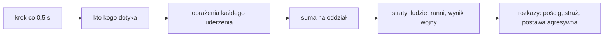

# Walka (nowa gra, 2026-11-19)

Decyzje Patryka: `claude/walka-burza-mozgow.md` (kwestionariusz) i `claude/walka-propozycja.md` (propozycja i odpowiedzi z 12:01).
Wszystkie liczby są w `data/sim/game.json`, sekcja `combat` (budowana przez `data/sim/tools/build_game_json.py`).
Kod: `src/CivSim.Sim/State/SimGame.Combat.cs` (rdzeń), `SimGame.War.cs` (wojna, oblężenia, zdobycie),
`game/scripts/Play/PlayGame.Combat.cs` (tryb walki w kliencie).

## Krok walki

Co `stepTicks` = 5 taktów (0,5 s przy ×1) każdy oddział wojska uderza:

- **wręcz** (zasięg 1): każdego wroga na sąsiednim heksie (albo na tym samym); przy każdym walczy co najwyżej
  `frontPerContact` = 12 jego ludzi (gdy styka się z trzema wrogami, a ma 15 ludzi, przy każdym walczy 5);
- **dystans** (łucznicy, kusznicy, myśliwi): jednego wroga w zasięgu, **tylko gdy stoi** (w marszu nie strzela);
  strzelają wszyscy jego ludzie.

Najpierw liczone są wszystkie uderzenia kroku, potem straty schodzą naraz, więc kolejność oddziałów nie ma znaczenia.



## Wzór obrażeń

Obrażenia w setnych częściach człowieka za jeden krok:

```
walczący × siła × broń / 100
  × (100 + premie) / 100 × najedzenie / 100
  × 100 / zbroja
  × (100 + teren) / 100 × flanka / 100 × (szarża albo odejście) / 100
  × 100 / killDivisor          (killDivisor = 400)
  × szczęście 80–120 %
```

| Czynnik | Wartości (dane) |
| --- | --- |
| broń, poziom 0–4 (gołe ręce, kamień, brąz, żelazo, stal) | ×0,6 / 1,0 / 1,4 / 1,8 / 2,2 |
| zbroja, poziom 0–4 (brak, skóra, brąz, żelazo, płyty): dzieli obrażenia | 1,0 / 1,3 / 1,7 / 2,1 / 2,6 |
| zbroja przeciw strzałom | jej nadwyżka ponad 1,0 liczy się o 20 % mocniej (np. 1,7 → 1,84) |
| kusze (`pierce`) | omijają 1 poziom zbroi celu |
| premie rodzaju | włócznicy +50 % na jazdę i zatrzymują szarżę; jeźdźcy i rycerze +50 % na strzelców, +20 % na równinie; wojownicy +30 % w lesie |
| flanka: ilu wrogów wręcz dotyka celu | 1 → ×1,0; 2 → ×1,25; 3 → ×1,5; 4 i więcej → ×1,8 |
| rzeźba | +8 % za każdy poziom wyżej od celu (równina 0, wzgórza 1, góry 2), najwyżej ±16 % |
| wysokość | +3 % za każde 20 jednostek wysokości ponad celem, najwyżej ±9 % |
| osłona heksu celu | las lub zagajnik: −30 % od strzał, −15 % wręcz; własna palisada: −50 % / −30 %; mur: −50 % / −30 % |
| utrata osłony | gdy cel dotykają wrogowie z dwóch stron, które się nie stykają |
| rzeka bez mostu (wręcz) | −25 % |
| otwarty teren (droga, bagno) | cel dostaje +15 % |
| głód | najedzony 100 %, głodny 75 %, umierający z głodu 50 % (sekcja `rations`) |

Siła rodzajów po zmianie (broń i zbroja dają resztę): mieszkańcy 5, myśliwi 6, wojownicy 9, łucznicy 9, włócznicy 11,
jeźdźcy 12, kusznicy 12, miecznicy 13, rycerze 16. Technologie z premiami „strength” działają dalej (wyszkolenie).

### Przykład

12 wojowników z bronią z kamienia (×1,0), bez technologii z premią, uderza 12 wojowników w skórzanych zbrojach (1,3), na równym polu, jeden na jednego:
12 × 9 × 100/100 = 108 → × 100/130 = 83 → × 100/400 = 20,8 setnych, czyli około 0,21 człowieka na krok i 0,42 na sekundę.
Ponieważ obie strony tracą ludzi naraz (a z nimi siłę), oddział 12 ludzi pada po około 30–40 s walki jeden na jednego. Przy trzech wrogach wokół (flanka ×1,5, każdy wróg walczy pełną dwunastką) pada po około 7–10 s. Bitwa 7 na 7 oddziałów po 15 ludzi w scenariuszu z AI trwała około 50 s.

## Broń i zbroja jako towary

Dziesięć towarów zamiast dawnego `arms`: `stone_weapons`, `bronze_weapons`, `iron_weapons`, `steel_weapons`, `hide_armour`,
`bronze_armour`, `iron_armour`, `steel_armour`. Są oznaczone `storedIn: "armoury"`: budynki z grupy `armoury` (koszary, płatnerz,
kowal broni, huta stali, zamek) mieszczą ich dwa razy więcej, czyli w swoim magazynie zajmują połowę miejsca.

| Kto robi | Co |
| --- | --- |
| narzędziarz (kamień) | 1 narzędzia i 0,5 broni z kamienia |
| krawiec | 1 odzież i 0,3 zbroi skórzanej |
| płatnerz (brąz) | 1 broń z brązu i 0,5 zbroi z brązu |
| kowal broni (żelazo) | 1,5 broni z żelaza i 1 zbroja z żelaza |
| huta stali | 4 narzędzia, 1 broń ze stali i 1 zbroja płytowa |

Przy szkoleniu oddział bierze najlepszy poziom, którego starczy dla **wszystkich** jego ludzi (1 sztuka na człowieka).
„Tylko broń” (`Shock`) nie bierze zbroi i szkoli się w 40 % czasu. **Uzbrojenie** (`Refit`) na własnej ziemi oddaje stare
do magazynu i bierze najlepsze; nigdy nie daje gorszego.

## Wielkość oddziału i dzielenie

Piechota i jazda mają `minPeople` 5 i `maxPeople` 30. Cena i czas szkolenia rosną z wielkością (20 wojowników kosztuje 60 jedzenia
zamiast 30). **Dzielenie** (`Split`) robi z części nowy oddział tego samego rodzaju i uzbrojenia na wolnym heksie obok; obie części
muszą mieć co najmniej `minPeople`. **Jeden oddział wojska na heks**: oddział, który staje tam, gdzie stoi inny, schodzi na wolny heks
obok (przejść można).

## Ruch w walce

- **Strefa kontroli:** oddział idący obok wroga staje; dalej idzie po jednym heksie.
- **Odejście:** każdy wróg wręcz, od którego oddział odchodzi, uderza raz za `disengagePercent` = 50 % kroku (jazda
  `cavalryDisengagePercent` = 25 %). Nie uderza, gdy przy tym wrogu zostaje inny nasz oddział wręcz (dlatego oddzielona część
  odchodzi bez straty, gdy reszta walczy) i gdy wróg jest bierny.
- **Szarża:** jazda, która przeszła co najmniej `chargeHexes` = 2 heksy od ostatniego kontaktu, w pierwszym kroku uderza za
  `chargePercent` = 200 %. Na włóczników nie działa. Jazda może odskoczyć (traci tylko ćwierć kroku) i wrócić z nową szarżą.

## Postawy, straż, szyk

| Postawa | Co robi |
| --- | --- |
| Trzymaj (domyślna) | uderza to, co dotyka (strzelcy: co w zasięgu), nie goni |
| Agresywna | idzie na wrogów, których widzi w swoim zasięgu wzroku |
| Bierna | uderza tylko wroga, na którego go wysłano (do przejścia obok albo wycofania) |

**Straż:** oddział z namalowanymi heksami idzie na wroga, który na nich stanie, a potem wraca na pierwszy z nich.
**Szyk** (`Formation`): wręcz w linii na wskazanym heksie w poprzek kierunku marszu, jazda na końcach linii, strzelcy rząd za nią,
machiny oblężnicze dwa rzędy za nią. Linia poprzeczna na heksach to zygzak: krok 60° w bok i krok 120° na zmianę.

## Czas

Gra jednoosobowa: pierwsze starcie po `calmSeconds` = 30 s spokoju zwalnia czas do ×1 (w kronice: „Battle! Time runs at ×1.”).
Oblężenia liczą się w tym samym kroku: dawna sekundowa siła oblężenia jest mnożona przez 0,5.

## Sterowanie w kliencie (tryb walki, klawisz F)

| Wejście | Co robi |
| --- | --- |
| lewy klik | wybiera nasz oddział wojska na heksie |
| przeciągnięcie lewym | ramka: wszystkie nasze oddziały wojska w środku (z Shiftem dokłada) |
| Ctrl + klik | oddział i wszystkie oddziały tego rodzaju stojące obok siebie w łańcuchu |
| Shift + przeciągnięcie | maluje heksy straży wybranych oddziałów |
| prawy klik z kilkoma oddziałami | szyk na wskazany heks (na wroga: atak każdego) |
| Z / X / C | postawa: trzymaj / agresywna / bierna |
| V / B / N | podziel na pół / uzbrój w osadzie / koniec straży |

W panelu osady nad kafelkami szkolenia jest suwak wielkości (lewy koniec: zwykła wielkość rodzaju) i pole „tylko broń”.
W panelu oddziału jest sekcja „Battle”: broń i zbroja z mnożnikami, straty w ostatnim pół sekundy, przyciski postaw,
dzielenia, uzbrojenia i straży.

## Co widać w bitwie (paczka 2)

Bez przewidywania wyniku, tylko to, co się dzieje:

- **pasek ludzi** nad żetonem każdego oddziału wojska: zielony powyżej połowy wielkości, żółty do ćwierci, czerwony poniżej;
  ranni na szaro (wielkość to liczba ludzi przy szkoleniu albo podziale);
- **straty** wyskakują nad oddziałem („-2”) i znikają po 1,4 s; „Charge!” przy szarży;
- **strzałki** od oddziału do tego, kogo uderzył w ostatnim kroku: żółte nasze, pomarańczowe wroga, czerwone i grubsze,
  gdy cel biją dwa albo więcej oddziałów (flanka); strzały przerywaną linią;
- **heks pod kursorem w trybie walki**: obwódka zielona (dobra osłona albo wyżej od najbliższego wroga), żółta (trochę),
  czerwona (otwarty teren albo niżej) i napisy z liczbami: osłona od strzał i wręcz, otwarty teren, wysokość wobec
  najbliższego widocznego wroga (strzałka w górę lub w dół);
- **kronika**: „Our warriors are down to 6 of 12” przy połowie i ćwierci (`warnPercents`).

## Scenariusze testowe

`06_battle_field` (pole, równe uzbrojenie), `07_battle_arms` (uzbrojenie, wielkość, dzielenie), `08_battle_cavalry`
(szarża, odskok jazdy, łucznicy, wysokość), `09_battle_ai` (wszystko przeciw atakującej AI). Opis pól: `data/sim/scenarios/README.md`.
Zrzut z ekranu: `--play --play-scenario 06_battle_field --play-window Battle --play-screenshot x.png --play-seconds 9`.

## Testy

`tests/CivSim.Sim.Tests/CombatTests.cs`: uzbrojenie z magazynu, wielkość i cena, połowa miejsca w zbrojowni, broń i zbroja
w obrażeniach, flanka, wysokość i las, strefa kontroli, odejście (½, jazda ¼, nic przy osłonie), szarża, łucznicy tylko stojąc,
dzielenie, szyk.

## Czego jeszcze nie ma (kolejne paczki)

Zaopatrzenie wojsk; garnizon i oblężenie etapami;
weterani, rezerwiści, limit dowodzenia, zmęczenie wojną; AI walki (formacje, flanki, odskoki jazdy).
