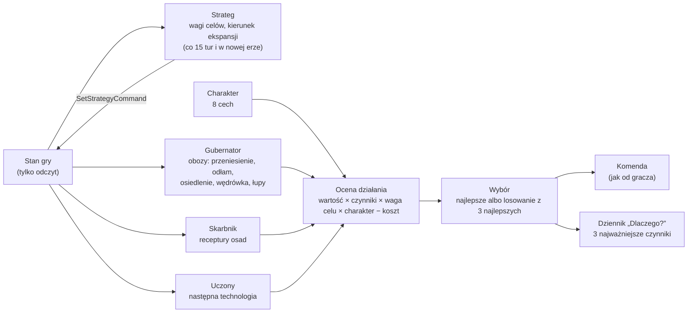

# AI: doradcy i ocena działań

**W jednym zdaniu:** każda cywilizacja komputerowa to rada doradców (GDD 8.1), którzy oceniają możliwe działania jednym wspólnym wzorem (GDD 8.3), wybierają najlepsze i wydają te same komendy co gracz, a każda decyzja zapisuje 3 najważniejsze powody („Dlaczego?”, GDD 8.7) (etap 4a). Od etapu 4b każda cywilizacja ma charakter (8 cech), a strateg ustawia wagi celów i kierunek ekspansji.

**Faza tury:** 3. Decyzje (`AiCouncil` jako źródło komend). Komendy rozstrzyga faza 4, jak komendy gracza.

## Dane wejściowe i wyjściowe
- Czyta: stan gry (tylko odczyt), pamięć mapy cywilizacji (`MapMemory.Knows`), `data/ai.json`, zasady z `data/population.json` (kara za odległość, premia za stare obozowisko, progi przenoszenia), ceny sieci handlowej, koszty technologii.
- Zmienia: nic bezpośrednio. Wydaje komendy przez `CommandQueue` (`PlayerId.Ai`); strateg komendą `SetStrategyCommand` zapisuje w `CivilizationState` wagi celów, cel ekspansji i termin następnego przeglądu. Charakter (`Traits`) losuje `Character.Roll` przy tworzeniu gry.
- Publikuje: dziennik decyzji tury (`AiCouncil.Log`) poza stanem gry; Headless zapisuje go opcją `--decisions why.csv`. W migawce jeszcze nic (panel „Dlaczego?” przyjdzie z protokołem w dalszej części etapu 4).

## Przepływ

## Zasady i wzory
- **Ocena** (`Evaluation`, GDD 8.3): `ocena = wartość bazowa × Π czynników × waga celu × charakter − koszt`. Wartość bazowa jest w jednostkach działania (jedzenie okolicy na rok, wartość dodana receptury). Każdy czynnik to liczba w tysięcznych: 1000 = bez zmian, 0 = wyklucza działanie, ponad 1000 = premia. Czynniki mnożymy po kolei z dzieleniem całkowitym, więc wynik jest bit w bit taki sam na każdym komputerze (ADR 0016).
- **Krzywe odpowiedzi** (`ResponseCurve`): zamieniają wartość ze świata na czynnik. Trzy kształty: prosta, krzywa S (wolno, szybko, wolno) i próg. Dziś używa ich bliskość miejsca (1,0 tuż obok, −3% na pole, `distancePenaltyPercentPerCell`) i bliskość dalekiego celu wędrówki (−1% na pole).
- **Charakter** (GDD 8.4, etap 4b): 8 cech w skali 0–1000 (agresja, ekspansywność, handlowość, ciekawość świata, otwartość, ostrożność, mściwość, lojalność), losowanych raz na grę ze strumienia `leaders` (średnia z dwóch losowań, więc skrajności są rzadkie). Mnożnik charakteru dla działania = 0,5 + cecha związana z jego celem: ekspansja ↔ ekspansywność, bezpieczeństwo ↔ ostrożność, dobrobyt ↔ handlowość, nauka ↔ ciekawość, wpływ ↔ otwartość, podbój ↔ agresja. Otwartość ustawia pierwsze wrażenie po kontakcie, a mściwość wydłuża pamięć napaści (etap 4c, `docs/systems/relations.md`); lojalność zadziała z sojuszami (4d).
- **Strateg** (GDD 8.1, 7.6): co 15 tur (przeglądy rozłożone między cywilizacje) i od razu w nowej erze ustawia wagi celów. Ekspansja rośnie z zatłoczeniem obozów (do 50% miejsc: 1,0; przy 90%: 1,6). Dobrobyt i bezpieczeństwo rosną z głodem (najedzeni w 95%: 1,0; w 60%: 1,5). Nauka, wpływ i podbój zostają 1,0 (podbój dostanie wagę z wojnami w 4e). Cel ekspansji to najlepsza znana wolna ziemia (niczyja) w promieniu wędrówki (40 pól) od największej osady, oceniona jak miejsce na obóz i pomniejszona za odległość.
- **Opinia o sąsiedzie** (GDD 8.3, etap 4c): ocena wypędzenia obcego obozu jest mnożona przez 1,0 − sympatia/200 (sympatia −100 → 1,5; +100 → 0,5; obcy bez kontaktu → 1,0). Sympatia pochodzi z pamięci relacji tej cywilizacji (`docs/systems/relations.md`), więc napadnięty chętniej oddaje cios.
- **Kierunek ekspansji:** miejsce bliżej celu niż obecny obóz dostaje +15% (`directionBonusPercent`, „sugestia” z GDD 7.6). Premia nie dotyczy obcych obozów.
- **Odłamy z powodu, nie tylko z głodu:** obóz wysyła grupę, gdy jest pełny w 80% podzielone przez (waga ekspansji × mnożnik charakteru), ale nie niżej niż 50% i nie wyżej niż 100%. Ekspansywna cywilizacja w ciasnych obozach rozsyła ludzi wcześniej.
- **Koszt i nauka:** uczony mnoży wartość technologii przez (koszt najtańszej / koszt tej)², więc najtańsza wygrywa, a dwa razy droższa ma cztery razy mniejszą szansę w losowaniu.
- **Wybór** (`Chooser`): doradca trzyma 3 najlepsze działania (`pickAmongTop`). Z szansą równą ostrożności cywilizacja bierze najlepsze, w przeciwnym razie losuje spośród trzech z szansą proporcjonalną do oceny. Przy remisie wygrywa działanie ocenione wcześniej. Losowanie jest deterministyczne: generator zależy tylko od seeda, doradcy, osady albo cywilizacji i tury, a wspólny strumień `ai` się nie przesuwa.
- **Histereza** (GDD 8.6): obóz przenosi się tylko, gdy nowe miejsce jest lepsze o co najmniej 30% (`moveWhenBetterByPercent`), a do wędrówki o 60%. Obie strony ważymy tą samą wagą celu, więc o przeprowadzce decyduje miejsce i kierunek, a nie sama waga. Rzemieślnicy zmieniają recepturę tylko na lepszą o 25% (`recipeSwitchBetterByPercent`); obecna receptura liczy się jako wykonalna, nawet gdy w tej turze zabrakło wejść (produkcja po prostu czeka).
- **Rzadsze szukanie:** głodny albo zmarznięty obóz szuka nowego miejsca co 3 tury (rozłożone między obozy), a co turę tylko przy najedzeniu poniżej 85% albo na planecie z porami roku na żywo.
- **„Dlaczego?”** (GDD 8.7): każda wydana komenda zapisuje doradcę, działanie, cel, ocenę i 3 czynniki, które najbardziej odbiegały od neutralnych. Potem idą notatki (wartości wyjaśniające regułę, np. „lepsze niż tu 3166”, „plon z pól 2605%”), a na końcu czynniki neutralne.

| Doradca | Klasa | Decyduje o | Co ile tur |
| --- | --- | --- | --- |
| Strateg | `StrategistAdvisor` | wagi celów, cel ekspansji (`SetStrategyCommand`) | co 15 tur, rozłożone; od razu w nowej erze |
| Gubernator | `GovernorAdvisor` | przeniesienie obozu, odłam, przyłączenie małego obozu, osiedlenie się jako wioska, wędrówka do dalekiego miejsca, łupy z opuszczonych osad, wypędzenie słabszego obozu | przetrwanie co turę, reszta raz na turę ery |
| Skarbnik | `TreasurerAdvisor` | receptura rzemieślników w każdej osadzie | raz na turę ery |
| Uczony | `ScholarAdvisor` | następna technologia | gdy nic nie jest badane |

Dyplomata (etap 4d) jest opisany w `docs/systems/diplomacy.md`; dowódca przyjdzie w etapie 4e.

**Przykład z dziennika** (seed 7, tura 3): `Civilization 5, Governor, MoveCamp, ocena 6645: distance 88% (4 pola), food 7552, better than here 3166`.

## Pliki danych
- `data/ai.json`: `pickAmongTop` (3), przeglądy stratega, krzywe wag (zatłoczenie, głód), premia za kierunek, próg zmiany receptury, rzadsze szukanie miejsc, najniższy próg odłamu.
- `data/population.json`: progi i kary, z których gubernator buduje czynniki.

## Testy
- `UtilityTests`: krzywe (prosta, S, próg, nigdy poniżej zera); czynniki w tysięcznych dają dokładnie ten sam wynik co rachunek procentowy z etapu 3 (10 000 losowych przypadków); zero wyklucza działanie; neutralna waga i charakter nic nie zmieniają; koszt i notatki; kolejność „Dlaczego?”; wybór: najlepsze, remisy, 3 najlepsze w kolejności, losowanie zgodne z ocenami i powtarzalne, brak przepełnienia.
- `AdvisorTests`: reguły z danych; każda komenda AI ma zapis w dzienniku; przeniesienia obozów podają jedzenie, wygodę albo odległość; wybór badań zapisuje koszt; losowanie z 3 najlepszych jest deterministyczne i zmienia przebieg gry.
- `AdvisorTests` (4b): losowanie z 3 najlepszych jest powtarzalne i zmienia przebieg gry; w pełni ostrożne cywilizacje dają dokładnie ten sam przebieg co wybór samego najlepszego.
- `StrategyTests`: charakter z seeda, różny między cywilizacjami, w skali 0–1000; mnożnik 0,5–1,5; strateg przegląda wszystkich w pierwszej turze, potem rozkłada przeglądy; cel ekspansji to znany ląd; głód podnosi dobrobyt i bezpieczeństwo; komenda strategii odrzuca złe dane; rzemieślnicy nie zmieniają receptur co turę; charakter i strategia przechodzą przez zapis; ruchy w stronę celu dostają premię.
- `DeterminismTests`, `WorldGeneratorTests`: nowe złote hashe (stan zawiera charakter; sama mapa się nie zmieniła).

## Wydajność
- **4b**, ta sama maszyna, Release, 1000 tur, mapa standard (przed → po): seed 7: 20,4 → 19,4 ms; seed 11: 14,9 → 13,4 ms; seed 23: 27,9 → 22,2 ms; seed 42: 19,0 → 20,0 ms. Mapa ogromna, seed 42, 150 tur: 150,8 → 154,1 ms (szczyt 235 → 294 ms); cel to 250 ms średnio. Alokacje na turę bez zmian (ok. 250–420 KB).
- Gubernator najpierw liczy górną granicę oceny miejsca z nietkniętej ziemi i pomija pola, które i tak nie weszłyby do 3 najlepszych (wynik identyczny, sprawdzone hashem).
- **4a:** seed 7 i 11, mapa standard, 1000 tur, ta sama maszyna: hash stanu identyczny jak przed etapem 4a (`4FE3BE49C2F03AF8`, `280BCF460E9A1470`). Czas tury 19,9 / 14,4 ms (przed: 26,2 / 17,5 ms; różnica to szum pomiaru, logika się nie zmieniła). Alokacje na turę bez zmian (349,7 / 253,8 KB).
- Ocena pola to struktura bez alokacji (8 czynników w tablicy wbudowanej); kosztowne sprawdzenia (siła obrońców, wolne miejsce, ścieżka) liczymy tylko dla działań, które wybór by zatrzymał.

## Zachowanie po 4b (seedy 7, 11, 23, 42; 1000 tur)
- Zmiany receptur: 82 810 → ok. 1 900 (seed 7); 101 868 → ok. 4 000 (seed 23). Przełączanie co turę z etapu 3e zniknęło.
- Rolnictwo przychodzi u części cywilizacji wcześniej, a ludność po 1000 tur jest podobna albo niższa o kilkanaście procent zależnie od seeda (wykres w PR). Symulacja jest chaotyczna: jeden seed niczego nie dowodzi, rzetelne porównanie da 100 gier z etapu 4g.
- Wypędzeń obcych obozów jest 3–7 razy więcej niż w etapie 3 (nieostrożne cywilizacje czasem wybierają drugie albo trzecie najlepsze miejsce, a agresywne mocniej ważą podbój). Po 1000 tur żyje zwykle 1–3 cywilizacje mniej.
