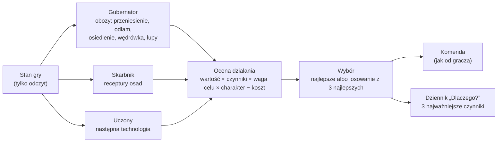

# AI: doradcy i ocena działań

**W jednym zdaniu:** każda cywilizacja komputerowa to rada doradców (GDD 8.1), którzy oceniają możliwe działania jednym wspólnym wzorem (GDD 8.3), wybierają najlepsze i wydają te same komendy co gracz, a każda decyzja zapisuje 3 najważniejsze powody („Dlaczego?”, GDD 8.7) (etap 4a).

**Faza tury:** 3. Decyzje (`AiCouncil` jako źródło komend). Komendy rozstrzyga faza 4, jak komendy gracza.

## Dane wejściowe i wyjściowe
- Czyta: stan gry (tylko odczyt), pamięć mapy cywilizacji (`MapMemory.Knows`), `data/ai.json`, zasady z `data/population.json` (kara za odległość, premia za stare obozowisko, progi przenoszenia), ceny sieci handlowej, koszty technologii.
- Zmienia: nic w stanie gry. Wydaje komendy przez `CommandQueue` (`PlayerId.Ai`).
- Publikuje: dziennik decyzji tury (`AiCouncil.Log`) poza stanem gry; Headless zapisuje go opcją `--decisions why.csv`. W migawce jeszcze nic (panel „Dlaczego?” przyjdzie z protokołem w dalszej części etapu 4).

## Przepływ

## Zasady i wzory
- **Ocena** (`Evaluation`, GDD 8.3): `ocena = wartość bazowa × Π czynników × waga celu × charakter − koszt`. Wartość bazowa jest w jednostkach działania (jedzenie okolicy na rok, wartość dodana receptury). Każdy czynnik to liczba w tysięcznych: 1000 = bez zmian, 0 = wyklucza działanie, ponad 1000 = premia. Czynniki mnożymy po kolei z dzieleniem całkowitym, więc wynik jest bit w bit taki sam na każdym komputerze (ADR 0016).
- **Krzywe odpowiedzi** (`ResponseCurve`): zamieniają wartość ze świata na czynnik. Trzy kształty: prosta, krzywa S (wolno, szybko, wolno) i próg. Dziś używa ich bliskość miejsca (1,0 tuż obok, −3% na pole, `distancePenaltyPercentPerCell`) i bliskość dalekiego celu wędrówki (−1% na pole).
- **Waga celu i charakter:** sześć celów stratega (ekspansja, bezpieczeństwo, dobrobyt, nauka, wpływ, podbój). W etapie 4a wszystkie wagi i mnożniki charakteru są neutralne (1000) i nie zmieniają ocen; nada je strateg w etapie 4b.
- **Koszt:** odejmowany na końcu. Uczony daje każdej technologii tę samą wartość i odejmuje jej dzisiejszy koszt, więc wygrywa najtańsza (jak w etapie 3f).
- **Wybór** (`Chooser`): doradca trzyma najlepsze działania. Przy remisie wygrywa działanie ocenione wcześniej. `pickAmongTop` w `data/ai.json`: 1 = zawsze najlepsze; 2–3 = losowanie spośród najlepszych z szansą proporcjonalną do oceny. Losowanie jest deterministyczne: generator zależy tylko od seeda, doradcy, osady albo cywilizacji i tury, a wspólny strumień `ai` się nie przesuwa.
- **Histereza** (GDD 8.6): obóz przenosi się tylko, gdy nowe miejsce jest lepsze o co najmniej 30% (`moveWhenBetterByPercent`), a do wędrówki o 60%.
- **„Dlaczego?”** (GDD 8.7): każda wydana komenda zapisuje doradcę, działanie, cel, ocenę i 3 czynniki, które najbardziej odbiegały od neutralnych. Potem idą notatki (wartości wyjaśniające regułę, np. „lepsze niż tu 3166”, „plon z pól 2605%”), a na końcu czynniki neutralne.

| Doradca | Klasa | Decyduje o | Co ile tur |
| --- | --- | --- | --- |
| Gubernator | `GovernorAdvisor` | przeniesienie obozu, odłam, przyłączenie małego obozu, osiedlenie się jako wioska, wędrówka do dalekiego miejsca, łupy z opuszczonych osad, wypędzenie słabszego obozu | przetrwanie co turę, reszta raz na turę ery |
| Skarbnik | `TreasurerAdvisor` | receptura rzemieślników w każdej osadzie | raz na turę ery |
| Uczony | `ScholarAdvisor` | następna technologia | gdy nic nie jest badane |

Strateg, dyplomata i dowódca przyjdą w etapach 4b–4e.

**Przykład z dziennika** (seed 7, tura 3): `Civilization 5, Governor, MoveCamp, ocena 6645: distance 88% (4 pola), food 7552, better than here 3166`.

## Pliki danych
- `data/ai.json`: `pickAmongTop` (1–3; dziś 1, żeby symulacja była identyczna jak w etapie 3).
- `data/population.json`: progi i kary, z których gubernator buduje czynniki.

## Testy
- `UtilityTests`: krzywe (prosta, S, próg, nigdy poniżej zera); czynniki w tysięcznych dają dokładnie ten sam wynik co rachunek procentowy z etapu 3 (10 000 losowych przypadków); zero wyklucza działanie; neutralna waga i charakter nic nie zmieniają; koszt i notatki; kolejność „Dlaczego?”; wybór: najlepsze, remisy, 3 najlepsze w kolejności, losowanie zgodne z ocenami i powtarzalne, brak przepełnienia.
- `AdvisorTests`: reguły z danych; każda komenda AI ma zapis w dzienniku; przeniesienia obozów podają jedzenie, wygodę albo odległość; wybór badań zapisuje koszt; losowanie z 3 najlepszych jest deterministyczne i zmienia przebieg gry.
- `DeterminismTests.HashIsStableAcrossVersionsAndPlatforms`: złoty hash się nie zmienił, więc przeniesienie AI nie zmieniło symulacji.

## Wydajność
- Seed 7 i 11, mapa standard, 1000 tur, ta sama maszyna: hash stanu identyczny jak przed etapem 4a (`4FE3BE49C2F03AF8`, `280BCF460E9A1470`). Czas tury 19,9 / 14,4 ms (przed: 26,2 / 17,5 ms; różnica to szum pomiaru, logika się nie zmieniła). Alokacje na turę bez zmian (349,7 / 253,8 KB).
- Ocena pola to struktura bez alokacji (8 czynników w tablicy wbudowanej); kosztowne sprawdzenia (siła obrońców, wolne miejsce, ścieżka) liczymy tylko dla działań, które wybór by zatrzymał.

## Znane problemy (do etapu 4b)
- Dziennik pokazał, że skarbnik przełącza recepturę co turę: w jednej turze wejścia są, receptura rusza i je zużywa, w następnej ich brakuje i rzemieślnicy stają (seed 7, 1000 tur: 82 810 zmian receptur, ok. 83 na turę, przy 1819 przeniesieniach obozów). To zachowanie z etapu 3e; naprawi je histereza i prognoza zasobów skarbnika (GDD 8.2, 8.6).
