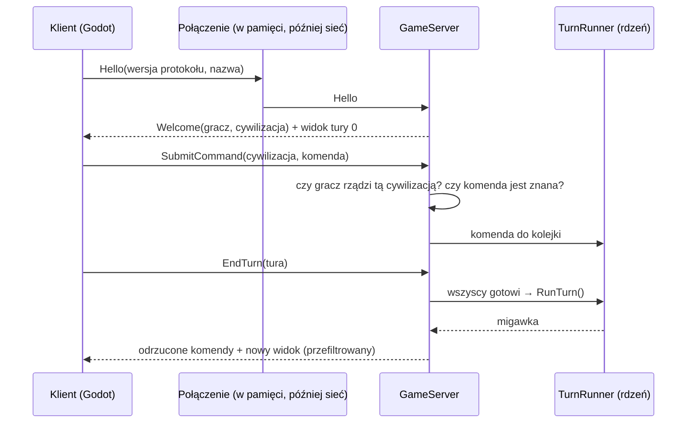

# Klient i serwer

**W jednym zdaniu:** gra zawsze działa jako klient i serwer; serwer liczy symulację i sprawdza komendy, klient tylko wysyła komendy i dostaje swój widok.

**Faza tury:** poza turą. Serwer zbiera komendy między turami, uruchamia turę, gdy wszyscy gracze skończyli, i rozsyła widoki po fazie 11.

## Dane wejściowe i wyjściowe
- Czyta: wiadomości od klientów (`HelloMessage`, `SubmitCommandMessage`, `EndTurnMessage`).
- Zmienia: kolejkę komend, przypisanie cywilizacji do graczy, stan gry (tylko przez turę).
- Publikuje: `WelcomeMessage`, `GameViewMessage` (widok gracza po każdej turze), `CommandRejectedMessage`, `ConnectionRejectedMessage`.

## Przepływ

## Zasady i wzory
- **Projekty:** `CivSim.Protocol` nie zależy od `CivSim.Core`. Klient (`game/`) widzi tylko Protocol, więc fizycznie nie może
  sięgnąć do stanu rdzenia. Serwer tłumaczy wiadomości na komendy rdzenia (`CommandMapper`) i stan na widok (`ViewBuilder`).
  To odstępstwo od tabeli w GDD 2 (tam Protocol zależy od Core): dzięki temu granica klient–serwer jest pilnowana przez kompilator.
- **Ramka:** 4 bajty wersji protokołu, potem treść w MessagePack. Inna wersja = odrzucenie połączenia.
  Numery w `[Union]` i `[Key]` są częścią formatu: można dopisywać, nie wolno zmieniać.
- **Połączenie w pamięci** (`InMemoryConnection`) też serializuje każdą wiadomość, więc gra jednoosobowa używa dokładnie
  tego samego formatu co przyszła gra sieciowa.
- **Serwer jest autorytatywny:** sprawdza, czy gracz przywitał się, czy rządzi wskazaną cywilizacją i czy komenda jest znana.
  Zasady gry sprawdza rdzeń w fazie 4; odrzucenia wracają do gracza z jego numerem komendy.
- **Przydział cywilizacji:** nowy gracz dostaje pierwszą żywą cywilizację prowadzoną przez AI.
  Kto rządzi cywilizacją, to dane sesji, a nie stan gry: nie wchodzi do hasha ani do zapisu.
- **Rozłączenie:** cywilizację przejmuje AI (GDD 2.1).
- **Koniec tury:** gdy wszyscy przywitani gracze wysłali `EndTurn` dla bieżącej tury. Limit czasu tury dojdzie razem z grą sieciową;
  `AdvanceTurn()` pozwala uruchomić turę bez graczy (obserwator, Headless).
- **Widok:** dziś zawiera światy i nazwy wszystkich cywilizacji. Mgła wojny i pamięć mapy (etap 3) będą filtrować w `ViewBuilder`, na serwerze.

**Zapis gry** (`SaveGameSerializer`, po stronie serwera):
- Plik: `CS2S` + wersja formatu (4 bajty) + MessagePack skompresowany LZ4.
- Zawiera ustawienia, numer tury, stany wszystkich generatorów losowych, światy i cywilizacje.
- Zapis idzie najpierw do pliku `.tmp`, potem podmienia właściwy plik, więc awaria nie zostawi uszkodzonego zapisu.
- Obcy plik albo nowsza wersja formatu = czytelny błąd zamiast awarii.

## Pliki danych
Brak.

## Testy
- `ProtocolSerializerTests`: każda wiadomość w obie strony, wersja w ramce, zła wersja, śmieci, stały format bajtów, połączenie w pamięci.
- `GameServerTests`: powitanie, zła wersja, koniec tury, odrzucanie cudzych i nieznanych komend, odrzucenia z numerem komendy,
  rozłączenie, oraz **komenda przez protokół daje ten sam hash co komenda podana bezpośrednio** (21 tur).
- `SaveGameTests`: zapis i odczyt dają ten sam hash; wczytana gra po 70 kolejnych turach jest identyczna z oryginałem; zapis do pliku; obce i nowsze pliki.

## Wydajność
Widoki i ramki są dziś małe. Pomiar razem z benchmarkiem w `CivSim.Headless`.
