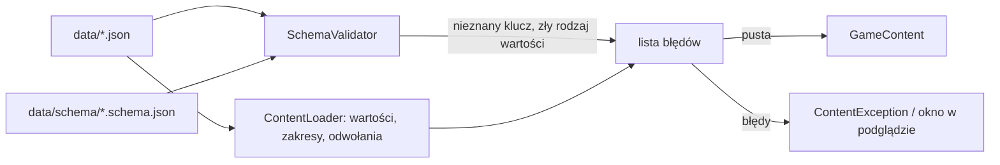

# Schematy danych i przeładowanie danych w podglądzie (etap 6, T14)

**W jednym zdaniu:** każdy plik z `data/` ma swój schemat w `data/schema/`, więc literówka w nazwie klucza jest błędem przy wczytaniu (z podpowiedzią właściwej nazwy), a podgląd wczytuje dane od nowa klawiszem F5 bez zamykania okna.

**Faza tury:** żadna. Sprawdzenie działa raz, przy wczytaniu danych (`ContentLoader.Load`), przed odczytem wartości.

## Po co

Dotąd loader czytał tylko klucze, których szukał. Klucz z literówką (`"journeyTickPerCell"`) był po cichu pomijany, a gra brała wartość domyślną albo błąd „brak wymaganej liczby” bez wskazania przyczyny. Przy strojeniu temp (etapy 6–7) to łatwy sposób na godzinę szukania, dlaczego zmiana nic nie daje.

Teraz:

```
units.json: journeyTickPerCell: unknown key, did you mean 'journeyTicksPerCell'?
units.json: journeyTicksPerCell: required whole number.
```

## Dane wejściowe i wyjściowe
- Czyta: `data/*.json` i `data/schema/<plik>.schema.json`.
- Zmienia: nic w stanie gry. Dopisuje błędy do tej samej listy co loader (`ContentException`).
- Publikuje: `LocalServerHost.CheckData(folder)` zwraca listę problemów (pusta = dane w porządku); podgląd pokazuje ją w oknie.

## Przepływ



## Zasady

- Schemat to zwykły JSON Schema (w edytorze, np. VS Code, daje podpowiedzi kluczy). Walidator rozumie tylko to, czego schematy używają:
  - `type` (`object`, `array`, `string`, `number`, `boolean`; liczby mogą być też tekstem, np. `"1.5"`, bo tak zapisujemy ilości);
  - `properties`: znane klucze obiektu;
  - `additionalProperties: false`: każdy inny klucz to błąd, z podpowiedzią najbliższej nazwy (ta sama nazwa inną wielkością liter albo najwyżej 3 litery różnicy);
  - `additionalProperties: {schemat}`: **mapa**, np. `{"wood": 2, "meat": 1}` albo `{"forest": 150}`; klucze są dowolne, a to, czy dobro albo biom istnieje, sprawdza loader;
  - `items`: schemat elementów listy.
- Klucz `comment` wolno wpisać w każdym obiekcie (notatki dla ludzi; loader go nie czyta).
- Zakresy liczb, wymagane klucze i odwołania (czy technologia istnieje) sprawdza dalej loader, tak jak wcześniej. Schemat pilnuje tylko **nazw kluczy i rodzaju wartości**.
- Gdy folder danych nie ma podfolderu `schema/`, sprawdzenie jest pomijane. Tak działają testy, które kopiują kilka plików do folderu tymczasowego i podmieniają jeden z nich.
- Plik danych bez schematu w folderze z `schema/` to błąd.

## Nowy klucz albo nowy plik

- **Nowy klucz w istniejącym pliku:** dopisz go w `data/schema/<plik>.schema.json` w obiekcie, w którym loader go czyta. Bez tego wczytanie skończy się błędem „unknown key”, więc nie da się zapomnieć.
- **Nowy plik danych:** `python3 docs/systems/tools/infer_schema.py data data/schema nowy.json` pisze pierwszy schemat z kluczy, które plik ma dziś. Potem dopisz ręcznie klucze opcjonalne, których w danych jeszcze nie ma, a mapy (obiekty z kluczami dóbr, biomów, warstw) dopisz do `MAP_PROPERTIES` w skrypcie albo popraw w schemacie na `additionalProperties`.
- Pierwsze schematy (2026-11-12) wygenerował ten skrypt; klucze opcjonalne, których dane nie używają, dopisałem ręcznie po przeglądzie loadera: `technologies` (`stratum`, `inOneSettlement` w wymaganiach ludzi), `units` (`requires`, `terrain` z `biomes` w rodzajach oddziałów), `planets` (`co2`, `starVariabilityPerMille`, `starCycleYears` i reszta opcjonalnych parametrów gwiazdy), `diplomacy` (`requires` w umowach).

## Przeładowanie danych w podglądzie

- **F5** w czasie gry: podgląd wczytuje `data/` od nowa i uruchamia **tę samą partię** (te same ustawienia, ten sam seed) z nowymi danymi. Okno zostaje otwarte. Podgląd czyta dane prosto z `data/` w repo, więc wystarczy zapisać plik i nacisnąć F5.
- Gdy dane mają błędy, obecna gra działa dalej, a okno „Game data has N problems” pokazuje listę (najwyżej 30 pierwszych, pełna w konsoli) z przyciskiem **Reload data** do ponowienia po poprawce.
- Tak samo przy otwarciu menu (Esc) i przy starcie gry: złe dane nie zamykają już podglądu wyjątkiem.
- Przeładowanie zaczyna partię od nowa, a nie podmienia danych w trwającej grze: systemy rdzenia trzymają dane od startu, a powtórka (`replay.md`) opisuje partię seedem i rozkazami przy jednych danych. Podmiana w trakcie gry to możliwe rozszerzenie (pytanie do Patryka w opisie PR).

## Pliki danych
Wszystkie z `data/` i ich schematy w `data/schema/`.

## Testy
`tests/CivSim.Tests/Data/SchemaTests.cs`: każdy plik ma schemat i odwrotnie; dane gry przechodzą schematy; literówka daje błąd z podpowiedzią; obcy klucz bez podpowiedzi; zły rodzaj wartości; mapy i `comment`; folder z literówką w `units.json` daje błąd w `CheckData` i w `ContentLoader.Load`.

## Wydajność
Sprawdzenie 25 plików trwa ok. 10–20 ms przy wczytaniu danych (Headless `--turns 0`: 494–561 ms ze schematami, 488–543 ms bez). Nie działa w takcie.
