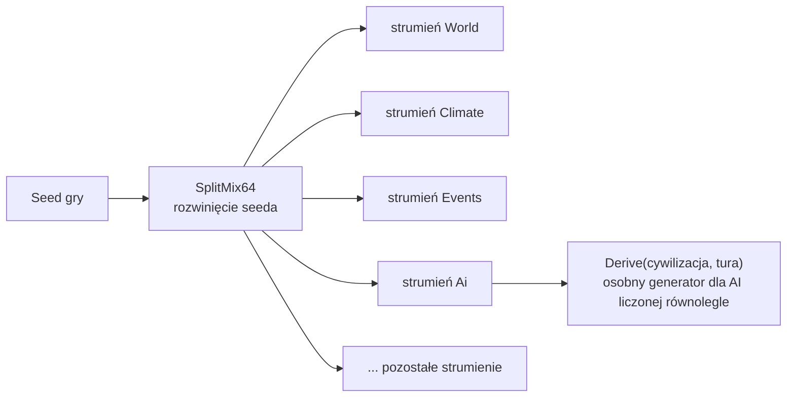

# Determinizm

**W jednym zdaniu:** ten sam seed i te same komendy dają identyczną grę, bit w bit, na Windowsie, Linuksie i macOS.

**Faza tury:** wszystkie. To zestaw zasad i narzędzi, z których korzysta każdy system.

## Dane wejściowe i wyjściowe
- Czyta: seed gry (liczba 64-bitowa).
- Zmienia: stan generatorów liczb losowych (po jednym na system).
- Publikuje w migawce: nic. Stan generatorów trafia do zapisu gry i do hasha stanu.

## Przepływ

## Zasady i wzory

**Liczby losowe** (`CivSim.Core.Random`):
- Generator to xoshiro256** (`DeterministicRandom`). Wyniki są sprawdzane testem z wartościami wzorcowymi autorów algorytmu.
- Każdy system ma własny strumień (`RandomStreamId`: World, Climate, Events, Ai, Combat, Population, Research, Leaders).
  Dzięki temu zmiana w walce nie przesuwa losowań pogody.
- Numery strumieni są częścią formatu zapisu: można dopisywać nowe na końcu, nigdy nie zmieniać istniejących.
- AI liczona równolegle bierze generator z `Derive(strumień, id cywilizacji, tura)`. Zależy on tylko od tych kluczy,
  a nie od tego, ile liczb wylosowały inne wątki.
- Losowanie z zakresu jest dokładnie równomierne (metoda Lemire'a z odrzucaniem), bez `float`.
- `System.Random`, `Guid.NewGuid`, `DateTime.Now` i `GetHashCode()` z napisów są w logice gry zakazane.

**Ilości** (`CivSim.Core.Numerics.Amount`):
- Ilość to liczba całkowita w setnych częściach jednostki: `12.34` to 1234.
- Dodawanie, odejmowanie i mnożenie przez liczbę całkowitą są dokładne. Przepełnienie zgłasza błąd zamiast cicho zawijać liczbę.
- Każde dzielenie podaje sposób zaokrąglania: do najbliższej (połówki od zera, domyślnie), w dół, w górę albo przez obcięcie.
- Mnożenie przez ułamek (`MultiplyRatio`, `MultiplyPercent`) liczy pośrednio na 128 bitach, więc duże ilości się nie przepełniają.
- `SplitProportionally` dzieli ilość według wag tak, że części zawsze sumują się dokładnie do całości.
  Przyda się przy rozdziale towarów przy niedoborach (GDD 4.5).
- Odczyt z danych JSON (`Amount.Parse`) przyjmuje najwyżej dwie cyfry po kropce i nie zależy od ustawień regionalnych systemu.

- **Hasz z podziałem na części** (T11, `GameStateHash.Sections`): 9 części stanu liczonych osobno; hasz całości to te same części
  w jednym strumieniu. Powtórka (`docs/systems/replay.md`) porównuje je co 600 taktów i wskazuje część, która rozjechała się pierwsza.

## Pliki danych
Brak. Ilości w plikach `data/` zapisujemy jako tekst, np. `"2.50"`, i czytamy przez `Amount.Parse`.

## Testy
- `DeterministicRandomTests`: wartości wzorcowe SplitMix64 i xoshiro256**, powtarzalność, odtwarzanie stanu, zakresy,
  równomierność (test chi-kwadrat), prawdopodobieństwo `Chance`, tasowanie.
- `RandomStreamsTests`: niezależność strumieni, brak korelacji, `Derive`, zapis i odczyt stanów, wartości „złote”
  (jeśli ten test się wysypie, stare seedy przestają dawać te same gry).
- `AmountTests`: tworzenie, formatowanie, odczyt tekstu, dokładność, przepełnienie, wszystkie tryby zaokrąglania, podział proporcjonalny.

## Wydajność
`DeterministicRandom` i `Amount` nie alokują pamięci przy losowaniu ani przy obliczeniach. Pomiar w pętli tury dojdzie z benchmarkiem.
