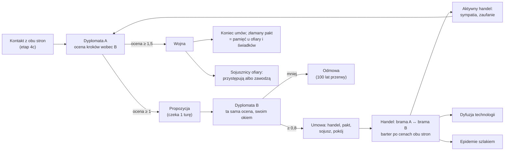

# Dyplomacja i handel między cywilizacjami

**W jednym zdaniu:** cywilizacje, które naprawdę się poznały, żyją w pokoju, mogą podpisać umowę handlową, pakt o nieagresji i sojusz obronny albo wypowiedzieć sobie wojnę; propozycję każdej umowy ocenia dyplomata drugiej strony tą samą oceną co proponujący, a umowa handlowa pozwala kupcom wymieniać nadwyżki między najbliższymi osadami partnerów (etap 4d, GDD 9.1–9.2).

**Faza tury:**
- 3. Decyzje: dyplomata AI (`DiplomatAdvisor`) odpowiada na propozycje i raz na `reviewEveryYears` lat proponuje umowę albo wypowiada wojnę.
- 4. Rozstrzyganie komend (kategoria Diplomacy, przed gospodarką i ruchem): `ProposeTreatyCommand`, `AnswerProposalCommand`, `DeclareWarCommand`.
- 7. Gospodarka: `ForeignTradeSystem`, zaraz po handlu wewnątrz sieci.
- 9. Państwo: `DiplomacySystem` (rozejmy wygasają, propozycje bez odpowiedzi przepadają, wspólny wróg, koniec handlu).
- 1. Świat (następna tura): epidemia może przejść szlakiem handlowym (`EventSystem`). 10. Nauka: partner handlowy liczy się jak sąsiad przy dyfuzji.

## Dane wejściowe i wyjściowe
- Czyta: `data/diplomacy.json`, relacje z etapu 4c (sympatia, zaufanie, wspomnienia, czy obie strony się poznały), osady i ich wojowników, pamięć mapy (AI liczy tylko wojowników z obozów, które widziała), ceny wewnętrzne sieci (`Market`), charakter i wagi celów.
- Zmienia: `GameState.Treaties` (księga umów i propozycji, posortowana po parze i rodzaju), magazyny osad bramowych, wspomnienia relacji (złamanie traktatu, aktywny handel, wspólny wróg, pomoc w wojnie), kronikę.
- Publikuje: nic w migawce (widok gracza przyjdzie z etapem 5). Headless: `--treaties treaties.csv` (co `--stats-every` tur) i podsumowanie na końcu.

## Przepływ

## Zasady i wzory
- **Stany (GDD 9.1):** nieznani → kontakt (obie strony muszą się poznać) → pokój bez umów → umowy. Wojna może zacząć się z każdego stanu. Pogłoska nie wystarcza.
- **Umowy:** umowa handlowa; pakt o nieagresji; sojusz obronny (tylko przy obowiązującym pakcie); pokój kończy wojnę i daje rozejm na 100 lat. W pliku można dla każdej umowy podać technologię, którą obie strony muszą znać (dziś żadna nie wymaga).
- **Napady:** pakt, sojusz i rozejm zabraniają wypędzania obozów drugiej strony (gubernator ich nie rozważa, a serwer odrzuca taką komendę). W czasie wojny napad na obóz wroga jest wart 1,5 raza więcej. Bez umów proste napady zostają jak w etapie 4c.
- **Wojna w 4d to stan dyplomatyczny bez armii.** Bitwy, cel, wynik i zmęczenie wojną przychodzą w etapie 4e. Do tego czasu zmęczenie liczymy z samych lat wojny.
- **Ocena (GDD 8.3):** podstawa 1, razy czynniki z krzywych, razy waga celu stratega, razy charakter (0,5 + cecha). Te same wzory liczy proponujący i odpowiadający:

| Krok | Czynniki | Cel i cecha |
| --- | --- | --- |
| Umowa handlowa | sympatia (−50 → 0, +50 → 2), zasięg (najbliższe osady ≤ 16 pól), zysk z handlu (różnica cen po stracie na drodze: 0% → 0, 40% → 1,5) | dobrobyt, handlowość |
| Pakt o nieagresji | sympatia, zaufanie (−50 → 0, +50 → 2), zasięg, zagrożenie (ich widziani wojownicy wobec naszych: 50% → 0,5, 200% → 1,5) | bezpieczeństwo, ostrożność |
| Sojusz obronny | sympatia, zaufanie (0 → 0, +30 → 1,5), największe zagrożenie od kogoś trzeciego (wróg w wojnie = pełne) | bezpieczeństwo, lojalność |
| Wojna | niechęć (sympatia 0 → 0, −50 → 2), powód (spór o osadę albo zapamiętana napaść; bez powodu 0), przewaga (nasi wojownicy wobec ich i ich sojuszników: 120% → 0, 250% → 1,5), łamany traktat (1 − lojalność, co najmniej 0,1) | podbój, agresja |
| Pokój | lata wojny (0 → 0, 150 → 1,5), sympatia (−100 → 0,3, +50 → 1,5) | bezpieczeństwo, ostrożność |

- **Progi:** propozycja od 1, zgoda od 0,8, wojna od 1,5. Dyplomata co przegląd wybiera jeden krok spośród 3 najlepszych (losowanie jak u innych doradców). Odmowa albo brak odpowiedzi blokuje tę samą propozycję na 100 lat.
- **Reputacja (GDD 9.1):** wypowiedzenie wojny mimo paktu, sojuszu albo rozejmu to złamanie traktatu: ofiara pamięta −20 sympatii i −40 zaufania (200 lat), a każdy, kto zna obie strony, połowę tego.
- **Sojusznicy:** gdy ktoś wypowiada wojnę, sojusznicy obronni ofiary przystępują z szansą od 30% (lojalność 0) do 100% (lojalność 1). Ten, kto przystąpi, zostaje zapamiętany jako „pomoc w wojnie”; ten, kto zawiedzie, łamie sojusz. Sojusznik obu stron zostaje z boku bez kary.
- **Handel bez karawan (GDD 9.2, CORE uproszczone):** co turę dla każdej umowy handlowej bierzemy dwie najbliższe zamieszkane osady partnerów (bramy), jeśli dzieli je najwyżej 16 pól. Każda brama oddaje połowę swojej nadwyżki (jedzenie ponad turę i rok zapasu, inne towary ponad rok potrzeb i wejść receptur) tych towarów, które druga sieć wycenia wyżej po stracie 2% na pole, i tylko tyle, ile drugiej bramie brakuje. To barter (GDD 4.6): strona, która dostaje więcej, dopłaca innymi zbędnymi towarami, a czego nie da się opłacić, nie jedzie. Wartość liczymy po średniej cen obu stron.
- **Skutki handlu:** tura z wymianą podtrzymuje „aktywny handel” (+0,5 sympatii i +0,2 zaufania na rok, do +30 i +20); partner, z którym była wymiana, liczy się przy dyfuzji technologii jak sąsiad (niezależnie od odległości); epidemia w sieci jednej z bram może przejść na drugą bramę z tą samą szansą co w sieci (15%), jeśli wymiana była w ostatnich dwóch turach.
- **Wspólny wróg:** dwie znające się cywilizacje w wojnie z tym samym wrogiem pamiętają to (+20 sympatii, +10 zaufania), a po końcu wojny wspomnienie zanika przez 50 lat.
- **Czasy w latach** (zasada 6): przegląd co 50 lat, rozejm 100 lat, przerwa po odmowie 100 lat.
- **Determinizm:** księga umów jest posortowana po parze i rodzaju, propozycje w kolejności złożenia; losowanie sojusznika ma generator z seeda, sojusznika, agresora i tury (strumień `ai`, sól `0xD4 << 40`); dyplomata losuje generatorem doradcy. Umowy i propozycje są w hashu stanu i w zapisie gry (format 18).

## Pliki danych
- `data/diplomacy.json`: progi, przegląd co ile lat, zasięg, udział nadwyżki, świadkowie, sojusznicy, krzywe ocen, lista umów (wszystkie 5 rodzajów muszą być; pokój musi mieć lata rozejmu).

## Testy
- `TreatyTests`: dyplomacja wymaga kontaktu z obu stron; zgoda i odmowa, pamięć odmowy; propozycja bez odpowiedzi przepada, odmowa zapomina się po latach; sojusz wymaga paktu; wojna kończy umowy, złamany pakt pamięta ofiara i świadkowie (połowa); wojna bez umów nic nie łamie; pokój i rozejm, który wygasa; lojalny sojusznik przystępuje, nielojalny zawodzi i łamie sojusz; pakt blokuje napad do wypowiedzenia wojny; handel wymienia jedzenie za narzędzia i podtrzymuje aktywny handel; bez umowy albo poza zasięgiem nie ma handlu; partner handlowy liczy się do dyfuzji; kupcy przenoszą epidemię; wspólny wróg; dyplomata proponuje pakt, a druga strona go przyjmuje; wrogi dyplomata nic nie proponuje; silny, wrogi sąsiad z powodem wypowiada wojnę; zapis gry; sortowanie księgi; dane i błędy w danych.
- `DeterminismTests`, `WorldGeneratorTests`: nowe złote hashe.

## Wydajność
- Dyplomata: raz na turę, gdy ktoś ma przegląd albo czeka propozycja, liczy najbliższe osady każdej pary cywilizacji (osady pogrupowane po właścicielu) i widzianych wojowników; ceny sieci tylko dla par, które rozważają handel.
- Handel: osady pogrupowane po właścicielu raz na turę, ceny dwóch sieci na każdą umowę handlową.
- Pomiar (seed 7, mapa standard, 1000 tur, ta sama maszyna, dwa przebiegi): średnia tura 20,5 ms wobec 21,0 ms na `development`, alokacje 308 KB na turę wobec 325 KB, pamięć robocza 177–181 MB wobec 165–168 MB (+8%). Symulacja różni się od bazowej, więc porównanie jest przybliżone.
