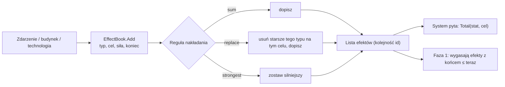

# Efekty

**W jednym zdaniu:** wspólny mechanizm modyfikatorów (GDD 10.1): zdarzenia, budynki, technologie i polityki nakładają na pole, osadę albo cywilizację efekt z siłą i datą końca, a systemy pytają o sumę.

**Faza tury:** 1. Świat (wygasanie efektów). Efekty dodają inne systemy; czytają je wszystkie, którym są potrzebne.

## Dane wejściowe i wyjściowe
- Czyta: typy efektów z `data/effects.json`, czas gry `GameState.Month`.
- Zmienia: listę aktywnych efektów `GameState.Effects` (dodawanie, usuwanie, wygasanie).
- Publikuje w migawce: na razie nic. Efekty pokażemy w inspektorze razem ze zdarzeniami (etap 3h).

## Przepływ

## Zasady i wzory
- **Efekt** = typ (z danych), cel (pole na danym świecie, osada albo cywilizacja), siła (liczba całkowita, np. −50 = połowa wydobycia) i miesiąc końca. Czas trwania podaje się w latach, więc nie zależy od długości tury.
- **Statystyki** (co efekt zmienia): wydajność osady w %, zakaz wejścia na pole, dodatkowy koszt ruchu, wydobycie z pola w %, ubytek ludności w promilach na rok, nastrój. Nowy typ efektu dodajesz w danych; nowa statystyka wymaga kodu, bo ktoś musi ją czytać.
- **Nakładanie:** `sum` dodaje siły; `replace` zostawia najnowszy; `strongest` zostawia ten o największej wartości bezwzględnej. Efekty różnych typów na tę samą statystykę zawsze się sumują.
- **Zniszczenie** z GDD 10.1 nie jest trwałym efektem, tylko jednorazową akcją zdarzenia (etap 3h).
- Efekty mają rosnące id i są trzymane w tej kolejności, więc wynik nie zależy od kolejności słowników.

## Pliki danych
- `data/effects.json`: 6 typów efektów (uszkodzenie, zakaz ruchu, spowolnienie ruchu, redukcja wydobycia, depopulacja, spadek nastroju).

## Testy
- `EffectBookTests`: sumowanie, „najsilniejszy wygrywa”, „najnowszy zastępuje”, wygasanie z czasem gry (20 i 60 lat przy turach po 50 lat), usuwanie po id.
- `StorageTests.SettlementsAndEffectsSurviveSaveAndLoad`: efekty przechodzą przez zapis gry.

## Wydajność
Pytanie o sumę przegląda całą listę. Przy kilkudziesięciu efektach to nic; gdy zdarzenia (etap 3h) dodadzą ich setki, dołożymy indeks po celu.
