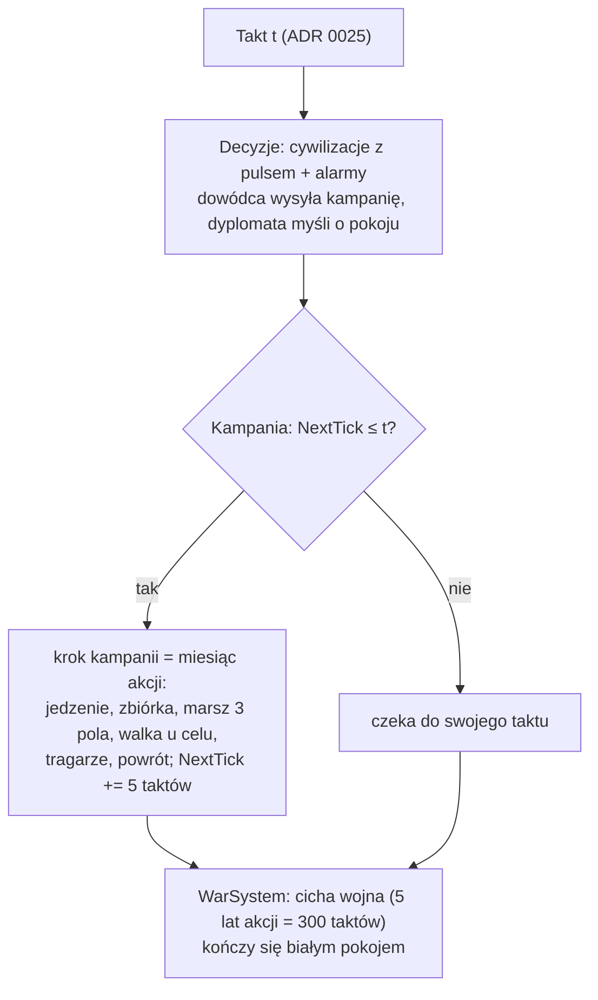

# Epizody (krótki zegar)

**W jednym zdaniu:** zdarzenia z przebiegiem (dziś kampanie wojenne) liczą się w taktach gry na żywo: krok kampanii to jeden miesiąc akcji (5 taktów, pół sekundy przy ×1), a świat i cywilizacje idą swoim rytmem pulsów i nigdy na nie nie czekają (ADR 0025; wcześniej ADR 0022).

**Faza tury:** zegar w fazie zapisu (`CalendarSystem`, `WorldClock.Begin`); kampanie w fazie walki (`CampaignSystem`, faza 6); decyzje dowódcy i dyplomaty w fazie decyzji.

**Stan:** etap 4e PR 2: silnik epizodów i pierwsza kampania; PR 3: armie z wielu osad, uzbrojenie, tragarze, głód, armie w podglądzie; PR 4: bitwa w rundach i podbój. Etap 6 PR 1: epizody na taktach, bez skracania kroków świata.

## Dane wejściowe i wyjściowe
- Czyta: `data/war.json` (krok kampanii, marsz, ciche wygasanie wojny, progi dowódcy), kroki cywilizacji, wojny, alarmy.
- Zmienia: `GameState.Episodes` (lista epizodów), wojowników i zapasy osad, wynik i zmęczenie wojny.
- Publikuje: kronika (wyprawa wyszła, najazd, zdobycie, odwrót, głód, napad po jedzenie, powrót); Headless `--wars` (kampanie, miesiące kampanii) i `--campaigns` (jeden wiersz na kampanię, PR 3); migawka dla podglądu: `ObserverDetailsMessage.Armies` (`ArmyView`: pole, cel, wojownicy, front, uzbrojenie, morale, jedzenie, faza, tragarze; protokół 9).

## Przepływ

## Zasady i wzory
- **Takty, nie lata:** epizod ma `NextTick` (następny krok) i `TickMonths` (miesiące akcji na krok, dziś 1). Miesiąc akcji trwa
  `ticksPerActionMonth` taktów (`data/time.json`, dziś 5). Zbiórka trwa do `MusterUntilTick`.
- **Świat nie czeka:** puls świata i pulsy cywilizacji idą swoim rytmem (`docs/systems/turn-loop.md`). Dawne skracanie kroku świata
  (`WorldClock.Shorten`) i krok samych epizodów zniknęły; znany problem 4 („wojny spowalniają czas gry”) jest naprawiony.
- **Kampania** (`LaunchCampaignCommand`, `CampaignSystem`):
  - wychodzą wojownicy osady wyjścia i osad do 6 pól od niej (PR 3): z każdej najwyżej 2/3 (1/3 zostaje w domu), razem co najmniej 5 i najwyżej limit wodza ery (50);
  - zbiórka (faza `Muster`): tyle miesięcy, ile najdalsza osada idzie do osady wyjścia; potem marsz;
  - każdy krok: armia je (najpierw niesione jedzenie, potem jedzenie z łupów); głodna traci morale, napada pobliską wioskę wroga, przy morale < 30 zawraca; tragarze idą za nią (szczegóły: `docs/systems/war.md`);
  - marsz: 3 pola na miesiąc po znanych polach (ok. 150 km na pole; ok. 15 km dziennie);
  - u celu wojownicy stają na polu obok i atakują w następnym miesiącu; dowódca, który teraz widzi osadę, może ich odwołać (od PR 5, decyzja K2 w `docs/ai/11-dowodca.md`);
  - walka (od PR 4): bitwa w rundach na strumieniu `combat` (`Battles.Fight`, szczegóły w `docs/systems/war.md`): siła z uzbrojeniem, morale, głodem i terenem obrońców, straty co rundę, ucieczka przy niskim morale;
  - wygrana: łupy (tyle, ile uniosą wojownicy, ten sam udział każdego zapasu); w wojnie o ziemię zdobyta wioska przechodzi z ludźmi do zwycięzcy, a pokonani mają do niej roszczenie; ludzie pobitego obozu uciekają do swojej najbliższej osady;
  - powrót: ocaleni wracają do osad, z których przyszli (w proporcji), łupy i resztka jedzenia do osady wyjścia (albo do najbliższej własnej, gdy domu już nie ma).
- **Wojna** (`WarSystem`): wojna bez kampanii przez 5 lat akcji (`quietPeaceYears` × 12 × `ticksPerActionMonth` = 300 taktów, 30 s przy ×1) kończy się białym pokojem; liczy się od `Treaty.QuietSince` = najpóźniejsze z: wypowiedzenia (`SinceTick`), gotowości (`ReadyTick`) i ostatniego kroku kampanii (`LastCampaignTick`); zmęczenie = miesiące kampanii × 5 + procent zabitych × 3.

## Pliki danych
- `data/war.json`: `campaignStepMonths` 1, `marchCellsPerMonth` 3, `quietPeaceYears` 5, `wearinessPerCampaignMonth` 5, `sendPercent` 67, `minWarriors` 5, `armySightCells` 1 (reguły); progi dowódcy w `data/ai.json` → `commander` (od PR 5).

## Testy
- `ArmyTests` (PR 3): patrz `docs/systems/war.md`.
- `EpisodeTests` (prawdziwy `data/time.json`): kampania robi krok co miesiąc akcji, a świat idzie dalej; cicha wojna kończy się dokładnie po 5 latach akcji w taktach; kampania zawraca przed zbyt silnym celem (na rozkaz dowódcy); kampania wymaga wojny i zostawia 1/3 w domu; zapis w trakcie marszu i dalsza gra dają ten sam hash.
- `DeterminismTests`, `WorldGeneratorTests`: nowe wartości kontrolne hashy.

## Wydajność
- Krok kampanii kosztuje ułamek milisekundy. Pomiar całej gry: w opisie PR.
