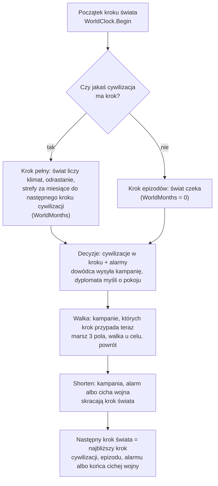

# Epizody (krótki zegar)

**W jednym zdaniu:** zdarzenia z przebiegiem, które w rzeczywistości trwają tygodnie albo miesiące (dziś kampanie wojenne), liczą się we własnych krokach co miesiąc, a reszta świata zostaje na długich krokach er (ADR 0022, GDD 6.2).

**Faza tury:** zegar w fazie zapisu (`CalendarSystem`, `WorldClock.Begin` i `WorldClock.Shorten`); kampanie w fazie walki (`CampaignSystem`, faza 6); decyzje dowódcy i dyplomaty w fazie decyzji.

**Stan:** etap 4e PR 2: silnik epizodów i pierwsza kampania.

## Dane wejściowe i wyjściowe
- Czyta: `data/war.json` (krok kampanii, marsz, ciche wygasanie wojny, progi dowódcy), kroki cywilizacji, wojny, alarmy.
- Zmienia: `GameState.Episodes` (lista epizodów), `GameState.StepMonths` (długość kroku świata) i `GameState.WorldMonths` (ile miesięcy liczy sam świat), wojowników i zapasy osad, wynik i zmęczenie wojny.
- Publikuje: kronika (wyprawa wyszła, najazd, zdobycie, odwrót, powrót); Headless `--wars` (kampanie, miesiące kampanii). Migawka dla podglądu: w PR 3.

## Przepływ

## Zasady i wzory
- **Krok świata** trwa do najbliższego z: kroku jakiejś cywilizacji (rytm ery, ADR 0018), kroku epizodu (kampania: co miesiąc), reakcji na alarm (następny miesiąc), końca cichej wojny (5 lat bez kampanii).
- **Krok pełny** (ktoś ma krok ery): świat liczy klimat, pory roku, odrastanie dzikiej żywności, odpoczynek ziemi, strefy i spory za `WorldMonths` = miesiące do następnego kroku cywilizacji. Kroki epizodów leżą w środku tego okresu i nie liczą go drugi raz.
- **Krok epizodów:** żadna cywilizacja nie ma kroku; systemy świata nie liczą nic, liczą się tylko kampanie, odpowiedzi na propozycje i decyzje po alarmach.
- **Skrócenie kroku** (`WorldClock.Shorten`, przed upływem czasu): gdy w kroku wysłano kampanię, wypowiedziano wojnę (alarm) albo cicha wojna kończy się wcześniej, krok świata kończy się wcześniej. Kroki cywilizacji (gospodarka liczona na cały ich krok) się nie zmieniają.
- **Kampania** (`LaunchCampaignCommand`, `CampaignSystem`):
  - wychodzą wojownicy jednej osady: co najmniej 5, najwyżej 2/3 (1/3 zostaje w domu);
  - marsz: 3 pola na miesiąc po znanych polach (ok. 150 km na pole; ok. 15 km dziennie);
  - u celu wojownicy widzą osadę: atakują tylko przy szansie co najmniej 60%, inaczej wracają;
  - walka: szansa = ich udział w sile (wojownicy przeciw wojownikom + 25% reszty mieszkańców), na strumieniu `combat`; straty jak przy napaści;
  - wygrana: łupy (tyle, ile uniosą wojownicy, ten sam udział każdego zapasu); w wojnie o ziemię zdobyta wioska przechodzi z ludźmi do zwycięzcy, a pokonani mają do niej roszczenie;
  - powrót: ocaleni i łupy wracają do osady (albo do najbliższej własnej, gdy domu już nie ma).
- **Wojna** (`WarSystem`): wojna bez kampanii przez 5 lat kończy się białym pokojem; zmęczenie = miesiące kampanii × 5 + procent zabitych × 3.

## Pliki danych
- `data/war.json`: `campaignStepMonths` 1, `marchCellsPerMonth` 3, `quietPeaceYears` 5, `wearinessPerCampaignMonth` 5, `minWinChancePercent` 60, `sendPercent` 67, `minWarriors` 5 (ostatnie trzy przejdą do `data/ai.json` z dowódcą w PR 5).

## Testy
- `EpisodeTests`: kampania dodaje kroki co miesiąc, a świat czeka; cicha wojna kończy się po 5 latach, a nie w następnym długim kroku; kampania zawraca przed zbyt silnym celem; kampania wymaga wojny i zostawia 1/3 w domu; zapis w trakcie marszu i dalsza gra dają ten sam hash.
- `DeterminismTests`, `WorldGeneratorTests`: nowe wartości kontrolne hashy.

## Wydajność
- Krok epizodów kosztuje ułamek milisekundy (świat nie liczy nic). Pomiar całej gry: w opisie PR.
