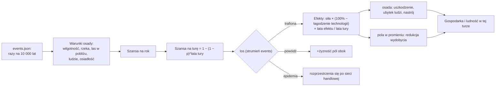

# Zdarzenia

**W jednym zdaniu:** co turę każda zamieszkana osada może zostać trafiona suszą, pożarem, powodzią albo epidemią; szansa wynika ze stanu świata (sucho, las, rzeka, tłok, osiadłość), technologie łagodzą skutki, a zdarzenie działa wyłącznie przez efekty, żyzność i kronikę (etap 3h, GDD 10).

**Faza tury:** 1. Świat, zaraz po wygaśnięciu starych efektów (`EventSystem`). Skutki czytają później gospodarka (zbieranie, rolnictwo) i ludność (ubytek, nastrój).

## Dane wejściowe i wyjściowe
- Czyta: `data/events.json`, `data/effects.json`, osady (ludzie, poziom, pole), mapę (wilgotność, rzeki, biomy), znane technologie właściciela, sieci handlowe (tylko gdy zdarzenie się rozprzestrzenia), strumień losowy `events`.
- Zmienia: dodaje efekty do `GameState.Effects`, podnosi `fertility` pól po powodzi, pisze wpisy w kronice.
- Publikuje w migawce: nic nowego (kronika już idzie do klienta).

## Przepływ

## Zasady i wzory
- **Szansa:** `timesPer10000Years` mówi, ile razy zdarzenie trafia osadę w 10 tys. lat bez warunków. Warunek, który zachodzi, mnoży szansę przez `percent` (0 = wyklucza); warunek `required`, który nie zachodzi, wyklucza zdarzenie. Na turę: 1 − (1 − p)^N dla N lat tury, najwyżej raz na turę na osadę.
- **Siła:** każda znana technologia z `softenedBy` obniża siłę wszystkich efektów o swój procent. Gdy tura trwa dłużej niż efekt, efekt zostaje na całą turę, a jego siła jest przeliczana przez (lata efektu / lata tury). Krótka susza w 50-letniej turze waży więc mało, a w późniejszych erach z krótkimi turami działa w pełni przez kilka tur. To ta sama zasada co „tempa na rok”.
- **Cel efektu** wynika z typu efektu: efekt osady spada na trafioną osadę, efekt cywilizacji na właściciela, efekt pola na każde pole lądu w promieniu `radiusCells`.
- **Zdarzenia (dane, do strojenia):**
  - **Susza** (15 na 10 tys. lat; ×3 przy wilgotności < 35, wykluczona przy > 75, ×0,5 przy rzece): −40% wydobycia i plonów w promieniu 4 pól przez 8 lat; nawadnianie łagodzi o 50%, garncarstwo o 20%.
  - **Pożar** (10; tylko z lasem lub sawanną w promieniu 2; ×2,5 przy wilgotności < 50): osada −30% wydajności przez 3 lata, −50% wydobycia w promieniu 2 przez 15 lat (las odrasta); kamieniarstwo łagodzi o 50%.
  - **Powódź** (30; tylko przy rzece; ×2 przy wilgotności > 60): ubytek 60‰ ludzi na rok przez rok, −50% wydobycia w promieniu 1 przez rok, potem +4 żyzności na polach w promieniu 1.
  - **Epidemia** (2; ×1,5 od 300 ludzi, ×2 od 1000, ×2 w osiadłej wiosce): ubytek 100‰ na rok przez 2 lata, nastrój −15 przez 3 lata; każda inna osada tej samej sieci handlowej zaraża się z szansą 15%.
- **Kronika:** każde zdarzenie pisze jedną linię; rozprzestrzenienie epidemii to jedna linia „spread from X to N more settlements”.
- **Rolnictwo** liczy teraz efekty: wydajność osady (`output_percent`) i wydobycie z pola (`extraction_percent`), tak jak zbieranie.
- **Poza CORE** (GDD 16, „Moduł”): ulewa, tornado, trzęsienie ziemi, wulkan, meteoryty, nieurodzaj, kryzys, rewolty, wielcy ludzie. Każde to nowy wpis w `events.json` (czasem nowy rodzaj warunku albo statystyki efektu w kodzie). Zniszczenie budynków przyjdzie z budynkami.

## Pliki danych
- `data/events.json`: 4 zdarzenia (susza, pożar, powódź, epidemia) z warunkami, łagodzeniem, efektami, żyznością, rozprzestrzenianiem i tekstem do kroniki.
- `data/effects.json`: używane typy `extraction_reduction`, `damage`, `depopulation`, `mood_drop`.

## Testy
- `EventTests`: dane się wczytują; szansa rośnie w suchym klimacie i z tłokiem, powódź wymaga rzeki; szansa na turę z szansy na rok; technologia łagodzi, długa tura rozcieńcza; susza obniża plony wioski; powódź podnosi żyzność i nakłada ubytek; epidemia przechodzi na połączoną osadę, ale nie na odległą; determinizm.
- `EffectBookTests`, `StorageTests`: sprawdzają już tylko własne efekty, bo zdarzenia dokładają swoje.

## Wydajność i strojenie
- Seed 7, mapa standard, 1000 tur (ta sama maszyna): tura 18,7 ms (bez etapu 3h 19,6 ms; szybciej, bo `EffectBook.Total` ma teraz indeks po celu), faza świata 1,45 ms (było 0,79), alokacje 350 KB na turę (było 280 KB: teksty kroniki i budowa sieci handlowych, gdy epidemia się rozprzestrzenia).
- Przebieg: ok. 5 susz, 2–3 pożary, 4 powodzie i 2 epidemie (plus ok. 1,6 rozprzestrzenienia) na turę na całym świecie. Ludność po 1000 turach ok. 89 tys. (bez zdarzeń ok. 111 tys.); żadna cywilizacja nie znika przez zdarzenia (11 z 12 żyje w obu przebiegach).
