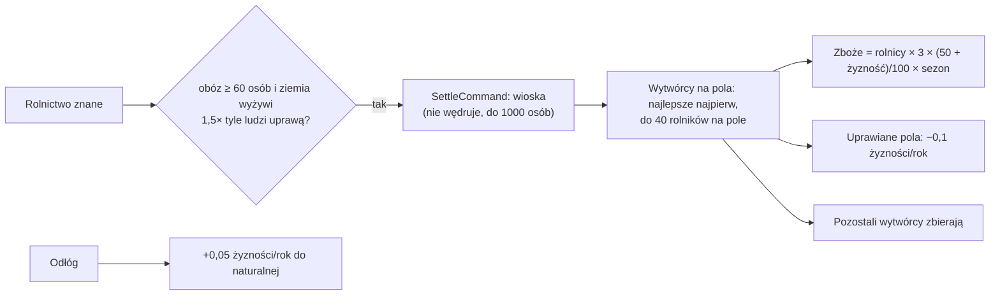

# Rolnictwo i osiedlanie się

**W jednym zdaniu:** obóz cywilizacji, która zna rolnictwo, osiada jako wioska; wytwórcy wioski uprawiają najlepsze żyzne pola jej strefy wpływów i dostają zboże, a uprawiana ziemia jałowieje i odzyskuje żyzność w odłogu (etap 3f, GDD 4.4 i 5.3).

**Faza tury:** 7. Gospodarka, przed zbieraniem (rolnictwo i jałowienie). Osiedlenie: komenda `SettleCommand` w fazie decyzji (AI plemion).

## Dane wejściowe i wyjściowe
- Czyta: poziomy osad (`data/settlements.json`: `requires` wioski = `agriculture`, `settle.minPeople`), zasady rolnictwa (`data/population.json`, sekcja `farming`), warstwy mapy `claim`, `fertility`, `natural_fertility`, `growing_season`, efekty plonów cywilizacji (ogień, nawadnianie).
- Zmienia: poziom osady (obóz → wioska), zboże w magazynie, `SettlementState.Farmers` (wytwórcy przy uprawie w tej turze; reszta zbiera), żyzność pól i jej ułamki (`fertility_remainder`, zapisywane).
- Publikuje w migawce: poziom osady jak dotąd.

## Przepływ

## Zasady i wzory
- **Osiedlenie** (GDD 5.3): obóz ruchomy z co najmniej `minPeople` (60) ludźmi, gdy cywilizacja zna technologię wymaganą przez wioskę (rolnictwo). Wioska nie może się przenosić, ale może wysyłać odłamy (nowe obozy). AI osiada, gdy pełna uprawa pól strefy dałaby co najmniej 1,5 raza tyle jedzenia, ile potrzebuje obóz.
- **Uprawa:** pole lądu w strefie wioski z żyznością co najmniej 20. Na rolnika na rok: `3 × (50 + żyzność) / 100 × udział sezonu wzrostu` (ta sama reguła co dla dzikiej żywności, łącznie z długimi zimami), plus efekty plonów cywilizacji. Najwyżej 40 rolników na pole, najlepsze pola najpierw (remis: niższy numer pola). Pole może dzielić kilka wiosek, ale razem nie więcej niż 40 rolników.
- **Jałowienie** (decyzja Patryka z GDD 4.4): w pełni obsadzone pole traci 0,1 punktu żyzności na rok (proporcjonalnie do obsady), nieuprawiane odzyskuje 0,05 na rok do żyzności naturalnej (zapisanej przez generator, `natural_fertility`). Ułamki punktów zbierają się na mapie.
- Rolnicy nie zbierają; pozostali wytwórcy zbierają jak w obozie.

## Pliki danych
- `data/settlements.json`: `requires` poziomu, `settle.minPeople`.
- `data/population.json`: `farming` (`grainGood`, `grainPerFarmerPerYear`, `farmersPerCell`, `minFertility`, `exhaustionPerYear`, `recoveryPerYear`).

## Testy
- `FarmingTests`: osiedlenie wymaga rolnictwa i ludzi, wioska nie może się przenieść; rolnicy uprawiają, obozy nie; uprawa wyjaławia ziemię, a odłóg ją odbudowuje (nigdy ponad naturalną żyzność); plon rośnie z żyznością, a zbyt jałowa ziemia nie rodzi.

## Wydajność i wyniki
- Seed 7, mapa standard: po rolnictwie (tura 228, ok. 11 tys. lat) obozy osiadają; ludność rośnie z ok. 11 tys. do ok. 100 tys. w 4 tys. lat i utrzymuje się (80–100 wiosek, ok. 35–40 tys. rolników).
- Seed 42, 3000 tur (80 tys. lat): ok. 119 tys. ludzi w 97 wioskach, 9 z 12 cywilizacji żyje, tura średnio 10,5 ms, pamięć zarządzana 5,7 MB.
- Wielkie puste lądy zostają niezasiedlone, bo odłamy odchodzą najwyżej 10 pól; dalekie wędrówki przyjdą w etapie 3g.
