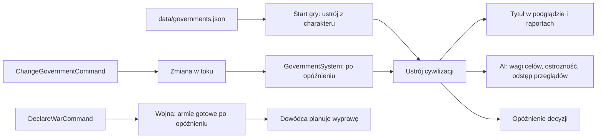

# Ustroje

**W jednym zdaniu:** każda cywilizacja ma ustrój z danych, który daje jej tytuł („Chiefdom of Karrut”), opóźnia decyzje państwowe
i zmienia tempo oraz charakter decyzji AI (GDD 7.2; etap 4f, ADR 0023).

**Faza tury:** State (`GovernmentSystem`: wchodzą zmiany ustroju, które dojrzały); skutki w fazie Decisions (strateg, dyplomata,
dowódca, wybór opcji) i przy komendach (wypowiedzenie wojny, wysłanie wyprawy).

## Dane wejściowe i wyjściowe

- Czyta: `data/governments.json`, cechy charakteru (start), erę cywilizacji (które ustroje są otwarte), miesiąc gry.
- Zmienia: `CivilizationState.Government`, `PendingGovernment`, `PendingGovernmentMonth`; `Treaty.ReadyMonth` przy wypowiedzeniu wojny.
- Publikuje w migawce: dla obserwatora tytuł i nazwę ustroju każdej cywilizacji (`CivilizationView.Title`, `Government`;
  szczegóły śledzonej cywilizacji). Podgląd pokazuje tytuł w tabeli cywilizacji i ustrój w panelu.

## Przepływ

## Zasady i wzory

- **Start (GDD 7.2):** wygrywa ustrój otwarty w erze 1 z największą sumą `cecha × leaning`; remis: pierwszy w pliku.
- **Tytuł:** wzór `title` z `{people}` zamienionym na rdzeń nazwy ludu. Kronika używa samego rdzenia.
- **Opóźnienie wdrożenia:** `enactYears × 12` miesięcy obecnego ustroju.
  - Zmiana ustroju: nowy wchodzi po opóźnieniu (od razu, gdy opóźnienie 0). W tym czasie bez wojen i bez drugiej zmiany. Po wejściu
    nowego ustroju 2 lata bezkrólewia (od PR 3): stabilność −20, nadal bez wojen i zmian ustroju ([stabilność](stability.md)).
  - Wypowiedzenie wojny: armie strony wypowiadającej ruszają od `ReadyMonth = miesiąc + opóźnienie`; obrońca od razu. Cicha wojna
    liczy 5 lat od `QuietSince` = najpóźniejsze z: wypowiedzenie, gotowość, ostatnia kampania.
- **Tempo AI:**
  - strateg: przegląd co `reviewEverySteps × reviewPercent / 100` własnych kroków;
  - dyplomata: przegląd co `reviewEveryYears × reviewPercent / 100` lat;
  - wybór opcji: najlepsza wprost z szansą `ostrożność + cautionShift` (0–1000);
  - wagi celów stratega razy `goalPercent / 100`.

| Ustrój | Od | Wdrożenie | Przeglądy | Ostrożność | Wagi celów |
| --- | --- | --- | --- | --- | --- |
| Rada starszych | epoka kamienia | 4 lata | 150% | +200‰ | bezpieczeństwo ×1,1 |
| Wodzostwo | epoka kamienia | 1 rok | 75% | 0 | ekspansja i podbój ×1,2 |
| Despotia | epoka brązu | 0 | 50% | −200‰ | podbój ×1,2, bezpieczeństwo ×1,1 |
| Republika miejska | epoka brązu | 2 lata | 100% | +100‰ | dobrobyt i nauka ×1,2, podbój ×0,9 |

## Pliki danych

`data/governments.json` (opis pól w `comment`). Ery w `fromEra` to klucze z `data/eras.json`.

## Testy

`tests/CivSim.Tests/Governance/GovernmentTests.cs`: ustroje w danych, start z charakteru (w grze z 12 cywilizacjami występują oba),
tytuł, zmiana po opóźnieniu i blokada wojny w tym czasie, armie czekają na gotowość wojny (obrońca nie), ostrożność i tempo,
zapis, odrzucanie złych danych. Złoty hash świata i test determinizmu zaktualizowane.

## Wydajność

Ustrój to kilka odczytów tablicy na decyzję; bez alokacji w pętli tury. Pomiar w opisie PR 1 etapu 4f.
