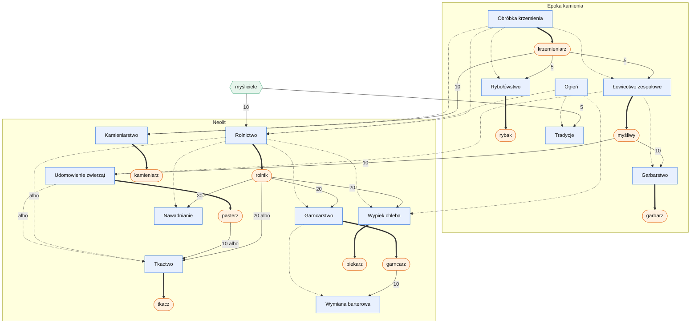

# Graf technologii, fachów i ludzi

Plik tworzy skrypt `docs/systems/tools/tech_graph.py` z `data/technologies.json`, `data/skills.json` i `data/strata.json`. Nie edytuj go ręcznie; po zmianie danych uruchom skrypt jeszcze raz.

Jak czytać (etap 4F, ADR 0020):

- **prostokąt (niebieski):** technologia; kropkowana strzałka: technologia, której wymaga (`albo`: jedna z kilku);
- **gruba strzałka:** technologia otwiera fach (pierwszych 2 mistrzów, potem uczniowie);
- **owal (pomarańczowy):** fach; strzałka z liczbą: tylu fachowców trzeba, żeby badać technologię (uczeń za pół);
- **sześciokąt (zielony):** warstwa ludzi (np. myśliciele), też z liczbą;
- `w osadzie`: wszyscy w jednej osadzie (pismo i filozofia w kolejnych erach).

Test `TechnologyGraphTests` sprawdza, że do każdej technologii i każdego fachu da się dojść od zera, a wczytywanie danych odrzuca fach z technologii, która nie jest wcześniej w drzewie (pętla albo ukryty krok).

