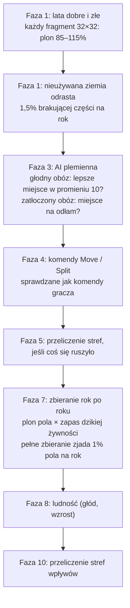

# Strefy wpływów, dzika żywność i wędrówki

**W jednym zdaniu:** każda osada zajmuje okoliczny ląd (strefę wpływów), zbiera z niego dziką żywność, która się wyjada i powoli odrasta, a głodne albo zatłoczone obozy przenoszą się lub wysyłają odłamy.

**Faza tury:** 1. Świat (lata dobre i złe, odrastanie nieużywanej ziemi), 3. Decyzje (prosta AI plemienna), 4. Rozstrzygnięcie komend (przeniesienie, odłam), 5. Ruch (przeliczenie stref po ruchu), 7. Gospodarka (zbieranie rok po roku), 10. Nauka i wpływy (przeliczenie stref, GDD 11.1).

## Dane wejściowe i wyjściowe
- Czyta: osady (pole, ludność, wojownicy), mapę (biom, rzeźba, żyzność, złoża), `data/population.json` (sekcje `wildFood`, `goodAndBadYears`, `influence`, `migration`), `data/strata.json` (`fights`).
- Zmienia: nowe warstwy mapy `wild_food` (0–1000 promili), `claim` (która osada pracuje na polu), `influence` (siła wpływu 0–255) i istniejącą `owner`; pole obozu; nowe osady z odłamów.
- Publikuje: fragmenty mapy niosą dziką żywność i siłę wpływu (protokół v4). Przeniesienia o co najmniej 8 pól i odłamy trafiają do kroniki.

## Przepływ

## Zasady i wzory
- **Strefa wpływów** (GDD 5.4): zasięg = 3 + 1 za każdych 20 wojowników, najwyżej 8. Wejście na pole kosztuje tyle, ile koszt ruchu biomu, plus 1 na wzgórzach i 2 w górach; woda zatrzymuje wpływ (łodzie przyjdą z technologiami). Siła = (zasięg − koszt dotarcia + 1) × 30, czyli słabnie z odległością. Gdzie strefy się nakładają, pole bierze silniejsza osada (przy remisie ta o niższym numerze). **Wyjątek: własna ziemia** (od 2026-11-08, `homeCost` = 2): pole osady i pola, do których dociera kosztem najwyżej 2, należą do niej przed każdą strefą, dla której to pole nie jest własną ziemią; gdy dwie osady mają tam własną ziemię, wygrywa silniejsza. Bez tego rolnicy z zasięgiem 8 zabierali bandom wszystkie pola, nawet pole obozu, i bandy wymierały z głodu (w 8 grach po 2000 tur: średnio 2,8 wymarłych cywilizacji przed zmianą, 0 po niej). Strefy liczymy w fazie 10, jak w GDD, i dodatkowo w fazie 5 po przeniesieniu albo odłamie, żeby zbieranie w tej samej turze widziało nową ziemię.
- **Dzika żywność** (GDD 4.4, zgoda Patryka z 2026-11-05): każde pole ma zapas zwierzyny i roślin od 0 do 1000 promili. Plon pola = plon biomu × zapas. Zbieranie pełną siłą zjada 10 promili rocznie, a każde pole co roku odzyskuje 1,5% brakującej części. Zbieranie liczymy rok po roku wewnątrz tury, więc plemię, które zbiera za dużo, widzi spadek już w tej samej turze. Pola bez osady odrastają w fazie 1.
- **Lata dobre i złe:** na każdą turę każdy fragment mapy 32×32 dostaje mnożnik plonu od 85% do 115% ze strumienia losowego `Climate`.
- **Przeniesienie obozu** (`MoveSettlementCommand`): tylko poziomy ruchome (obóz), najwyżej 10 pól, na ląd, nie na cudzy ląd i nie na inną osadę. Ludzie i magazyn idą razem.
- **Odłam** (`SplitSettlementCommand`, decyzja nr 4: w etapie 3 zostaje w tej samej cywilizacji): osada z co najmniej 60 osobami wysyła część ludzi (z każdej warstwy po równo) i tę samą część magazynu do nowego obozu, co najmniej 4 pola od pozostałych obozów.
- **AI plemienna** (decyzja nr 1; od etapu 4a to doradca gubernator `GovernorAdvisor` na wspólnej ocenie, `docs/systems/ai.md`): obóz, w którym najadło się mniej niż 95% ludzi, szuka w promieniu 10 pól miejsca z co najmniej 30% większym plonem okolicy (po karze 3% za każde pole odległości) i przenosi się, ale nie częściej niż raz na 100 lat. Obóz z co najmniej 80% limitu ludności (120 z 150) wysyła 40% ludzi na najlepsze wolne miejsce, dopóki cywilizacja ma mniej niż 40 obozów. AI widzi tylko pola w promieniu 10 od swoich obozów (zastępczo, do mgły wojny w 3g) i wydaje te same komendy co gracz.
- **Podbój przy migracji** (decyzja nr 5) przesunąłem do 3d razem z przejmowaniem osad, bo wymaga tych samych zasad (kto przejmuje osadę, co z ludźmi).

**Co z tego wychodzi** (seed 42, mapa standardowa, 2000 tur): w 5000 lat plemiona zajmują swoją część lądu (z 600 do ok. 11 000 ludzi w ok. 360 obozach). Potem liczebność każdej cywilizacji faluje o kilkanaście procent; zdarzają się też duże zmiany, np. plemię, które przez 30 000 lat siedziało na ubogiej ziemi, przebija się dalej i rośnie z 150 do 1200 osób. Trzy plemiona na ubogich ziemiach zostają małe (25–90 osób). Dzika żywność na lądzie to średnio 86% pełni.

## Pliki danych
- `data/population.json`: sekcje `wildFood`, `goodAndBadYears`, `influence`, `migration`.
- `data/strata.json`: pole `fights` (wojownicy poszerzają strefę).

## Testy
- `MigrationTests`: każdy obóz zajmuje ziemię wokół siebie; wpływ najsilniejszy przy obozie i nie wchodzi na wodę; wojownicy poszerzają strefę; banda zachowuje własną ziemię obok silniejszego sąsiada; zbieranie zjada dziką żywność, a porzucona ziemia odrasta; obóz przenosi się z ludźmi i magazynem; serwer odrzuca złe przeniesienia (cudza osada, woda, za daleko, zajęte pole); odłam zabiera swoją część ludzi i towarów; plemiona same się rozchodzą; gra z AI jest deterministyczna; AI nie rusza cywilizacji gracza.

## Wydajność
10 000 tur, Release, seed 42: mapa standardowa średnio 10 ms na turę (ok. 490 osad, z czego ok. 360 zamieszkanych), ogromna 22 ms (ok. 3000 osad). Najwięcej kosztują decyzje AI (szukanie miejsca) i zbieranie rok po roku. Alokacje 0,2–1,3 MB na turę to kopie osad w migawce; puste obozy zostają na liście, dopóki etap 3d nie zamieni ich w ruiny, więc wtedy zmaleją.
