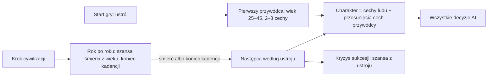

# Przywódcy

**W jednym zdaniu:** każda cywilizacja ma przywódcę z imieniem z języka ludu, wiekiem i 2–3 cechami, które na czas rządów przesuwają
jej charakter; przywódca się starzeje i umiera, a następcę i kryzys wyznacza ustrój (GDD 7.5; etap 4f PR 2).

**Faza tury:** State (`LeaderSystem`, po `GovernmentSystem`), we własnym kroku cywilizacji (ADR 0018), rok po roku w środku kroku.

## Dane wejściowe i wyjściowe

- Czyta: `data/leaders.json` (cechy, wiek startowy, śmiertelność z wiekiem, kandydaci rady), pola sukcesji w `data/governments.json`,
  cechy ludu (rada dobiera pasującego), język ludu (imię).
- Zmienia: `CivilizationState.LeaderName`, `LeaderBornMonth`, `LeaderSinceMonth`, `LeaderTraits`, `LeaderShift`, `Leaders` (licznik),
  `CrisisUntilMonth` (kryzys sukcesji, liczy się w stabilności od PR 3); wpisy w kronice.
- Publikuje: obserwator widzi przywódcę w panelu śledzonej cywilizacji („Chief Tarok, 54, conqueror, builder”) i charakter z cechami
  przywódcy (tak, jak liczy go AI).

## Przepływ

## Zasady i wzory

- **Cechy przywódcy** (decyzja Patryka z 2026-11-07): zdobywca (agresja +0,2), budowniczy (ekspansywność +0,2), uczony (ciekawość +0,2),
  kupiec (handlowość i otwartość +0,2), ostrożny (ostrożność +0,2), paranoik (otwartość −0,2, mściwość +0,2). Cecha charakteru używana
  przez AI = cecha ludu + suma przesunięć, w granicach 0–1000 (`CivilizationState.Trait`). Ustrój na starcie liczy się z cech ludu
  (`OwnTrait`), nie przywódcy.
- **Śmierć:** co rok szansa z `deathByAge` (‰ na rok, liniowo między punktami: 20 lat 10‰, 40 lat 20‰, 60 lat 60‰, 80 lat 250‰,
  90 lat 500‰); w kroku krótszym niż rok szansa w proporcji do miesięcy.
- **Następca według ustroju:**

| Ustrój | Tytuł | Sukcesja | Wiek następcy | Kryzys |
| --- | --- | --- | --- | --- |
| Rada starszych | Elder | rada waży 3 kandydatów i bierze najbardziej podobnego do ludu | 40–60 | nigdy |
| Wodzostwo | Chief | najsilniejszy wojownik | 22–40 | zawsze, 5 lat |
| Despotia (brąz) | King | dziedzic | 15–35 | 30%, 5 lat |
| Republika miejska (brąz) | Consul | wybory co 10 lat | 35–55 | nigdy |

- **Losowanie:** generator z seeda, strumienia `Leaders`, numeru cywilizacji i miesiąca kroku (`Leaders.Reseed`), więc żaden wspólny
  strumień się nie przesuwa. Imię: słowo z języka ludu z numerem przywódcy (bez losowania).

- **Kronika:** jeden wpis o przywódcach na krok cywilizacji. Gdy w jednym kroku (np. 50 lat w epoce kamienia) następuje kilku
  przywódców po sobie, wpis podaje pierwszego, liczbę następnych i obecnego (w grze bywa 8–15 tysięcy następstw).

## Pliki danych

`data/leaders.json` i pola `leaderTitle`, `succession`, `successorAge`, `crisisPercent`, `crisisYears`, `termYears` w `data/governments.json`.

## Testy

`tests/CivSim.Tests/Governance/LeaderTests.cs`: przywódca na starcie (imię, wiek, cechy, powtarzalność), przesunięcie charakteru,
śmierć i następca rady (wiek 40–60, bez kryzysu), kryzys po śmierci wodza, rada wybiera pasujących (uczony u ciekawego ludu w ponad 65%
zamiast ok. 42%), kadencja konsula, zapis, odrzucanie złych danych.

## Wydajność

Kilka losowań na cywilizację na rok jej kroku (w epoce kamienia 50 na krok); bez alokacji poza nowym przywódcą.
