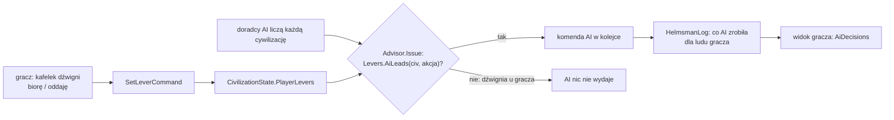

# Dźwignie sternika

**W jednym zdaniu:** gracz prowadzi cywilizację pięcioma dźwigniami (gdzie żyjemy, dokąd zmierzamy, co robimy na ziemi, z kim i jak,
karty); każdą może wziąć albo oddać, a AI decyduje każdą dźwignię, której gracz nie wziął, tymi samymi komendami (etap 6 PR P1,
ADR 0027, GDD 1.2).

**Faza tury:** 3. Decyzje (rada doradców; `Advisor.Issue` sprawdza dźwignię) i 4. Rozstrzyganie komend (`SetLeverCommand`).

## Dane wejściowe i wyjściowe
- Czyta: `CivilizationState.Controller` (kto prowadzi lud) i `PlayerLevers` (wzięte dźwignie), akcję AI (`AiAction`).
- Zmienia: `CivilizationState.PlayerLevers` (komenda `SetLeverCommand`, w protokole `SetLeverDto`); zapis 37, hasz (tylko gdy jakaś
  dźwignia jest wzięta, więc gry bez gracza mają ten sam hasz).
- Publikuje: w widoku gracza (`GameViewMessage`, protokół 18) `PlayerLevers` (flagi) i `AiDecisions` (ostatnie 30 decyzji AI dla jego
  ludu: takt, dźwignia 1–5 albo 0, tekst z przyczyną; `HelmsmanLog`, dane sesji, bez zapisu i hasza).

## Przepływ

## Zasady

- **Przypisanie decyzji AI do dźwigni:** tabela w `docs/ai/01-wspolne-mechanizmy.md`, pkt 10 (`Levers.Of`). Receptury nie należą do
  żadnej dźwigni: liczy je zawsze AI (gracz nie ustawia receptur, GDD 1.2).
- **Domyślnie gracz nie trzyma żadnej dźwigni:** AI prowadzi wszystko, więc gracz, który nie klika, ma partię identyczną z partią AI
  (test `LeverTests.APlayerWhoTakesNoLeverGetsTheGameTheAiWouldPlay`, punkt 5 testu sternika).
- **Rozkaz gracza na dźwigni, której nie wziął**, jest przyjmowany jak każda komenda, ale AI może go w następnym pulsie zmienić. Żeby AI
  nie poprawiało gracza, trzeba wziąć dźwignię (do oceny w prototypie: `docs/ai/08-ocena-i-uwagi.md`, pkt 21).
- **Dźwignie ma tylko lud prowadzony przez gracza:** komenda dla cywilizacji AI jest odrzucana, a dźwignie zostawione w stanie przez
  gracza, który odszedł, nic nie znaczą (`Controller == Ai`). Zapis je trzyma, więc gracz po powrocie ma kafelki jak zostawił.
- **Wybór ludu:** `HelloMessage.CivId` (−1 = pierwszy wolny); zajęty albo martwy lud jest odrzucany.
- **Zegar na żywo dla gracza:** host liczy takty, gdy podłączony jest obserwator albo gracz. Gracz, który gra sam, ustawia pauzę
  i prędkość (×1/×2/×4); w grze kilku graczy prędkość ustala gospodarz (etap 9). Gra startuje zatrzymana.

## Test sternika (ADR 0027)

1. **Dźwignia:** wszystkie pięć; to sam mechanizm „biorę / oddaję”.
2. **AI, gdy gracz nie klika:** tak, cała partia jak u AI (ten sam hasz).
3. **Co widać:** kafelek pokazuje, kto prowadzi dźwignię, i ostatnią decyzję AI na niej (klient: PR P2).
4. **Kronika:** decyzje AI dla ludu gracza z przyczyną (`AiDecisions`).
5. **Partia bez klikania:** ta sama co AI.

## Pliki danych
Brak (dźwignie to zasada gry, nie zawartość).

## Testy
`tests/CivSim.Tests/Ai/LeverTests.cs`: każda akcja AI ma dźwignię; gracz bez dźwigni = partia AI (ten sam hasz); AI nie rusza wziętej
dźwigni i decyduje pozostałe (dwa warianty); komenda tylko dla ludu gracza; zapis i hasz; wybór ludu w `Hello`, odmowa zajętego ludu,
widok z dźwigniami i decyzjami AI. `LocalServerHostTests.PlayerOnlyReceivesCellsItKnows`: gracz sam ustawia prędkość, przy drugim
graczu już nie.

## Wydajność
Doradcy liczą teraz także lud gracza (wcześniej go pomijali): to jedna cywilizacja więcej, tyle samo co przy AI. `HelmsmanLog` zbiera
decyzje tylko wtedy, gdy podłączony jest gracz.
