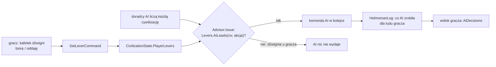

# Dźwignie sternika

**W jednym zdaniu:** gracz prowadzi cywilizację pięcioma dźwigniami (gdzie żyjemy, dokąd zmierzamy, co robimy na ziemi, z kim i jak,
karty); każdą może wziąć albo oddać, a AI decyduje każdą dźwignię, której gracz nie wziął, tymi samymi komendami (etap 6 PR P1,
ADR 0027, GDD 1.2).

**Faza tury:** 3. Decyzje (rada doradców; `Advisor.Issue` sprawdza dźwignię) i 4. Rozstrzyganie komend (`SetLeverCommand`).

## Dane wejściowe i wyjściowe
- Czyta: `CivilizationState.Controller` (kto prowadzi lud) i `PlayerLevers` (wzięte dźwignie), akcję AI (`AiAction`).
- Zmienia: `CivilizationState.PlayerLevers` (komenda `SetLeverCommand`, w protokole `SetLeverDto`); zapis 37, hasz (tylko gdy jakaś
  dźwignia jest wzięta, więc gry bez gracza mają ten sam hasz).
- Publikuje: w widoku gracza (`GameViewMessage`, protokół 18) `PlayerLevers` (flagi) i `AiDecisions` (ostatnie 30 decyzji AI dla jego
  ludu: takt, dźwignia 1–5 albo 0, tekst z przyczyną; `HelmsmanLog`, dane sesji, bez zapisu i hasza).

## Przepływ

## Zasady

- **Przypisanie decyzji AI do dźwigni:** tabela w `docs/ai/01-wspolne-mechanizmy.md`, pkt 10 (`Levers.Of`). Receptury nie należą do
  żadnej dźwigni: liczy je zawsze AI (gracz nie ustawia receptur, GDD 1.2).
- **Domyślnie gracz nie trzyma żadnej dźwigni:** AI prowadzi wszystko, więc gracz, który nie klika, ma partię identyczną z partią AI
  (test `LeverTests.APlayerWhoTakesNoLeverGetsTheGameTheAiWouldPlay`, punkt 5 testu sternika).
- **Rozkaz gracza na dźwigni, której nie wziął**, jest przyjmowany jak każda komenda, ale AI może go w następnym pulsie zmienić. Żeby AI
  nie poprawiało gracza, trzeba wziąć dźwignię (do oceny w prototypie: `docs/ai/08-ocena-i-uwagi.md`, pkt 21).
- **Dźwignie ma tylko lud prowadzony przez gracza:** komenda dla cywilizacji AI jest odrzucana, a dźwignie zostawione w stanie przez
  gracza, który odszedł, nic nie znaczą (`Controller == Ai`). Zapis je trzyma, więc gracz po powrocie ma kafelki jak zostawił.
- **Wybór ludu:** `HelloMessage.CivId` (−1 = pierwszy wolny); zajęty albo martwy lud jest odrzucany.
- **Zegar na żywo dla gracza:** host liczy takty, gdy podłączony jest obserwator albo gracz. Gracz, który gra sam, ustawia pauzę
  i prędkość (×1/×2/×4); w grze kilku graczy prędkość ustala gospodarz (etap 9). Gra startuje zatrzymana.

## Rozkaz gracza trzyma (pytanie Patryka z 2026-11-13)

**Pytanie:** czy decyzja gracza zawsze zostanie wykonana do końca, czy AI może ją zmienić w trakcie? Przegląd każdej komendy gracza:

| Rozkaz gracza | Co mogło go zmienić przed poprawką | Teraz |
| --- | --- | --- |
| odłam: osadnicy idą założyć obóz (np. daleko) | AI nie wydaje rozkazów oddziałom, więc droga była bezpieczna; ale **gubernator w pierwszym pulsie scalał nowy mały obóz z powrotem** (poniżej 15 ludzi) albo go dzielił | obóz założony przez osadników gracza jest trzymany przez 10 lat akcji (60 s) |
| przeprowadzka obozu | **komenda AI z tego samego taktu** wykonywała się po komendzie gracza i przestawiała obóz; w kolejnych pulsach gubernator mógł go od razu przenieść | komenda AI z tego samego taktu jest odrzucana; osada trzymana 60 s |
| połączenie obozów, napaść, zajęcie, podbój | wykonują się od razu; AI mogło w tym samym takcie wydać inną komendę z tej osady | osada trzymana 60 s |
| zadanie na obszarze | AI mogło scalić albo przenieść dom grupy (grupa wracała) | dom trzymany, dopóki grupa gracza jest w terenie |
| atak armii na inny cel | **dowódca AI mógł ją odwołać** („beznadziejne”, „brak jedzenia”); **dyplomata AI mógł zawrzeć pokój** w trakcie marszu | kampania trzymana do końca: bez odwołania i bez pokoju z jej wrogiem |
| idź / załóż / wróć oddziałem | AI nie wydaje rozkazów oddziałom | bez zmian (oddział oznaczony, jego obóz trzymany) |

**Co dalej przerywa rozkaz** (to świat, nie AI; zawsze z przyczyną w kronice): miejsce osiedlenia zajęte (osadnicy szukają wolnego do 3 pól albo wracają), brak drogi, głód osadników, głód armii (wypad po jedzenie, złamane morale), przegrana bitwa, cel zniknął, wróg zawarł pokój sam (gracz nie trzyma się pokoju, ale wróg może go zaproponować; przyjęcie przez AI gracza jest wstrzymane), wyczerpane złoże, brak jedzenia grupy roboczej, secesja osady.

**Jak to działa:** `src/CivSim.Core/Ai/PlayerOrders.cs`. Po każdej przyjętej komendzie gracza `TurnRunner` znakuje to, czego dotyczyła
(`SettlementState.PlayerOrderTick`, `Unit.ByPlayer`, `Episode.ByPlayer`). Doradcy nie wydają komend przeciw oznaczonym rzeczom
(`Advisor.Issue`), a komenda AI wydana w tym samym takcie jest odrzucana przy rozstrzyganiu („A player's order holds.”). Czas: `ai.json`
`playerOrderHoldYears` (10). Znaczniki działają niezależnie od dźwigni i od tego, kto prowadzi lud (wygasają same).

**Decyzja dyplomatyczna gracza trzyma** (PR P1, część 2): wypowiedzenie wojny, propozycja umowy albo odpowiedź gracza wobec ludu X
znakuje relację (`Relation.PlayerOrderTick`, zapis, hasz tylko gdy ustawiony). Przez 10 lat akcji (60 s) AI nie wypowiada X wojny,
nie proponuje mu niczego i nie odpowiada na jego propozycje (propozycje czekają na gracza). Do tego, dopóki trwa kampania gracza przeciw X,
AI nie proponuje X pokoju i nie przyjmuje jego pokoju.

**Komendy gracza dla każdej dźwigni** (`docs/known-issues.md` 14, naprawione): te same komendy, które wydaje AI, w protokole 19:

| Dźwignia | Komenda w protokole | Komenda rdzenia | Co gracz widzi, żeby wybrać |
| --- | --- | --- | --- |
| 1. Gdzie żyjemy | `SettleDto` (osiąść na stałe), wcześniej: odłam, przeprowadzka, połączenie, oddziały | `SettleCommand` | osady i oddziały na mapie |
| 2. Dokąd zmierzamy | `SetResearchDto(technologia)` | `SetResearchCommand` | `GameViewMessage.Research`: co badamy, postęp w promilach, dostępne technologie od najtańszej |
| 3. Co robimy na ziemi | `StartTaskDto` (z PR 4a) | `StartTaskCommand` | złoża i grupy robocze |
| 4. Z kim i jak | `DeclareWarDto(cel, powód, osada)`, `ProposeTreatyDto(lud, umowa)`, `AnswerProposalDto(od, umowa, tak/nie)`, `LaunchCampaignDto(dom, cel, wojownicy)` | `DeclareWarCommand`, `ProposeTreatyCommand`, `AnswerProposalCommand`, `LaunchCampaignCommand` | `GameViewMessage.Proposals`: propozycje czekające na odpowiedź |
| 5. Karty | `ChangeGovernmentDto(ustrój)` do czasu kart (PR 7) | `ChangeGovernmentCommand` | ustrój w widoku ludu |

Rodzaj umowy albo powód wojny spoza zakresu jest odrzucany (nigdy zgadywany); nieznana technologia daje komendę, która nie przechodzi
sprawdzenia. Strategia (wagi doradców) nie ma komendy gracza: to wewnętrzna rada AI; gracz, który wziął dźwignię 2, wybiera badanie wprost.

**Zwiadowcy wracają sami** (`docs/known-issues.md` 15, w części): po dojściu na pole z rozkazu „idź” zwiadowcy wracają do domu z tym, co
zobaczyli, a osada może wysłać następnych. Osadnicy po „idź” dalej czekają na „załóż obóz” (licznik jedzenia w podglądzie: PR P2).

Testy: `tests/CivSim.Tests/Ai/PlayerOrderTests.cs` (6): ten sam takt (gracz wygrywa, komenda AI odrzucona), czas przytrzymania i jego
koniec, obóz z osadników gracza trzymany i nie scalany, dom grupy roboczej trzymany, kampania bez odwołania i bez pokoju, cała gra z AI:
nowy obóz gracza nietknięty przez cały czas przytrzymania (bez przytrzymania AI od razu go scala i dzieli).

## Test sternika (ADR 0027)

1. **Dźwignia:** wszystkie pięć; to sam mechanizm „biorę / oddaję”.
2. **AI, gdy gracz nie klika:** tak, cała partia jak u AI (ten sam hasz).
3. **Co widać:** kafelek pokazuje, kto prowadzi dźwignię, i ostatnią decyzję AI na niej (klient: PR P2).
4. **Kronika:** decyzje AI dla ludu gracza z przyczyną (`AiDecisions`).
5. **Partia bez klikania:** ta sama co AI.

## Pliki danych
Brak (dźwignie to zasada gry, nie zawartość).

## Testy
`tests/CivSim.Tests/Ai/LeverTests.cs`: każda akcja AI ma dźwignię; gracz bez dźwigni = partia AI (ten sam hasz); AI nie rusza wziętej
dźwigni i decyduje pozostałe (dwa warianty); komenda tylko dla ludu gracza; zapis i hasz; wybór ludu w `Hello`, odmowa zajętego ludu,
widok z dźwigniami i decyzjami AI. `LocalServerHostTests.PlayerOnlyReceivesCellsItKnows`: gracz sam ustawia prędkość, przy drugim
graczu już nie. `tests/CivSim.Tests/Ai/PlayerCommandTests.cs` (4): każda komenda dźwigni z protokołu daje komendę AI
(a zła odmowę), AI nie cofa dyplomacji gracza, wybór badania gracza trwa do nauczenia i widok pokazuje opcje, zwiadowcy wracają po „idź”
(bez poprawki test pada).

## Wydajność
Doradcy liczą teraz także lud gracza (wcześniej go pomijali): to jedna cywilizacja więcej, tyle samo co przy AI. `HelmsmanLog` zbiera
decyzje tylko wtedy, gdy podłączony jest gracz.
