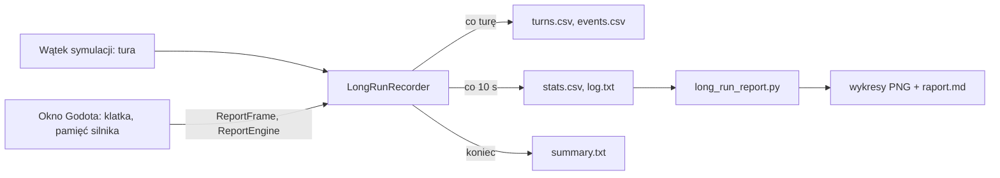

# Długi bieg (benchmark na godziny)

**W jednym zdaniu:** podgląd gry działa przez zadany czas (np. 4 godziny) i przez cały czas zapisuje do plików,
co robi program (pamięć, procesor, płynność okna, czas tury) i co dzieje się w symulacji (ludność, cywilizacje,
wojny, traktaty, zdarzenia z kroniki), a na końcu sam się zamyka i zostawia podsumowanie.

**Faza tury:** żadna. Zapis tylko czyta stan po turze; gra jest identyczna z nim i bez niego (determinizm bez zmian).

## Jak uruchomić

W Godocie: **Debug → Customize Run Instances** (albo Editor → Run → Main Run Args) i wpisz na przykład:

```
-- --seed 42 --map-size standard --long-run 4h
```

Potem F5 i można odejść od komputera. Albo w menu startowym, kolumna „Simulation”: pole **Long run (4h, 30m)**.

| Opcja | Znaczenie |
| --- | --- |
| `--long-run 4h` | długość biegu: `4h`, `30m`, `90s` albo liczba godzin (`2.5`); puste = wyłączone |
| `--long-run-folder ŚCIEŻKA` | gdzie zapisać; domyślnie `long_runs/` obok projektu (np. `I:\CivSim\CivSim2\long_runs\`) |
| `--long-run-every 10` | co ile sekund nowy wiersz w `stats.csv` (domyślnie 10 → 1440 wierszy na 4 h) |

Bieg rusza z prędkością **maksymalną**, chyba że w menu lub `--speed` wybrano inną. Po czasie gra się zamyka.
Zamknięcie okna wcześniej (albo Esc do menu) też kończy zapis i zostawia podsumowanie. Dane trafiają na dysk
po każdym wierszu `stats.csv`, więc awaria gubi najwyżej ostatnie sekundy.

Każdy bieg dostaje własny folder, np. `long_runs/2026-11-08_09-30_seed42_standard/`. Folder `long_runs/` jest w `.gitignore`.

## Pliki

| Plik | Co zawiera | Rozmiar na 4 h (mapa standard, prędkość maks.) |
| --- | --- | --- |
| `stats.csv` | wiersz co 10 s: pamięć, procesor, FPS, czas tury, zaległość okna, stan świata, liczniki zdarzeń | ok. 0,5 MB |
| `turns.csv` | wiersz na turę: czas tury i każdej z 11 faz, liczba zdarzeń | kilkadziesiąt MB |
| `events.csv` | linie kroniki: tura, rok, czas, rodzaj, tekst | kilkadziesiąt MB |
| `log.txt` | start (ustawienia, komputer, karta graficzna), wolne tury (> 1 s), okno nie nadąża, nowe szczyty pamięci, błędy, koniec | mały |
| `summary.txt` | najważniejsze liczby na koniec | mały |

Kolumny `stats.csv`:

- czas: `elapsed_s`, `clock`, `turn`, `year`;
- tempo: `turns` (tury w tym odcinku), `turns_per_s`, `turn_ms_avg`, `turn_ms_p95`, `turn_ms_max`;
- pamięć i .NET: `working_set_mb` (RAM procesu, to co pokazuje Menedżer zadań), `private_mb`, `gc_heap_mb` (obiekty .NET),
  `gc_committed_mb`, `gc_gen0/1/2` (liczba sprzątań pamięci), `gc_pause_pct` (ile czasu zajęło sprzątanie);
- procesor: `cpu_pct` (procent całego komputera), `cpu_cores` (ile rdzeni naraz), `threads`;
- okno: `fps`, `client_ms_avg/max` (praca okna na klatkę), `frame_gap_max_ms` (najdłuższa przerwa między klatkami),
  `slow_frames` (klatki wolniejsze niż 30 FPS), `godot_static_mb`, `video_mb`, `godot_objects`, `godot_nodes`;
- połączenie: `backlog_max` (wiadomości czekające na okno; powyżej 256 serwer wstrzymuje widoki, PR #60), `clients_behind`;
- świat: `civs_alive`, `civs_total`, `settlements`, `settlements_total`, `people`, `era_max`, `stability_avg`, `unrest_civs`,
  `wars`, `truces`, `trade`, `non_aggression`, `alliances`, `proposals`, `relations`;
- zdarzenia od startu: `events` i `ev_<rodzaj>` (war, peace, treaty, secession, coup, died_out, era, settlement, unrest,
  epidemic, nature, other).

Liczby rosnące bez końca przy stałym świecie (np. `settlements_total`, `relations`, `proposals`, `godot_objects`) to
pierwsze miejsce, gdzie szukać wycieku pamięci.

**Zdarzenia:** epidemie oraz susze, pożary i powodzie pojawiają się tysiącami na minutę, więc są tylko liczone
(`ev_epidemic`, `ev_nature`), bez tekstu. Rutynowe linie (nowe obozy, niepokoje, inne) są zapisywane do miliona;
wojny, pokoje, traktaty, secesje, zamachy stanu, wymarcia i nowe ery są zapisywane zawsze.

## Przepływ



`LongRunRecorder` (`src/CivSim.Server/LongRunRecorder.cs`) działa na wątku symulacji w `LocalServerHost`.
Okno (klient) nie widzi rdzenia: przez `LocalServerHost` podaje tylko czasy klatek i liczby silnika,
a odbiera folder i sygnał „koniec” (zasada 10 z CLAUDE.md).

## Wykresy i raport

```
pip install matplotlib
python docs/systems/tools/long_run_report.py long_runs/2026-11-08_09-30_seed42_standard
```

Tworzy w folderze biegu `charts/`: `1_pamiec.png`, `2_wydajnosc.png`, `3_symulacja.png`, `4_fazy_tury.png`,
`5_zdarzenia.png` i `raport.md` (po polsku). Raport ocenia, czy pamięć rośnie w drugiej połowie biegu
(początek wypełnia pamięci podręczne, więc liczy się trend później).

## Testy

`tests/CivSim.Tests/Server/LongRunTests.cs`: rodzaje zdarzeń, bieg 3 s z limitem czasu (wszystkie pliki, równa liczba
kolumn, podsumowanie), wcześniejsze zamknięcie, gra bez długiego biegu nic nie zapisuje.

## Wydajność

Koszt zapisu: wiersz `turns.csv` na turę i wiersz `stats.csv` co 10 s (przejście po osadach i cywilizacjach),
pomijalny w porównaniu z turą (kilkadziesiąt ms na mapie standard).
