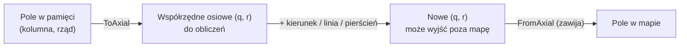

# Mapa

**W jednym zdaniu:** `HexTorus` odpowiada na wszystkie pytania „gdzie” (sąsiedzi, odległości, linie, obszary), a `WorldMap` przechowuje dane każdego pola w płaskich tablicach podzielonych na fragmenty 32×32.

**Faza tury:** wszystkie. To biblioteka geometrii, z której korzystają generator świata, ruch, widoczność, strefy wpływów i AI.

## Dane wejściowe i wyjściowe
- Czyta: szerokość i wysokość mapy.
- Zmienia: warstwy `WorldMap` (zmieniają je systemy i generator świata) i flagi zmian fragmentów.
- Publikuje w migawce: listę fragmentów zmienionych w turze (`WorldSnapshot.ChangedChunks`).

## Przepływ

## Zasady i wzory
- **Układ:** heksy flat-top, kolumny co 36 px, co druga kolumna (nieparzysta) przesunięta o pół heksa w dół (21 px), jak w szablonie
  `art/templates/hex_template_48x42.png`. W pamięci pola leżą rzędami: `indeks = rząd × szerokość + kolumna`.
- **Obliczenia** idą we współrzędnych osiowych (q, r), a wynik jest zawsze zawijany z powrotem do mapy.
- **Torus:** idąc na wschód lub zachód wraca się przez szew pionowy, idąc na północ lub południe przez szew poziomy (tam spotykają się bieguny).
- **Rozmiar:** obie strony muszą być parzyste. Wysokość wymaga GDD; szerokość musi być parzysta, bo inaczej przesunięte kolumny
  nie zeszłyby się na szwie. Wszystkie rozmiary z GDD (64×40, 256×160, 384×240, 512×320) to spełniają.
- **Kierunki:** N, NE, SE, S, SW, NW (zgodnie z ruchem wskazówek zegara od północy).
- **Odległość:** najmniejsza liczba kroków, także „na skróty” przez szwy. Sprawdzona testem: dla każdej pary pól na kilku małych mapach
  wynik jest równy prawdziwemu przejściu krok po kroku (BFS).
- **Linia:** pola na najkrótszej prostej, liczona wyłącznie na liczbach całkowitych, więc taka sama na każdym systemie.
- **Pierścień i obszar:** pola dokładnie w promieniu *r* (6·r pól) i w promieniu do *r* (1 + 3·r·(r+1) pól, np. 37 pól dla r = 3).
  Do promienia `MaxUniqueRadius` żadne pole się nie powtarza.
- **Krawędzie** (pod rzeki): każda krawędź ma jednego właściciela, pole, które ma ją po stronie N, NE albo SE. Dzięki temu rzeka między dwoma
  polami jest zapisana raz, a mapa ma dokładnie 3 krawędzie na pole.
- Metody nie alokują pamięci (piszą wyniki do podanego bufora), poza wygodną wersją `Line`, która zwraca listę.

**Dane pól** (`WorldMap`):
- Każda wartość z GDD 3 („Dane jednego pola”) to osobna tablica (warstwa): wysokość, temperatura, wilgotność, biom, rzeźba,
  cecha terenu, żyzność, złoże (typ, zasobność, głębokość), właściciel, zanieczyszczenie oraz rzeki na krawędziach (3 na pole).
  Osady, ulepszenia i efekty dojdą w etapie 3.
- Zmiana wartości przez `Set` zaznacza jej fragment jako zmieniony, ale tylko wtedy, gdy wartość naprawdę się zmieniła.
  Generator i wczytywanie piszą hurtowo (`Raw`) i zaznaczają całą mapę.
- **Fragmenty 32×32:** mapa testowa ma 2×2 fragmenty (dolne są niepełne, 32×8), standardowa 8×5, duża 12×8, ogromna 16×10.
- Po każdej turze migawka dostaje listę zmienionych fragmentów, a flagi są czyszczone. Nowa albo wczytana mapa ma wszystkie fragmenty zmienione,
  więc pierwszy widok zawsze dostaje całość.
- Mapa wchodzi do hasha stanu i do zapisu gry (warstwa po warstwie, po nazwie). Format zapisu: wersja 3 (od generatora świata dochodzą typ świata, procent wody i pole startowe każdej cywilizacji).

## Pliki danych
Sama siatka nie ma plików danych. Wartości pól (biomy, złoża) pochodzą z `data/biomes.json` i `data/resources.json`; zob. `worldgen.md`.

**Narożniki** (`HexCorners`): rzeki płyną po krawędziach, więc generator potrzebuje grafu narożników. Każde pole ma 2 narożniki (prawy górny i wschodni),
każdy narożnik styka się z 3 polami i ma 3 sąsiednie narożniki połączone krawędziami.

## Testy
`WorldMapTests`: siatka fragmentów dla wszystkich rozmiarów z GDD, niepełne fragmenty brzegowe, flagi zmian, `Set` zaznacza tylko swój fragment
i tylko przy zmianie, migawka z listą zmian, mapa w hashu i w zapisie.

`HexTorusTests`: złe rozmiary, indeksy, zawijanie, zgodność układu z szablonem grafiki, wzajemność sąsiadów, odległość = BFS dla wszystkich par,
linia (ciągła, właściwa długość, 2000 losowych par), pierścienie, obszar, unikalność do `MaxUniqueRadius`, krawędzie.

## Wydajność
Pamięć danych mapy: ok. 20 bajtów na pole, czyli 3,3 MB dla mapy ogromnej (pomiar `CivSim.Headless`).
Pusta tura na mapie ogromnej: średnio 0,0057 ms (wcześniej 0,0049 ms; dochodzi lista zmienionych fragmentów w migawce).

Każda operacja to kilka działań na liczbach całkowitych. Odległość sprawdza 9 kopii pola za szwami; jeśli kiedyś będzie wąskim gardłem,
da się to zredukować do jednego przypadku.
