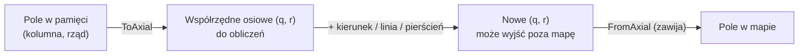

# Mapa (geometria)

**W jednym zdaniu:** `HexTorus` odpowiada na wszystkie pytania „gdzie”: sąsiedzi, odległości, linie i obszary na mapie z heksów, która zawija się w obu kierunkach.

**Faza tury:** wszystkie. To biblioteka geometrii, z której korzystają generator świata, ruch, widoczność, strefy wpływów i AI.

## Dane wejściowe i wyjściowe
- Czyta: tylko szerokość i wysokość mapy.
- Zmienia: nic (nie ma stanu).
- Publikuje w migawce: nic.

## Przepływ

## Zasady i wzory
- **Układ:** heksy flat-top, kolumny co 36 px, co druga kolumna (nieparzysta) przesunięta o pół heksa w dół (21 px), jak w szablonie
  `art/templates/hex_template_48x42.png`. W pamięci pola leżą rzędami: `indeks = rząd × szerokość + kolumna`.
- **Obliczenia** idą we współrzędnych osiowych (q, r), a wynik jest zawsze zawijany z powrotem do mapy.
- **Torus:** idąc na wschód lub zachód wraca się przez szew pionowy, idąc na północ lub południe przez szew poziomy (tam spotykają się bieguny).
- **Rozmiar:** obie strony muszą być parzyste. Wysokość wymaga GDD; szerokość musi być parzysta, bo inaczej przesunięte kolumny
  nie zeszłyby się na szwie. Wszystkie rozmiary z GDD (64×40, 256×160, 384×240, 512×320) to spełniają.
- **Kierunki:** N, NE, SE, S, SW, NW (zgodnie z ruchem wskazówek zegara od północy).
- **Odległość:** najmniejsza liczba kroków, także „na skróty” przez szwy. Sprawdzona testem: dla każdej pary pól na kilku małych mapach
  wynik jest równy prawdziwemu przejściu krok po kroku (BFS).
- **Linia:** pola na najkrótszej prostej, liczona wyłącznie na liczbach całkowitych, więc taka sama na każdym systemie.
- **Pierścień i obszar:** pola dokładnie w promieniu *r* (6·r pól) i w promieniu do *r* (1 + 3·r·(r+1) pól, np. 37 pól dla r = 3).
  Do promienia `MaxUniqueRadius` żadne pole się nie powtarza.
- **Krawędzie** (pod rzeki): każda krawędź ma jednego właściciela, pole, które ma ją po stronie N, NE albo SE. Dzięki temu rzeka między dwoma
  polami jest zapisana raz, a mapa ma dokładnie 3 krawędzie na pole.
- Metody nie alokują pamięci (piszą wyniki do podanego bufora), poza wygodną wersją `Line`, która zwraca listę.

## Pliki danych
Brak.

## Testy
`HexTorusTests`: złe rozmiary, indeksy, zawijanie, zgodność układu z szablonem grafiki, wzajemność sąsiadów, odległość = BFS dla wszystkich par,
linia (ciągła, właściwa długość, 2000 losowych par), pierścienie, obszar, unikalność do `MaxUniqueRadius`, krawędzie.

## Wydajność
Każda operacja to kilka działań na liczbach całkowitych. Odległość sprawdza 9 kopii pola za szwami; jeśli kiedyś będzie wąskim gardłem,
da się to zredukować do jednego przypadku.
