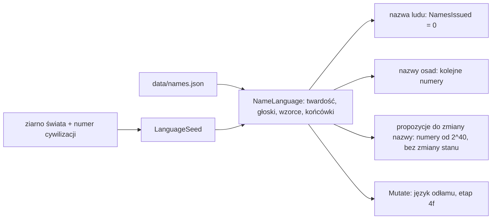

# Nazwy: języki ludów

**W jednym zdaniu:** każda cywilizacja ma własny wymyślony język, z którego powstają nazwa ludu i nazwy jej osad; nazwy można
zmienić, a gra proponuje wtedy inne słowa w tym samym języku.

**Faza tury:** poza fazami. Nazwy nadaje tworzenie świata (`GameState.CreateNew`) i komenda odłamu (`SplitSettlementCommand`).
Zmiana nazwy to komenda (`RenameCivilizationCommand`, `RenameSettlementCommand`). GDD 5.6, decyzje Patryka z 2026-11-06.

## Dane wejściowe i wyjściowe
- Czyta: `data/names.json` (pule twardych i miękkich głosek, wzorce sylab, końcówki, długości), ziarno świata, numer cywilizacji.
- Zmienia: `CivilizationState.Name`, `SettlementState.Name`, `CivilizationState.LanguageSeed` (ziarno języka) i `NamesIssued`
  (licznik wydanych nazw). Oba pola są w hashu stanu i w zapisie gry (format 20).
- Nie używa strumieni losowania symulacji: wszystko liczy `SplitMix64` z ziarna języka i numeru nazwy. Statystyki 300 tur są
  identyczne przed i po wprowadzeniu nazw; zmienił się tylko hash (nazwy są jego częścią).

## Przepływ

## Zasady i wzory
- **Język:** twardość 0–100% (szansa, że każda głoska, samogłoska i końcówka pochodzi z puli twardej), 7–11 spółgłosek, 3–5 samogłosek
  (najwyżej jedna dwugłoska), 2–5 wygłosów, 1–3 końcówki ludu, 2–4 końcówki miejsc, wagi wzorców sylab ×50–150%, 0–15% podwajania
  spółgłosek.
- **Słowo:** 2–3 sylaby dla ludu, 1–2 dla osady; końcówka z szansą 70% (lud) i 55% (osada); długość 3–10 liter. Sylaba zaczynająca się
  od samogłoski tylko na początku słowa; po samogłosce może stać najwyżej jedna inna samogłoska; żadna litera trzy razy z rzędu;
  słowo nie zaczyna się od „ll”, „ss”, „nd” itp.
- **Unikalność:** nazwa zajęta przez inną cywilizację lub osadę (bez względu na wielkość liter) jest pomijana i bierze się następną.
  Zmiana nazwy na zajętą jest odrzucana.
- **Bez listy zakazanych słów** (decyzja Patryka): komu nazwa się nie podoba, zmienia ją. Okno zmiany nazwy w podglądzie pokazuje
  8 propozycji w tym samym języku („More names” daje kolejne) i pole na własną nazwę. Obserwator może zmienić każdą nazwę; serwer
  stosuje zmianę od razu, między turami, i zapisuje ją w kronice. Gracz (etap 13) zmieni tylko swoje.
- **Na później (etap 4f, zapisane w ROADMAP i `docs/prompts/03-etap-4-ai-dyplomacja.md`):** tytuł ustroju w nazwie (wzór tytułu w danych
  ustroju, np. „Kingdom of {name}”) oraz język nowej cywilizacji z secesji: `NameLanguage.Mutate(seed)` (zamienia kilka głosek
  i końcówek, twardość zostaje) i `DaughterPeopleName(rodzic, n)` (rdzeń nazwy rodzica + końcówka języka córki, np. Trugaar → Trugeth).

Przykłady (seed 7, mapa testowa): ludy *Qushasug*, *Lakhaem*, *Eakout*; osady *Regpaus*, *Khun*, *Teassaue*, *Rialliasae*.

## Pliki danych
`data/names.json`. Walidacja: wszystkie części to małe litery a–z, wzorce tylko z C, V i K, zakresy w granicach.

## Testy
`NameTests`: ten sam seed daje ten sam język i nazwy; nazwy mają poprawne litery i długość; języki różnią się między ludami; nowa gra
nazywa wszystkie ludy i obozy bez powtórzeń; propozycje są wolne, powtarzalne i nie zmieniają stanu; zmiana na zajętą nazwę jest
odrzucana; nazwa ludu-córki jest spokrewniona z nazwą rodzica; błędne dane są zgłaszane. `ObserverLayerTests`: obserwator zmienia nazwy
od razu i dostaje propozycje; gracz dostaje propozycje tylko dla swojej cywilizacji.
