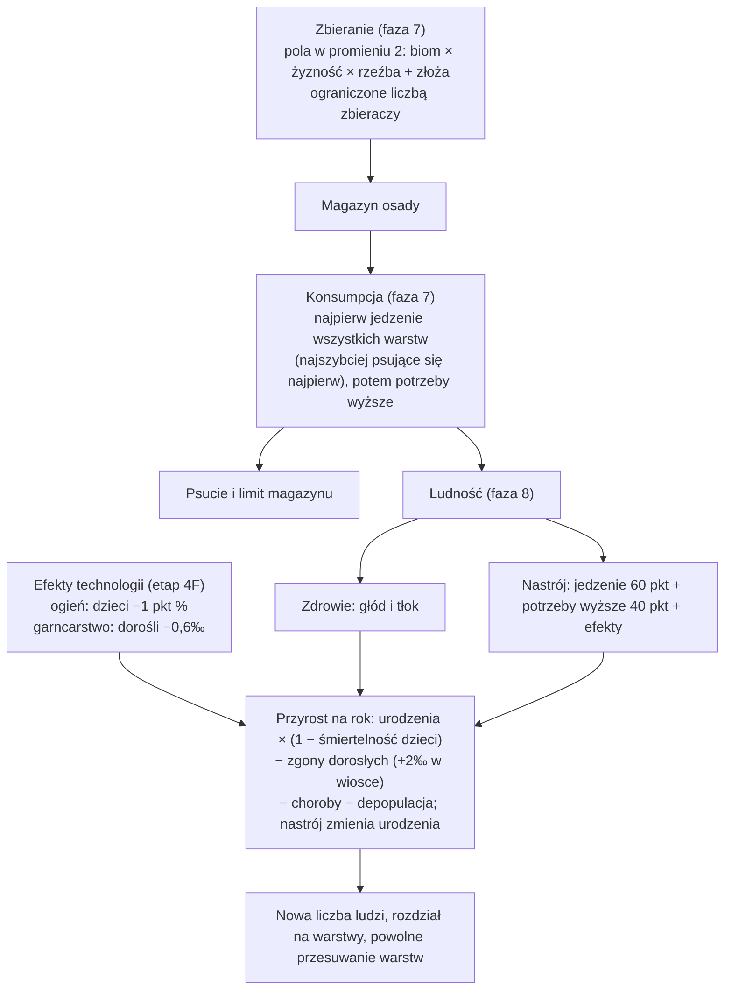

# Ludność

**W jednym zdaniu:** ludzie w każdej osadzie zbierają jedzenie z okolicy, jedzą z własnego magazynu, rodzą się, umierają, chorują i powoli przechodzą między pięcioma warstwami (od etapu 4F: wytwórcy, rzemieślnicy, wojownicy, myśliciele, przywódcy) i uczą się fachów (`docs/systems/skills.md`).

**Faza tury:** 7. Gospodarka (zbieranie, potem konsumpcja, potem magazyn) i 8. Ludność (wzrost, głód, zdrowie, warstwy).

## Dane wejściowe i wyjściowe
- Czyta: osady (ludność w warstwach, magazyn), mapę wokół osady (biom, żyzność, rzeźba, złoża), efekty (wydobycie, wydajność, depopulacja, nastrój), `data/strata.json`, `data/population.json`, pole `gather` w `data/resources.json`.
- Zmienia: zapasy w magazynie, ludność w warstwach, zdrowie, nastrój, zapisane ilości jedzenia z ostatniej tury, `IsAlive` cywilizacji.
- Publikuje w migawce: ludność w warstwach, zdrowie, nastrój i jedzenie z ostatniej tury dla każdej osady. Gracz widzi te dane tylko dla swoich osad. Wymarcie cywilizacji trafia do kroniki.

## Przepływ

## Zasady i wzory
Wszystkie tempa są na rok i przeliczane przez długość kroku cywilizacji (ADR 0011, ADR 0018). Liczby to pierwsze przymiarki do strojenia.

- **Warstwy** (GDD 5.1, CORE uproszczone): wytwórcy (zbierają, docelowo 80%), rzemieślnicy (5%), wojownicy (15%). Ludzie przesuwają się w stronę tego podziału o 1% różnicy na rok.
- **Start plemienia:** 50 osób (40 wytwórców, 10 wojowników) w obozie.
- **Zbieranie** (od etapu 3c na polach strefy wpływów osady, z dziką żywnością, która się wyjada; opis w [influence-migration.md](influence-migration.md)): pole lądu daje rocznie `4 × jedzenie biomu × (50 + żyzność) / 100` jednostek, na wzgórzach 75%, w górach 25%; 60% to rośliny, reszta mięso, do tego 0,2 skóry na jednostkę mięsa. Złoża z polem `gather` dokładają swoje (zwierzyna: 6 mięsa i 1,5 skóry na rok; dzikie zboże: 8 roślin). Jeden zbieracz przynosi najwyżej 2 jednostki jedzenia na rok. Efekt „redukcja wydobycia” zmniejsza plon pola, „uszkodzenie” pracę osady.
- **Potrzeby:** każdy zjada 1 jednostkę jedzenia na rok (wojownik 1,2). Potrzeby wyższe: odzież ze skór (wytwórcy), narzędzia kamienne (rzemieślnicy i wojownicy). Najpierw wszyscy jedzą, dopiero potem zużywają narzędzia i odzież.
- **Głód:** z osób, dla których zabrakło jedzenia, 80% umiera w czasie tury, w koczowniczym obozie 50% (`campStarvationDeathPercent`, 2026-11-08: łowcy się rozpraszają i mają mniej dzieci zamiast umierać na miejscu).
- **Zdrowie** (0–100): minus brak jedzenia (w procentach), minus tłok (połowa nadwyżki ponad limit poziomu osady, np. 150 dla obozu). Poniżej 60 każdy punkt to 0,2 promila dodatkowych zgonów na rok.
- **Przyrost** (od etapu 4F, PR 4, ADR 0020, GDD 5.2): `urodzenia × (1 − śmiertelność dzieci) − zgony dorosłych` na rok (`PopulationSystem.GrowthRate`). Na start (najedzona, zdrowa osada, nastrój 50): 60‰ × (1 − 49%) − 29,6‰ = **+1,0‰ na rok** (wcześniej +3‰, czyli 3 razy wolniej). Liczby z danych historycznych: zbieracze-łowcy tracili ok. 49% dzieci przed 15. rokiem życia (Volk i Atkinson 2013), a ludność świata rosła od 10 000 lat p.n.e. do 1700 roku średnio o ok. 0,4‰ na rok (Our World in Data; głód, choroby i wojny zabierają resztę).
  - Nastrój zmienia urodzenia: 0,1‰ za każdy punkt ponad 50 (mniej poniżej); z tego przeżywa tyle dzieci, ile pozwala śmiertelność, więc na przyrost działa mniej więcej jak dawne 0,05‰.
  - Wioska: +5‰ urodzeń (osiadli rolnicy mają dzieci w krótszych odstępach, „neolityczna rewolucja demograficzna”, Bocquet-Appel; decyzja Patryka z 2026-11-07) i +2‰ zgonów dorosłych (ciasnota, brud, choroby od zwierząt hodowlanych). Z ogniem i garncarstwem wioska rośnie o +2,8‰, obóz o +2,2‰.
  - Choroby: poniżej 60 zdrowia każdy punkt to 0,2‰ zgonów dorosłych więcej.
  - Technologie przez efekty (`data/effects.json`): `child_care` (śmiertelność dzieci w dziesiątych częściach procenta), `clean_living` (zgony dorosłych na 10 000), `fertility` (urodzenia na 10 000). Ery 1–2: ogień −10 (49% → 48%, przyrost +1,6‰), garncarstwo −6 (29,6‰ → 29‰, przyrost +2,2‰; czystsze przechowywanie wody i jedzenia). Kolejne ery (higiena, medycyna, kanalizacja, szczepionki) dodadzą efekty według tabeli w GDD 5.2.
- Cywilizacja bez ani jednego człowieka wymiera; kronika to zapisuje.

**Co z tego wychodzi** (seed 42, mapa standardowa, 2000 tur): każde plemię w ok. 10 turach (500 lat) dochodzi do granicy tego, co da się zebrać wokół obozu (115–310 osób), i tam zostaje. Zdrowie średnio ok. 64 przez tłok ponad 150 osób. Dalszy wzrost dadzą wędrówki i nowe obozy (3c).

## Twardy limit poziomu (etap 6 PR T2)

Decyzja Patryka z 2026-11-14: osada nigdy nie urośnie ponad liczbę ludzi swojego poziomu (`settlements.json`: obóz 150, wioska 1000…);
nadmiar się rozprasza (`growth.levelLimitScatters`). Obóz na limicie wysyła osadników, jeśli państwo ma wolną administrację
(`ai.json` `settlersBelowAdminPercent`), a jeśli nie, zostaje taki, jaki jest. Wioska czeka na technologię miasta. Bez limitu obóz,
który nie mógł się podzielić, puchł do ponad 1800 ludzi. Ludy, które nie rosną, bo ich ziemia wyżywi tylko ok. 50–60 osób, zostają
takie, jakie są: to ich wybór i cel podboju (ta sama decyzja).

## Pliki danych
- `data/strata.json`: warstwy, czy zbierają, docelowy udział, potrzeby (kategoria albo konkretny towar, ilość na rok, podstawowa albo wyższa).
- `data/population.json`: urodzenia (`birthsPerMille`, `villageBirthsPerMille`), śmiertelność dzieci (`childMortalityPercent`), zgony dorosłych (`adultDeathsPerMille`, `villageDeathsPerMille`), głód, zdrowie, nastrój, przesuwanie warstw, zbieranie i ludność nowego plemienia.
- `data/resources.json`: opcjonalne `gather` przy złożach.

## Testy
- `DemographyTests` (etap 4F): zbieracze rosną o 1‰ na rok, nastrój zmienia urodzenia; ogień i garncarstwo obniżają śmiertelność, wioska ją podnosi; choroby dalej zabijają; liczby pochodzą z danych.
- `PopulationTests`: dane się wczytują; zepsute dane zgłaszają każdy błąd; wzrost liczy się jak procent składany; plemię startuje z 50 osobami; zbieracze przynoszą jedzenie; najedzone plemię rośnie; plemię bez jedzenia wymiera i trafia do kroniki; głodni łowcy giną rzadziej niż głodni rolnicy; zaokrąglenia nie tworzą ani nie gubią ludzi; warstwy dochodzą do 5% i 15%; liczebność się stabilizuje zamiast rosnąć bez końca; zapis i odczyt w połowie gry daje identyczną dalszą historię; długość tury nie zmienia tempa rocznego.

## Wydajność
10 000 tur, Release, seed 42: mapa standardowa średnio 0,06 ms na turę, ogromna 0,10 ms (32 plemiona). Alokacje 11–27 KB na turę to kopie w migawce. Najwięcej czasu zajmuje przegląd pól wokół osad; gdy osad będzie dużo, policzymy plon pola raz na turę zamiast dla każdej osady osobno.
