# Ludność

**W jednym zdaniu:** ludzie w każdej osadzie zbierają jedzenie z okolicy, jedzą z własnego magazynu, rodzą się, umierają, chorują i powoli przechodzą między trzema warstwami.

**Faza tury:** 7. Gospodarka (zbieranie, potem konsumpcja, potem magazyn) i 8. Ludność (wzrost, głód, zdrowie, warstwy).

## Dane wejściowe i wyjściowe
- Czyta: osady (ludność w warstwach, magazyn), mapę wokół osady (biom, żyzność, rzeźba, złoża), efekty (wydobycie, wydajność, depopulacja, nastrój), `data/strata.json`, `data/population.json`, pole `gather` w `data/resources.json`.
- Zmienia: zapasy w magazynie, ludność w warstwach, zdrowie, nastrój, zapisane ilości jedzenia z ostatniej tury, `IsAlive` cywilizacji.
- Publikuje w migawce: ludność w warstwach, zdrowie, nastrój i jedzenie z ostatniej tury dla każdej osady. Gracz widzi te dane tylko dla swoich osad. Wymarcie cywilizacji trafia do kroniki.

## Przepływ

```mermaid
flowchart TD
  G["Zbieranie (faza 7)<br/>pola w promieniu 2: biom × żyzność × rzeźba + złoża<br/>ograniczone liczbą zbieraczy"] --> M["Magazyn osady"]
  M --> C["Konsumpcja (faza 7)<br/>najpierw jedzenie wszystkich warstw<br/>(najszybciej psujące się najpierw), potem potrzeby wyższe"]
  C --> S["Psucie i limit magazynu"]
  C --> P["Ludność (faza 8)"]
  P --> H["Zdrowie: głód i tłok"]
  P --> N["Nastrój: jedzenie 60 pkt + potrzeby wyższe 40 pkt + efekty"]
  H --> R["Przyrost na rok: urodzenia − zgony<br/>+ nastrój − choroby − depopulacja"]
  N --> R
  R --> W["Nowa liczba ludzi, rozdział na warstwy, powolne przesuwanie warstw"]
```

## Zasady i wzory
Wszystkie tempa są na rok i przeliczane przez długość tury (ADR 0011). Liczby to pierwsze przymiarki do strojenia.

- **Warstwy** (GDD 5.1, CORE uproszczone): wytwórcy (zbierają, docelowo 80%), rzemieślnicy (5%), wojownicy (15%). Ludzie przesuwają się w stronę tego podziału o 1% różnicy na rok.
- **Start plemienia:** 50 osób (40 wytwórców, 10 wojowników) w obozie.
- **Zbieranie** (od etapu 3c na polach strefy wpływów osady, z dziką żywnością, która się wyjada; opis w [influence-migration.md](influence-migration.md)): pole lądu daje rocznie `4 × jedzenie biomu × (50 + żyzność) / 100` jednostek, na wzgórzach 75%, w górach 25%; 60% to rośliny, reszta mięso, do tego 0,2 skóry na jednostkę mięsa. Złoża z polem `gather` dokładają swoje (zwierzyna: 6 mięsa i 1,5 skóry na rok; dzikie zboże: 8 roślin). Jeden zbieracz przynosi najwyżej 2 jednostki jedzenia na rok. Efekt „redukcja wydobycia” zmniejsza plon pola, „uszkodzenie” pracę osady.
- **Potrzeby:** każdy zjada 1 jednostkę jedzenia na rok (wojownik 1,2). Potrzeby wyższe: odzież ze skór (wytwórcy), narzędzia kamienne (rzemieślnicy i wojownicy). Najpierw wszyscy jedzą, dopiero potem zużywają narzędzia i odzież.
- **Głód:** z osób, dla których zabrakło jedzenia, 80% umiera w czasie tury.
- **Zdrowie** (0–100): minus brak jedzenia (w procentach), minus tłok (połowa nadwyżki ponad limit poziomu osady, np. 150 dla obozu). Poniżej 60 każdy punkt to 0,2 promila dodatkowych zgonów na rok.
- **Przyrost:** 35 urodzeń − 32 zgony na tysiąc rocznie (+0,3% na rok, ok. +16% na turę 50 lat), plus 0,05 promila za każdy punkt nastroju ponad 50.
- Cywilizacja bez ani jednego człowieka wymiera; kronika to zapisuje.

**Co z tego wychodzi** (seed 42, mapa standardowa, 2000 tur): każde plemię w ok. 10 turach (500 lat) dochodzi do granicy tego, co da się zebrać wokół obozu (115–310 osób), i tam zostaje. Zdrowie średnio ok. 64 przez tłok ponad 150 osób. Dalszy wzrost dadzą wędrówki i nowe obozy (3c).

## Pliki danych
- `data/strata.json`: warstwy, czy zbierają, docelowy udział, potrzeby (kategoria albo konkretny towar, ilość na rok, podstawowa albo wyższa).
- `data/population.json`: urodzenia, zgony, głód, zdrowie, nastrój, przesuwanie warstw, zbieranie i ludność nowego plemienia.
- `data/resources.json`: opcjonalne `gather` przy złożach.

## Testy
- `PopulationTests`: dane się wczytują; zepsute dane zgłaszają każdy błąd; wzrost liczy się jak procent składany; plemię startuje z 50 osobami; zbieracze przynoszą jedzenie; najedzone plemię rośnie; plemię bez jedzenia wymiera i trafia do kroniki; zaokrąglenia nie tworzą ani nie gubią ludzi; warstwy dochodzą do 5% i 15%; liczebność się stabilizuje zamiast rosnąć bez końca; zapis i odczyt w połowie gry daje identyczną dalszą historię; długość tury nie zmienia tempa rocznego.

## Wydajność
10 000 tur, Release, seed 42: mapa standardowa średnio 0,06 ms na turę, ogromna 0,10 ms (32 plemiona). Alokacje 11–27 KB na turę to kopie w migawce. Najwięcej czasu zajmuje przegląd pól wokół osad; gdy osad będzie dużo, policzymy plon pola raz na turę zamiast dla każdej osady osobno.
