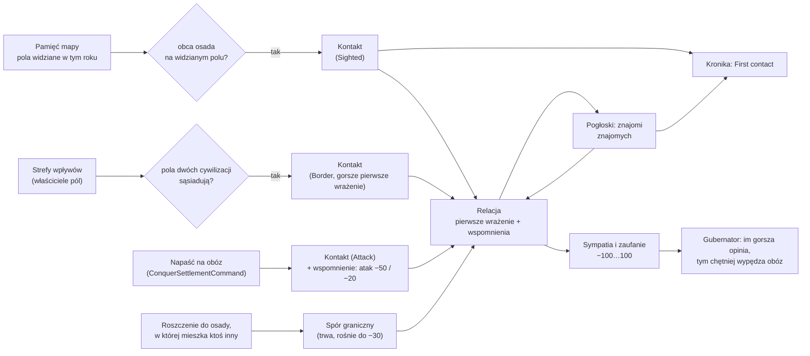

# Odkrywanie cywilizacji i pamięć relacji

**W jednym zdaniu:** na starcie nikt nikogo nie zna; cywilizacja poznaje inną, gdy jej osady albo zwiadowcy zobaczą obcy obóz, gdy ich strefy wpływów się zetkną albo gdy ktoś napadnie jej obóz, słyszy pogłoski o ludach, które poznali jej znajomi, i pamięta wydarzenia (napaść, spór o osadę), z których wynikają dwie liczby: sympatia i zaufanie (etap 4c, GDD 8.5).

**Faza tury:** 2. Percepcja, zaraz po pamięci mapy (`ContactSystem`). Napaść zapisuje komenda `ConquerSettlementCommand` w fazie 4.

## Dane wejściowe i wyjściowe
- Czyta: `data/relations.json`, pamięć mapy (`CivilizationState.SeenYear`, rok ostatniej obserwacji pola), właścicieli pól (`WorldMap.Owner`, strefy wpływów), osady, roszczenia do osad (`ClaimCiv`), charakter (otwartość, mściwość).
- Zmienia: `CivilizationState.Relations` (lista relacji posortowana po id drugiej cywilizacji), kronikę (pierwszy kontakt, pogłoski, „It was their first meeting”).
- Publikuje: nic w migawce. Headless zapisuje relacje opcją `--relations relations.csv` (co `--stats-every` tur) i na końcu wypisuje liczbę znajomości.
- Używa: gubernator (AI) przy wypędzaniu obcego obozu bierze pod uwagę sympatię do jego ludu (czynnik `opinion`).

## Przepływ

## Zasady i wzory
- **Lista relacji:** pusta na starcie. Cywilizacja trafia na nią tylko przez widzenie, kontakt albo pogłoskę (GDD 8.5). Relacja ma poziom: pogłoska albo kontakt.
- **Zobaczyć obóz:** jeśli pole z obcą zamieszkaną osadą jest w pamięci mapy oznaczone jako widziane w tym roku (przez osadę: 6 pól, albo przez zwiadowcę: 15 pól w losowym kierunku), to jest kontakt. Kronika: `First contact: scouts of A saw B Camp 3, 11 cells southeast of A Camp 2.`
- **Zetknięcie stref:** dwa sąsiednie pola lądu należą do stref dwóch cywilizacji, więc obie się poznają. Pierwsze wrażenie jest wtedy o 5 pkt gorsze (`borderOpening`).
- **Napaść:** obóz, który próbuje wypędzić obcy obóz (wygrana albo przegrana), zostawia u ofiary wspomnienie „atak na nas” (−50 sympatii, −20 zaufania). Jeśli się wcześniej nie znali, to jest ich pierwsze spotkanie (dopisek w kronice). Napastnik też poznaje ofiarę.
- **Pierwsze wrażenie:** od −20 (otwartość 0) do +20 (otwartość 1000), liniowo; średnia otwartość daje 0. Nie zanika.
- **Wspomnienia:** każde ma sympatię, zaufanie i czas zanikania. Po zakończeniu słabnie liniowo do zera (połowa czasu = połowa siły), potem jest zapominane. Atak zanika po 150 latach u cywilizacji bez mściwości i po 300 latach u najbardziej mściwej (liniowo pomiędzy).
- **Spór graniczny:** trwa, dopóki inna cywilizacja mieszka w osadzie, do której nasza ma roszczenie (dawna nasza osada przejęta przez kogoś, GDD 5.5). Rośnie o −1 na rok aż do −30, a po zakończeniu zanika przez 20 lat. Liczy się tylko, gdy znamy tego, kto tam mieszka.
- **Sympatia i zaufanie:** sympatia = pierwsze wrażenie + suma wspomnień, zaufanie = suma wspomnień; obie obcięte do −100…100. Liczone w setnych częściach punktu (liczby całkowite).
- **Pogłoski:** co turę cywilizacja może usłyszeć o ludzie, który poznał ktoś, kogo ona zna (20% na stulecie na każdy taki lud, przeliczone na długość tury; najwyżej jedna pogłoska na turę). Pogłoska podaje nazwę, przybliżone miejsce (przesunięte nawet o połowę odległości) i liczebność zawyżoną albo zaniżoną nawet o połowę. Przykład: `A heard from B of a people called C, about 3400 strong, somewhere to the southeast.` Pogłoska nie daje sympatii (dla AI to 0) ani dyplomacji; prawdziwy kontakt ją zastępuje i jest pierwszym kontaktem.
- **Najwyżej 12 wspomnień** na znaną cywilizację (`maxMemories`); gdy brakuje miejsca, znika najsłabsze.
- **AI (GDD 8.3, czynnik „Opinia o B”):** gubernator mnoży ocenę wypędzenia obcego obozu przez 1,0 − sympatia/200: przy sympatii −100 to 1,5, przy +100 to 0,5, przy obcych bez kontaktu 1,0. AI zna tylko własne relacje, nie cudze.
- **Czasy w latach, nie w turach:** zasada 6 z `CLAUDE.md` (tempa na rok). Tabela w GDD 8.5 podaje tury; wartości przyjęte jako lata, do decyzji Patryka.
- **Determinizm:** losowanie pogłosek ma generator zależny tylko od seeda, cywilizacji i tury (strumień `ai`, sól `0xD1 << 40`), więc inne strumienie się nie przesuwają. Relacje są w hashu stanu i w zapisie gry (format 17).

| Wydarzenie | Sympatia | Zaufanie | Zanika po | Kto je wywołuje |
| --- | --- | --- | --- | --- |
| Atak na nas | −50 | −20 | 150 lat (mściwi: 300) | napaść na obóz (4c) |
| Złamanie traktatu | −20 | −40 | 200 lat | umowy (4d) |
| Spór graniczny | −1 na rok (do −30) | — | 20 lat po końcu | roszczenie do osady (4c) |
| Aktywny handel | +0,5 na rok (do +30) | +0,2 na rok (do +20) | 20 lat po końcu | handel (4d) |
| Wspólny wróg | +20 | +10 | 50 lat po końcu wojny | wojny (4e) |
| Pomoc w wojnie | +30 | +25 | 200 lat | wojny (4e) |
| Inny ustrój | −10 | — | od razu po końcu | ustroje (4f) |

## Pliki danych
- `data/relations.json`: szanse i błąd pogłosek, pierwsze wrażenie, limit wspomnień, tabela wydarzeń (wszystkie 7 rodzajów muszą być w pliku; tempo roczne musi prowadzić w stronę wartości docelowej).

## Testy
- `ContactTests`: nikt nikogo nie zna na starcie; zobaczony obóz daje kontakt i wpis w kronice (raz); zetknięcie stref daje kontakt z gorszym pierwszym wrażeniem; otwartość ustawia pierwsze wrażenie (−20, 0, +20); napaść jest pamiętana, słabnie liniowo, znika po czasie, mściwi pamiętają dłużej; spór graniczny rośnie do limitu i zanika; przejęta osada z roszczeniem to spór; pogłoski mówią o znajomych znajomych, a prawdziwy kontakt je zastępuje; najsłabsze wspomnienie robi miejsce; relacje są posortowane i przechodzą przez zapis (ten sam hash); dane z pliku i błędy w pliku.
- `DeterminismTests`, `WorldGeneratorTests`: nowe złote hashe (stan zawiera relacje; mapa się nie zmieniła).

## Wydajność
- Koszt na turę: przejście po osadach razy cywilizacje (widzenie) i jedno przejście po polach mapy z 6 sąsiadami (granice). Bufory par cywilizacji są wielokrotnego użytku; nowe obiekty powstają tylko przy pierwszym kontakcie i nowym wspomnieniu.
- Wyniki pomiarów: w opisie PR etapu 4c.
