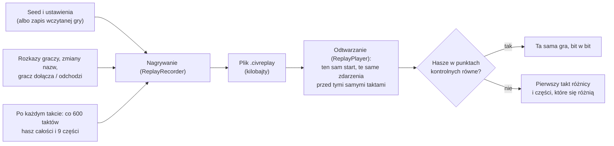

# Powtórka i hasz z podziałem na systemy (T11)

**W jednym zdaniu:** partia to jej seed i lista rozkazów z zewnątrz, więc da się ją odtworzyć bit w bit, a hasz stanu co minutę gry,
liczony osobno dla każdej części stanu, pokazuje, w którym takcie i w którym systemie dwa przebiegi się rozjechały.

**Faza tury:** poza fazami. Nagrywanie działa w serwerze między taktami (rozkazy, zmiany nazw, przejęcie cywilizacji) i po każdym takcie
(punkt kontrolny). Odtwarzanie uruchamia te same systemy co serwer (`CoreSystems.Register`).

## Dane wejściowe i wyjściowe
- Czyta: ustawienia gry (`GameSettings`: seed, mapa, planeta, świat), rozkazy graczy (`SubmitCommandMessage`), zmiany nazw obserwatora,
  dołączenie i odejście gracza, stan po każdym takcie.
- Zmienia: nic w grze. Nagrywanie tylko zapisuje.
- Publikuje: plik powtórki `.civreplay` (Headless `--record`, gra w podglądzie z `ReplayPath`, długi bieg zawsze jako `replay.civreplay`
  w swoim folderze).

## Przepływ



## Zasady i wzory
- **Co jest w powtórce:** to, co przychodzi spoza symulacji. Wszystko inne (AI, świat, losowanie) wynika z seedu (zasada 4 z `CLAUDE.md`).
  - **Rozkaz** gracza: takt, przed którym przyszedł, gracz, cywilizacja i rozkaz jako wiadomość protokołu (DTO). Odtwarzanie kolejkuje
    go tak jak serwer, więc kolejność rozstrzygania jest ta sama.
  - **Zmiana nazwy** obserwatora: serwer stosuje ją od razu, między taktami (GDD 5.6), i tak samo robi odtwarzanie.
  - **Przejęcie cywilizacji:** gdy gracz dołącza, AI przestaje za niego decydować, a gdy odchodzi, AI przejmuje cywilizację z powrotem.
    To zmienia przebieg gry, choć nie jest w zapisie (kto steruje, to dane sesji).
- **Start:** nowa gra startuje z ustawień (świat generuje się znowu z seedu). Wczytana gra startuje z zapisu stanu w chwili rozpoczęcia
  nagrywania (`StartSave`).
- **Punkt kontrolny** co `CheckpointTicks` taktów (domyślnie 600 = minuta gry przy ×1), także na starcie: hasz całego stanu
  (`GameStateHash.Compute`) i 9 haszy części (`GameStateHash.Sections`).
- **Części stanu** (w tej kolejności): `clock` (ustawienia, takt, miesiące), `units` (oddziały), `episodes` (kampanie i bitwy),
  `random` (strumienie losowania), `worlds` (mapa i klimat), `civilizations`, `settlements`, `effects`, `treaties`. Hasz całości to te
  same części w jednym strumieniu, więc się nie zmienił (złoty hash bez zmian).
- **Rozjazd:** odtwarzanie zatrzymuje się na pierwszym punkcie kontrolnym, w którym hasz jest inny, i podaje części, które się różnią.
  Przykład z testu: bez zmiany nazwy różni się tylko `civilizations` w pierwszym punkcie po niej.
- **Plik:** 4 bajty „CS2R”, wersja formatu (1), potem MessagePack z kompresją LZ4. Zapisane są też wersja protokołu i formatu zapisu,
  z którymi grę nagrano. 3000 taktów gry AI to 666 bajtów.
- **Ograniczenie:** powtórka wymaga tych samych plików `data/` i tego samego kodu co nagranie. Inna zawartość da inną grę, a
  odtwarzanie pokaże to jako rozjazd od pierwszego punktu kontrolnego, w którym zmiana zadziałała.

## Jak używać
```
dotnet run --project src/CivSim.Headless -c Release -- --map-size standard --seed 7 --turns 18000 --record gra.civreplay --quiet
dotnet run --project src/CivSim.Headless -c Release -- --replay gra.civreplay
```
Wynik odtworzenia to „the same game, bit for bit” (kod wyjścia 0) albo „DIFFERENT: first at tick …” z listą części (kod 1).
Długi bieg w podglądzie (`--long-run`) zapisuje `replay.civreplay` w swoim folderze, więc błąd z wielogodzinnej gry da się odtworzyć
w Headless bez okna.

## Pliki danych
Brak własnych. Powtórka używa tych samych plików `data/` co gra.

## Testy
- `ReplayTests`:
  - gra z graczem (zmiana nazwy cywilizacji, potem odejście) i obserwatorem (zmiana nazwy osady) odtwarza się bit w bit, także przez plik;
  - brak jednego rozkazu daje rozjazd w pierwszym punkcie po nim, w części `civilizations`;
  - wczytana gra odtwarza się z zapisu;
  - zmiana jednej osady zmienia tylko hasz części `settlements`;
  - obcy plik nie jest powtórką.
- `LocalServerHostTests.TheHostWritesAReplayThatPlaysTheSameGame`: gra w podglądzie zapisuje powtórkę przy zamknięciu i ta odtwarza się tak samo.
- Złoty hash świata (`WorldGeneratorTests`) bez zmian: podział hasza na części nie zmienia hasza całości.

## Wydajność
Nagrywanie kosztuje jeden hasz całości i 9 haszy części co 600 taktów (poza pomiarem czasu taktu w Headless). Rozkazy to kilka liczb
każdy. Odtworzenie 3000 taktów mapy standard: 4,4 s.
