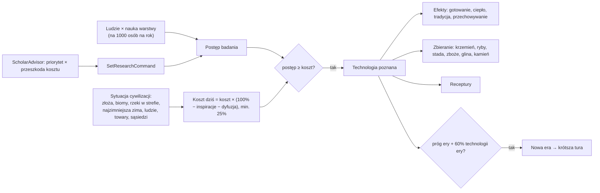

# Technologie i badania

**W jednym zdaniu:** ludzie każdej cywilizacji wytwarzają punkty nauki, które idą na jedną wybraną technologię; technologia jest tańsza, gdy sytuacja jej sprzyja (inspiracje) albo zna ją sąsiad (dyfuzja), a po zbadaniu odblokowuje receptury, zbieranie nowych dóbr i stałe efekty, i może przenieść cywilizację w nową erę (etap 3f).

**Faza tury:** 10. Nauka i wpływy (badanie, efekty, ery). Wybór technologii: faza decyzji (`ScholarAdvisor`, doradca uczony, komenda `SetResearchCommand`).

## Dane wejściowe i wyjściowe
- Czyta: `data/technologies.json` (graf, koszty, inspiracje, odblokowania, zasady dyfuzji), `data/eras.json` (`threshold`), `sciencePerThousandPerYear` warstw z `data/strata.json`, osady i ludność, warstwę `claim` mapy (strefy wpływów), rzeki, temperatury, zapasy.
- Zmienia: `CivilizationState.KnownTechnologies`, `KnownCount`, `Researching`, `ResearchProgress`, `LastScience`, `Era`; dodaje stałe efekty cywilizacji (`EffectBook`); wpisy w kronice („X learned Fire.”, „X entered the Neolithic.”).
- Publikuje w migawce: nic nowego (ery i technologie pokaże podgląd w jednej z kolejnych zmian; kronika już idzie do klienta).

## Przepływ

## Zasady i wzory
- **Nauka** (GDD 6.1, uproszczone: uczeni i budynki przyjdą z erami): punkty na rok = Σ ludzie warstwy × `sciencePerThousandPerYear` / 1000. Od etapu 4F (PR 3, ADR 0020) głównie myśliciele: myśliciel 60, rzemieślnik 10, wytwórca, wojownik i przywódca 2 (proporcja Patryka 30 : 5 : 1, razy 2, żeby cywilizacja o zwykłym składzie badała tak szybko jak przedtem: 4,1 punktu na tysiąc ludzi na rok zamiast 4,2). Obóz 100 ludzi daje ok. 0,4 punktu na rok.
- **Badanie:** jedna technologia naraz. Punkty zbierają się zawsze; nadwyżka po zbadaniu przechodzi na następną.
- **Wymagania:** `requires` (wszystkie) i `requiresAny` (co najmniej jedna, np. tkactwo: hodowla albo rolnictwo).
- **Wymóg ludzi** (etap 4F, PR 3, ADR 0020): `requiresPeople` (wszystkie) i `requiresPeopleAny` (co najmniej jeden): liczba fachowców (uczniowie za pół) albo ludzi warstwy w całej cywilizacji, a z `inOneSettlement` w jednej osadzie. Technologię można wybrać (`SetResearchCommand` mówi, czego brakuje) i ukończyć tylko z tymi ludźmi; punkty zbierają się dalej (`Technologies.PeopleReady`, `CanResearch`). Wymogi er 1–2: `docs/prompts/06-etap-fachy.md`, graf z danych: [graf-technologii.md](graf-technologii.md). Wczytywanie danych odrzuca fach z technologii, której badana technologia nie wymaga (wprost albo przez inne): to byłaby pętla albo krok, którego drzewo nie pokazuje (PR 5).
- **Koszt dziś** = koszt bazowy × max(25%, 100% − Σ inspiracji − dyfuzja). Inspiracje (GDD 6.1): towar w magazynach cywilizacji, złoże, biom albo rzeka w strefie wpływów (woda tuż przy strefie też się liczy), zima obozu co najmniej tak zimna, liczba ludzi. **Dyfuzja:** −20% za każdego sąsiada, który zna technologię, najwyżej 2 sąsiadów; sąsiad = inna cywilizacja z osadą w promieniu 12 pól od naszej.
- **Odblokowania:** receptury (każda receptura musi mieć technologię, sprawdza to ładowanie danych); dodatkowe zbieranie według złoża albo biomu (łowienie ryb działa na wodzie przy strefie wpływów, bo strefy nie wchodzą na wodę); stałe efekty cywilizacji: `cooking` (+% plonów), `cold_tolerance`, `tradition` (+nastrój), `storage` (−% psucia), `carrying`.
- **Ery** (GDD 6.2): cywilizacja wchodzi w następną erę, gdy zna jej technologię progową (neolit: rolnictwo) i 60% technologii obecnej ery. Długość tury wyznacza nadal najbardziej zaawansowana żywa cywilizacja.
- **Tempo (etap 6 PR T, ADR 0026 zasada 2):** koszty ery kamienia są 20 razy niższe niż przed PR T, rolnictwa 16 razy, reszty neolitu
  8 razy (ogień i krzemień 300, rolnictwo 1700). Przyczyna: nauka rośnie z liczbą ludzi, a startowe plemię (ok. 50–100 osób) zbiera
  ok. 200 punktów na minutę gry, więc pierwsza technologia przychodziła w 5. minucie (mediana na 10 seedach). Po zmianie: pierwsza
  technologia 0,8 min, wioska 3,75 min, era 1 3,8 min (`docs/long-runs/2026-11-14_pace/`). Pomiar: `CivSim.Headless --map-size small
  --turns 9000 --batch 10 --milestones pace.csv`, wykres: `docs/systems/tools/milestones_chart.py before.csv after.csv out.png`.
- **AI** (doradca uczony `ScholarAdvisor`, od etapu 4a na wspólnej ocenie, `docs/systems/ai.md`): od PR B (ADR 0019) liczy priorytet każdej dostępnej technologii z tego, co da cywilizacji (zbieranie na polach jej strefy, receptury dla jej rzemieślników, efekty według potrzeb, wioski według żyzności, droga do kolejnych technologii), ważony celami stratega i charakterem; koszt po dzisiejszych zniżkach jest przeszkodą łagodzoną ciekawością. Nad morzem ważne jest rybołówstwo, w zimnie ogień, na żyznej ziemi rolnictwo. Pełny opis: `docs/ai/05-uczony.md`.
- Odkrycia przypadkiem przez użytkowanie: w GDD 16 „Wytnij” (dubluje inspiracje).

## Pliki danych
- `data/technologies.json`: 14 technologii er 1–2 z GDD 6.3, `diffusionPercent`, `maxNeighbours`, `contactCells`, `minCostPercent`, `eraSharePercent`.
- `data/eras.json`: `threshold`.
- `data/strata.json`: `sciencePerThousandPerYear`.
- `data/effects.json`: `cooking`, `tradition`, `storage` (nowa statystyka `spoilage_percent`).

## Testy
- `TechnologyGraphTests` (etap 4F, PR 5): do każdej technologii i fachu da się dojść od zera; każda technologia poza ogniem i krzemieniem wymaga ludzi; fach z późniejszej technologii jest zgłaszany jako błąd danych.
- `ResearchTests`: graf się wczytuje i każda receptura ma technologię; wymagania (także „jedna z”) blokują badanie; inspiracje, dyfuzja i dolna granica kosztu; badanie uczy technologii i włącza efekty, nadwyżka przechodzi dalej; rolnictwo i 60% epoki kamienia otwierają neolit i skracają turę; AI wybiera najtańszą technologię, a komenda odrzuca niedostępną; rybołówstwo daje jedzenie z wybrzeża; ceramika spowalnia psucie; determinizm i zapis.
- `TradeProductionTests`: receptury tylko ze znanych technologii.

## Wydajność i strojenie
- Seed 7, mapa standard, 500 tur: tura ok. 21 ms (bez etapu 3f ok. 18,4 ms). Sytuację cywilizacji (`CivFacts`, przegląd stref wpływów) mierzymy tylko wtedy, gdy któraś cywilizacja ma już co najmniej 25% kosztu albo nie ma celu badań.
- Tempo (seed 7, 1500 tur): pierwsza cywilizacja zna rolnictwo i wchodzi w neolit w turze 227 (ok. 11 tys. lat), druga w turze 243; pod koniec średnio 10 z 14 technologii. Koszty: epoka kamienia 6 000–16 000, rolnictwo 27 000, reszta neolitu 12 000–20 000. Do strojenia razem z osiedlaniem się (wioski powinny przyspieszyć naukę).
