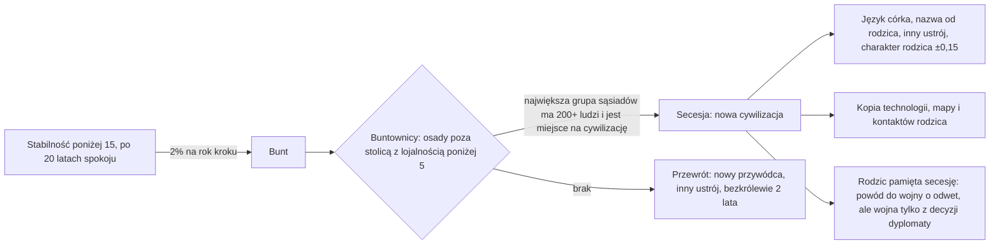

# Bunty, secesja i przewrót

**W jednym zdaniu:** gdy stabilność spadnie poniżej 15, może wybuchnąć bunt: dalekie osady, które straciły lojalność, odłączają się jako
nowa cywilizacja (język córka, inny ustrój, własny przywódca), a gdy takich nie ma, władzę bierze nowy przywódca z innym ustrojem
(GDD 7.3; etap 4f PR 4, decyzja Patryka z 2026-11-07).

**Faza tury:** State (`StabilitySystem`, zaraz po przeliczeniu stabilności), we własnym kroku cywilizacji, najwyżej raz w roku.

## Dane wejściowe i wyjściowe

- Czyta: `data/stability.json` (próg i szansa buntu, spokój po buncie, kto się odłącza, limit cywilizacji, przesunięcie charakteru),
  stabilność i lojalność osad (PR 3), kampanie w toku, `trade.json` `linkCells` (które osady są „sąsiadami”), język i cechy rodzica.
- Zmienia: przy secesji nową `CivilizationState` (kolejny numer, `ParentCiv`, `FoundedMonth`, `LanguageMutations`, cechy, ustrój,
  przywódca, technologie, pamięć mapy, kontakty), właściciela osad i pól ich strefy, pamięć rodzica (wspomnienie „secesja”);
  przy przewrocie przywódcę, ustrój i bezkrólewie; `RevoltCalmUntilMonth`; wpis w kronice.
- Publikuje: nowa cywilizacja pojawia się w podglądzie jak każda inna; panel pokazuje „Broke away from the ... in year ...”.
  Headless: linia `revolts:` (secesje i przewroty).

## Przepływ

## Zasady i wzory

- **Szansa buntu:** gdy stabilność < 15 i minęły 20 lata od poprzedniego buntu: 20‰ na rok, w kroku dłuższym niż rok złożone
  (1 − 0,98^lata; krok 50 lat → około 64%).
- **Buntownicy:** zamieszkane osady cywilizacji poza stolicą z lojalnością < 5, które nie wysłały wojowników na kampanię i nie są celem
  kampanii. Lojalność = stabilność − 5 za każde 10 punktów drogi od stolicy, więc przy stabilności 10 buntują się osady dalej niż
  10 punktów drogi. Osady łączą się w grupy, gdy dzieli je najwyżej `linkCells` pól (jak sieć handlowa); odłącza się grupa z największą
  liczbą ludzi, jeśli ma ich co najmniej 200 i gra ma mniej niż 64 cywilizacje.
- **Nowa cywilizacja:**
  - numer: następny wolny (iteracja zawsze po numerach, więc nowa idzie na końcu);
  - język: język rodzica z mutacją (`NameLanguage.Mutate`, ziarno z generatora buntu), zapisany jako lista mutacji, więc odtwarzalny;
    nazwa ludu z rdzenia nazwy rodzica i końcówki nowego języka (np. Huhiathian → Huhiathira);
  - ustrój: ten, do którego lud skłania się najbardziej, ale inny niż rodzica („odłam o innych poglądach”);
  - charakter: cechy ludu rodzica ±150‰ każda (losowo);
  - przywódca: nowy, w wieku następców swojego ustroju; stolica: największa z odłączonych osad;
  - technologie, era, pamięć mapy i wagi celów: kopia rodzica; kontakty: zna, kogo znał rodzic, z własną pierwszą opinią;
  - rytm: ten sam co rodzica (zaczyna od jego następnego kroku); 20 lat spokoju bez buntu.
- **Rodzic** pamięta secesję (sympatia −60, zaufanie −40, 200 lat, u mściwych do 400): to powód wojny o odwet (`HasGrievance`), ale wojnę
  wybiera jego dyplomata. Obie strony się znają od razu. Rodzic traci osady, więc spada mu zużycie administracji.
- **Przewrót:** nowy przywódca i ustrój, do którego lud skłania się najbardziej poza obecnym (od razu, bez czekania na wdrożenie),
  potem 2 lata bezkrólewia. Gdy innego ustroju nie ma, zostaje stary, a bezkrólewie i tak przychodzi.
- **Losowanie:** generator z seeda, strumienia `Leaders` (bez przesuwania wspólnych strumieni), numeru cywilizacji przesuniętego
  o 2·2^20 i miesiąca.

## Pliki danych

`data/stability.json` (pola `revolt*`, `secession*`, `maxCivilizations`), wydarzenie `secession` w `data/relations.json`.

## Testy

`tests/CivSim.Tests/Governance/RevoltTests.cs`: szansa (próg, krok 50 lat, rok wojny, spokój po buncie), wybór buntowników (największa
grupa sąsiadów, bez stolicy i lojalnych, za mało ludzi), secesja (numer, właściciel osad i pól, stolica, inny ustrój, spokrewniona
nazwa i język, kopia technologii, przywódca, pamięć rodzica, brak wojny, dalsze tury i zapis), przewrót (przywódca, ustrój,
bezkrólewie), pełny świat (przewrót zamiast secesji).

## Wydajność

Bunt jest rzadki (w 3 grach po kilka); sprawdzenie szansy to kilka działań na cywilizację na krok. Secesja przechodzi raz po polach
mapy, żeby przepisać właściciela.
