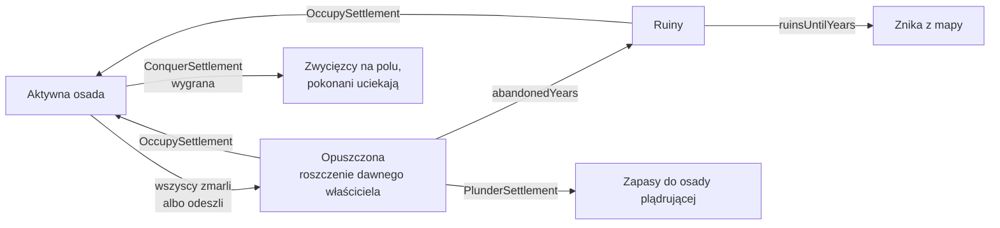

# Osady jako majątek: porzucanie, ruiny, przejmowanie, podbój

**W jednym zdaniu:** osada, z której wszyscy odeszli albo wymarli, nie znika od razu: stoi opuszczona, potem zostają z niej ruiny, a w tym czasie każdy, czyja to ziemia, może się do niej wprowadzić albo zabrać to, co zostało.

**Fazy tury:** 1. Świat (niszczenie: opuszczona → ruiny → znika), 4. Rozstrzyganie komend (porzucenie, przejęcie, plądrowanie, podbój), 8. Ludność (osada bez ludzi zostaje opuszczona; cywilizacja bez ludzi wymiera).

## Dane wejściowe i wyjściowe
- Czyta: `GameState.Settlements`, `data/settlements.json` (lata stanów dla każdego poziomu, roszczenie, ile niesie osoba), `data/population.json` (zasady podboju i AI), efekt `carrying`.
- Zmienia: `SettlementState.Status`, `AbandonedMonth`, `ClaimCiv`, `ClaimUntilMonth`, właściciela, ludzi i magazyny; `CivilizationState.IsAlive` i `DiedOutMonth`.
- Publikuje: stan osady i roszczenie widzi każdy, kto zna pole (to widać z zewnątrz); magazyn tylko właściciel i obserwator. W kronice: wypędzenia, odparte ataki, przejęcia cudzych osad z roszczeniem, wymarcie cywilizacji.

## Przepływ

## Zasady i wzory
- **Dwa stany** (GDD 16: CORE uproszczone): opuszczona i ruiny. Czasy zależą od poziomu osady (`abandonedYears`, `ruinsUntilYears`): obóz 50 i 100 lat, wioska i miasteczko 50 i 300, miasto 100 i 500, metropolia i megalopolis 100 i 1000. Im większa i bardziej rozwinięta osada, tym dłużej stoi. Trwałość poszczególnych budynków (drewno, kamień) dojdzie razem z budynkami.
- **Porzucenie z konieczności:** osada bez ludzi po fazie ludności. **Z wyboru:** komenda `AbandonSettlement` (wszyscy przechodzą do innej własnej osady w zasięgu), a także przeprowadzka obozu, który nie uniesie całego magazynu: to, co zostaje, leży w opuszczonym obozowisku „Old …” na starym polu.
- **Noszenie** to ogólna zasada, nie tylko przy porzucaniu: każda przeprowadzka, odłam, porzucenie, przejęcie i plądrowanie niesie najwyżej `carrying.perPerson` (10 jednostek) na osobę. Efekt `carrying` (cel: cywilizacja) podnosi to w procentach. Zwierzęta juczne, wozy i łodzie z technologii dodadzą ten efekt bez zmian w kodzie. Gdy ładunek jest za ciężki, każdy towar jest ucinany w tej samej proporcji.
- **Roszczenie:** dawny właściciel (jeśli żyje) ma roszczenie przez `claimYears` (100 lat). Roszczenie nie blokuje przejęcia i zostaje po nim; w etapie 4 stanie się sporem granicznym i powodem wojny. Dziś jest tylko zapisane i widoczne w inspektorze (decyzja z 2026-11-05).
- **Przejęcie i plądrowanie:** opuszczona osada albo ruiny w zasięgu wędrówki, na ziemi własnej albo niczyjej. Przejęcie przenosi część albo wszystkich ludzi; plądrowanie zabiera tyle, ile uniosą ludzie osady plądrującej.
- **Podbój przy migracji** (GDD 5.4, wersja uproszczona do etapu 4, decyzja z 2026-11-05): obóz z wojownikami atakuje cudzy obóz w zasięgu. Siła ataku = wojownicy; obrona = wojownicy + 25% pozostałych. Szansa wygranej = atak / (atak + obrona), losowana ze strumienia `combat`. Wygrani tracą 10% wojowników, przegrani 40%. Pokonani obrońcy tracą jeszcze 20% wszystkich ludzi w ucieczce i uciekają na najbliższe wolne pole (albo do własnej osady); zwycięzcy wchodzą na ich pole i zabierają to, czego tamci nie unieśli. Wcielenie pokonanych (lojalność) i trybut to przyszłe moduły.
- **Wymarcie:** cywilizacja bez żadnego człowieka zostaje oznaczona jako wymarła (z miesiącem wymarcia); jej osady zostają jako opuszczone, bez roszczenia, i niszczeją jak inne.

## AI plemion (zmiany w 3d)
- **Bez limitu obozów:** odłam wyrusza tylko na ziemię, która wyżywi odchodzących (`splitNeedsFoodPercent`). Liczbę obozów ogranicza ziemia, nie sztywny limit.
- **Ocena ziemi zgodna ze strefą wpływów:** AI liczy jako ziemię miejsca te pola, do których obóz bez wojowników naprawdę dotrze, płacąc koszt terenu (wzgórza, lasy, bagna). Wcześniej liczyła okrąg o promieniu 2, więc plemię na wzgórzach (strefa 7 pól) uważało swoją ziemię za bogatą i nigdy nie odchodziło. To był błąd mechaniki, który zostawiał 3 z 12 plemion na 25 osobach przez 100 000 lat.
- Głodny obóz może iść: na wolne pole, do własnego lub cudzego opuszczonego obozowiska (własne ma +10%, to znana ziemia) albo na cudzy obóz, jeśli ma co najmniej 150% jego siły obrony.
- Obóz poniżej 15 osób dołącza do najbliższego własnego obozu. Bezczynny obóz plądruje opuszczone osady w zasięgu, gdy ma miejsce w magazynie.

## Pliki danych
- `data/settlements.json`: `abandonedYears` i `ruinsUntilYears` w każdym poziomie, `abandonment.claimYears`, `carrying.perPerson`.
- `data/population.json`: `migration.splitNeedsFoodPercent`, `mergeBelowPeople`, `ownCampsiteBonusPercent`, `attackAboveStrengthPercent` oraz sekcja `conquest`.
- `data/effects.json`: efekt `carrying` (`carry_capacity_percent`).

## Testy
- `SettlementAssetTests` (7 testów, ok. 0,2 s): dane się wczytują; noszenie ma limit i rośnie z efektem; przeprowadzka zostawia nadmiar w opuszczonym obozowisku; osada przechodzi w ruiny i znika; inne plemię plądruje i przejmuje, a roszczenie zostaje; silniejszy obóz zwykle wygrywa podbój; cywilizacja bez ludzi wymiera.

## Wydajność
10 000 tur, Release, seed 1: mapa standardowa średnio 8,9 ms (3c: 5 ms), ogromna 31 ms (3c: 22 ms). Wzrost to dokładniejsza ocena ziemi przez AI (przejście po terenie zamiast okręgu). Wciąż daleko od celów (50 i 250 ms).
