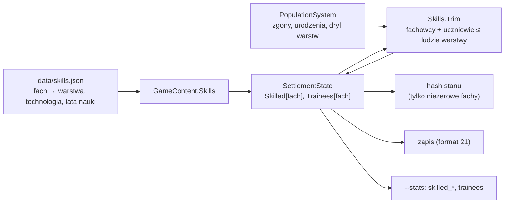

# Fachy (etap 4F)

**W jednym zdaniu:** każda osada liczy, ilu jej ludzi zna każdy fach i ilu się go uczy, a fachowcy i uczniowie zawsze mieszczą się w swojej warstwie (ADR 0020, GDD 5.1).

**Faza tury:** 8. Ludność (po zgonach, urodzeniach i dryfie warstw `PopulationSystem` przycina fachy). Od PR 2 dojdzie nauka fachu i przenoszenie fachowców.

**Stan:** PR 1 (dane, stan, zapis, hash, statystyki). Liczby są jeszcze zerami: nic ich nie zwiększa, dopóki PR 2 nie wprowadzi nauki fachu. Gra liczy się bit w bit tak samo jak przed PR 1 (hash seeda 23 po 1000 turach: `FF4C717C0D03518D` przed i po).

## Dane wejściowe i wyjściowe
- Czyta: `data/skills.json` (fach, warstwa, technologia, która go otwiera, lata nauki), ludzi warstw osady.
- Zmienia: `SettlementState.Skilled` i `SettlementState.Trainees` (liczba na fach, indeks = id fachu).
- Publikuje: nic w migawce (podgląd dostanie fachy później); Headless: kolumny `skilled_<fach>` i `trainees` w `--stats` (suma w świecie).

## Przepływ

## Zasady i wzory
- Fach należy do jednej warstwy. Ludzie warstwy bez fachu to jej zwykli członkowie (zbieracze wśród wytwórców, wojownicy wśród wojowników), więc tych fachów nie ma w pliku.
- **Przycinanie** (`Skills.Trim`): gdy fachowców i uczniów jest więcej niż ludzi warstwy, najpierw odchodzą uczniowie (każdy fach w swojej proporcji, zaokrąglenie w dół), potem fachowcy (proporcja, zaokrąglenie w górę, żeby fach znikał dopiero z ostatnim fachowcem; nadmiar z zaokrągleń zabiera największy fach, przy remisie ten o niższym id). Bez alokacji, deterministyczne.
- Hash stanu dodaje tylko fachy, które ktoś zna albo których ktoś się uczy, więc świat bez fachowców ma ten sam hash co przed etapem 4F.

## Pliki danych
- `data/skills.json` (wersja 1): 10 fachów er 1–2 dla wytwórców (myśliwy, rybak, rolnik, pasterz) i rzemieślników (krzemieniarz, garbarz, garncarz, tkacz, kamieniarz, piekarz). Starszyzna i wódz przyjdą z warstwami myślicieli i przywódców (PR 3).

## Testy
- `SkillTests`: dane fachów (warstwa i technologia istnieją), błędy w danych (nieznana warstwa, technologia, powtórzony klucz), przycinanie (uczniowie pierwsi, proporcje, fach znika z ostatnim fachowcem, inne warstwy nietknięte), nowe osady mają miejsce na każdy fach, zapis i hash.

## Wydajność
- Dwie tablice liczb na osadę (po 10 liczb) i jedna pętla po fachach na osadę w fazie ludności. Seed 23, mapa standard, 1000 tur: 55 ms (przed: 52 ms; różnica w granicach szumu tej maszyny, praca na turę taka sama).
