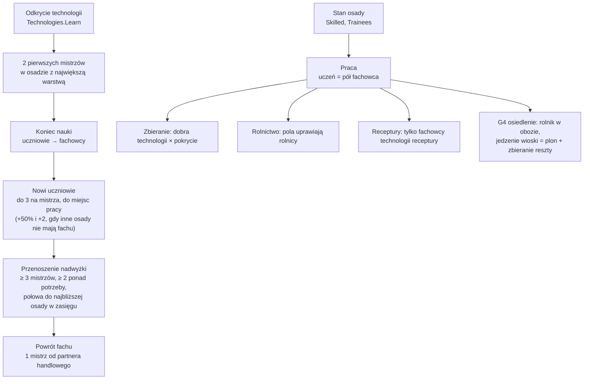

# Fachy (etap 4F)

**W jednym zdaniu:** ludzie uczą się fachów od mistrzów, a dobra z technologii, pola i receptury dają tyle, ilu jest fachowców (ADR 0020, GDD 5.1).

**Faza tury:** 8. Ludność, po `PopulationSystem` (zgony, urodzenia, dryf warstw), w krokach cywilizacji (ADR 0018). Pierwsi mistrzowie pojawiają się w fazie badań, gdy cywilizacja odkryje technologię (`Technologies.Learn`).

**Stan:** PR 1 (dane, stan, zapis, hash, statystyki) i PR 2 (nauka fachu, przenoszenie, utrata, praca fachowców). PR 3: warstwy myślicieli (3%, główne źródło nauki) i przywódców (1%), wymogi ludzi w technologiach (`docs/systems/research.md`). PR 4: demografia (`docs/systems/population.md`). PR 5: graf technologii, fachów i ludzi rysowany z danych ([graf-technologii.md](graf-technologii.md), skrypt `docs/systems/tools/tech_graph.py`) i test, że całe drzewo jest osiągalne od zera.

## Dane wejściowe i wyjściowe
- Czyta: `data/skills.json` (fachy i reguły), ludzi warstw osady, znane technologie, umowy handlowe, odległości osad (`data/trade.json` `linkCells`).
- Zmienia: `SettlementState.Skilled` i `Trainees` (liczba na fach), a przy przenoszeniu także ludzi warstwy w obu osadach.
- Publikuje: nic w migawce (podgląd dostanie fachy później); Headless: kolumny `skilled_<fach>` i `trainees` w `--stats`.

## Przepływ

## Zasady i wzory
- **Fach** należy do jednej warstwy i przychodzi z jedną technologią. Ludzie warstwy bez fachu to jej zwykli członkowie (zbieracze, wojownicy).
- **Miejsca pracy** (`Skills.Needed`): `jobsPercent` ludzi warstwy osady (rolnik 50, myśliwy 20, rybak 15, pasterz 15; rzemiosła 10–15; razem najwyżej 100% warstwy, żeby każdy fach znalazł ludzi); osada, której receptura wymaga fachu, zatrudni wszystkich rzemieślników.
- **Praca** (`Skills.Workers`): fachowcy + uczniowie × 50%, najwyżej tyle, ilu ludzi ma warstwa.
- **Pokrycie** (`Skills.CoveragePerMille`): praca ÷ miejsca pracy, najwyżej 1000. Dobra, które technologia dodaje do zbierania (mięso i skóry z łowiectwa, ryby, zboże, krzemień, glina, kamień), przychodzą w tej części.
- **Pierwsi mistrzowie** (`Skills.Seed`): 2 w osadzie cywilizacji z największą liczbą ludzi warstwy (remis: niższe id). Gdy w warstwie nie ma wolnych ludzi, przyuczają się z największego innego fachu.
- **Nauka** (`SkillSystem`, w każdym kroku cywilizacji): uczniowie z poprzedniego kroku kończą naukę (krok krótszy niż lata nauki kończy ich część, zaokrągloną w górę; w erach 1–2 kroki są dłuższe niż każda nauka). Potem każdy fach przyjmuje nowych: `min(3 × fachowcy − uczniowie, miejsca pracy − fachowcy − uczniowie, wolni ludzie warstwy)`. Gdy jakaś osada cywilizacji potrzebuje fachu i nie ma nikogo, kto go zna, mistrzowie uczą 50% ponad własne miejsca pracy i jeszcze 2 osoby (`teachForOthersPercent`, `moveSpareAbove`), żeby było kogo wysłać.
- **Przenoszenie:** osada z co najmniej 3 fachowcami i co najmniej 2 ponad miejsca pracy wysyła połowę nadwyżki (najmniej 1) do najbliższej własnej osady w zasięgu `linkCells` (8 pól), której brakuje rąk; fachowcy przechodzą razem ze swoim miejscem w warstwie. Listę osad, którym brakuje rąk, system buduje raz na turę; osada, której zabraknie rąk w trakcie przenosin, czeka do następnego kroku.
- **Odłamy, osadnicy, zajęcia, łączenie, ucieczka:** fachowcy i uczniowie idą w tej samej proporcji co ludzie (w dół), ale grupa zabiera co najmniej 1 fachowca każdego fachu, jeśli w osadzie zostaje co najmniej 1 (osadnicy biorą rolnika).
- **Utrata i powrót:** gdy umrze ostatni fachowiec, nikt nie uczy. Cywilizacja, która zna technologię, ale nie ma nikogo z fachem, dostaje 1 mistrza na krok, jeśli ma umowę handlową z cywilizacją, która ma co najmniej 3 fachowców.
- **Przycinanie** (`Skills.Trim`): po zgonach, dryfie warstw i stratach fachowców i uczniów nigdy nie jest więcej niż ludzi warstwy (uczniowie odchodzą pierwsi; fach znika dopiero z ostatnim fachowcem).

## Pliki danych
- `data/skills.json` (wersja 2): 10 fachów er 1–2 z `jobsPercent` i latami nauki, reguły (`firstMasters` 2, `apprenticesPerMaster` 3, `apprenticeWorkPercent` 50, `moveMinMasters` 3, `moveSpareAbove` 2, `moveSharePercent` 50, `teachForOthersPercent` 50, `farmingSkill` farmer). Fach jest powiązany z recepturami i dobrami zbierania swojej technologii (`SkillLinks`, liczone przy wczytywaniu; jedna technologia otwiera najwyżej jeden fach).

## Testy
- `TechnologyGraphTests` (PR 5): każda technologia i każdy fach osiągalne od zera, bez pętli między fachami a technologiami.
- `SkillTests` (PR 1): dane, błędy w danych, przycinanie, nowe osady, zapis i hash.
- `SkillLearningTests` (PR 2): pierwsi mistrzowie tam, gdzie żyje najwięcej ludzi warstwy; uczniowie po 3 na mistrza do miejsc pracy i koniec nauki po latach; uczeń pracuje za pół; utracony fach wraca tylko od partnera handlowego; nadwyżka przenosi się z miejscem w warstwie; osadnicy biorą fachowca; recepturę robią tylko fachowcy; dobra technologii według pokrycia.
- Testy rolnictwa, receptur i suszy dostały rolników i garbarzy; `DeadValueTests`: sytuacja „rynek” z garbarzami i piekarzami, pakt obok umowy handlowej w sytuacjach neolitycznych.

## Wydajność
- Na osadę: kilka pętli po 10 fachach w kroku cywilizacji. Przenoszenie: raz na turę lista osad, którym brakuje rąk (na cywilizację i fach), a dawcy przeglądają tylko ją (pierwsza wersja przeglądała wszystkie osady: faza ludności na mapie ogromnej 33 ms, teraz 2,8 ms).
- PR 2, Release, 1000 tur (mapa ogromna 300), przed → po: standard seed 7: 39,6 → 38,3 ms; seed 23: 53,3 → 53,4 ms; seed 42: 50,5 → 45,3 ms; ogromna seed 42: 164–168 → 178 ms (+7%), pamięć 255 → 289 MB przy 17% większej ludności.
