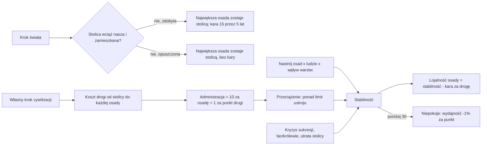

# Stolica, administracja i stabilność

**W jednym zdaniu:** każda cywilizacja ma stolicę, płaci punktami administracji za każdą osadę (więcej za dalsze, liczone drogą),
a jej stabilność 0–100 to nastrój osad ważony wpływem warstw, plus premia ustroju, minus przeciążenie administracji, kryzys sukcesji,
bezkrólewie i utrata stolicy; poniżej 30 zaczynają się niepokoje (GDD 7.3; etap 4f PR 3).

**Faza tury:** State (`StabilitySystem`, po `LeaderSystem`). Stolica sprawdzana w każdym kroku świata; administracja, stabilność
i lojalność we własnym kroku cywilizacji (ADR 0018).

## Dane wejściowe i wyjściowe

- Czyta: `data/stability.json` (progi, kary, koszt administracji), pola `stabilityBonus`, `administration`, `strataInfluence`
  w `data/governments.json`, nastrój i ludzi osad, koszty ruchu biomów i rzeźby (te same co strefy wpływów), `CrisisUntilMonth` przywódcy.
- Zmienia: `CivilizationState.Capital`, `Stability`, `AdminUsed`, `AnarchyUntilMonth` (przy zmianie ustroju), `CapitalLostUntilMonth`;
  `SettlementState.Loyalty`; efekt `unrest` (wydajność osad cywilizacji); wpisy w kronice.
- Publikuje: panel cywilizacji w podglądzie pokazuje stabilność z rozbiciem („mood 62, government +10, administration −8”), stolicę
  i administrację „użyte / limit”; panel osady pokazuje lojalność. Headless: linia `stability:` i kolumny `stability_avg`, `unrest_civs`
  w statystykach.

## Przepływ

## Zasady i wzory

- **Stolica:** na start pierwszy obóz. Gdy stolica przestaje być zamieszkaną osadą cywilizacji, stolicą zostaje największa osada
  (najwięcej ludzi, przy remisie najniższy numer). Zdobyta przez wroga stolica obniża stabilność o 15 przez 5 lat; opuszczona przez
  własnych ludzi (przeprowadzka, połączenie) nie.
- **Stolica osiada** (etap 5b, 2026-11-08): stolica, która jest jeszcze wędrującym obozem, przenosi się do największej wioski, gdy
  tylko cywilizacja jakąś ma (kronika: „X made Y its capital”, bez kary). Osiadła stolica już się nie przenosi, nawet gdy inna wioska
  urośnie większa. Podgląd rysuje nad stolicą złoty romb, a widok niesie jej numer (`CivilizationView.Capital`, tylko gdy widz widzi tę osadę).
- **Koszt drogi:** najtańsza droga po lądzie od stolicy, suma kosztów ruchu wchodzonych pól (biom 1–3, wzgórza +1, góry +2),
  szukana do 60. Osada dalej albo za wodą liczy się jako 60.
- **Administracja:** każda osada zużywa 10 punktów plus 1 za punkt kosztu drogi. Limit z ustroju: rada starszych 250, wodzostwo 200,
  despotia 350, republika miejska 300. Przeciążenie: kara 10 punktów stabilności, gdy zużycie jest dwa razy większe niż limit
  (proporcjonalnie), najwyżej 25.
- **Stabilność** = średni nastrój osad ważony liczbą ludzi każdej warstwy razy jej wpływ polityczny (rada starszych: myśliciele
  i przywódcy x4; wodzostwo: wojownicy i przywódcy x4; despotia: wojownicy x3, przywódcy x6; republika: rzemieślnicy x4, myśliciele
  i przywódcy x2; reszta x1). Nastrój warstwy to na razie nastrój jej osady (decyzja Patryka z 2026-11-07). Do tego premia ustroju
  (rada +10, wodzostwo 0, despotia −5, republika +5) i kary: przeciążenie, kryzys sukcesji 15, bezkrólewie 20, utrata stolicy 15.
  Kryzys, bezkrólewie i utrata stolicy liczą się w części kroku, którą trwają: 5-letni kryzys w 50-letnim kroku to 1/10 kary,
  w roku wojny cała.
- **Jak często:** we własnym kroku cywilizacji, ale najwyżej raz w roku: w wojnie (kroki miesięczne) w pierwszym miesiącu roku.
- **Bezkrólewie:** po zmianie ustroju 2 lata: kara 20 i brak decyzji państwowych (bez wypowiadania wojen i kolejnej zmiany ustroju).
- **Lojalność osady** = stabilność − 5 za każde 10 punktów drogi od stolicy (0–100). Bunty i secesja dalekich osad przyjdą w PR 4.
- **Niepokoje:** poniżej 30 efekt `unrest` (z `data/effects.json`) obniża wydajność wszystkich osad o 1% za każdy punkt poniżej 30,
  do następnego kroku cywilizacji. Kronika zapisuje początek („Unrest spread...”) i koniec („Calm returned...”).

### Jak reaguje AI (od PR 5)

- Strateg: przy przeciążonej administracji waga ekspansji × pojemność / zużycie (nie mniej niż 50%); w niepokojach waga
  bezpieczeństwa × 1,5 i premia stabilności ustroju w wyborze ustroju (S2).
- Dyplomata: w niepokojach ocena wojny × 0,5; w bezkrólewiu i w trakcie zmiany ustroju wojny w ogóle nie rozważa.
- Parametry w `data/ai.json` (`overloadExpansionMinPercent`, `unrestSecurityPercent`, `unrestWarPercent`,
  `governmentChangeMarginPercent`, `governmentStabilityWeight`, `governmentKeepYears`); opis w [`docs/ai/`](../ai/02-strateg.md).

## Pliki danych

`data/stability.json`, pola `stabilityBonus`, `administration`, `strataInfluence` w `data/governments.json`, efekt `unrest`
w `data/effects.json`.

## Testy

`tests/CivSim.Tests/Governance/StabilityTests.cs`: stolica na start, utrata stolicy (kara) i przeprowadzka (bez kary), ważenie nastroju
wpływem warstw w dwóch ustrojach, przeciążenie, kryzys w części kroku, bezkrólewie blokuje wojnę i zmianę ustroju, koszt drogi
i lojalność dalszych osad, niepokoje obniżają wydajność i znikają, zapis, odrzucanie złych danych. Bezkrólewie po zmianie ustroju:
`GovernmentTests`.

## Wydajność

Jedno przeszukanie drogi (Dijkstra do kosztu 60) na cywilizację na jej krok, najwyżej raz w roku, z buforami trzymanymi między krokami.
