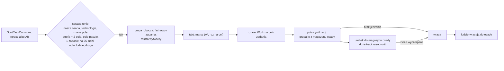

# Zadania na obszarze

**W jednym zdaniu:** osada wysyła grupę roboczą (oddział) na pole w swojej okolicy: wycinka, kopalnia krzemienia albo kamieniołom;
grupa idzie tam, zostaje i pracuje, a urobek trafia do magazynu osady w pulsie jej cywilizacji (etap 6 PR 4a, GDD 4.4 „Zadania na
obszarze”, decyzje Patryka z 2026-11-12, ADR 0026 i 0027).

**Faza tury:** rozkaz `StartTaskCommand` w fazie decyzji (kategoria ekonomia); marsz grupy co takt w fazie 5. Ruch (`UnitSystem`,
rozkaz `Work`); urobek, jedzenie grupy i wyczerpanie złoża w pulsie cywilizacji, w fazie gospodarki zaraz po zbieraniu ze strefy
(`TaskSystem`). Powrót grupy to zwykły rozkaz „wróć” (`ReturnUnitCommand`).

## Dane wejściowe i wyjściowe
- Czyta: `data/tasks.json` (rodzaje zadań, zasięg, limity), rola `workers` w `data/units.json` (prędkość grupy), wartości `gather`
  biomów (`biomes.json`), złoża z `resources.json` (rodzaj, głębokość, zasobność), pamięć mapy cywilizacji, strefę wpływów osady
  (`WorldMap.Claim`), właściciela pól, technologie cywilizacji, fachy osady.
- Zmienia: `GameState.Units` (nowa grupa robocza z polem `Task`), ludzi i fachowców osady (wyjście i powrót), magazyn osady (urobek,
  jedzenie grupy), zasobność złoża (`DepositRichness`, wyczerpane złoże znika), kronikę.
- Publikuje: `GameSnapshot.Units` i `UnitView` z rolą 4 (grupa robocza), rodzajem zadania i polem zadania (`Task`, `TargetCol`,
  `TargetRow`, protokół 17); `ContentMessage.Tasks` (rodzaje zadań: id, klucz, nazwa, dobro).

## Przepływ

## Zasady

- **Gdzie:** pole należące do strefy osady albo najwyżej `rangeBeyondZoneCells` (2) pola od jej strefy; znane cywilizacji, lądowe,
  nie cudze. Na jednym polu pracuje najwyżej jedna grupa danej cywilizacji.
- **Ile:** osada prowadzi jedno zadanie na każde `peoplePerTask` (25) ludzi (grupy w terenie dalej się liczą do osady). Grupa ma
  `defaultPeoplePerGroup` (10) ludzi, najwyżej `maxPeoplePerGroup` (30). W osadzie zostaje co najmniej 1 osoba.
- **Kto idzie:** najpierw fachowcy z fachem zadania (łupacze krzemienia do kopalni krzemienia, kamieniarze do kamieniołomu), ze swojej warstwy; reszta
  to wytwórcy, którzy nie mają innego fachu (myśliwi, rybacy i rolnicy zostają przy swojej pracy).
- **Rodzaje** (`tasks.json`, do strojenia):

| Rodzaj | Źródło | Dobro | Urobek na osobę na rok | Technologia | Fach |
| --- | --- | --- | --- | --- | --- |
| wycinka (`woodcutting`) | biom: wartość `gather` drewna | drewno | 0,5 × wartość biomu (las liściasty 6 → 3, tajga 5 → 2,5, łąka 0,5 → 0,25) | — | — |
| kopalnia krzemienia (`flint_mine`) | złoże krzemienia na powierzchni | krzemień | 1 | obróbka krzemienia | łupacz krzemienia |
| kamieniołom (`quarry`) | złoże kamienia na powierzchni | kamień | 1 | kamieniarstwo | kamieniarz |

- **Urobek w pulsie:** ludzie × urobek na osobę na rok × miesiące pulsu / 12. Przykład z testu: 10 ludzi w lesie liściastym przez rok
  = 10 × 0,5 × 6 = 30 drewna.
- **Złoża się wyczerpują** (GDD 4.4): zasobność jest w całych jednostkach; grupa bierze najwyżej to, co zostało. Puste złoże znika,
  a grupa wraca do domu („Flint Mine of X ran out; the work group comes home”). Las w tym PR się nie wyczerpuje (odrastanie lasu
  przyjdzie, gdy wycinka będzie miała znaczenie dla AI, PR 4b).
- **Jedzenie:** grupa je razem ze swoją osadą, w pulsie, z jej magazynu (`war.json foodPerWarriorPerYear` na osobę). Gdy jedzenia
  brakuje, wraca. Grupa robocza to realny koszt: 10 ludzi mniej zbiera jedzenie. Pomiar z 2026-11-13: zlecanie wycinki każdemu obozowi
  od 25 ludzi co sekundę zagłodziło świat (6 osad zamiast 232 po 15 minutach), więc AI w 4b musi liczyć ten koszt.
- **Dom zniknął** (osada porzucona albo zdobyta): grupa idzie do najbliższej własnej osady (jak każdy oddział wracający do domu).
- **Zbieranie ze strefy:** dopóki `zoneGathersMaterials` jest `true`, osady dalej zbierają drewno, krzemień i kamień z całej strefy,
  jak przed tym PR. W 4b AI zacznie zlecać zadania i flaga przejdzie na `false`: wtedy drewno (dobra zadań z biomu) i złoża zadań
  (krzemień, kamień) przychodzą tylko z zadań, a żywność dalej ze strefy (decyzja Patryka z 2026-11-12).

## Test sternika (ADR 0027)

1. **Dźwignia:** 3 „co robimy na ziemi”.
2. **AI robi to samo, gdy gracz nie klika:** w 4a jeszcze nie (AI nie zleca zadań, zbieranie ze strefy zostaje włączone, więc nic
   się nie psuje); w 4b gubernator wydaje ten sam `StartTaskCommand`.
3. **Widać w 2–3 minuty:** grupa idzie na pole (dwie postacie z siekierkami w kolorze ludu), pole zadania ma obrys w kolorze ludu,
   magazyn osady rośnie, puste złoże znika z mapy.
4. **Kronika:** „The work group of X ran out of food and comes home”, „Flint Mine of X ran out; the work group comes home”.
   Brakuje zdania przy starcie zadania (dojdzie z dziennikiem „dlaczego” gubernatora w 4b).
5. **Partia bez klikania:** bez zmian względem `development` (ten sam hasz stanu), bo AI jeszcze nie zleca zadań.

## Pliki danych
`data/tasks.json` (+ `data/schema/tasks.schema.json`), rola `workers` w `data/units.json`, grafika `art/placeholder/units/unit_workers_idle_01.png`.

## Testy
`tests/CivSim.Tests/Units/TaskTests.cs`: dane; zasady komendy (rodzaj, zasięg, wielkość grupy, cudza osada, złoże i technologia,
jedno zadanie na pole, limit na 25 ludzi); marsz i urobek w pulsie (30 drewna za rok, nic bez pulsu); wyczerpanie złoża i powrót;
odwołanie grupy; brak jedzenia; zapis i hasz; komenda z protokołu; zbieranie ze strefy z flagą wyłączoną (drewna 0, żywność bez zmian).

## Wydajność
Mapa standard, seed 7, 8 cywilizacji, 9000 taktów (15 minut przy ×1), Release:

| Bieg | Średni takt | 95% taktów poniżej | Takty > 30 ms | Oddziały na końcu |
| --- | --- | --- | --- | --- |
| `development` przed PR | 2,38–2,40 ms | 7,7 ms | 12 (z raportu) | 96 |
| ten PR, bez grup | 2,26–2,49 ms | 7,1 ms | 10 (z raportu) | 96 |
| ten PR, `--work-groups 400` (197 grup, 153 przy pracy) | 2,04 ms | 6,8 ms | 7 | 312 |

Wszystkie takty powyżej 30 ms to puls świata (klimat) co 300 taktów, 35–40 ms, także przed tym PR (znany problem 12).
`TaskSystem` przegląda oddziały co takt, ale liczy tylko w pulsie właściciela; bez alokacji.
Pomiar: `CivSim.Headless --map-size standard --seed 7 --turns 9000 --civs 8 --quiet --work-groups 400` (opcja tylko do pomiaru:
zleca wycinkę każdej osadzie od 100 ludzi raz, przez zwykłą komendę; to nie jest AI).
