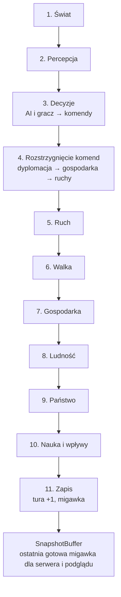

# Pętla tury

**W jednym zdaniu:** przesuwa grę o jedną turę: uruchamia 11 faz w stałej kolejności, rozstrzyga komendy, mierzy czas i publikuje migawkę.

**Faza tury:** wszystkie (to ona je wywołuje).

## Dane wejściowe i wyjściowe
- Czyta: komendy z kolejki (`CommandQueue`) i od źródeł komend (`ICommandSource`, np. przyszła AI).
- Zmienia: `GameState` (przez systemy i komendy), licznik tur.
- Publikuje w migawce: numer tury, światy, cywilizacje (`GameSnapshot`).

## Przepływ

## Zasady i wzory
- Kolejność faz z GDD 11.1 jest zapisana w `TurnPhase`. Każdy system (`ITurnSystem`) mówi, w której fazie działa;
  w obrębie fazy systemy idą w kolejności rejestracji.
- **Komendy** (`ICommand`) to jedyny sposób zmiany stanu. Każda ma kategorię (dyplomacja, gospodarka, ruch),
  sprawdzenie zasad (`Validate`) i wykonanie (`Apply`). Każda komenda niesie gracza i cywilizację (`CommandEnvelope`).
- **Kolejność rozstrzygania:** najpierw kategoria, potem cywilizacja, potem kolejność nadejścia.
  Kolejność cywilizacji obraca się co turę: w turze *t* pierwsza jest cywilizacja o indeksie *t mod liczba cywilizacji*.
  Po 400 turach przy 4 cywilizacjach każda była pierwsza dokładnie 100 razy (test).
- Komenda, która nie przejdzie `Validate`, nie zmienia stanu i trafia do raportu tury z powodem.
- **Migawka:** po fazie 11 powstaje nowa, niezmienna `GameSnapshot` i jest podmieniana atomowo w `SnapshotBuffer`.
  Czytelnik zawsze widzi całą turę i nigdy nie czeka na symulację. Stara migawka się nie zmienia.
- **Hash stanu** (`GameStateHash`): FNV-1a 64-bit po wszystkim, co wpływa na dalszą grę (ustawienia, tura,
  stany generatorów, światy, cywilizacje), zawsze w kolejności identyfikatorów.
- Pierwsza prawdziwa komenda to `RenameCivilizationCommand` (zmiana nazwy cywilizacji).

## Pliki danych
Brak.

## Testy
- `TurnRunnerTests`: kolejność faz, pomiar czasu, komendy poprawne i odrzucone, migawki.
- `CommandQueueTests`: kolejność kategorii, rotacja cywilizacji, sprawiedliwość rotacji.
- `DeterminismTests`: dwa przebiegi po 1000 tur z tym samym seedem dają ten sam hash; różne seedy dają różne;
  „złoty” hash po 100 turach musi być identyczny na Windowsie, Linuksie i macOS.

## Wydajność

Pomiar z 4 listopada 2026, `CivSim.Headless`, seed 1, 10 000 pustych tur (fazy bez systemów), build Release, Linux w chmurze:

| Mapa | Średnia tura | 95% tur szybciej niż | Najwolniejsza (tura 1) | Alokacja na turę | Pamięć zarządzana na końcu |
| --- | --- | --- | --- | --- | --- |
| Standard 256×160, 12 cyw. | 0,0035 ms | 0,0072 ms | 3,7 ms | 888 B | 0,1 MB |
| Ogromna 512×320, 32 cyw. | 0,0049 ms | 0,0086 ms | 3,0 ms | 1 848 B | 0,1 MB |

- Pierwsza tura jest wolniejsza, bo .NET wtedy kompiluje kod (JIT).
- Jedyna alokacja w turze to nowa migawka. Zasada „zero alokacji w pętli tury” będzie wymagać migawek ze zmianami
  (tylko zmienione fragmenty mapy) albo puli migawek; zrobimy to razem z mapą w etapie 1.
- CI uruchamia ten benchmark w każdym PR (Ubuntu) i pokazuje wynik w podsumowaniu zadania. Pełne CSV są w artefakcie `benchmark-reports`.
