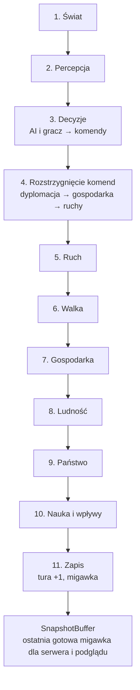
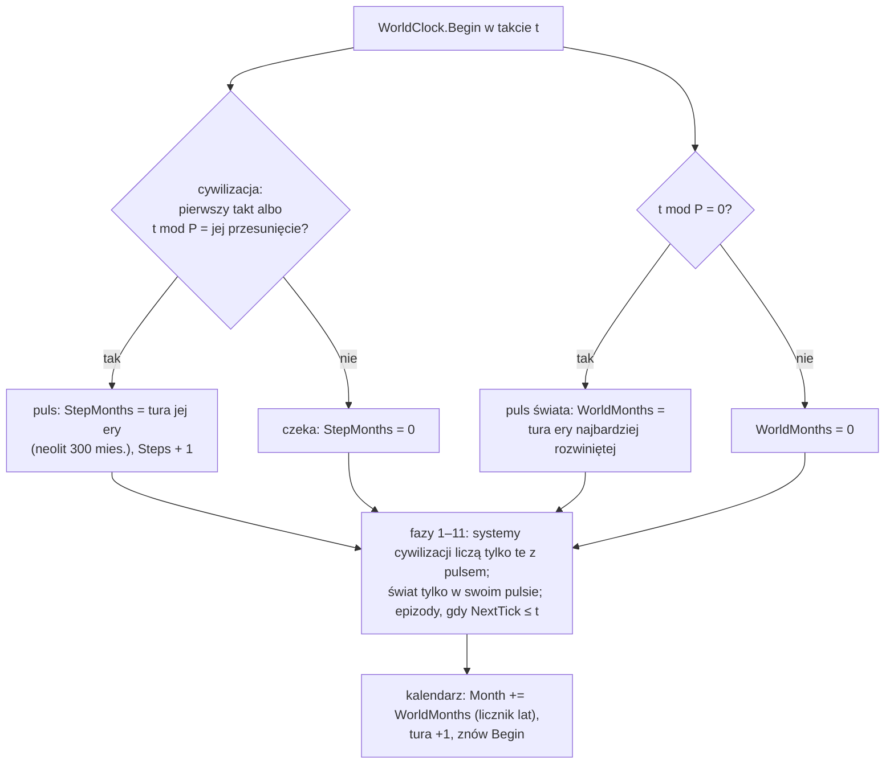
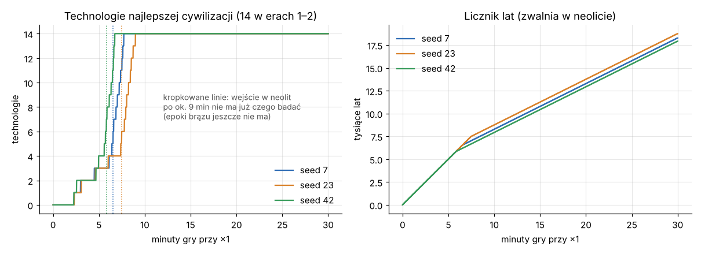

# Pętla tury

**W jednym zdaniu:** przesuwa grę o jeden **takt** (ADR 0025): uruchamia 11 faz w stałej kolejności, rozstrzyga komendy, mierzy czas i publikuje migawkę; zegar mówi, które cywilizacje mają w tym takcie puls (i za ile miesięcy), czy świat ma swój puls i które epizody robią krok.

**Faza tury:** wszystkie (to ona je wywołuje).

## Dane wejściowe i wyjściowe
- Czyta: komendy z kolejki (`CommandQueue`) i od źródeł komend (`ICommandSource`, np. przyszła AI).
- Zmienia: `GameState` (przez systemy i komendy), licznik tur.
- Publikuje w migawce: numer tury, światy, cywilizacje (`GameSnapshot`).

## Przepływ

## Zegar gry na żywo: takty i pulsy (ADR 0025, etap 6 PR 1; wcześniej ADR 0018 i 0022)

- **Takt** = jeden obrót pętli (`GameState.Turn`). Serwer robi `ticksPerSecond` taktów na sekundę przy ×1 (×2 i ×4 dwa i cztery
  razy więcej; „Max” tak szybko, jak się da). Liczby w `data/time.json`: 10 taktów na sekundę, puls co 30 taktów (P), miesiąc akcji = 5 taktów.
- **Puls cywilizacji** to dawny krok cywilizacji: cywilizacja liczy gospodarkę, ludność, naukę, widzenie i decyzje AI za
  `monthsPerTurn` swojej ery (neolit 25 lat), dokładnie jak w ADR 0018. Pierwszy puls przychodzi od razu (także nowej cywilizacji z
  secesji), potem co P taktów w jej własnym takcie: `WorldClock.PulseOffset` = 1 + (id × 7 mod (P − 1)), nigdy w takcie świata.
  Dzięki temu praca rozkłada się równo na takty.
- **Puls świata** co P taktów (takty 0, 30, 60…): klimat, morze, odrastanie poza strefami, strefy wpływów liczą się za
  `WorldMonths` = tura ery najbardziej rozwiniętej żywej cywilizacji. Po takcie kalendarz przesuwa o tyle **licznik lat**
  (`GameState.Month`), który jest tylko liczbą dla gracza.
- **Akcja w taktach:** epizody (kampanie) robią krok, gdy `NextTick ≤ takt`; krok kampanii to miesiąc akcji = `ticksPerActionMonth`
  taktów. Liczniki wojny (`Treaty.SinceTick`, `ReadyTick`, `LastCampaignTick`, cicha wojna `quietPeaceYears` z `war.json`)
  liczą się w taktach przez `TimeRules.ActionTicks(miesiące)`. **Wojna nie zatrzymuje świata** (znany problem 4 naprawiony).
- **Miesiące akcji** (`GameState.ActionMonth` = takt / `ticksPerActionMonth`, etap 6 PR 2): zegar polityki i dyplomacji. Rozejmy,
  propozycje, pamięć krzywd, kryzysy, bezkrólewie, spokój po buncie, roszczenia, opóźnienie ustroju i przegląd dyplomaty liczą się
  w nich (decyzja Patryka z 2026-11-09: rok akcji = 6 s przy ×1). Licznik lat (`Month`) zostaje dla rozwoju (ludność, nauka, klimat,
  ruiny, wiek przywódców).
- **Takty spóźnione przy ×4 (T1, etap 6 PR 2):** pętla serwera (`LocalServerHost`) jest najwyżej jeden takt do tyłu: gdy takt trwa
  dłużej niż dwa odstępy, zegar nie nadrabia, tylko liczy od teraz. Spirali zaległości więc nie ma; ciężki takt na chwilę zwalnia
  grę. Pomiar 2026-11-09 (Release, po kolei, mapa standard, 18 000 taktów; `CivSim.Headless` wypisuje `turns over 25 ms` i
  `turns over 30 ms`): przy ×4 takt ma 25 ms, dłużej trwało 0,27% taktów (seed 7), 3,30% (seed 23) i 0,37% (seed 42); dłużej niż
  30 ms 0,08% / 0,74% / 0,12%. Średnio 7,3 / 10,9 / 8,2 ms, 95% poniżej 15,7 / 23,3 / 16,2 ms. Najdłuższe (ok. 125–136 ms) to
  pierwszy takt i puls świata z wieloma ludami; przyspieszenie w PR 8 (równoległe pulsy, sieci handlowe przyrostowo).
- **Alarmy** (wypowiedziana wojna, napad) dalej budzą radę w najbliższej fazie decyzji, czyli w następnym takcie.
- `WorldClock.MonthsOf(state, civ)` i `MonthsOf(state, osada)` podają miesiące do przeliczania temp na rok; osada opuszczona liczy
  się miesiącami pulsu świata. `WorldClock.PlansNow` mówi, czy to puls na decyzje wolne.
- Nowy stan gry (`CreateNew`) i każdy krok kalendarza wołają `Begin`; drugie wywołanie w tym samym takcie nic nie zmienia
  (`CivilizationState.LastPulseTick`).
- **Tempo na żywo** (3 seedy, mapa standard, 18 000 taktów = 30 min przy ×1, etap 6 PR 1): neolit po 5,8–7,5 min, wszystkie
  14 technologii er 1–2 po 6,7–9 min, licznik lat po 30 min ok. 18 tys. lat. Strojenie pod cel z GDD 1.1 w PR 2.

  
- Testy jednostkowe systemów używają `TestContent.Load()`: prawdziwe dane, ale puls co takt i miesiąc akcji = 1 takt, więc
  jedna tura testu to jeden krok każdej cywilizacji jak przed ADR 0025. Testy zegara, epizodów, determinizmu i całych gier
  używają prawdziwego `data/time.json`.

## Zasady i wzory
- Kolejność faz z GDD 11.1 jest zapisana w `TurnPhase`. Każdy system (`ITurnSystem`) mówi, w której fazie działa;
  w obrębie fazy systemy idą w kolejności rejestracji. `CoreSystems.Register` dodaje systemy rdzenia w stałej kolejności
  (serwer i Headless robią to tak samo): wygasanie efektów, lata dobre i złe i odrastanie dzikiej żywności (faza 1), strefy po ruchu (faza 5), zbieranie, konsumpcja i magazyny (faza 7), ludność (faza 8), strefy wpływów (faza 10), kalendarz (faza 11), a jako źródło komend radę doradców AI (`AiCouncil`: gubernator, skarbnik, uczony; faza 3, `docs/systems/ai.md`).
  Systemy mogą dopisać zdanie do kroniki (`TurnContext.Chronicle`); serwer przekazuje je klientom.
- **Grupy w kronice** (etap 5b): częste zdania (nowi przywódcy, susze, pożary, powodzie, epidemie, nowe i przeniesione osady,
  osiadanie, wieści o dalekich ludach) idą przez `TurnContext.Chronicle(tekst, grupa, cywilizacja)`. Gdy w turze grupa ma jedno
  zdanie, zostaje ono bez zmian; gdy więcej, na końcu tury zamieniają się w jedno podsumowanie w miejscu pierwszego, np.
  „Drought in 4 settlements: Osxou (2), Korkbri, no one.”. Na 1500 turach seeda 42 kronika skurczyła się z ok. 10 400 do 3 400 linii.
- **Komendy** (`ICommand`) to jedyny sposób zmiany stanu. Każda ma kategorię (dyplomacja, gospodarka, ruch),
  sprawdzenie zasad (`Validate`) i wykonanie (`Apply`). Każda komenda niesie gracza i cywilizację (`CommandEnvelope`).
- **Kolejność rozstrzygania:** najpierw kategoria, potem cywilizacja, potem kolejność nadejścia.
  Kolejność cywilizacji obraca się co turę: w turze *t* pierwsza jest cywilizacja o indeksie *t mod liczba cywilizacji*.
  Po 400 turach przy 4 cywilizacjach każda była pierwsza dokładnie 100 razy (test).
- Komenda, która nie przejdzie `Validate`, nie zmienia stanu i trafia do raportu tury z powodem.
- **Migawka:** po fazie 11 powstaje nowa, niezmienna `GameSnapshot` i jest podmieniana atomowo w `SnapshotBuffer`.
  Czytelnik zawsze widzi całą turę i nigdy nie czeka na symulację. Stara migawka się nie zmienia.
- **Hash stanu** (`GameStateHash`): FNV-1a 64-bit po wszystkim, co wpływa na dalszą grę (ustawienia, tura,
  stany generatorów, światy, cywilizacje), zawsze w kolejności identyfikatorów.
- Pierwsza prawdziwa komenda to `RenameCivilizationCommand` (zmiana nazwy cywilizacji).

## Pliki danych
Brak.

## Testy
- `TurnRunnerTests`: kolejność faz, pomiar czasu, komendy poprawne i odrzucone, migawki.
- `CommandQueueTests`: kolejność kategorii, rotacja cywilizacji, sprawiedliwość rotacji.
- `WorldClockTests`: pulsy w taktach własnych cywilizacji i puls świata przesuwający licznik lat, nowa era zmienia puls i licznik,
  cywilizacja czekająca między pulsami się nie zmienia, tylko alarm budzi radę poza rytmem, przegląd dyplomaty raz na 50 lat przy
  krokach półrocznych, zapis i odczyt przy mieszanych rytmach.
- `DeterminismTests`: dwa przebiegi po 1000 tur z tym samym seedem dają ten sam hash; różne seedy dają różne;
  „złoty” hash po 100 turach musi być identyczny na Windowsie, Linuksie i macOS.

## Wydajność

Pomiar z 4 listopada 2026, `CivSim.Headless`, seed 1, 10 000 pustych tur (fazy bez systemów), build Release, Linux w chmurze:

| Mapa | Średnia tura | 95% tur szybciej niż | Najwolniejsza (tura 1) | Alokacja na turę | Pamięć zarządzana na końcu |
| --- | --- | --- | --- | --- | --- |
| Standard 256×160, 12 cyw. | 0,0035 ms | 0,0072 ms | 3,7 ms | 888 B | 0,1 MB |
| Ogromna 512×320, 32 cyw. | 0,0049 ms | 0,0086 ms | 3,0 ms | 1 848 B | 0,1 MB |

- Pierwsza tura jest wolniejsza, bo .NET wtedy kompiluje kod (JIT).
- Jedyna alokacja w turze to nowa migawka. Zasada „zero alokacji w pętli tury” będzie wymagać migawek ze zmianami
  (tylko zmienione fragmenty mapy) albo puli migawek; zrobimy to razem z mapą w etapie 1.
- CI uruchamia ten benchmark w każdym PR (Ubuntu) i pokazuje wynik w podsumowaniu zadania. Pełne CSV są w artefakcie `benchmark-reports`.
