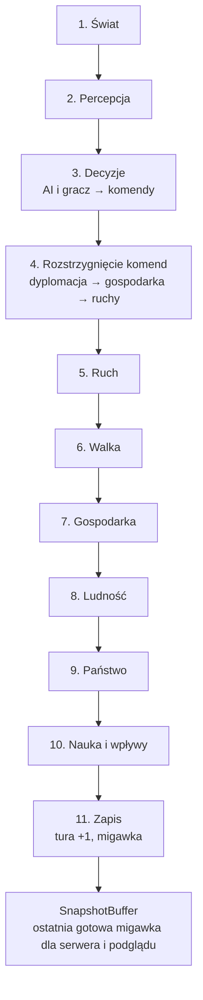
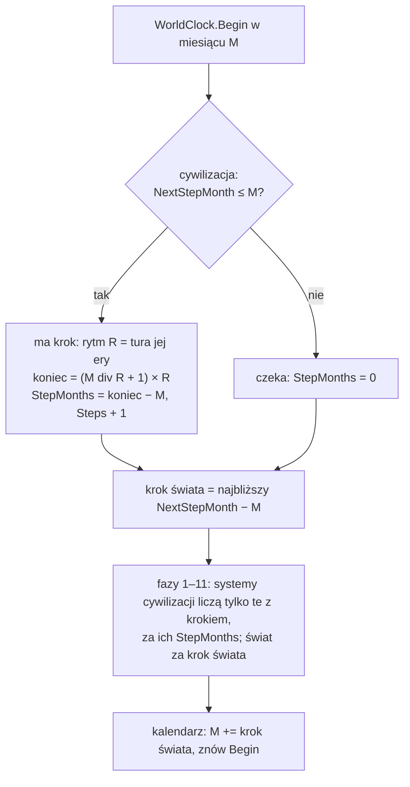

# Pętla tury

**W jednym zdaniu:** przesuwa grę o jeden krok świata: uruchamia 11 faz w stałej kolejności, rozstrzyga komendy, mierzy czas i publikuje migawkę; zegar świata (ADR 0018) mówi, które cywilizacje liczą się w tym kroku i za ile miesięcy.

**Faza tury:** wszystkie (to ona je wywołuje).

## Dane wejściowe i wyjściowe
- Czyta: komendy z kolejki (`CommandQueue`) i od źródeł komend (`ICommandSource`, np. przyszła AI).
- Zmienia: `GameState` (przez systemy i komendy), licznik tur.
- Publikuje w migawce: numer tury, światy, cywilizacje (`GameSnapshot`).

## Przepływ

## Zegar świata i rytmy cywilizacji (ADR 0018)

- `GameState.Month` to licznik. Pętla przeskakuje od razu do najbliższego miesiąca, w którym ktoś ma krok.
- `CivilizationState`: `NextStepMonth` (początek następnego kroku), `StepStartMonth`, `StepMonths` (miesiące w tym kroku świata,
  0 = czeka), `Steps` (licznik własnych kroków), `Alarms` (powody do reakcji poza rytmem: `WarDeclared`, `Attacked`).
- Rytm = `monthsPerTurn` ery z `data/eras.json`; na planecie z porami roku na żywo nie dłużej niż krok pory roku (ADR 0013).
- Kroki są przypięte do wielokrotności rytmu, więc cywilizacje tej samej ery liczą się razem, a po zmianie ery pierwszy krok
  jest krótszy, nigdy dłuższy. Suma kroków cywilizacji = czas od startu (test `ANewEraStartsWithAShorterStepAndNoTimeIsLost`).
- `WorldClock.MonthsOf(state, civ)` i `MonthsOf(state, osada)` podają miesiące do przeliczania temp na rok; osada opuszczona liczy
  się czasem świata. `WorldClock.PlansNow` mówi, czy to krok na decyzje wolne (początek okresu długości ery).
- Kto liczy się czasem cywilizacji: zbieranie, rolnictwo i zużycie pól, sieć handlowa, receptury, jedzenie, psucie w osadach z
  ludźmi, ludność, zdarzenia, nauka, widzenie i zwiad, marsz wędrówki, pogłoski, handel z partnerem (gdy krok ma któraś ze stron).
  Kto czasem świata: klimat, pory roku, morze, odrastanie dzikiej żywności poza strefami, odpoczynek ziemi, rozpad ruin,
  wygasanie efektów, strefy wpływów, granice i spory, wojny i wspólny wróg.
- Nowy stan gry (`CreateNew`) i każdy krok kalendarza wołają `Begin`, więc stan zawsze opisuje krok, który zaraz się policzy.

## Zasady i wzory
- Kolejność faz z GDD 11.1 jest zapisana w `TurnPhase`. Każdy system (`ITurnSystem`) mówi, w której fazie działa;
  w obrębie fazy systemy idą w kolejności rejestracji. `CoreSystems.Register` dodaje systemy rdzenia w stałej kolejności
  (serwer i Headless robią to tak samo): wygasanie efektów, lata dobre i złe i odrastanie dzikiej żywności (faza 1), strefy po ruchu (faza 5), zbieranie, konsumpcja i magazyny (faza 7), ludność (faza 8), strefy wpływów (faza 10), kalendarz (faza 11), a jako źródło komend radę doradców AI (`AiCouncil`: gubernator, skarbnik, uczony; faza 3, `docs/systems/ai.md`).
  Systemy mogą dopisać zdanie do kroniki (`TurnContext.Chronicle`); serwer przekazuje je klientom.
- **Grupy w kronice** (etap 5b): częste zdania (nowi przywódcy, susze, pożary, powodzie, epidemie, nowe i przeniesione osady,
  osiadanie, wieści o dalekich ludach) idą przez `TurnContext.Chronicle(tekst, grupa, cywilizacja)`. Gdy w turze grupa ma jedno
  zdanie, zostaje ono bez zmian; gdy więcej, na końcu tury zamieniają się w jedno podsumowanie w miejscu pierwszego, np.
  „Drought in 4 settlements: Osxou (2), Korkbri, no one.”. Na 1500 turach seeda 42 kronika skurczyła się z ok. 10 400 do 3 400 linii.
- **Komendy** (`ICommand`) to jedyny sposób zmiany stanu. Każda ma kategorię (dyplomacja, gospodarka, ruch),
  sprawdzenie zasad (`Validate`) i wykonanie (`Apply`). Każda komenda niesie gracza i cywilizację (`CommandEnvelope`).
- **Kolejność rozstrzygania:** najpierw kategoria, potem cywilizacja, potem kolejność nadejścia.
  Kolejność cywilizacji obraca się co turę: w turze *t* pierwsza jest cywilizacja o indeksie *t mod liczba cywilizacji*.
  Po 400 turach przy 4 cywilizacjach każda była pierwsza dokładnie 100 razy (test).
- Komenda, która nie przejdzie `Validate`, nie zmienia stanu i trafia do raportu tury z powodem.
- **Migawka:** po fazie 11 powstaje nowa, niezmienna `GameSnapshot` i jest podmieniana atomowo w `SnapshotBuffer`.
  Czytelnik zawsze widzi całą turę i nigdy nie czeka na symulację. Stara migawka się nie zmienia.
- **Hash stanu** (`GameStateHash`): FNV-1a 64-bit po wszystkim, co wpływa na dalszą grę (ustawienia, tura,
  stany generatorów, światy, cywilizacje), zawsze w kolejności identyfikatorów.
- Pierwsza prawdziwa komenda to `RenameCivilizationCommand` (zmiana nazwy cywilizacji).

## Pliki danych
Brak.

## Testy
- `TurnRunnerTests`: kolejność faz, pomiar czasu, komendy poprawne i odrzucone, migawki.
- `CommandQueueTests`: kolejność kategorii, rotacja cywilizacji, sprawiedliwość rotacji.
- `WorldClockTests`: rytmy przypięte do kalendarza, krótszy pierwszy krok po zmianie ery bez utraty czasu, cywilizacja czekająca
  się nie zmienia, tylko alarm budzi radę poza rytmem, przegląd dyplomaty raz na 50 lat przy krokach półrocznych, zapis i odczyt
  przy mieszanych rytmach.
- `DeterminismTests`: dwa przebiegi po 1000 tur z tym samym seedem dają ten sam hash; różne seedy dają różne;
  „złoty” hash po 100 turach musi być identyczny na Windowsie, Linuksie i macOS.

## Wydajność

Pomiar z 4 listopada 2026, `CivSim.Headless`, seed 1, 10 000 pustych tur (fazy bez systemów), build Release, Linux w chmurze:

| Mapa | Średnia tura | 95% tur szybciej niż | Najwolniejsza (tura 1) | Alokacja na turę | Pamięć zarządzana na końcu |
| --- | --- | --- | --- | --- | --- |
| Standard 256×160, 12 cyw. | 0,0035 ms | 0,0072 ms | 3,7 ms | 888 B | 0,1 MB |
| Ogromna 512×320, 32 cyw. | 0,0049 ms | 0,0086 ms | 3,0 ms | 1 848 B | 0,1 MB |

- Pierwsza tura jest wolniejsza, bo .NET wtedy kompiluje kod (JIT).
- Jedyna alokacja w turze to nowa migawka. Zasada „zero alokacji w pętli tury” będzie wymagać migawek ze zmianami
  (tylko zmienione fragmenty mapy) albo puli migawek; zrobimy to razem z mapą w etapie 1.
- CI uruchamia ten benchmark w każdym PR (Ubuntu) i pokazuje wynik w podsumowaniu zadania. Pełne CSV są w artefakcie `benchmark-reports`.
