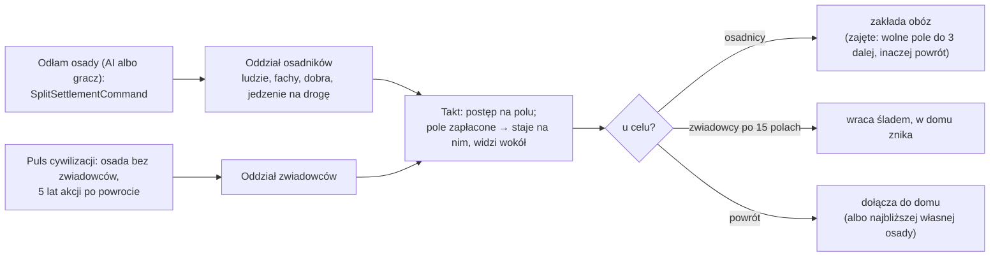

# Oddziały

**W jednym zdaniu:** oddział to grupa ludzi, która chodzi po mapie w taktach gry na żywo: osadnicy idą zakładać obóz, zwiadowcy
idą w nieznane i wracają z tym, co widzieli, armie kampanii maszerują, walczą, uciekają i wracają, a tragarze noszą im jedzenie;
drogę liczy A* z kosztem terenu, raz na cel (etap 6 PR 3a–3b, ADR 0024, decyzje Patryka z 2026-11-09).

**Faza tury:** 5. Ruch, co takt (`UnitSystem`, zaraz po wędrówkach obozów). Zwiadowców wysyła osada w pulsie swojej cywilizacji.
Rozkazy (`MoveUnitCommand`, `FoundCampCommand`, `ReturnUnitCommand`, `AttackCommand`) i odłam (`SplitSettlementCommand`) przychodzą w
fazie decyzji. Armie i tragarzy prowadzi kampania (`CampaignSystem`, faza 6, `docs/systems/war.md`): ustawia im rozkaz i cel, a
oddział sam idzie.

## Dane wejściowe i wyjściowe
- Czyta: `data/units.json` (rodzaje, prędkości, teren, zwiad, osadnicy), `movementCost` biomów z `data/biomes.json`, rzeźbę i
  rzeki mapy, pamięć mapy cywilizacji (`MapMemory.Knows`), `data/time.json` (miesiąc akcji), `war.json` (`foodPerWarriorPerYear`,
  `supplySharePercent`).
- Zmienia: `GameState.Units` (`UnitBook`), ludzi, fachowców, uczniów i dobra osad (wyjście i powrót), nowe obozy,
  `CivilizationState.SeenYear` (oddział widzi wokół siebie), `SettlementState.ScoutOut` i `ScoutBackMonth`, kronikę.
- Publikuje: `GameSnapshot.Units` (rodzaj, rola, pole, następne pole, postęp 0–1000, ludzie, rozkaz); widok `GameViewMessage.Units`
  (protokół 16, rola od PR 3b): obserwator widzi wszystkie oddziały, gracz swoje i obce na polach, które widzi teraz (`MapMemory.SeesNow`).

## Przepływ

## Rodzaje są danymi (gotowe na kolejne ery, prośba Patryka z 2026-11-09)

Każdy rodzaj w `units.json` ma klucz, rolę (`settlers`, `scouts`, `army`, `carriers`), wymaganą technologię, takty na płaskie pole,
zasięg widzenia, **zasięg walki** (`rangeCells`), ludzi i fach (zwiadowcy) i może mieć własny teren (`terrain`: wzgórza, góry,
rzeki, procent dla wybranych biomów). Kod zna tylko role. Kampania maszeruje jako ostatni rodzaj armii z danych, którego technologię
cywilizacja zna (`Campaigns.ArmyKind`), tak jak bierze najlepsze uzbrojenie. Łucznicy, strzelcy, jazda czy wojska zmotoryzowane to
nowe wpisy: jazda szybka na stepie (`biomes: {"steppe": 50}`), zmotoryzowani wolni na bagnach, strzelcy walczą z 2–3 pól, artyleria
z dalej. Ocena odległości w A* skaluje się przez najtańszy biom rodzaju, więc droga zostaje najtańsza. Dziś są cztery rodzaje:
osadnicy, zwiadowcy, wojownicy (15 taktów, zasięg 1), tragarze (10 taktów).

## Stany (rozkazy) i przejścia (T5)

| Rozkaz | Co robi | Przejście |
| --- | --- | --- |
| `Idle` | stoi | rozkaz gracza albo AI |
| `Move` | idzie do celu i staje | u celu → `Idle` |
| `Found` | osadnicy idą do celu i zakładają obóz | obóz założony → oddział znika; miejsce zajęte → nowy cel do 3 pól, bez niego → `Return`; brak drogi → zakłada obóz tam, gdzie stoi, jeśli wolno, inaczej `Idle` |
| `Scout` | zwiadowcy idą prosto w swoim kierunku, przy wodzie skręcają | po 15 polach albo zamknięci wodą → `Return` |
| `Return` | wraca do domu i dołącza | w domu → oddział znika (zwiadowcy: osada może wysłać następnych); dom zniknął → najbliższa własna osada, bez niej obóz na miejscu; armia kampanii: w domu → `Idle`, kampania sprowadza ocalałych |
| `Attack` | armia idzie do celu, aż cel jest w zasięgu jej rodzaju, i stoi; w bitwie stoi dalej (kampania w fazie `Battle`, runda co sekundę) | kampania: miesiąc akcji w zasięgu → bitwa; wygrana → `Return`, przegrana → `Flee`; brak drogi → `Idle` i kampania wraca |
| `Flee` | pobita armia ucieka do domu; nikt jej nie zawróci (ani gracz, ani dowódca) | w domu → `Idle`, ocalali wracają do osad |

Odpoczynek to stan osady, nie oddziału: wojownicy, którzy wrócili, odpoczywają `restMonths` (6) miesięcy akcji i ich osada nie może
w tym czasie wysłać nikogo na kampanię (`SettlementState.RestUntilMonth`).

## Zasady i wzory
- **Rodzaje** (`units.json`, `kinds`): osadnicy 20 taktów na płaskie pole (2 s przy ×1), widzą 2 pola; zwiadowcy 10 taktów, widzą 1;
  wojownicy 15 taktów (0,67 pola/s, decyzja Patryka z 2026-11-09), widzą 1, walczą z sąsiedniego pola; tragarze 10 taktów (lżejsi,
  doganiają armię).
- **Koszt pola** (T3, `RouteFinder.StepTicks`): takty rodzaju × (`movementCost` biomu × 100% + wzgórza 50% albo góry 200%
  + 100% za rzekę na krawędzi, którą oddział przechodzi). Łąka, step, sawanna 100%, las, tajga, pustynia, tundra 200%, bagno,
  dżungla, lód 300%; lód morski 200%. Przykład: osadnicy przez las na wzgórzach 20 × 250% = 50 taktów.
- **Droga** (T3): A* po polach, które cywilizacja zna (cel może być nieznany) i po których da się chodzić (ląd i lód morski).
  Ocena odległości to odległość na kuli × takty płaskiego pola, a żadne pole nie jest tańsze od płaskiego, więc droga jest
  najtańsza. Kopiec binarny na tablicach, znaczniki przebiegu, najwyżej `routeNodeLimit` (20 000) pól na wyszukiwanie, zero
  alokacji poza wynikiem. Oddział liczy drogę **raz na cel** i ją zapamiętuje (`Unit.Path`, zapisywana w zapisie gry); liczy
  ponownie tylko przy nowym celu, gdy stoi poza swoją drogą albo gdy następnego pola nie da się wejść.
- **Ruch:** co takt `Progress + 1`; gdy dojdzie do kosztu następnego pola, oddział staje na nim i widzi pola w swoim zasięgu (jak
  osady: wpis roku do `SeenYear`).
- **Osadnicy:** odłam wyjmuje z osady procent każdej warstwy, fachowców i uczniów (`Skills.MoveOut`) i tyle dóbr, ile udźwigną
  (`carrying`). Do tego biorą jedzenie na drogę: miesiące akcji znanej drogi + `foodMonths` (6) zapasu; czego nie mają w swojej
  części, biorą z magazynu domu, najwyżej `supplySharePercent` każdego jedzenia. W drodze jedzą raz na miesiąc akcji tyle, co
  wojownicy (`foodPerWarriorPerYear`); bez jedzenia co miesiąc ginie `hungerDeathPercent` (5%) każdej warstwy (co najmniej 1).
  W drodze nie pracują w żadnej osadzie.
- **Zwiadowcy:** każda osada (co najmniej 4 × `people` osób) ma najwyżej jedną grupę w drodze (`ScoutOut`); nowa wychodzi w pulsie
  cywilizacji, gdy od powrotu poprzedniej minęło `everyYears` (5) lat akcji. Kierunek losowy (strumień „population”, w kolejności
  osad). Od PR 3b grupa to `people` (3) ludzi z osady: najpierw myśliwi (`skill`), potem inni z tej warstwy bez fachu; wracają z nią.
- **Armie** (PR 3b): kampania to „mózg” (cel, wojna, łupy, morale, jedzenie, bitwa, decyzje dowódcy), a armia to oddział. Wojownicy
  osady wyjścia stają się oddziałem u siebie; wojownicy innych osad idą do niej jako własne oddziały i dołączają, gdy staną na
  miejscu (zbiórka kończy się, gdy nikt już nie idzie). Armia idzie do celu najtańszą znaną drogą i staje, gdy cel jest w zasięgu jej
  rodzaju; bitwa przychodzi miesiąc akcji później (dowódca może jeszcze odwołać). Głodna armia zmienia cel na wioskę wroga po drodze
  (droga liczona na nowo). Gracz może posłać armię na inną osadę tego samego wroga (`AttackCommand`) albo odwołać ją
  (`ReturnUnitCommand`); oddziałem kampanii nie da się ruszyć zwykłym `MoveUnitCommand`.
- **Tragarze** (PR 3b): gdy armii brakuje jedzenia, osada w zasięgu, która może dać najwięcej, wysyła oddział tragarzy z jedzeniem.
  Idą za armią (cel liczony na nowo najwyżej raz na miesiąc akcji, bo armia idzie), oddają jedzenie, gdy stoją obok niej, i wracają
  do domu jako zwykły oddział (`Return`), gdzie dołączają do swojej warstwy. Gdy kampania się kończy albo tragarze nie znajdą drogi,
  wracają z jedzeniem.
- **Wioski zostają** (decyzja Patryka z 2026-11-09): obozy wędrują, bo są ruchome, ale osiadła wioska zostaje do końca. Może rosnąć
  i być porzucona; mała głodna wioska nie przenosi się już do innej osady (usunięta reguła gubernatora, `docs/ai/03-gubernator.md`).
  Rozrost wiosek w miasta na większym obszarze i wcielanie mniejszej przez większą przy zetknięciu: etap 7 (`ROADMAP.md`).
- **Rozkazy** (te same dla gracza i AI, ADR 0024): `MoveUnitCommand` (znany ląd, istnieje droga), `FoundCampCommand` (osadnicy, pole
  wolne, poza 4 polami od własnych obozów), `ReturnUnitCommand` (armia: odwołanie kampanii, która się zbiera albo maszeruje),
  `AttackCommand` (armia w marszu, osada tego samego wroga, znana). Wysłany rozkazem zwiadowca zostawia swój ślad i wraca najtańszą
  drogą.

## Pula oddziałów (T4)

`UnitBook` trzyma oddziały w płaskich tablicach według slotu: pole, cel, rozkaz, postęp, następne pole, kierunek, a ludzie,
fachowcy, uczniowie i dobra wszystkich oddziałów w jednym buforze każde (krok = liczba warstw, fachów, dóbr). `Unit` to tylko uchwyt
(księga + slot), kopia nic nie kopiuje. Slot oddziału, który zniknął, wraca do puli razem z jego listami (ślad, droga). Oddziały chodzą
w kolejności wyjścia (rosnące id), w tej samej kolejności są w zapisie i w haszu, więc wczytana gra idzie dalej identycznie. Takt z
idącymi oddziałami nie alokuje pamięci (test `WalkingUnitsAllocateNothingInATick`).

## Siatka przestrzenna osad (T2)

`GameState.Grid` (`SettlementGrid`): kubełki 8 × 8 pól na każdy świat. Pytanie „osady w promieniu N pól” patrzy tylko w kubełki pasa
wierszy (z zawinięciem wokół kuli i przez bieguny), a nie na każdą osadę; zwraca indeksy rosnąco, tak jak przegląd wszystkich, więc nic
nie zmienia w wynikach. Siatka to pamięć podręczna: przebudowuje się, gdy osada powstanie, zniknie albo się przeniesie
(`SettlementState.LayoutVersion`); nie jest zapisywana ani haszowana. Używają jej: zakładanie obozu (`CanFound`), sprawdzenie odłamu,
najbliższy własny obóz gubernatora, zbiórka wojowników dowódcy, napad głodnej kampanii i wybór tragarzy.

## Pliki danych
- `data/units.json`, `movementCost` w `data/biomes.json`.

## Testy
- `UnitTests`: droga najtańsza (zgodna z Dijkstrą) i omija góry; oddział liczy drogę raz i idzie 6 pól w 120 taktów; osadnicy
  na rozkaz stają, nie mogą założyć obozu za blisko domu, wracają i dołączają; drudzy zakładają obóz na rozkaz; cudze oddziały nie
  słuchają; pula używa slotów ponownie i trzyma kolejność id; takt z oddziałami bez alokacji.
- `SettlementGridTests`: siatka znajduje to samo co przegląd wszystkich osad (różne promienie, bieguny, szerokość mapy niebędąca
  wielokrotnością kubełka) i śledzi przeniesienie i usunięcie osady.
- `MigrationTests`: odłam wychodzi jako oddział z częścią ludzi i dóbr, idzie i zakłada obóz; plemiona same się rozchodzą.
- `MapMemoryTests`: zwiadowcy poszerzają wiedzę; wędrówka pole po polu w taktach.
- `SaveGameTests.LoadedGameContinuesExactlyLikeTheOriginal` (z oddziałami w drodze).
- `WarUnitsTests` (PR 3b): pobita armia ucieka i nikt jej nie zawróci; wojownicy odpoczywają po powrocie; tragarze idą jako oddział,
  dochodzą do armii i wracają do warstwy w domu; rozkaz ataku na inną osadę wroga; rodzaj z zasięgiem 3 staje 3 pola przed celem;
  kampania maszeruje jako najlepszy znany rodzaj; zwiadowcy biorą myśliwych i ich przyprowadzają.
- `BattleTimeTests`: bitwa runda po rundzie w czasie, armia maleje, nikt jej nie odwoła, zapis w trakcie bitwy.
- `ArmyTests`, `CommanderTests`, `EpisodeTests`: zbiórka pieszo, marsz i bitwa po miesiącu w zasięgu, kampania w taktach.

## Wydajność i wyniki
Pomiar z 2026-11-09 (3 seedy 7 / 23 / 42, mapa standard, 18 000 taktów = 30 min przy ×1, Release, po kolei):
- takt średnio 4,9 / 6,7 / 5,6 ms, 95% poniżej 10,8 / 14,9 / 12,8 ms, dłużej niż 25 ms (spóźnione przy ×4) 0,07 / 0,23 / 0,11%;
  na mapie chodzi ok. 300 zwiadowców;
- zwiad oddziałami jest rzadszy niż dawne wyprawy w pulsie: cywilizacje znają ok. 450 pól zamiast ok. 1100, mniej się spotykają
  (umowy handlowe 28 / 40 / 39 zamiast 60 / 73 / 65), neolit po 8,5 / 8,1 / 7,3 min zamiast 6,6 / 7,5 / 5,8 min (PR 1);
- odpoczynek zwiadowców 1 rok zamiast 5 (seedy 7 i 42) prawie nic nie zmienia (neolit 8,1 i 7,2 min): o wiedzy decyduje
  raczej długość wyprawy (`tripCells`). Strojenie zwiadu i temp: etap 7 (decyzja Patryka z 2026-11-09).

Pomiar PR 3b (2026-11-09, te same seedy i warunki): takt średnio 4,9 / 7,2 / 4,9 ms, 95% poniżej 11,3 / 15,5 / 10,9 ms, dłużej niż
25 ms 0,09 / 0,29 / 0,12%. W 30 minut: 27 / 10 / 10 kampanii, 11 / 5 / 4 bitwy (wszystkie wygrane), 13 / 7 / 4 dostawy tragarzy;
wojny 23 / 12 / 17 (PR 3a: 22 / 29 / 23). Neolit po 8,6 / 8,4 / 7,1 min (bez zmian względem PR 3a).
