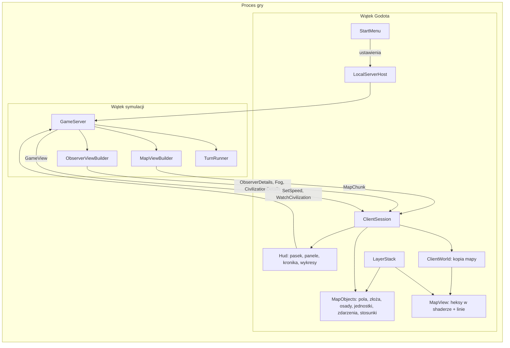

# Podgląd symulacji (klient Godot)

**W jednym zdaniu:** okno w Godocie z menu startowym, które uruchamia lokalny serwer z wybranymi ustawieniami, łączy się z nim
jako obserwator i rysuje mapę z warstwami, panele cywilizacji, kronikę i wykresy, w pikselowym interfejsie.

**Faza tury:** poza turą. Klient tylko czyta wiadomości, które serwer wysyła po fazie 11, i wysyła komendy obserwatora
(prędkość, śledzona cywilizacja).

Etap 2 zbudował podgląd, etap 5 (decyzja Patryka z 2026-11-06) dodał menu startowe, widok warstw, grafiki zastępcze,
śledzenie cywilizacji i pikselowy interfejs.

## Dane wejściowe i wyjściowe
- Czyta: `WelcomeMessage`, `ContentMessage` (biomy, złoża, towary, poziomy osad), `GameViewMessage` (tura, prędkość, czas tury,
  kronika, osady, cywilizacje; obserwator dostaje też erę, ludność, liczbę osad i technologii każdej cywilizacji),
  `MapChunkMessage` (fragmenty 32×32), a od etapu 5 tylko dla obserwatora: `ObserverDetailsMessage` (wędrujące obozy, pola uprawne,
  efekty zdarzeń, stosunki między cywilizacjami), `FogMessage` (mgła wojny śledzonej cywilizacji) i `CivilizationDetailsMessage`
  (wszystko o śledzonej cywilizacji).
- Zmienia: nic w stanie gry. Wysyła `HelloMessage` (rola: obserwator), `SetSpeedMessage` i `WatchCivilizationMessage`.
- Trzyma u siebie: kopię mapy z fragmentów (`ClientWorld`), ostatnie 300 czasów tury, kronikę (do 2000 linii), historię cywilizacji
  (`CivHistory`, najwyżej 600 próbek; gdy się zapełni, co druga próbka wypada, więc dawne lata są rzadsze, stała pamięć).
- Zapisuje na dysku tylko swoje ustawienia: `user://viewer_settings.json` (ostatnie ustawienia startu, warstwy, otwarte panele).

## Przepływ

## Menu startowe
- Ustawienia świata z GDD 3: ziarno (z przyciskiem losowania), rozmiar mapy, liczba cywilizacji (domyślna rośnie z rozmiarem),
  typ świata, procent wody, wilgotność, wilgotność w głębi lądu, górzystość, złoża.
- Planeta: preset (`data/planets.json`) i każda jego wartość: nachylenie osi, mimośród, jasność gwiazdy, odległość, rok, światło,
  CO₂, ciśnienie, wulkanizm, wahania gwiazdy i ich okres. Puste pole = wartość presetu (podpowiedź w polu ją pokazuje).
- Symulacja: prędkość startowa, limit tur (serwer zatrzymuje się po tylu turach i pisze to w kronice; dalszy bieg po wybraniu prędkości),
  raport CSV (jedna linia na turę: tura, rok, czas tury, ludność, osady; domyślnie `user://turn_report.csv`).
- **Podgląd planety** pod formularzem: gwiazda, orbita, powietrze i klimat z prawdziwych wzorów (`LocalServerHost.Preview`, bez
  generowania mapy), notatki o przesuniętych wartościach albo błąd, który blokuje „Start”.
- Ostatnie ustawienia są zapamiętane. **Argumenty uruchomienia dalej działają** (te same nazwy co przed etapem 5: `--seed`,
  `--map-size`, `--planet`, `--tilt`... oraz nowe `--turn-limit N` i `--report plik.csv`) i pomijają menu, nie zmieniając zapisanych
  ustawień. `--no-menu` startuje od razu z zapisanymi ustawieniami. Przycisk „Menu” albo Esc kończy grę i wraca do menu.

## Warstwy (`LayerStack`)
Jedna lista warstw od dołu do góry. **Warstwy pól** barwią całe heksy i są mieszane na procesorze w jeden odcień na heks
(nakładanie „over”: każda warstwa ma kolor i pokrycie pola, np. złoża tylko tam, gdzie są). **Warstwy rysowane** to osobne węzły nad
heksami (z-index = miejsce na liście). Warstwy pól leżą zawsze pod rysowanymi; w obrębie grupy kolejność można zmieniać.

| Warstwa | Rodzaj | Domyślnie | Co pokazuje |
| --- | --- | --- | --- |
| Biomes and terrain | pola (podkład) | wł. | kafelki biomów (3 warianty), wzgórza i góry, cechy terenu, rzeki na krawędziach |
| Height and depth | pola | wył. | wysokość lądu (zielony → żółty → brązowy → szary → biały) i głębokość wody (jasne płycizny → ciemne głębie); głębokość jeziora liczona od najniższego brzegu, więc szacunkowa |
| Hill shading | pola | wł., 50% | cieniowanie rzeźby: zbocza zwrócone ku światłu z lewej góry jaśniejsze, pozostałe ciemniejsze |
| Temperature, Humidity, Fertility, Growing season, Season swing, Temperature now, Wild food | pola | wył. | jak nakładki z etapów 1b–3 |
| Deposits | pola + ikony | wył. | kolor złoża daleko, ikona 24×24 z bliska (głębokie złoża przyciemnione) |
| Owner | pola | wył., 60% | właściciel pola |
| Influence zones | pola | wł., 45% | strefa wpływów w kolorze cywilizacji, mocniejsza przy osadzie |
| Memory and fog | pola, zawsze na wierzchu warstw pól | wł., 100% | mgła wojny **śledzonej cywilizacji** (decyzja Patryka z 2026-11-06): nieznane pola całkiem zakryte ciemnoszarym kolorem z palety (`#3E3C3A`), razem z biomami, rzekami, granicami, osadami, jednostkami, zdarzeniami i nazwami; zapamiętane zakryte w 60%; widziane w ostatniej turze odsłonięte. Niższa przezroczystość pozwala widzieć więcej (poniżej 100% rysowane warstwy wracają). Bez śledzonej cywilizacji mgła nic nie robi |
| Rivers | rysowana | wł. | z bliska grafiki rzek w shaderze, z daleka linie |
| Fields | rysowana | wł. | pola uprawne wiosek (grafika pola, mocniejsza przy większej obsadzie rolników) |
| Borders | rysowana | wł. | granice cywilizacji po krawędziach heksów, kolor cywilizacji z ciemnym obrysem |
| Settlements | rysowana | wł. | obozy, wioski, miasteczka w stanach zamieszkana / opuszczona / ruiny; daleko kwadraty; nad największą osadą każdej cywilizacji tabliczka z jej nazwą |
| Units | rysowana | wł. | wędrujące obozy (etap 3g) i przerywana strzałka do celu; armie kampanii (etap 4e PR 3: 1–3 wojowników według siły, grubsza strzałka do celu albo do domu) i tragarze z jedzeniem |
| Events | rysowana | wł. | efekty zdarzeń: jedna ikona na zdarzenie (na środkowym polu), na pozostałych polach kropka |
| Relations | rysowana | wył. | linie między największymi osadami cywilizacji, które się spotkały: wojna czerwona, sojusz niebieski, pakt turkusowy, handel złoty, pokój biały, sam kontakt szary przerywany |

Sterowanie warstwami: **ikony w górnym pasku** włączają i wyłączają warstwy; **okno „Layer settings”** (ikona zębatki albo Tab)
ustawia przezroczystość (suwak i wartość w %) i kolejność. Biomy zostają na dole, a mgła na górze warstw pól.

**Heks w shaderze** (`game/shaders/map_hex.gdshader`): każdy heks to instancja w `MultiMesh` z kolorem (odcień warstw pól i jego
pokrycie) i 4 liczbami (kafelek biomu + rzeźba, kafelek rzeźby, kafelek cechy, 12 bitów rzek: po 2 na każdą z 6 krawędzi). Od zoomu
0,4 shader rysuje grafiki, poniżej średni kolor kafelka (piksele z daleka migotałyby) i cieniuje rzeźbę.
**Kolor cywilizacji** (`game/shaders/civ_sprite.gdshader`): piksele w zarezerwowanych magentach `#FF00FF`, `#C000C0`, `#800080`
dostają jasny, zwykły i ciemny odcień koloru cywilizacji.

## Grafiki zastępcze, podmiana i paczki grafik
Wszystkie grafiki ładuje `ArtLibrary` po nazwie, w kolejności: **wybrana paczka grafik** → `art/export/<warstwa>/<nazwa>.png` (pixel art
Patryka) → `art/placeholder/<warstwa>/<nazwa>.png`. Pliki zastępcze i `art/placeholder/manifest.json` (wszystkie nazwy i rozmiary)
robi skrypt `art/placeholder/generate.py`. Pliki są czytane jako zwykłe PNG, bez importu Godota.

**Paczki grafik** (prośba Patryka z 2026-11-06): folder w `art/packs/<nazwa>/` albo `user://art_packs/<nazwa>/` z dowolną częścią
plików i opcjonalnym `pack.json` (nazwa, autor, opis). Wybór w menu startowym (sekcja Art) albo `--art-pack <folder>`; zapisany
w ustawieniach po „Start”. **Sprawdzenie przy uruchomieniu** (`ArtCheck`): plik paczki i `art/export/` jest używany tylko wtedy, gdy
ma znaną nazwę z manifestu, jest czytelnym PNG i ma dokładnie wymagany rozmiar; inaczej rysuje się grafika domyślna. Problemy
(zły rozmiar, nieznana nazwa, zły folder z podpowiedzią właściwego, uszkodzony plik, plik inny niż PNG) są w menu, w `art_check.txt`
w folderze paczki i w konsoli. Paczka może też zmienić ramki interfejsu (`ui/`). Opis dla twórców paczek: `art/packs/README.md`.

## Interfejs (pikselowy)
- **Motyw** (`PixelTheme`): nieprzezroczyste ramki 9-slice z `art/placeholder/ui/` (styl „skóra i kamień” ery kamienia), przyciski
  w 4 stanach, pola tekstowe, zakładki, pola wyboru, suwaki, paski przewijania, dymki; wszystko powiększone ×2 bez wygładzania.
- **Czcionka Pixelify Sans** (`game/fonts/`, licencja SIL OFL 1.1 obok pliku), bez wygładzania, rozmiar 16 (wielokrotność siatki).
  Zgodnie z GDD 12.4 miała wejść w etapie 13; Patryk poprosił 2026-11-06 o pikselowy interfejs już w etapie 5.
- **Górny pasek:** tura i rok, prędkości, „follow” (wybór śledzonej cywilizacji), „Go” (kamera na jej największą osadę), „Track”
  (kamera jedzie za nią), ikony warstw i ustawienia warstw, przełączniki paneli (Info, Log, Chart), Menu, FPS.
- **Lewy panel, zakładka Cell:** inspektor pola: biom, rzeźba, wysokość i głębokość wody, klimat, żyzność, złoże, rzeki, właściciel,
  osada z ludnością i magazynem, pole uprawne, wędrujący obóz, armia (wojownicy, faza, uzbrojenie, morale, jedzenie) i tragarze, zdarzenia.
- **Lewy panel, zakładka Civilizations:** tabela wszystkich cywilizacji (era, ludność, osady, technologie; klik = śledź), wykres
  ludności / osad / technologii w czasie (śledzona grubą linią, pozostałe przygaszone), a dla śledzonej: era, ludność w warstwach,
  osady według poziomów, jedzenie, badania (znane technologie, bieżące badanie i postęp), charakter (8 cech), wagi celów stratega,
  zapasy, stosunki z innymi (sympatia, zaufanie, umowy, wojny i wspomnienia od najsilniejszego).
- **Zmiana nazwy** (GDD 5.6): przycisk „Rename people” w panelu śledzonej cywilizacji i „Rename settlement” w zakładce Cell, gdy na polu
  stoi osada. Okno pokazuje 8 propozycji w języku tego ludu („More names” daje kolejne) i pole na własną nazwę; serwer sprawdza, czy
  nazwa jest wolna, i zmienia ją od razu (także w pauzie). Test: `--rename-dialog`.
- **Kronika** w prawym dolnym rogu (mniejsza, przycisk ↕ wydłuża ją do pełnej wysokości), z opcją „followed”: tylko linie o śledzonej
  cywilizacji.
- **Wykres czasu tury** na dole między panelami.

## Sterowanie
| Klawisz / mysz | Działanie |
| --- | --- |
| WASD, strzałki, przeciąganie prawym lub środkowym przyciskiem | przesuwanie mapy |
| kółko myszy, `+` / `-` | zoom |
| lewy przycisk | wybór pola (zakładka Cell) |
| Spacja / 1–5 | pauza i ×1 / pauza, ×1, ×2, ×5, maks. |
| F | śledź następną cywilizację (po ostatniej: nikogo) |
| G / T | kamera na śledzoną cywilizację / jazda za nią |
| Tab | okno ustawień warstw |
| I / L / C | panel informacji / kronika / wykres czasu tury |
| Esc | koniec gry, menu startowe |

Do testów i zrzutów: `--screenshot plik.png` (z `--screenshot-turn N`: po N turach), `--menu-screenshot plik.png`, `--zoom Z`,
`--overlay WARSTWA` (tylko ta warstwa pól), `--layer WARSTWA` (włącza warstwę), `--watch CYW` (śledzi i włącza mgłę), `--opacity WARSTWA=PROCENT`, `--layer-settings` (otwiera okno ustawień warstw), `--art-pack FOLDER`,
`--benchmark KLATKI`.

## Zasady
- **Granica klient–serwer:** `game/` nie widzi `CivSim.Core` (ADR 0010). Szczegóły dla obserwatora liczy na serwerze
  `ObserverViewBuilder`; gracz (etap 13) ich nie dostaje, a próba śledzenia innej cywilizacji jest odrzucana.
- **Pola uprawne** serwer wylicza tak samo jak system rolnictwa (najlepsze zajęte pola osady, po `FarmersPerCell` rolników na pole),
  bo system trzyma obsadę tylko w trakcie tury; efekty zdarzeń są tu pominięte, więc to podgląd, nie zapis stanu.
- **„Widziane teraz”** w mgle to pola z najnowszym rokiem w pamięci mapy cywilizacji (z ostatniego postrzegania i zwiadu).
- **Wydajność:** przekolorowanie fragmentów i odbiór wiadomości mają limit czasu na klatkę (3 ms i 4 ms), więc przełączenie warstwy na
  mapie ogromnej rozkłada się na kilka klatek.

## Pliki danych
`data/biomes.json` i `data/resources.json` (kolory i klucze grafik), `data/effects.json` (klucze ikon zdarzeń), `data/planets.json`
(presety w menu). Klient dostaje je od serwera albo przez `LocalServerHost.Describe`, nie czyta plików danych sam.

## Testy
- `ObserverLayerTests`: lista presetów i ich wartości, podgląd planety i błąd złego ustawienia, limit tur zatrzymuje symulację i raport
  CSV ma linię na turę, obserwator dostaje warstwy, mgłę i szczegóły śledzonej cywilizacji oraz statystyki w tabeli cywilizacji,
  gracz nie może śledzić innej cywilizacji.
- `ProtocolSerializerTests`: nowe wiadomości w obie strony, protokół w wersji 8.
- `LocalServerHostTests`: jak w etapie 2.

## Wydajność
Pomiar bez karty graficznej (Xvfb, renderowanie programowe llvmpipe), `--benchmark`: kamera przelatuje nad mapą przy najmniejszym
zoomie i włącza kolejne warstwy pól, symulacja w tle na maks. Porównanie z gałęzią `development` na tej samej maszynie:

| Mapa | Klatki | Praca klienta na klatkę: przed / po | Klatki na sekundę (programowo): przed / po |
| --- | --- | --- | --- |
| Standard 258×160 | 300 | 10,4 ms / 9,0 ms | 4,5 / 4,0 |
| Ogromna 514×320 | 150 | 28,3 ms / 11,0 ms | 1,7 / 1,5 |

Prawdziwe FPS zależą od karty graficznej; do sprawdzenia u Patryka (`-- --map-size huge --benchmark 600`). Spadek klatek przy
renderowaniu programowym to koszt shadera z grafikami; praca procesora spadła dzięki limitom czasu.
