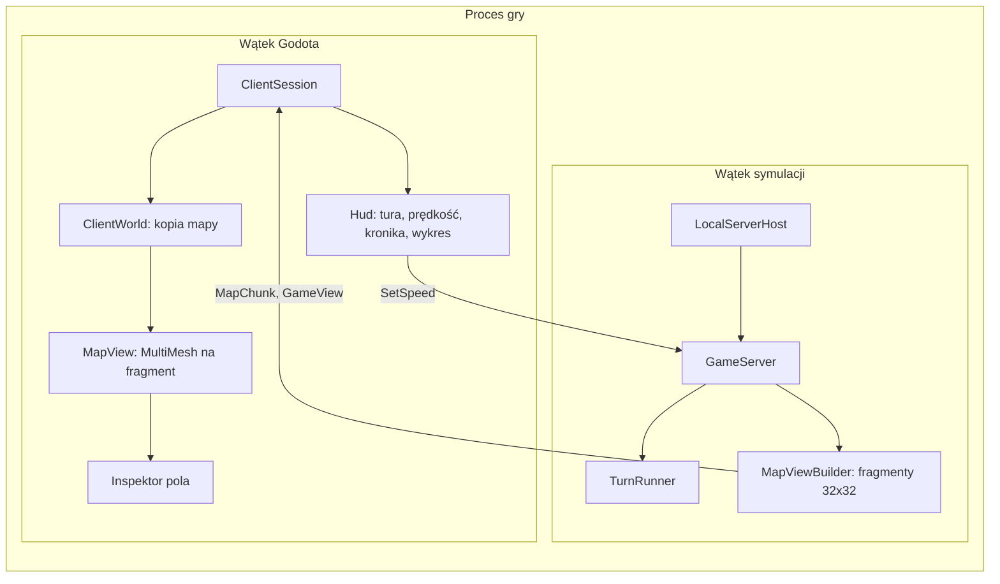

# Podgląd symulacji (klient Godot)

**W jednym zdaniu:** okno w Godocie, które uruchamia lokalny serwer, łączy się z nim jako obserwator i rysuje mapę,
nakładki, inspektor pola, kronikę i wykres czasu tury.

**Faza tury:** poza turą. Klient tylko czyta widoki, które serwer wysyła po fazie 11, i wysyła komendę zmiany prędkości.

## Dane wejściowe i wyjściowe
- Czyta: `WelcomeMessage`, `ContentMessage` (nazwy i kolory biomów, złóż, cech terenu), `GameViewMessage`
  (tura, prędkość, czas tury, nowe wpisy kroniki) i `MapChunkMessage` (fragmenty 32×32 mapy).
- Zmienia: nic w stanie gry. Wysyła tylko `HelloMessage` (rola: obserwator) i `SetSpeedMessage`.
- Trzyma u siebie: kopię mapy złożoną z fragmentów (`ClientWorld`), ostatnie 300 czasów tury, ostatnie wpisy kroniki.

## Przepływ

## Zasady i wzory
- **Granica klient–serwer:** `game/` nie widzi `CivSim.Core` (ADR 0010). Wszystko, co klient wie, przyszło w wiadomościach.
- **Obserwator** widzi całą mapę i może zmieniać prędkość. Gracz (od etapu 5) zobaczy tylko to, co zna jego cywilizacja;
  do etapu 3 to heksy w promieniu 4 od startu. Gracz nie może zmienić prędkości.
- **Prędkości:** pauza, ×1 (tura co 2 s), ×2 (1 s), ×5 (0,4 s), maks. (tury bez przerwy; widok najwyżej co 250 ms,
  żeby nie zalać klienta). Symulacja toczy się w osobnym wątku, więc okno nie zacina się przy długiej turze.
- **Fragmenty mapy:** serwer wysyła cały świat przy powitaniu, potem tylko fragmenty, które się zmieniły.
- **Rysowanie:** każdy fragment 32×32 to jeden `MultiMesh` heksów (1024 instancje) i jeden dla rzek. Rysowane są tylko
  fragmenty w kadrze. Zawijanie mapy: fragment przy krawędzi rysuje się drugi raz przesunięty o szerokość lub wysokość mapy.
  Pozycja kamery też się zawija, więc można przewijać w nieskończoność.
- **Heks:** flat-top 48×42 px, kolumny co 36 px, nieparzyste kolumny przesunięte o 21 px w dół (jak w pixel arcie z CLAUDE.md).
  Siatka (przerwy między heksami) jest widoczna od zoomu 0,6.
- **Nakładki:** biomy, wysokość, temperatura, wilgotność, żyzność, złoża, właściciel, strefa wpływów.
  Właściciel i strefa wpływów są puste, dopóki osady nie powstaną (etap 3). Zmiana nakładki przelicza
  najwyżej 32 fragmenty na klatkę, żeby nie było przycięcia.
- **Kolory** biomów i złóż pochodzą z `data/` przez `ContentMessage`, nie są wpisane w kod klienta.

## Sterowanie
| Klawisz / mysz | Działanie |
| --- | --- |
| WASD, strzałki, przeciąganie prawym lub środkowym przyciskiem | przesuwanie mapy |
| kółko myszy, `+` / `-` | zoom |
| lewy przycisk | wybór pola (inspektor po lewej; na polu z osadą także jej poziom i magazyn) |
| Spacja | pauza / ×1 |
| 1–5 | pauza, ×1, ×2, ×5, maks. |
| Tab | następna nakładka |

## Pliki danych
`data/biomes.json` (kolory biomów) i `data/resources.json` (kolory złóż). Klient dostaje je od serwera, nie czyta plików sam.

## Testy
- `LocalServerHostTests`: obserwator dostaje zawartość, całą mapę i może zmienić prędkość; gracz dostaje tylko 61 znanych
  pól i nie może zmienić prędkości; nieznane słowo w ustawieniach daje czytelny błąd.
- `ProtocolSerializerTests`: nowe wiadomości w obie strony.
- Brak zależności `game/` od rdzenia sprawdza kompilator (ADR 0010).

## Wydajność
Pomiar bez karty graficznej (Xvfb, renderowanie programowe), tryb `--benchmark 600`: kamera przelatuje nad mapą przy
najmniejszym zoomie i przełącza nakładki, symulacja w tle na maks.

| Mapa | Praca klienta na klatkę (średnio) | Fragmenty rysowane | Wolne klatki (> 16 ms) |
| --- | --- | --- | --- |
| Standard 256×160 | 0,9 ms | 242 | 3 (wczytanie mapy) |
| Ogromna 512×320 | 3,0 ms | 882 | 4 (wczytanie mapy) |

Prawdziwe FPS zależą od karty graficznej; trzeba je zmierzyć na komputerze Patryka (`-- --map-size huge --benchmark 600`).
Wąskie gardło na przyszłość: pierwsze wczytanie dużej mapy (do 120 ms, raz).

**Osady (etap 3a):** kwadrat w kolorze właściciela na polu osady, większy dla wyższego poziomu (`SettlementMarkers`). Górny pasek pokazuje rok gry.
